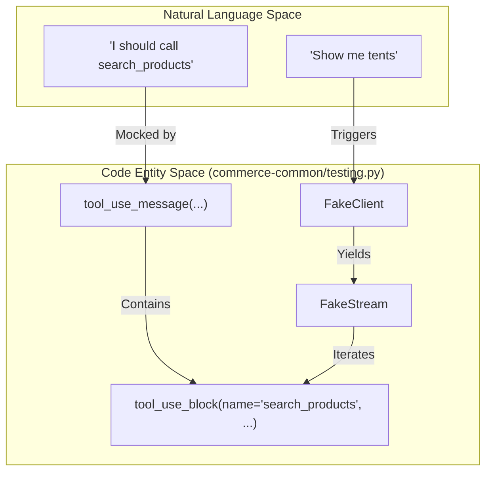
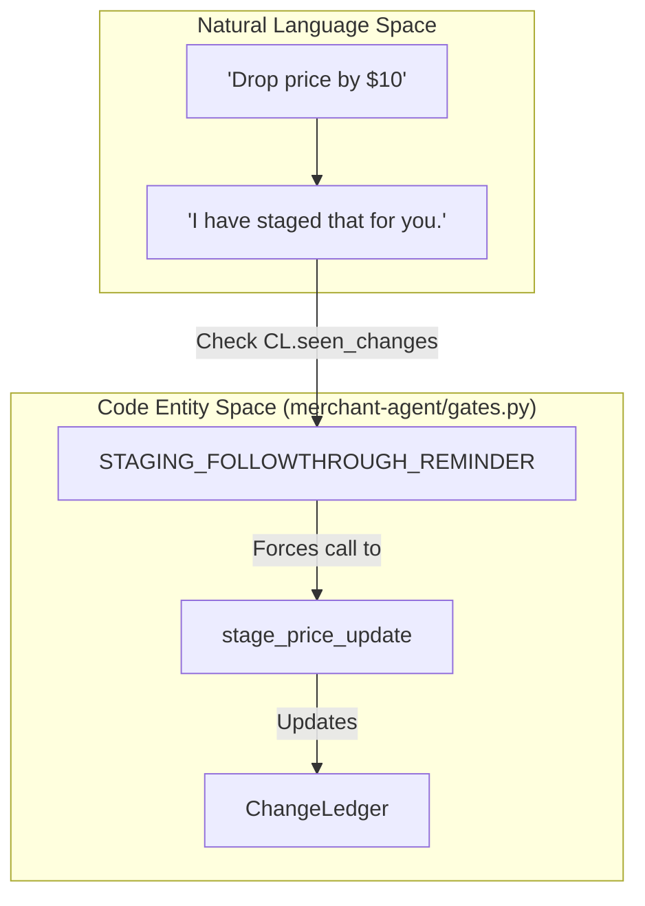

<!-- source: DeepWiki mcp.deepwiki.com · repo anthropics/commerce-agents · page 11.1 Unit and Integration Tests · fetched 2026-10-26 -->

# Unit and Integration Tests

Relevant source files

The following files were used as context for generating this wiki page:

- [commerce-common/commerce_common/streaming.py](commerce-common/commerce_common/streaming.py)
- [commerce-common/commerce_common/testing.py](commerce-common/commerce_common/testing.py)
- [commerce-common/tests/test_streaming.py](commerce-common/tests/test_streaming.py)
- [merchant-agent/runtime-agent-sdk/tests/conftest.py](merchant-agent/runtime-agent-sdk/tests/conftest.py)
- [merchant-agent/runtime-agent-sdk/tests/test_agent.py](merchant-agent/runtime-agent-sdk/tests/test_agent.py)
- [merchant-agent/runtime-messages-api/tests/test_orchestrator_followthrough.py](merchant-agent/runtime-messages-api/tests/test_orchestrator_followthrough.py)
- [shopping-agent/runtime-agent-sdk/tests/conftest.py](shopping-agent/runtime-agent-sdk/tests/conftest.py)
- [shopping-agent/runtime-messages-api/tests/test_orchestrator.py](shopping-agent/runtime-messages-api/tests/test_orchestrator.py)
- [tests/test_turn_loop.py](tests/test_turn_loop.py)

This page details the testing infrastructure for the Claude Commerce Agents reference implementation. The test suite covers per-package unit tests, cross-package integration tests for the turn loops, and specialized testing utilities like `FakeClient` for simulating model interactions.

## Overview of Test Suites

The codebase employs a multi-layered testing strategy to ensure the reliability of the shopping and merchant agents across three different runtime paths (Messages API, Agent SDK, and Managed Agents).

| Test Suite | Location | Focus |
| :--- | :--- | :--- |
| **Turn Loop Integration** | `tests/test_turn_loop.py` | Eager dispatch, history compaction, and rolling cache breakpoints. |
| **Messages API Orchestrator** | `shopping-agent/runtime-messages-api/tests/` | UI partial streaming and account prefetching. |
| **SDK Runtime** | `merchant-agent/runtime-agent-sdk/tests/` | Tool registration, sub-agent mapping, and hook execution. |
| **Safety Gates** | `merchant-agent/runtime-messages-api/tests/` | Provenance checks and staging follow-through reminders. |
| **Streaming Utilities** | `commerce-common/tests/test_streaming.py` | SSE serialization and partial JSON parsing. |

Sources: [tests/test_turn_loop.py:4-6](), [commerce-common/tests/test_streaming.py:4-6](), [merchant-agent/runtime-agent-sdk/tests/test_agent.py:4-5]()

## The FakeClient Testing Utility

To test agent logic without incurring LLM costs or latency, the suite uses `FakeClient` [commerce-common/commerce_common/testing.py:130-138](). It plays back a pre-defined script of `SimpleNamespace` objects that mimic the Anthropic Messages API response structure.

### Key Capabilities
- **Scripted Responses**: Returns specific `text_block` or `tool_use_block` sequences [commerce-common/commerce_common/testing.py:38-43]().
- **Chunked Streaming**: Simulates partial JSON delivery via the `chunks` parameter to test the `ui_partial` reconciliation logic [commerce-common/commerce_common/testing.py:83-91]().
- **Call Inspection**: Records every request made to the client in the `calls` list for assertion [commerce-common/commerce_common/testing.py:135-141]().

### Natural Language to Code Entity: Testing Simulation
The following diagram shows how `FakeClient` bridges the gap between a conceptual "Model Response" and the internal code entities used for validation.

Sources: [commerce-common/commerce_common/testing.py:38-69](), [commerce-common/commerce_common/testing.py:130-144]()

## Turn Loop Integration Tests

The `test_turn_loop.py` suite validates the core `stream_turn` logic shared by both `ShoppingAgent` and `MerchantAgent`.

### Eager Dispatch and Gating
Tests verify that when a "gated" tool (e.g., `add_to_cart` or `apply_change`) is called, the turn loop holds the execution and forces a specific model response to confirm the action [tests/test_turn_loop.py:176-181]().
- **Ungated Turns**: Use `tool_choice={"type": "auto"}` from the first iteration [tests/test_turn_loop.py:171-174]().
- **Gated Turns**: Switch from a specific `tool_choice` to `auto` only after the gate is satisfied [tests/test_turn_loop.py:157-169]().

### History Compaction and Caching
The turn loop manages a rolling conversation cache. The tests assert:
- **Cache Breakpoints**: The system prompt is marked with `cache_control` to optimize for Anthropic's prompt caching [tests/test_turn_loop.py:141-145]().
- **Compaction**: When `results_cleared` is non-zero in the `turn_complete` event, it indicates that previous tool results were pruned to save context window space [commerce-common/commerce_common/streaming.py:22-25]().

Sources: [tests/test_turn_loop.py:157-181](), [commerce-common/commerce_common/streaming.py:123-134]()

## UI Presentation and Partial Streaming

Tests in `test_orchestrator.py` focus on how the agent communicates UI updates to the host.

### Partial JSON Parsing
The `parse_partial_json` utility allows the host to render UI components while the model is still generating the JSON tool input [commerce-common/commerce_common/streaming.py:55-57]().
- **Structural Changes**: `ui_partial` events are only emitted when the JSON structure grows (e.g., a new item is added to a list), not for every character delta [shopping-agent/runtime-messages-api/tests/test_orchestrator.py:54-65]().
- **Safety**: Half-written strings are "settled" or skipped to prevent rendering broken UI [commerce-common/commerce_common/streaming.py:65-72]().

### Presentation Reconciliation
The `test_ui_partial_skips_unresolvable_ids` test ensures that if a model suggests a product ID that hasn't been "grounded" (seen in a previous search result), the UI component skips that item to maintain provenance safety [shopping-agent/runtime-messages-api/tests/test_orchestrator.py:74-84]().

Sources: [commerce-common/commerce_common/streaming.py:98-103](), [shopping-agent/runtime-messages-api/tests/test_orchestrator.py:54-84]()

## Merchant Agent Safety Gates

The merchant agent tests focus heavily on the `Propose -> Preview -> Approve -> Apply` lifecycle.

### Staging Follow-through
The `test_orchestrator_followthrough.py` validates the `STAGING_FOLLOWTHROUGH_REMINDER` mechanism.
- If a model discusses a change (e.g., "I'll lower the price") but fails to call a `stage_*` tool, the orchestrator injects a hidden user message reminding the model to actually stage the change [merchant-agent/runtime-messages-api/tests/test_orchestrator_followthrough.py:113-130]().
- The reminder is suppressed if the model attempted a stage call that was blocked by a safety gate [merchant-agent/runtime-messages-api/tests/test_orchestrator_followthrough.py:148-161]().

### SDK Tool Mapping
The `test_agent.py` in the SDK runtime ensures that the `MerchantToolset` correctly maps the `AnalysisRunner` to a read-only sub-agent [merchant-agent/runtime-agent-sdk/tests/test_agent.py:123-140]().

### Natural Language to Code Entity: Merchant Safety
This diagram illustrates the enforcement of the staging workflow during a turn.

Sources: [merchant-agent/runtime-messages-api/tests/test_orchestrator_followthrough.py:113-130](), [merchant-agent/runtime-agent-sdk/tests/test_agent.py:158-175]()

## Streaming Event Serialization

The `commerce-common` package includes tests for the `AgentEvent` lifecycle.

| Event Type | Logic Tested | Source |
| :--- | :--- | :--- |
| `text_delta` | Incremental text delivery. | [commerce-common/commerce_common/streaming.py:58-59]() |
| `progress` | Tool-specific status messages (e.g., "querying metrics"). | [commerce-common/commerce_common/streaming.py:114-120]() |
| `to_sse` | Serialization into Server-Sent Events format for web hosts. | [commerce-common/commerce_common/streaming.py:164-167]() |
| `turn_complete` | Usage reporting and result clearing counts. | [commerce-common/commerce_common/streaming.py:123-134]() |

Sources: [commerce-common/tests/test_streaming.py:9-52](), [commerce-common/commerce_common/streaming.py:7-28]()

---

