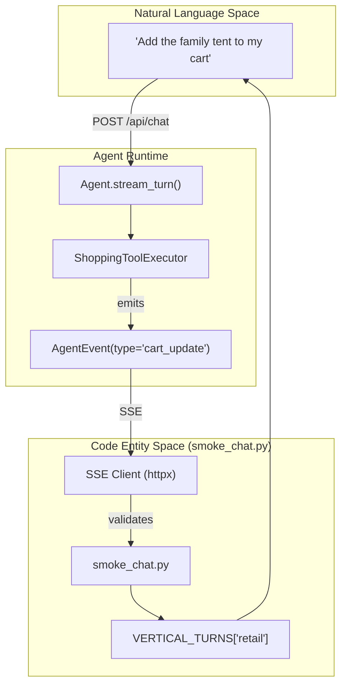
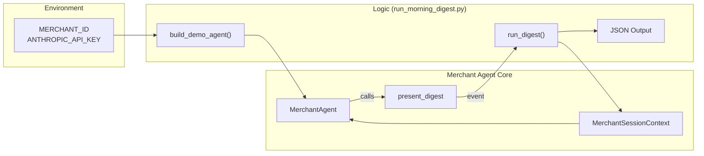

<!-- source: DeepWiki mcp.deepwiki.com · repo anthropics/commerce-agents · page 11.2 Consistency Checks and Smoke Tests · fetched 2026-10-26 -->

# Consistency Checks and Smoke Tests

Relevant source files

The following files were used as context for generating this wiki page:

- [merchant-agent/managed-agents/scheduled-digest/run_morning_digest.py](merchant-agent/managed-agents/scheduled-digest/run_morning_digest.py)
- [scripts/check.py](scripts/check.py)
- [scripts/screenshot_tour.py](scripts/screenshot_tour.py)
- [scripts/smoke_chat.py](scripts/smoke_chat.py)
- [scripts/verify_all.py](scripts/verify_all.py)
- [tests/test_role_registries.py](tests/test_role_registries.py)
- [tests/test_system_switches.py](tests/test_system_switches.py)

This section covers the automated validation and end-to-end testing infrastructure used to ensure the reliability, consistency, and visual integrity of the Commerce Agents reference implementation. These tools bridge the gap between unit tests and production deployments by verifying cross-package dependencies, multi-turn conversational logic, and visual rendering.

## Consistency Validation (`check.py`)

The `check.py` script performs static and structural validation across the repository to ensure that data duplicated for different runtime paths or verticals remains synchronized. It acts as a "meta-linter" for agent configurations and domain data.

### Key Validation Areas
*   **Skill Integrity**: Validates that all required skills for the `shopping` and `merchant` roles are present in their respective `skills/` directories, have valid frontmatter, and meet minimum length requirements for routing [scripts/check.py:156-175]().
*   **Managed Agent Synchronization**: The Managed Agents path (using `agent.yaml`) requires a hand-derived `system.md`. `check.py` dynamically builds the expected system prompt using the core library's `build_static_system` and compares it against the managed agent's files to ensure they haven't drifted [scripts/check.py:103-112]().
*   **Fixture Integrity**: For each vertical (retail, travel, telecom, entertainment), it verifies that `catalog.json` contains unique IDs, that variants correctly map to parent listings, and that example `orders.json` and `memory.json` files contain valid data structures [scripts/check.py:182-201]().
*   **Package Version Pinning**: Ensures that internal dependencies between the seven pip packages (e.g., `shopping-agent` depending on `commerce-common`) are consistently versioned.

### Data Flow in `check.py`

| Component | Function/Class | Purpose |
| :--- | :--- | :--- |
| **Role Definition** | `Role` [scripts/check.py:65-84]() | Encapsulates paths and expected skills for shopping vs merchant agents. |
| **Prompt Builder** | `Role.static_prompt` [scripts/check.py:103-112]() | Imports the actual `build_static_system` from the core packages to generate the ground-truth prompt. |
| **Catalog Loader** | `catalog_ids_of` [scripts/check.py:44-49]() | Uses `demo_common.storefront_fixtures` to resolve listing/variant IDs for cross-reference. |

Sources: [scripts/check.py:44-112](), [scripts/check.py:156-201]()

---

## Conversational Smoke Tests (`smoke_chat.py`)

`smoke_chat.py` executes scripted, multi-turn conversations against the example verticals. It can run against the mock backends in-process or against a live running FastAPI server via SSE (Server-Sent Events) [scripts/smoke_chat.py:4-15]().

### Test Arcs and Assertions
The script defines `VERTICAL_TURNS` for storefronts and `MERCHANT_TURNS` for merchant portals. Each turn specifies:
*   **Message**: The natural language input from the user.
*   **Expectations**: A set of `expect_tools` that the agent *must* call and `expect_events` (like `ui` or `cart_update`) that must be emitted [scripts/smoke_chat.py:37-57]().
*   **Negative Assertions**: `forbid_tools` ensures the agent does not attempt unauthorized actions (e.g., applying a change without approval) [scripts/smoke_chat.py:148-158]().

### Merchant Approval Simulation
A unique feature of the merchant smoke tests is the `portal_approve_kind` step. This simulates a user leaving the chat to approve a staged change in the Merchant Portal UI, allowing the script to verify that subsequent chat turns reflect the updated backend state [scripts/smoke_chat.py:166-169]().

### System Relationship: Smoke Test to Runtime

Sources: [scripts/smoke_chat.py:37-57](), [scripts/smoke_chat.py:139-169]()

---

## Visual Regression (`screenshot_tour.py`)

`screenshot_tour.py` uses Playwright to automate a headless browser, driving the React-based storefronts and merchant portals through "hero turns" to capture screenshots for visual regression testing [scripts/screenshot_tour.py:4-18]().

### Implementation Details
*   **Headless Navigation**: It targets the local development ports (e.g., `3000` for retail storefront, `3100` for retail merchant) [scripts/screenshot_tour.py:28-30]().
*   **Component Targeting**: It specifically captures UI states such as the "comparison carousel," "research guide," and the "activity panel" (showing memory facts and tool traces) [scripts/screenshot_tour.py:32-62]().
*   **State Persistence**: For the travel and entertainment verticals, it volunteers durable preferences to trigger the memory extraction system, ensuring the "Memory" tab in the UI is populated for the screenshot [scripts/screenshot_tour.py:78-84]().

Sources: [scripts/screenshot_tour.py:4-84]()

---

## Headless Merchant Digest (`run_morning_digest.py`)

While not a test script per se, `run_morning_digest.py` serves as a functional smoke test for the Merchant Agent's scheduled tasks. It runs the `MerchantAgent` headlessly to generate a "morning digest" [merchant-agent/managed-agents/scheduled-digest/run_morning_digest.py:5-15]().

### Data Flow
1.  **Context Setup**: Initializes a `MerchantSessionContext` with environment variables for `MERCHANT_ID` and `MERCHANT_TIMEZONE` [merchant-agent/managed-agents/scheduled-digest/run_morning_digest.py:57-65]().
2.  **Turn Execution**: Calls `agent.stream_turn` with a hardcoded prompt: *"Produce the morning digest: what needs attention today and why."* [merchant-agent/managed-agents/scheduled-digest/run_morning_digest.py:30, 70]().
3.  **Event Parsing**: Specifically listens for `ui` events where the component is `digest` to extract the JSON payload [merchant-agent/managed-agents/scheduled-digest/run_morning_digest.py:73-74]().

Sources: [merchant-agent/managed-agents/scheduled-digest/run_morning_digest.py:30-82]()

---

## Verification Suite (`verify_all.py`)

`verify_all.py` is the top-level CI entry point that orchestrates all checks in order of increasing cost and complexity [scripts/verify_all.py:4-13]().

### Execution Sequence
1.  **Static Analysis**: `ruff check` and `ruff format` [scripts/verify_all.py:66-67]().
2.  **Consistency**: `scripts/check.py` [scripts/verify_all.py:68]().
3.  **Unit/Integration Tests**: `pytest` [scripts/verify_all.py:69]().
4.  **Managed Agent Dry-runs**: Validates `agent.yaml` deployments via `deploy_managed_agent.sh` [scripts/verify_all.py:70-86]().
5.  **Web Builds**: Executes `next build` for all eight web applications (4 verticals x 2 roles) [scripts/verify_all.py:98-106]().
6.  **Live Smoke Tests**: (Optional) Runs `smoke_chat.py` against the Anthropic API [scripts/verify_all.py:110-111]().

Sources: [scripts/verify_all.py:65-113]()

---

