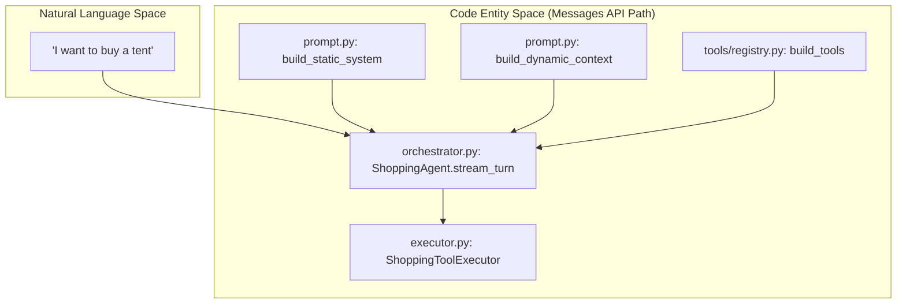
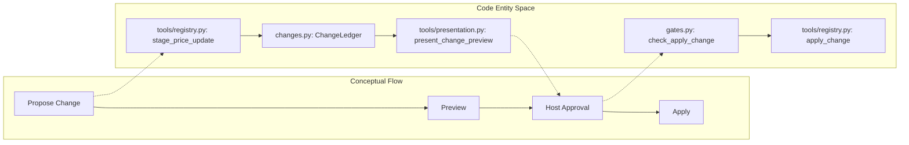

<!-- source: DeepWiki mcp.deepwiki.com · repo anthropics/commerce-agents · page 12 Glossary · fetched 2026-10-26 -->

# Glossary

Relevant source files

The following files were used as context for generating this wiki page:

- [commerce-common/commerce_common/memory.py](commerce-common/commerce_common/memory.py)
- [commerce-common/commerce_common/types.py](commerce-common/commerce_common/types.py)
- [commerce-common/tests/test_memory_facts.py](commerce-common/tests/test_memory_facts.py)
- [commerce-common/tests/test_memory_runtime.py](commerce-common/tests/test_memory_runtime.py)
- [commerce-common/tests/test_memory_stores.py](commerce-common/tests/test_memory_stores.py)
- [conftest.py](conftest.py)
- [merchant-agent/core/merchant_agent/analysis.py](merchant-agent/core/merchant_agent/analysis.py)
- [merchant-agent/core/merchant_agent/backend.py](merchant-agent/core/merchant_agent/backend.py)
- [merchant-agent/core/merchant_agent/changes.py](merchant-agent/core/merchant_agent/changes.py)
- [merchant-agent/core/merchant_agent/config.py](merchant-agent/core/merchant_agent/config.py)
- [merchant-agent/core/merchant_agent/enrichment.py](merchant-agent/core/merchant_agent/enrichment.py)
- [merchant-agent/core/merchant_agent/tools/presentation.py](merchant-agent/core/merchant_agent/tools/presentation.py)
- [merchant-agent/core/merchant_agent/tools/registry.py](merchant-agent/core/merchant_agent/tools/registry.py)
- [merchant-agent/core/tests/test_analysis.py](merchant-agent/core/tests/test_analysis.py)
- [merchant-agent/core/tests/test_gates.py](merchant-agent/core/tests/test_gates.py)
- [merchant-agent/managed-agents/merchant-agent/agent.yaml](merchant-agent/managed-agents/merchant-agent/agent.yaml)
- [merchant-agent/managed-agents/merchant-mcp-server/README.md](merchant-agent/managed-agents/merchant-mcp-server/README.md)
- [merchant-agent/managed-agents/merchant-mcp-server/merchant_mcp_server.py](merchant-agent/managed-agents/merchant-mcp-server/merchant_mcp_server.py)
- [merchant-agent/managed-agents/scheduled-digest/run_morning_digest.py](merchant-agent/managed-agents/scheduled-digest/run_morning_digest.py)
- [merchant-agent/runtime-messages-api/README.md](merchant-agent/runtime-messages-api/README.md)
- [merchant-agent/runtime-messages-api/merchant_agent_runtime/analysis.py](merchant-agent/runtime-messages-api/merchant_agent_runtime/analysis.py)
- [merchant-agent/runtime-messages-api/merchant_agent_runtime/orchestrator.py](merchant-agent/runtime-messages-api/merchant_agent_runtime/orchestrator.py)
- [merchant-agent/runtime-messages-api/tests/test_analysis.py](merchant-agent/runtime-messages-api/tests/test_analysis.py)
- [plugins/commerce-builder/commands/scaffold-commerce-agent.md](plugins/commerce-builder/commands/scaffold-commerce-agent.md)
- [scripts/check.py](scripts/check.py)
- [scripts/screenshot_tour.py](scripts/screenshot_tour.py)
- [scripts/smoke_chat.py](scripts/smoke_chat.py)
- [shopping-agent/core/shopping_agent/config.py](shopping-agent/core/shopping_agent/config.py)
- [shopping-agent/core/shopping_agent/enrichment.py](shopping-agent/core/shopping_agent/enrichment.py)
- [shopping-agent/core/shopping_agent/gates.py](shopping-agent/core/shopping_agent/gates.py)
- [shopping-agent/core/shopping_agent/tools/presentation.py](shopping-agent/core/shopping_agent/tools/presentation.py)
- [shopping-agent/core/shopping_agent/tools/registry.py](shopping-agent/core/shopping_agent/tools/registry.py)
- [shopping-agent/core/tests/test_gates.py](shopping-agent/core/tests/test_gates.py)
- [shopping-agent/managed-agents/shopping-agent/agent.yaml](shopping-agent/managed-agents/shopping-agent/agent.yaml)
- [shopping-agent/managed-agents/storefront-mcp-server/README.md](shopping-agent/managed-agents/storefront-mcp-server/README.md)
- [shopping-agent/managed-agents/storefront-mcp-server/storefront_mcp_server.py](shopping-agent/managed-agents/storefront-mcp-server/storefront_mcp_server.py)
- [shopping-agent/runtime-messages-api/README.md](shopping-agent/runtime-messages-api/README.md)
- [shopping-agent/runtime-messages-api/shopping_agent_runtime/orchestrator.py](shopping-agent/runtime-messages-api/shopping_agent_runtime/orchestrator.py)
- [tests/test_consumption_paths.py](tests/test_consumption_paths.py)

This page defines codebase-specific terms, jargon, and domain concepts used throughout the Claude Commerce Agents reference implementation.

## Core System Concepts

### Fencing
The practice of wrapping untrusted third-party content (like product descriptions or merchant listings) in XML-like tags to prevent prompt injection attacks. The model is instructed to treat any text inside these tags as data, not instructions.
*   **Code Pointer:** `STOREFRONT_FENCE` in [shopping-agent/core/shopping_agent/fencing.py](), `MERCHANT_FENCE` in [merchant-agent/core/merchant_agent/fencing.py](), and the `Fence` class in [commerce-common/commerce_common/fencing.py:28-28]().

### Grounding
A safety mechanism that forces the agent to call specific backend "read" tools before answering a user query. This ensures the model's response is based on fresh system data rather than its internal training weights or outdated conversation history.
*   **Code Pointer:** `first_forced_tool` in [commerce-common/commerce_common/grounding.py](), `GROUNDING_RULES` in [shopping-agent/core/shopping_agent/grounding.py:67-67]().

### Skill
A set of high-level instructions for a specific business flow (e.g., "Search & Discovery" or "Inventory Operations") stored in a `SKILL.md` file. Skills are loaded dynamically using the `LOAD_SKILL` tool to keep the primary system prompt small and byte-stable for prompt caching.
*   **Code Pointer:** `SkillRegistry` in [commerce-common/commerce_common/skills.py:15-15](), `LOAD_SKILL` constant in [commerce-common/commerce_common/execution.py:15-15]().

### Presentation Component
An abstraction for UI elements rendered by the host application. Instead of the model generating raw HTML or Markdown for complex UI, it calls a "presentation tool" (e.g., `present_products`). The system then "enriches" this call by fetching full objects (images, prices) from the backend before sending a `ui` event to the frontend.
*   **Code Pointer:** `PresentationComponent` in [commerce-common/commerce_common/presentation.py:17-17](), `PRESENTATION_COMPONENTS` in [shopping-agent/core/shopping_agent/enrichment.py:65-65]().

---

## Technical Mapping: Natural Language to Code Entities

The following diagrams bridge the gap between conceptual system names and the specific classes or files that implement them.

### Diagram 1: Request Lifecycle Mapping
This diagram shows how a user message moves from "Natural Language Space" into the "Code Entity Space" of the Messages API runtime.

**Sources:** [shopping-agent/runtime-messages-api/shopping_agent_runtime/orchestrator.py:75-166](), [shopping-agent/core/shopping_agent/prompt.py:68-68](), [shopping-agent/core/shopping_agent/tools/registry.py:72-72]().

### Diagram 2: Merchant Staged Change Workflow
This diagram maps the conceptual "Propose → Preview → Approve → Apply" workflow to the specific code entities in the Merchant Agent.

**Sources:** [merchant-agent/core/merchant_agent/changes.py:23-23](), [merchant-agent/core/merchant_agent/tools/registry.py:88-168](), [merchant-agent/core/merchant_agent/gates.py:70-70]().

---

## Glossary Table

| Term | Definition | Key Code Pointer |
| :--- | :--- | :--- |
| **Analysis Delegate** | An isolated sub-agent used by the Merchant Agent to perform complex data analysis via SQL and code execution. | [merchant-agent/core/merchant_agent/analysis.py]() |
| **Change Ledger** | A session-scoped storage for changes that have been "staged" but not yet "applied" to the production backend. | [merchant-agent/core/merchant_agent/changes.py:23-23]() |
| **Eager Dispatch** | A runtime optimization where tool execution begins as soon as the model finishes streaming a tool use block, rather than waiting for the entire turn to end. | [commerce-common/commerce_common/turn.py:43-43]() |
| **Enrichment** | The process of replacing minimal IDs in a presentation tool call with full data objects from the backend (e.g., turning a `product_id` into a full `Product` object). | [shopping-agent/core/shopping_agent/enrichment.py:82-102]() |
| **Managed Agent** | An agent deployed via the Anthropic Agents API using an `agent.yaml` manifest and MCP servers. | [shopping-agent/managed-agents/shopping-agent/agent.yaml:1-15]() |
| **Memory Fact** | A durable, cross-session piece of information about a user (preference, constraint, or context). | [commerce-common/commerce_common/types.py:31-31]() |
| **Memory Runtime** | The component that coordinates memory retrieval (Tier One vs. Recall) and post-turn fact extraction. | [commerce-common/commerce_common/memory.py:4-9]() |
| **Provenance Gate** | A security check ensuring that the model only acts on IDs (products, orders, changes) that were actually returned by a tool in the current session. | [shopping-agent/core/shopping_agent/gates.py:22-22]() |
| **Rolling Cache** | A strategy for placing prompt cache breakpoints at the most recent turn to maximize cache hits during a conversation. | [commerce-common/commerce_common/prompt_assembly.py:38-38]() |
| **Storefront Backend** | The abstract interface a shopping agent uses to communicate with a retailer's catalog, cart, and order systems. | [shopping-agent/core/shopping_agent/backend.py]() |

---

## Domain-Specific Abbreviations

*   **MCP**: Model Context Protocol. Used for connecting agents to backend tools via standardized servers.
    *   Sources: [shopping-agent/managed-agents/storefront-mcp-server/storefront_mcp_server.py]()
*   **SSE**: Server-Sent Events. The streaming format used by the example host to send `text_delta` and `ui` events to the browser.
    *   Sources: [examples/demo_common/host.py]()
*   **AOV**: Average Order Value. A key metric in the Merchant Agent's business snapshot.
    *   Sources: [merchant-agent/core/merchant_agent/tools/registry.py:130-135]()
*   **ISO Date**: Standard date format (YYYY-MM-DD) required by backend tool arguments.
    *   Sources: [merchant-agent/core/merchant_agent/tools/registry.py:24-24]()

**Sources:**
- [shopping-agent/runtime-messages-api/shopping_agent_runtime/orchestrator.py:75-166]()
- [merchant-agent/core/merchant_agent/tools/registry.py:88-168]()
- [commerce-common/commerce_common/memory.py:78-99]()
- [commerce-common/commerce_common/presentation.py:13-20]()
- [shopping-agent/core/shopping_agent/enrichment.py:1-32]()