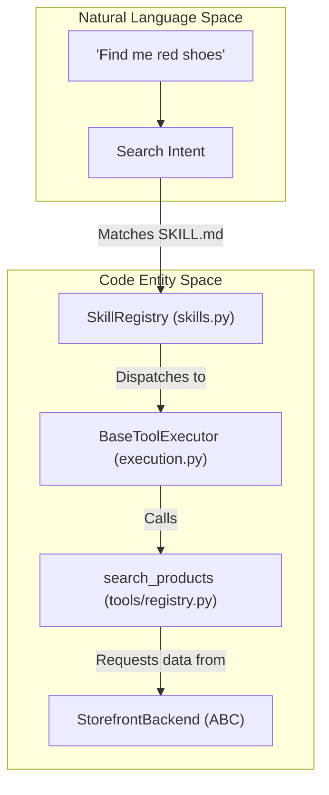
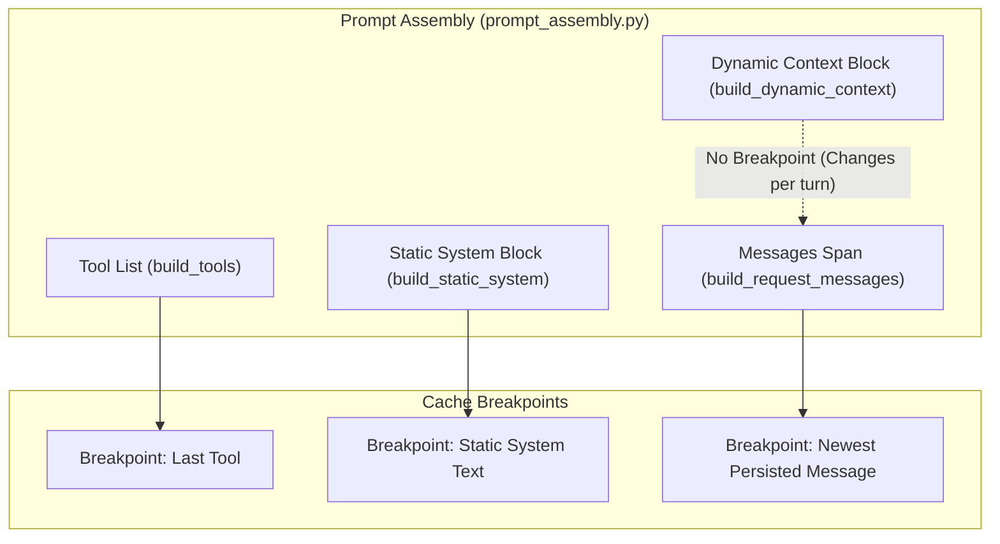

<!-- source: DeepWiki mcp.deepwiki.com · repo anthropics/commerce-agents · page 2 Core Architecture · fetched 2026-10-26 -->

# Core Architecture

Relevant source files

The following files were used as context for generating this wiki page:

- [commerce-common/README.md](commerce-common/README.md)
- [commerce-common/commerce_common/__init__.py](commerce-common/commerce_common/__init__.py)
- [commerce-common/commerce_common/agent_sdk.py](commerce-common/commerce_common/agent_sdk.py)
- [commerce-common/commerce_common/grounding.py](commerce-common/commerce_common/grounding.py)
- [commerce-common/commerce_common/presentation.py](commerce-common/commerce_common/presentation.py)
- [commerce-common/tests/test_presentation.py](commerce-common/tests/test_presentation.py)
- [plugins/commerce-builder/skills/commerce-prompt-caching/SKILL.md](plugins/commerce-builder/skills/commerce-prompt-caching/SKILL.md)
- [plugins/commerce-builder/skills/commerce-ui-tools/SKILL.md](plugins/commerce-builder/skills/commerce-ui-tools/SKILL.md)

This section provides a high-level overview of the shared architectural patterns used by both the Shopping and Merchant agents. The framework is designed to be byte-stable for prompt caching, safe against prompt injection through fencing, and predictable through grounding rules.

## The Skill-Tool-Backend Pipeline

The codebase follows a strictly layered pipeline where the model interacts with a **Skill Registry**, which in turn utilizes a **Tool Executor** to communicate with a **Backend** implementation.

1.  **Skills**: Encapsulated in `SKILL.md` files, these provide the model with high-level domain expertise (e.g., "Search and Discovery").
2.  **Tools**: The model invokes tools defined in a role's `tools/registry.py`.
3.  **Executor**: The `BaseToolExecutor` [commerce-common/commerce_common/execution.py:35-35]() manages the dispatch, failure handling, and event emission.
4.  **Backend**: The final destination for data retrieval or mutations (e.g., `StorefrontBackend` or `MerchantBackend`).

For details on the shared foundation, see [commerce-common: Shared Foundation](#2.1).

### Natural Language to Code Entity Mapping

The following diagram bridges how natural language concepts map to specific code entities within the pipeline.

Sources: [commerce-common/commerce_common/skills.py:12-12](), [commerce-common/commerce_common/execution.py:35-35](), [commerce-common/README.md:1-24]()

## Fencing and Grounding

To ensure safety and data integrity, the architecture employs two primary mechanisms:

*   **Fencing**: All third-party data (product descriptions, merchant metrics) is wrapped in XML-like tags using the `Fence` class [commerce-common/commerce_common/fencing.py:10-10](). This prevents the model from interpreting data as instructions.
*   **Grounding**: The `GroundingRule` [commerce-common/commerce_common/grounding.py:63-63]() system forces the agent to perform a backend read (e.g., `get_product_details`) before answering specific query types, ensuring the model's response is grounded in current facts.

For details, see [Fencing and Grounding](#2.2).

Sources: [commerce-common/commerce_common/fencing.py:10-10](), [commerce-common/commerce_common/grounding.py:4-8]()

## Execution Frame and Turn Loop

The "Turn" is the fundamental unit of interaction. The `commerce-common` package provides helpers in `turn.py` [commerce-common/commerce_common/turn.py:19-19]() to manage the Messages API loop, including:

*   **Eager Dispatch**: Processing tool calls as they are streamed.
*   **History Compaction**: Replacing old tool results with markers when the conversation exceeds token limits [plugins/commerce-builder/skills/commerce-prompt-caching/SKILL.md:51-58]().
*   **Rolling Breakpoints**: Strategically placed cache breakpoints to optimize prompt caching performance [plugins/commerce-builder/skills/commerce-prompt-caching/SKILL.md:11-25]().

### Request Assembly and Caching

The system is designed for **byte-stable request assembly**. The prompt is split into three cacheable spans:
1.  **Tools**: Fixed tool definitions.
2.  **Static System**: Identity and core rules.
3.  **Rolling Messages**: The newest persisted message in the conversation.

Sources: [plugins/commerce-builder/skills/commerce-prompt-caching/SKILL.md:11-25](), [commerce-common/commerce_common/prompt_assembly.py:13-13]()

For details, see [Prompt Assembly and Skill System](#2.5).

## Presentation and UI Enrichment

The agents do not return raw data to the model to be re-formatted. Instead, they use **Presentation Tools**.

*   **Model Role**: The model selects which items to show and provides the reasoning text.
*   **Server Role**: The `run_presentation` function [commerce-common/commerce_common/presentation.py:120-120]() validates the model's arguments and uses an `enrich` hook to join real-time backend data (prices, images, metrics) onto the payload.
*   **Enrichment**: This ensures the UI only displays verified data that has session provenance [plugins/commerce-builder/skills/commerce-ui-tools/SKILL.md:13-15]().

For details, see [Presentation and UI Enrichment](#2.4).

Sources: [commerce-common/commerce_common/presentation.py:84-95](), [plugins/commerce-builder/skills/commerce-ui-tools/SKILL.md:13-28]()

## Memory System

The agents maintain a durable, cross-session memory using the `MemoryStore` protocol [commerce-common/commerce_common/memory.py:11-11](). 
*   **Extraction**: After a turn, the agent extracts new facts (e.g., user preferences).
*   **Retrieval**: Tiered retrieval fetches relevant facts to inject into the dynamic context of the next turn.
*   **Filtering**: A `MemoryWriteFilter` [commerce-common/commerce_common/memory.py:11-11]() ensures only safe, non-sensitive information is persisted.

For details, see [Memory System](#2.3).

Sources: [commerce-common/README.md:11-11](), [commerce-common/commerce_common/memory.py:37-37]()

---

