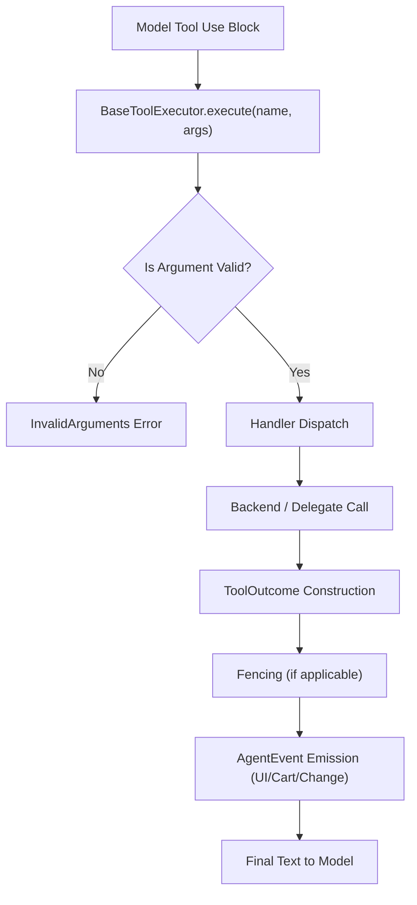
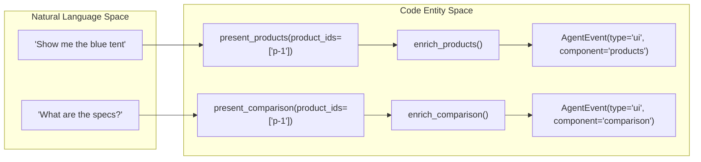

<!-- source: DeepWiki mcp.deepwiki.com · repo anthropics/commerce-agents · page 2.1 commerce-common: Shared Foundation · fetched 2026-10-26 -->

# commerce-common: Shared Foundation

Relevant source files

The following files were used as context for generating this wiki page:

- [commerce-common/commerce_common/agent_sdk.py](commerce-common/commerce_common/agent_sdk.py)
- [commerce-common/commerce_common/execution.py](commerce-common/commerce_common/execution.py)
- [commerce-common/commerce_common/fencing.py](commerce-common/commerce_common/fencing.py)
- [commerce-common/commerce_common/grounding.py](commerce-common/commerce_common/grounding.py)
- [commerce-common/commerce_common/mcp_server.py](commerce-common/commerce_common/mcp_server.py)
- [commerce-common/commerce_common/presentation.py](commerce-common/commerce_common/presentation.py)
- [commerce-common/commerce_common/prompt_assembly.py](commerce-common/commerce_common/prompt_assembly.py)
- [commerce-common/commerce_common/skills.py](commerce-common/commerce_common/skills.py)
- [commerce-common/commerce_common/turn.py](commerce-common/commerce_common/turn.py)
- [commerce-common/commerce_common/types.py](commerce-common/commerce_common/types.py)
- [commerce-common/tests/test_agent_sdk.py](commerce-common/tests/test_agent_sdk.py)
- [commerce-common/tests/test_execution.py](commerce-common/tests/test_execution.py)
- [commerce-common/tests/test_fencing.py](commerce-common/tests/test_fencing.py)
- [commerce-common/tests/test_presentation.py](commerce-common/tests/test_presentation.py)
- [commerce-common/tests/test_skills.py](commerce-common/tests/test_skills.py)
- [commerce-common/tests/test_turn.py](commerce-common/tests/test_turn.py)
- [merchant-agent/core/tests/test_executor.py](merchant-agent/core/tests/test_executor.py)
- [plugins/commerce-builder/skills/commerce-ui-tools/SKILL.md](plugins/commerce-builder/skills/commerce-ui-tools/SKILL.md)

The `commerce-common` package provides the foundational abstractions and safety mechanisms shared across the Shopping Agent, Merchant Agent, and their various runtime environments (Messages API, Agent SDK, and MCP). It defines the core execution frame, the skill system, security fencing, grounding rules, and the server-side UI enrichment pipeline.

## Execution Framework

The `BaseToolExecutor` is the central engine for tool dispatch. It manages the lifecycle of a tool call, including argument validation, error handling, and the integration of delegates, memory, and presentation components.

### BaseToolExecutor
Every session maintains a role-specific executor (e.g., `ShoppingToolExecutor`) that inherits from `BaseToolExecutor` [commerce-common/commerce_common/execution.py:106-119](). It provides a unified `execute` method that ensures tool results are built consistently regardless of the runtime [commerce-common/commerce_common/execution.py:4-9]().

Key responsibilities include:
*   **Argument Validation**: Uses Pydantic models to validate model-supplied arguments via `parse_argument` [commerce-common/commerce_common/execution.py:54-62]().
*   **Failure Ladder**: Maps backend exceptions and domain-specific errors to standardized `ToolOutcome` objects [commerce-common/commerce_common/execution.py:161-163]().
*   **Status Handling**: Injects a `status` field into tool schemas for non-presentation tools, allowing the model to provide user-facing progress updates [commerce-common/commerce_common/execution.py:69-80]().
*   **Skill & Memory Integration**: Provides handlers for `save_memory`, `recall_memories`, and `load_skill` [commerce-common/commerce_common/execution.py:146-150]().

### Tool Dispatch and Outcomes
The result of any tool execution is a `ToolOutcome`, which encapsulates the text returned to the model and a sequence of `AgentEvent` objects for the host (e.g., UI updates) [commerce-common/commerce_common/execution.py:29-30]().

**Tool Execution Data Flow**

*Sources: [commerce-common/commerce_common/execution.py:106-150](), [commerce-common/commerce_common/streaming.py:29-30]()*

## Fencing and Sanitization

Fencing is a primary safety mechanism that wraps third-party data (product descriptions, reviews, merchant metrics) in XML-like tags to prevent prompt injection.

### The Fence Class
The `Fence` class defines a `label` (e.g., `storefront_data`) and a `notice` [commerce-common/commerce_common/fencing.py:83-90]().
*   **`sanitize_text`**: Removes invisible characters, control characters, and forged turn boundaries (e.g., `\n\nHuman:`) [commerce-common/commerce_common/fencing.py:99-120]().
*   **`fence_payload`**: Serializes data to JSON, sanitizes every string leaf, and wraps the result in the defined tags [commerce-common/commerce_common/fencing.py:135-149]().

### Sanitization Rules
The system enforces strict linear-time sanitization to neutralize hostile input:
*   **Invisible Characters**: Strips zero-width joiners, bidi overrides, and tag characters [commerce-common/commerce_common/fencing.py:21-37]().
*   **Marker Neutralization**: Removes any attempt by the data to close the current fence or open new special tokens (e.g., `<tool_code>`) [commerce-common/commerce_common/fencing.py:60-68]().
*   **Turn Boundary Protection**: Replaces role indicators like `Assistant:` or `System:` at the start of lines with a neutral hyphen to prevent the model from hallucinating a new message context [commerce-common/commerce_common/fencing.py:113]().

*Sources: [commerce-common/commerce_common/fencing.py:1-150](), [commerce-common/tests/test_fencing.py:17-112]()*

## Presentation and UI Enrichment

The presentation system separates model judgment (which items to show) from server-side facts (the current price or stock level).

### PresentationComponent
A `PresentationComponent` defines how a specific UI card is built [commerce-common/commerce_common/presentation.py:84-95]().
1.  **Model Input**: The model calls a tool (e.g., `present_products`) with a list of IDs.
2.  **Validation**: `payload_model` ensures the IDs and metadata are structured correctly [commerce-common/commerce_common/presentation.py:129-131]().
3.  **Enrichment**: The `enrich` hook joins data from the `SessionState` (provenance-gated) onto the payload [commerce-common/commerce_common/presentation.py:135-142]().
4.  **Emission**: A `ui` event is emitted with the fully enriched data [commerce-common/commerce_common/presentation.py:144]().

### Progressive Rendering (Eager Dispatch)
For low-latency UI, components can implement `enrich_partial`. As the model streams JSON, the `EagerDispatcher` parses partial buffers and emits `ui_partial` events whenever a "visible change" (detected by `partial_signature`) occurs [commerce-common/commerce_common/turn.py:174-176](), [commerce-common/commerce_common/presentation.py:147-159]().

**Natural Language to UI Entity Mapping**

*Sources: [commerce-common/commerce_common/presentation.py:1-174](), [plugins/commerce-builder/skills/commerce-ui-tools/SKILL.md:11-28]()*

## Turn and Conversation Management

The `commerce_common.turn` module provides utilities for managing the Messages API loop and maintaining conversation health.

### History Compaction
To prevent context window exhaustion, `compact_history` identifies old `tool_result` blocks and replaces their content with a `CLEARED_RESULT` sentinel once a token threshold is met [commerce-common/commerce_common/turn.py:124-157](). This preserves the model's ability to see the conversation flow while discarding bulky data payloads that are no longer needed.

### Turn Termination
The `round_closes_turn` helper determines if a turn should end based on the tools called in the current round [commerce-common/commerce_common/turn.py:22-27](). A turn typically closes when:
1.  A "clean" presentation call is made (no errors or refusals).
2.  The `present_suggestions` (chips) tool is included in the round [commerce-common/commerce_common/turn.py:61-65]().

*Sources: [commerce-common/commerce_common/turn.py:1-176](), [commerce-common/tests/test_turn.py:77-91]()*

## Agent SDK Integration

The `commerce_common.agent_sdk` module allows the shared executors to run within the Anthropic Agent SDK environment.

| Component | Role |
| :--- | :--- |
| `BaseToolset` | Manages state (UI events, tool outcomes) across multiple rounds of an SDK turn [commerce-common/commerce_common/agent_sdk.py:99-114](). |
| `build_sdk_tools` | Converts `BaseToolExecutor` handlers into `SdkMcpTool` instances [commerce-common/commerce_common/agent_sdk.py:67-72](). |
| `close_on_presentation_hook` | Implements the `PostToolBatch` hook to signal turn completion to the SDK CLI [commerce-common/commerce_common/agent_sdk.py:135-150](). |
| `ensure_project_skills` | Materializes repo-based skills into the `.claude/skills` directory for SDK discovery [commerce-common/commerce_common/agent_sdk.py:54-81](). |

*Sources: [commerce-common/commerce_common/agent_sdk.py:1-160]()*

---

