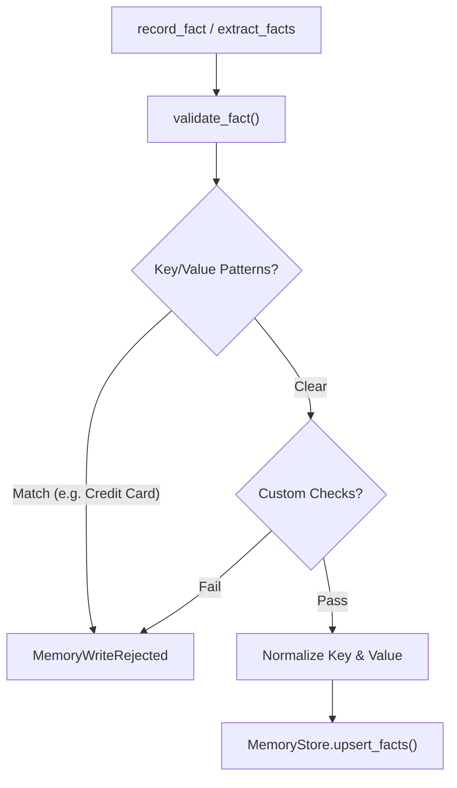
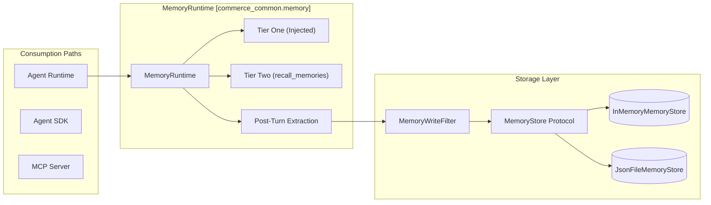

<!-- source: DeepWiki mcp.deepwiki.com · repo anthropics/commerce-agents · page 2.3 Memory System · fetched 2026-10-26 -->

# Memory System

Relevant source files

The following files were used as context for generating this wiki page:

- [commerce-common/commerce_common/memory.py](commerce-common/commerce_common/memory.py)
- [commerce-common/tests/test_memory_facts.py](commerce-common/tests/test_memory_facts.py)
- [commerce-common/tests/test_memory_runtime.py](commerce-common/tests/test_memory_runtime.py)
- [commerce-common/tests/test_memory_stores.py](commerce-common/tests/test_memory_stores.py)
- [merchant-agent/core/merchant_agent/memory.py](merchant-agent/core/merchant_agent/memory.py)
- [merchant-agent/core/tests/test_memory_prompt.py](merchant-agent/core/tests/test_memory_prompt.py)
- [shopping-agent/core/shopping_agent/memory.py](shopping-agent/core/shopping_agent/memory.py)
- [shopping-agent/skills/memory-personalization/SKILL.md](shopping-agent/skills/memory-personalization/SKILL.md)
- [tests/test_consumption_paths.py](tests/test_consumption_paths.py)

The Memory System provides durable, cross-session storage for facts about a subject (a customer for the Shopping Agent or an operation for the Merchant Agent). It is designed to bridge the gap between short-term conversation history and long-term user preferences, constraints, and context.

The system implements a **tiered retrieval** strategy, a **write-filtering** safety layer, and an **automated post-turn extraction** process that identifies new facts without requiring the agent to manually call "save" tools for every detail.

## Data Model and Store Protocol

The system is built around the `MemoryFact` data model and a flexible `MemoryStore` protocol, allowing deployments to swap in different storage backends (e.g., In-Memory, JSON, or a production database).

### MemoryFact
A `MemoryFact` represents a single piece of durable information.
*   **Key**: A normalized string (e.g., `shoe_size`) used for upserting and retrieval [commerce-common/commerce_common/memory.py:41]().
*   **Value**: The content of the fact, limited to 200 characters [commerce-common/commerce_common/memory.py:42]().
*   **Category**: One of `preference`, `constraint`, or `context` [commerce-common/commerce_common/memory.py:43]().
*   **Provenance**: Includes the `source_session_id` to track where the fact originated [commerce-common/commerce_common/memory.py:50-55]().

### MemoryStore Protocol
Any storage implementation must satisfy the `MemoryStore` protocol [commerce-common/commerce_common/memory.py:78-99]():
*   `get_facts`: Retrieves all facts for a subject.
*   `upsert_facts`: Adds or updates facts, replacing by key.
*   `search_facts`: Performs a keyword/semantic search.
*   `delete_fact`: Removes a specific key.
*   `clear`: Purges all facts for a subject and increments a `purge_generation`.

**Sources:** [commerce-common/commerce_common/memory.py:35-105](), [commerce-common/commerce_common/types.py:31-31]()

---

## Tiered Retrieval Strategy

To balance model performance (context window limits) with utility, the system uses two tiers of memory retrieval:

| Tier | Name | Mechanism | Content |
| :--- | :--- | :--- | :--- |
| **Tier One** | **Profile** | Automatic | Facts categorized as `constraint` or recently updated `preference` facts. Injected into the system prompt of every turn [commerce-common/commerce_common/memory.py:24-25](). |
| **Tier Two** | **Recall** | Tool-based | Accessed via the `recall_memories` tool. Used for specific topics like "past recipients" or "sizes" that are too bulky for the system prompt [shopping-agent/skills/memory-personalization/SKILL.md:12-13](). |

**Sources:** [commerce-common/commerce_common/memory.py:24-25](), [shopping-agent/skills/memory-personalization/SKILL.md:8-15]()

---

## Memory Write Pipeline and Safety

Before any fact is committed to the `MemoryStore`, it passes through a multi-stage validation and filtering pipeline to prevent the storage of PII (Personally Identifiable Information) or sensitive data.

### MemoryWriteFilter
The `MemoryWriteFilter` uses regex patterns and custom check functions to block sensitive identifiers [commerce-common/commerce_common/memory.py:150-176]().
*   **Default Patterns**: Blocks credit card numbers, IBANs, email addresses, and phone numbers [commerce-common/commerce_common/memory.py:130-139]().
*   **Custom Checks**: Hosts can provide `MemoryWriteCheck` callables for domain-specific logic (e.g., blocking internal employee IDs) [commerce-common/commerce_common/memory.py:146-147]().

### Fact Validation
The `validate_fact` function normalizes keys to snake_case, clamps value lengths, and enforces the write filter. If a fact is rejected, it raises a `MemoryWriteRejected` error, which the system handles gracefully by skipping the save [commerce-common/commerce_common/memory.py:126-127](), [commerce-common/commerce_common/memory.py:183-184]().

### Diagram: Write Pipeline

**Sources:** [commerce-common/commerce_common/memory.py:121-184](), [commerce-common/tests/test_memory_facts.py:72-148]()

---

## Post-Turn Extraction

The system performs "implicit memory" updates via a background extraction pass after a conversation turn completes. This prevents the user from having to explicitly tell the agent to "remember this."

1.  **Trigger**: After the `stream_turn` finishes, the `MemoryRuntime` triggers `extract_and_store` [commerce-common/commerce_common/memory.py:7-8]().
2.  **Model Call**: A separate, small model call uses the `MEMORY_EXTRACTION_TEMPLATE` to analyze the transcript [commerce-common/commerce_common/memory.py:53-74]().
3.  **Role-Specific Guidelines**:
    *   **Shopping**: Focuses on sizes, materials, household context, and the `current_project` [shopping-agent/core/shopping_agent/memory.py:11-36]().
    *   **Merchant**: Focuses on business goals, margin requirements, and briefing preferences [merchant-agent/core/merchant_agent/memory.py:11-36]().
4.  **Race Condition Protection**: The `extract_and_store` function checks the `purge_generation` before writing. If the user cleared their memory while the extraction model was running, the batch is discarded [commerce-common/commerce_common/memory.py:7-8]().

**Sources:** [commerce-common/commerce_common/memory.py:4-9](), [shopping-agent/core/shopping_agent/memory.py:11-36](), [merchant-agent/core/merchant_agent/memory.py:11-36]()

---

## Consumption Paths

The memory system is exposed through three distinct paths to ensure consistency across different deployment environments.

### 1. Runtime Path
Used by the `ShoppingAgent` and `MerchantAgent` classes. The `MemoryRuntime` manages the lifecycle, including extraction and tiered retrieval [commerce-common/commerce_common/memory.py:23-26]().

### 2. SDK Path
The `commerce-common/agent_sdk` allows host applications to interact with memory directly, often for UI-driven memory management (e.g., a "Memory Settings" page) [commerce-common/commerce_common/memory.py:23-26]().

### 3. MCP Path
Managed Agents expose memory via Model Context Protocol (MCP) tools. The `storefront-mcp-server` and `merchant-mcp-server` map standard memory tools to the underlying `MemoryStore` [tests/test_consumption_paths.py:174-187]().

### Diagram: Memory System Architecture

**Sources:** [commerce-common/commerce_common/memory.py:78-99](), [tests/test_consumption_paths.py:129-190](), [commerce-common/tests/test_memory_runtime.py:23-26]()

---

