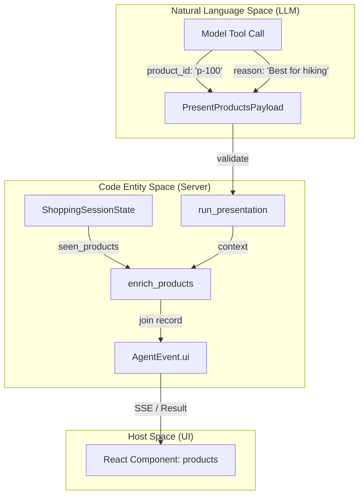
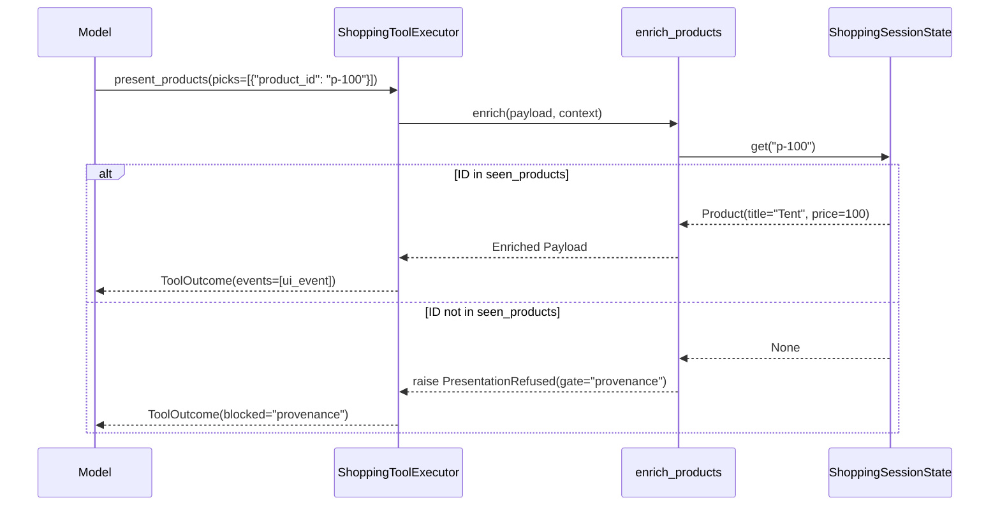

<!-- source: DeepWiki mcp.deepwiki.com · repo anthropics/commerce-agents · page 2.4 Presentation and UI Enrichment · fetched 2026-10-26 -->

# Presentation and UI Enrichment

Relevant source files

The following files were used as context for generating this wiki page:

- [commerce-common/commerce_common/presentation.py](commerce-common/commerce_common/presentation.py)
- [commerce-common/tests/test_presentation.py](commerce-common/tests/test_presentation.py)
- [merchant-agent/core/merchant_agent/enrichment.py](merchant-agent/core/merchant_agent/enrichment.py)
- [merchant-agent/core/merchant_agent/tools/presentation.py](merchant-agent/core/merchant_agent/tools/presentation.py)
- [merchant-agent/core/tests/test_presentation.py](merchant-agent/core/tests/test_presentation.py)
- [plugins/commerce-builder/skills/commerce-ui-tools/SKILL.md](plugins/commerce-builder/skills/commerce-ui-tools/SKILL.md)
- [shopping-agent/core/shopping_agent/enrichment.py](shopping-agent/core/shopping_agent/enrichment.py)
- [shopping-agent/core/shopping_agent/tools/presentation.py](shopping-agent/core/shopping_agent/tools/presentation.py)
- [shopping-agent/core/tests/test_executor.py](shopping-agent/core/tests/test_executor.py)
- [shopping-agent/core/tests/test_presentation.py](shopping-agent/core/tests/test_presentation.py)
- [shopping-agent/core/tests/test_serialization.py](shopping-agent/core/tests/test_serialization.py)

The Presentation and UI Enrichment system provides a secure, server-side mechanism for transforming model-generated tool arguments into rich, data-validated UI components. This architecture ensures that the frontend never renders raw model-authored data for sensitive fields like prices, inventory, or metrics. Instead, the model selects identifiers (e.g., `product_id`), and the server joins the canonical records before emitting a `ui` event to the host.

## Overview and Core Abstractions

The system is built around the `PresentationComponent` abstraction, which defines the relationship between a model's tool call and the resulting UI block.

| Entity | Role | Location |
| :--- | :--- | :--- |
| `PresentationComponent` | Dataclass defining the tool name, UI component name, and enrichment hooks. | [commerce-common/commerce_common/presentation.py:84-94]() |
| `PresentationPayload` | Pydantic base class that enforces strict validation while dropping undeclared keys. | [commerce-common/commerce_common/presentation.py:34-40]() |
| `EnrichmentContext` | Provides hooks with access to the backend, session state, and a notes buffer. | [commerce-common/commerce_common/presentation.py:65-73]() |
| `run_presentation` | The central execution function that validates, enriches, and emits events. | [commerce-common/commerce_common/presentation.py:120-145]() |

### Presentation Data Flow

The following diagram illustrates the transition from the model's "Natural Language Space" (judgment and selection) to the "Code Entity Space" (validated, enriched payloads).

**Natural Language to Code Entity Mapping**

**Sources:** [commerce-common/commerce_common/presentation.py:120-145](), [shopping-agent/core/shopping_agent/enrichment.py:82-102]()

## The Enrichment Lifecycle

The enrichment process follows a strict lifecycle to maintain safety and data integrity:

1.  **Validation**: The `PresentationPayload` (using Pydantic) validates the model's arguments. Extra keys are dropped to prevent stray model text from appearing in the UI [commerce-common/commerce_common/presentation.py:39]().
2.  **Provenance Gating**: Enrichment hooks verify that the requested IDs (products, orders, changes) exist in the current `SessionState`. If an ID is unknown, it is dropped, and a note is added for the model [shopping-agent/core/shopping_agent/enrichment.py:50-55]().
3.  **Data Joining**: The hook fetches the full record (e.g., `Product`, `Listing`, `MetricSeries`) from the session state or backend and merges it into the payload.
4.  **Reconciliation**: Specifically for the Merchant Agent, the engine reconciles model-authored text against the data. For example, if the model writes a note with a dollar sign but the staged change is in EUR, the conflicting text is removed [merchant-agent/core/merchant_agent/enrichment.py:25]().
5.  **Outcome Emission**: The `run_presentation` function returns a `ToolOutcome` containing the enriched UI event and any "notes" (e.g., "Skipped unknown product_ids") that the model needs to see to correct its state [commerce-common/commerce_common/presentation.py:143-144]().

### Progressive Rendering (Partial Streaming)

To reduce perceived latency, components can implement `enrich_partial`. This allows the UI to render a "frame" as soon as the model begins streaming JSON arguments.

*   **`with_eager_input`**: Tools are marked for eager streaming in prompt assembly [plugins/commerce-builder/skills/commerce-ui-tools/SKILL.md:56-65]().
*   **`partial_signature`**: A helper that tracks when a frame has "visibly changed" (e.g., a new item added to a list or a title appearing) to avoid over-emitting events [commerce-common/commerce_common/presentation.py:147-159]().
*   **`ui_partial` event**: Emitted during the turn; the final `ui` event uses the same `stream_id` to replace the partial frame [plugins/commerce-builder/skills/commerce-ui-tools/SKILL.md:56-65]().

**Sources:** [commerce-common/commerce_common/presentation.py:147-174](), [plugins/commerce-builder/skills/commerce-ui-tools/SKILL.md:54-65]()

## Role-Specific Components

### Shopping Agent Components
Defined in `shopping_agent/enrichment.py` and `shopping_agent/tools/presentation.py`.

| Component | Description | Enrichment Logic |
| :--- | :--- | :--- |
| `present_products` | Renders a carousel or grid of products. | Joins `Product` records from `seen_products` [shopping-agent/core/shopping_agent/enrichment.py:82](). |
| `present_comparison` | Side-by-side comparison table. | Calculates `price_delta` between entries [shopping-agent/core/shopping_agent/enrichment.py:105](). |
| `present_plan` | Multi-step itinerary or project plan. | Resolves `product_ids` for each step [shopping-agent/core/shopping_agent/enrichment.py:130](). |
| `present_order_status` | Current status of a specific order. | Fetches live order data from `backend.get_order` [shopping-agent/core/shopping_agent/enrichment.py:153](). |
| `checkout` | Renders the cart for final handoff. | Joins the current cart and fetches `checkout_handoff` links [shopping-agent/core/shopping_agent/enrichment.py:164](). |

### Merchant Agent Components
Defined in `merchant_agent/enrichment.py` and `merchant_agent/tools/presentation.py`.

| Component | Description | Enrichment Logic |
| :--- | :--- | :--- |
| `present_metrics` | Dashboard tiles and time-series charts. | Resolves metrics from `BusinessSnapshot`, `MetricSeries`, or `AnalysisResult` [merchant-agent/core/merchant_agent/enrichment.py:176](). |
| `present_digest` | A summary of actionable items. | Joins `DigestItem` to referenced listing or change records [merchant-agent/core/merchant_agent/enrichment.py:270](). |
| `present_change_preview` | A diff view of a staged change. | Joins the `StagedChange` record and performs currency reconciliation [merchant-agent/core/merchant_agent/enrichment.py:317](). |

## Session Provenance and Gating

The `PresentationRefused` exception is used to enforce safety gates. If the model attempts to present a product it hasn't "seen" (via a prior search or detail lookup), the enrichment hook raises this exception with a `gate` identifier.

*   **`PROVENANCE_GATE`**: Raised when `product_id` or `order_id` is not found in the session's history [shopping-agent/core/shopping_agent/enrichment.py:97]().
*   **Result**: The call is marked as `blocked` in the `ToolOutcome`. In the Messages API runtime, this prevents the model from hallucinating product details [commerce-common/commerce_common/presentation.py:140]().

**Enrichment and Gating Logic**

**Sources:** [shopping-agent/core/shopping_agent/enrichment.py:82-102](), [commerce-common/commerce_common/presentation.py:120-145](), [shopping-agent/core/tests/test_executor.py:62-73]()

## Suggestion Chips (`present_suggestions`)

`present_suggestions` is a specialized component that carries the turn's "chips" (actionable buttons).

*   **Sanitization**: `sanitize_suggestion_chips` removes control characters, collapses whitespace, and limits chips to 80 characters and a maximum of 4 items [commerce-common/commerce_common/presentation.py:49-61]().
*   **Turn Termination**: The presence of this tool call typically signals the end of an agent turn in the `round_closes_turn` logic [plugins/commerce-builder/skills/commerce-ui-tools/SKILL.md:37-41]().

**Sources:** [commerce-common/commerce_common/presentation.py:42-63](), [commerce-common/tests/test_presentation.py:28-37]()

---

