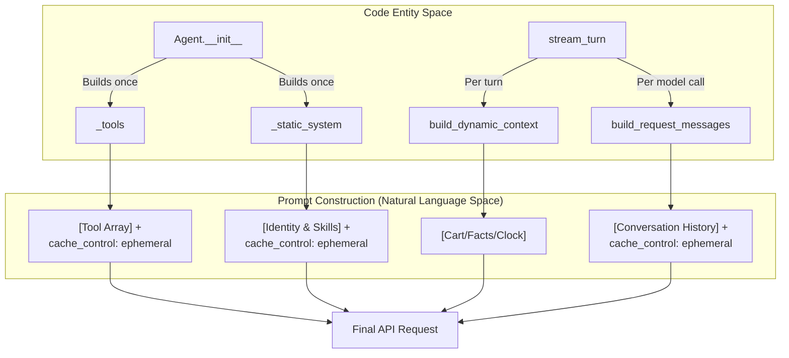
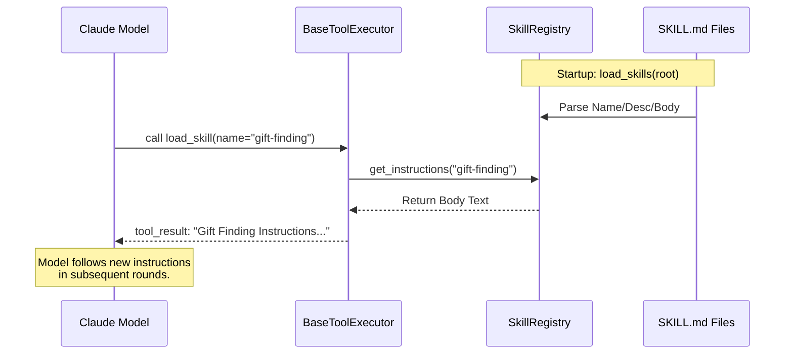

<!-- source: DeepWiki mcp.deepwiki.com · repo anthropics/commerce-agents · page 2.5 Prompt Assembly and Skill System · fetched 2026-10-26 -->

# Prompt Assembly and Skill System

Relevant source files

The following files were used as context for generating this wiki page:

- [commerce-common/README.md](commerce-common/README.md)
- [commerce-common/commerce_common/__init__.py](commerce-common/commerce_common/__init__.py)
- [commerce-common/commerce_common/prompt_assembly.py](commerce-common/commerce_common/prompt_assembly.py)
- [commerce-common/commerce_common/skills.py](commerce-common/commerce_common/skills.py)
- [commerce-common/tests/test_prompt_assembly.py](commerce-common/tests/test_prompt_assembly.py)
- [commerce-common/tests/test_skills.py](commerce-common/tests/test_skills.py)
- [merchant-agent/core/merchant_agent/gates.py](merchant-agent/core/merchant_agent/gates.py)
- [merchant-agent/core/merchant_agent/prompt.py](merchant-agent/core/merchant_agent/prompt.py)
- [plugins/commerce-builder/skills/commerce-prompt-caching/SKILL.md](plugins/commerce-builder/skills/commerce-prompt-caching/SKILL.md)
- [shopping-agent/core/shopping_agent/prompt.py](shopping-agent/core/shopping_agent/prompt.py)

The reference agents use a two-part prompt assembly strategy designed for **byte-stability** and **prompt caching**. The system prompt is split into a static, cached block containing the agent's identity and core rules, and a dynamic context block containing per-request data like carts, memory facts, and the session clock.

## Request Assembly and Caching Strategy

The agents place three specific cache breakpoints to minimize reprocessing costs and latency. These are implemented in `commerce_common/prompt_assembly.py` [commerce-common/commerce_common/prompt_assembly.py:4-16]().

| Breakpoint | Logic | Implementation |
| :--- | :--- | :--- |
| **1. The Last Tool** | Marks the final tool in the array. Since the tool list is fixed at construction, this span hits on every request. | `with_tool_cache_control(tools)` [commerce-common/commerce_common/prompt_assembly.py:52-57]() |
| **2. Static System Text** | Marks the end of the identity and global rules. These bytes remain identical for the life of a deployment. | `build_system_blocks(static, context)` [commerce-common/commerce_common/prompt_assembly.py:33-40]() |
| **3. Newest Message** | A rolling marker on the last persisted message in the conversation. This allows subsequent rounds to read prior turns from cache. | `build_request_messages(messages)` [commerce-common/commerce_common/prompt_assembly.py:60-119]() |

### The Dynamic Context Block
Per-request material is placed in a second system block *after* the static breakpoint. This includes:
*   **The Session Clock**: Rendered to the hour via `context_clock` so that the cache only breaks once per hour rather than every minute [commerce-common/commerce_common/prompt_assembly.py:25-30]().
*   **Memory Facts**: Retrieved facts relevant to the current turn [shopping-agent/core/shopping_agent/prompt.py:30-32]().
*   **Role-Specific Data**: The cart and page context for the Shopping Agent [shopping-agent/core/shopping_agent/prompt.py:22-23](); the business snapshot for the Merchant Agent [merchant-agent/core/merchant_agent/prompt.py:31-32]().

### Request Assembly Flow

**Sources:** [plugins/commerce-builder/skills/commerce-prompt-caching/SKILL.md:11-38](), [commerce-common/commerce_common/prompt_assembly.py:33-40](), [commerce-common/commerce_common/prompt_assembly.py:60-119]()

---

## The Skill System

Skills are discrete instruction sets stored as `SKILL.md` files within directories. The `SkillRegistry` loads these files, extracts their YAML frontmatter, and manages their injection into the prompt [commerce-common/commerce_common/skills.py:4-7]().

### Skill Structure
Each `SKILL.md` must contain:
1.  **Name**: Unique identifier for the skill.
2.  **Description**: A short summary used in the static prompt's index.
3.  **Body**: The actual natural language instructions for the model.

**Sources:** [commerce-common/commerce_common/skills.py:18-40](), [commerce-common/tests/test_skills.py:8-16]()

### The LOAD_SKILL Pattern
The agents use a dynamic injection pattern to keep the primary system prompt concise.
1.  **Index Injection**: The `SkillRegistry.index_block()` renders a list of all available skills into the static system prompt [commerce-common/commerce_common/skills.py:79-82]().
2.  **Dynamic Loading**: The model is provided with a `load_skill` tool. When the model encounters a complex flow (e.g., "gift-finding" or "listing-edits"), it calls `load_skill(name=...)`.
3.  **Tool Outcome**: The `BaseToolExecutor` retrieves the body from the registry and returns it as a tool result, effectively "loading" those instructions into the conversation context for the next round [commerce-common/commerce_common/execution.py:17-18]().

### Skill Loading Data Flow

**Sources:** [commerce-common/commerce_common/skills.py:64-86](), [plugins/commerce-builder/skills/commerce-prompt-caching/SKILL.md:36-38]()

---

## Rolling Conversation Breakpoints

To optimize caching for long conversations, the `build_request_messages` function applies a "rolling" breakpoint strategy.

*   **Mechanism**: It identifies the newest persisted content block in the message history and attaches `cache_control: {"type": "ephemeral"}` to it [commerce-common/commerce_common/prompt_assembly.py:113-119]().
*   **Stability**: The function shallow-copies messages to avoid mutating the host's durable history. It also strips any existing markers from previous turns to ensure only the most recent block is marked [commerce-common/commerce_common/prompt_assembly.py:88-99]().
*   **Exceptions**: 
    *   **First Turn**: A single-message session skips the marker to avoid a cache write that will never be read [commerce-common/commerce_common/prompt_assembly.py:113-114]().
    *   **Forced Tool Choice**: If `tool_choice` is set to anything other than `auto` (e.g., during grounding), the marker is skipped because `tool_choice` keys the message span in the provider's cache [plugins/commerce-builder/skills/commerce-prompt-caching/SKILL.md:44-49]().

**Sources:** [commerce-common/commerce_common/prompt_assembly.py:60-84](), [commerce-common/tests/test_prompt_assembly.py:118-130]()

---

## Prompt-Critical Configuration

Certain configuration fields are considered "prompt bytes." Changing these fields requires a redeploy because they alter the static system block or the tool schemas, breaking the cache hit for all active sessions.

| Config Class | Prompt-Critical Fields |
| :--- | :--- |
| `BaseAgentConfig` | `brand_name`, `assistant_name`, `brand_voice`, `enable_web_search` |
| `ShoppingAgentConfig` | `domain_search_notes`, `enable_cart`, `enable_orders`, `enable_policies` |
| `MerchantAgentConfig` | `enable_analysis`, `require_host_approval`, `stage_shows_preview`, `max_items_per_change` |

**Sources:** [plugins/commerce-builder/skills/commerce-prompt-caching/SKILL.md:60-70](), [merchant-agent/core/merchant_agent/prompt.py:24-49]()

---

