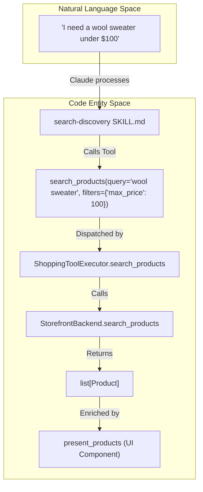
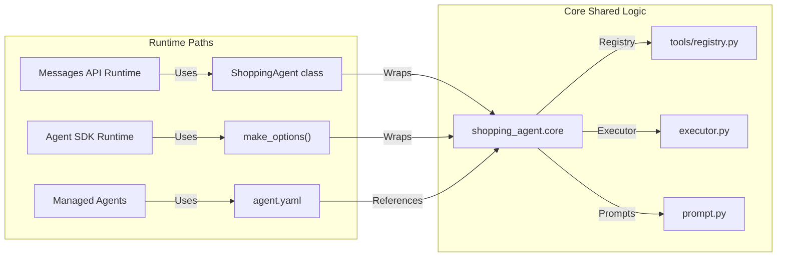

<!-- source: DeepWiki mcp.deepwiki.com · repo anthropics/commerce-agents · page 3 Shopping Agent · fetched 2026-10-26 -->

# Shopping Agent

Relevant source files

The following files were used as context for generating this wiki page:

- [merchant-agent/core/README.md](merchant-agent/core/README.md)
- [merchant-agent/core/merchant_agent/__init__.py](merchant-agent/core/merchant_agent/__init__.py)
- [merchant-agent/core/merchant_agent/tools/registry.py](merchant-agent/core/merchant_agent/tools/registry.py)
- [merchant-agent/managed-agents/merchant-agent/agent.yaml](merchant-agent/managed-agents/merchant-agent/agent.yaml)
- [shopping-agent/core/README.md](shopping-agent/core/README.md)
- [shopping-agent/core/shopping_agent/__init__.py](shopping-agent/core/shopping_agent/__init__.py)
- [shopping-agent/core/shopping_agent/tools/registry.py](shopping-agent/core/shopping_agent/tools/registry.py)
- [shopping-agent/managed-agents/shopping-agent/agent.yaml](shopping-agent/managed-agents/shopping-agent/agent.yaml)
- [shopping-agent/skills/customer-care/SKILL.md](shopping-agent/skills/customer-care/SKILL.md)
- [shopping-agent/skills/planning-goals/SKILL.md](shopping-agent/skills/planning-goals/SKILL.md)
- [shopping-agent/skills/purchase-research/SKILL.md](shopping-agent/skills/purchase-research/SKILL.md)
- [shopping-agent/skills/search-discovery/SKILL.md](shopping-agent/skills/search-discovery/SKILL.md)

The Shopping Agent is a reference implementation of a customer-facing commerce assistant. It is designed to handle the end-to-end consumer journey: from initial category research and product discovery to cart management, fulfillment planning, and post-purchase customer care.

The agent is built on a shared core library that supports three distinct runtime paths, allowing it to be deployed as a standalone Messages API loop, an Agent SDK integration, or a Managed Agent on the Anthropic platform.

## Functional Overview

 The shopping agent's intelligence is organized into five primary flows, each defined by a **Skill** (a `SKILL.md` file containing specialized instructions).

| Flow | Purpose | Key Tools |
|---|---|---|
| **Search & Discovery** | Finding specific items or gifts based on constraints. | `search_products`, `get_product_details` |
| **Purchase Research** | Teaching the customer how to choose in a new category. | `search_policies`, `web_search` |
| **Planning & Goals** | Coordinating multiple items for an event or project. | `present_plan`, `add_to_cart` |
| **Cart & Fulfillment** | Managing the bag and selecting delivery options. | `add_to_cart`, `get_fulfillment_options` |
| **Customer Care** | Post-purchase support, order status, and returns. | `get_orders`, `get_order_status` |

For details on how these flows are implemented via instructions, see [Shopping Agent Tool Registry and Executor](#3.2).

## Core Architecture

The shopping agent follows a strict separation between agentic logic, tool definitions, and backend implementation.

### StorefrontBackend Interface
The `StorefrontBackend` abstract base class defines the contract between the agent and the commerce platform. Any deployment must implement this interface to provide real-time data for products, carts, and orders.
*   **Reads:** `search_products`, `get_product_details`, `get_cart`, `get_orders`.
*   **Writes:** `add_to_cart`, `update_cart_item`, `remove_from_cart`.
*   **Context:** `get_account_context` and `get_preferences` for personalization.

### ShoppingToolExecutor
The `ShoppingToolExecutor` acts as the dispatcher. It receives tool calls from Claude, validates them against session state (e.g., ensuring a `product_id` exists in the current session), and calls the corresponding `StorefrontBackend` methods.

For details on the types and backend interface, see [Shopping Agent Core: Types, Config, and Backend](#3.1).

## Mapping Natural Language to Code

The following diagrams illustrate how user intent is translated into specific code entities within the Shopping Agent.

### Discovery to Cart Pipeline
This diagram shows the transition from a user's natural language request to the execution of backend logic and UI presentation.

Sources: [shopping-agent/core/shopping_agent/executor.py:1-22](), [shopping-agent/skills/search-discovery/SKILL.md:1-20](), [shopping-agent/core/shopping_agent/backend.py:9-13]()

### The Three Runtime Paths
The Shopping Agent can be instantiated in three different ways depending on the hosting environment.

Sources: [shopping-agent/core/README.md:1-24](), [shopping-agent/managed-agents/shopping-agent/agent.yaml:1-30]()

## Key Components

### Tool Registry
The `build_tools` function in `registry.py` generates the JSON tool definitions sent to Claude. It dynamically enables or disables tools based on the `ShoppingAgentConfig` (e.g., `enable_cart`, `enable_orders`).
*   **Source:** [shopping-agent/core/shopping_agent/tools/registry.py:72-102]()

### Session Management
The agent maintains state through `ShoppingSessionContext` (static data like the user profile) and `ShoppingSessionState` (dynamic data like the current `cart_id` or `product_id` provenance).
*   **Source:** [shopping-agent/core/shopping_agent/types.py:11-30]()

### Fencing and Safety
All data returned from the `StorefrontBackend` is wrapped in a `storefront_data` fence to prevent prompt injection from untrusted product descriptions or reviews.
*   **Source:** [shopping-agent/core/shopping_agent/fencing.py:19]()

## Further Reading

*   **[Shopping Agent Core: Types, Config, and Backend](#3.1)**: Detailed documentation on the domain models and the backend implementation requirements.
*   **[Shopping Agent Tool Registry and Executor](#3.2)**: Deep dive into the tool surface, cart provenance gates, and the execution pipeline.
*   **[Shopping Agent Runtimes](#3.3)**: Implementation details for the three runtime paths (Messages API, SDK, and Managed).

Sources:
- [shopping-agent/core/README.md:1-24]()
- [shopping-agent/core/shopping_agent/backend.py:1-13]()
- [shopping-agent/core/shopping_agent/tools/registry.py:1-159]()
- [shopping-agent/managed-agents/shopping-agent/agent.yaml:1-179]()
- [shopping-agent/skills/search-discovery/SKILL.md:1-30]()
- [shopping-agent/skills/purchase-research/SKILL.md:1-38]()
- [shopping-agent/skills/customer-care/SKILL.md:1-35]()
- [shopping-agent/skills/planning-goals/SKILL.md:1-38]()

---

