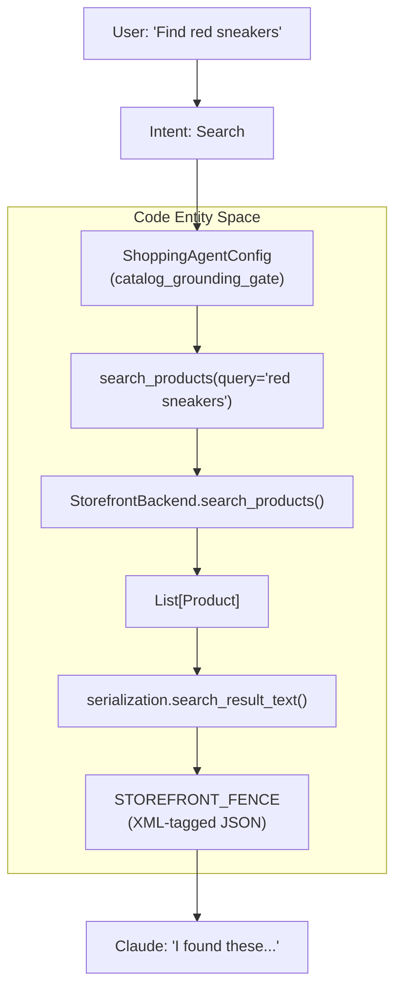
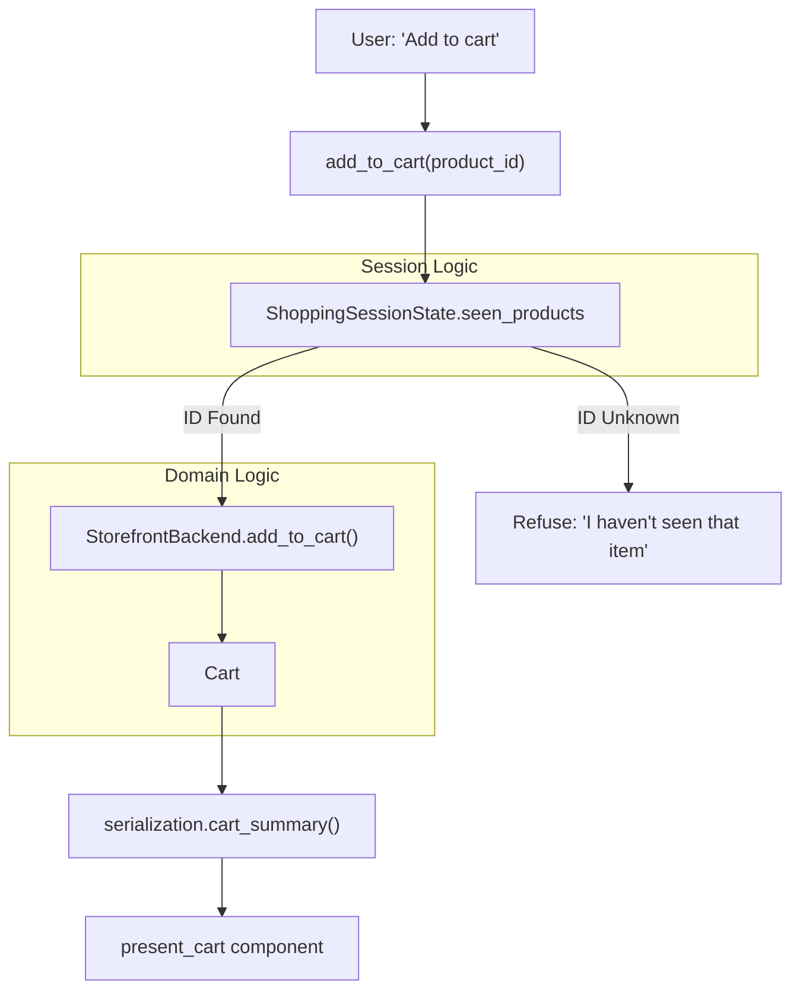

<!-- source: DeepWiki mcp.deepwiki.com · repo anthropics/commerce-agents · page 3.1 Shopping Agent Core: Types, Config, and Backend · fetched 2026-10-26 -->

# Shopping Agent Core: Types, Config, and Backend

Relevant source files

The following files were used as context for generating this wiki page:

- [merchant-agent/core/merchant_agent/config.py](merchant-agent/core/merchant_agent/config.py)
- [merchant-agent/core/merchant_agent/serialization.py](merchant-agent/core/merchant_agent/serialization.py)
- [merchant-agent/core/merchant_agent/types.py](merchant-agent/core/merchant_agent/types.py)
- [merchant-agent/skills/catalog-listings/SKILL.md](merchant-agent/skills/catalog-listings/SKILL.md)
- [plugins/commerce-builder/commands/scaffold-commerce-agent.md](plugins/commerce-builder/commands/scaffold-commerce-agent.md)
- [shopping-agent/core/shopping_agent/backend.py](shopping-agent/core/shopping_agent/backend.py)
- [shopping-agent/core/shopping_agent/config.py](shopping-agent/core/shopping_agent/config.py)
- [shopping-agent/core/shopping_agent/serialization.py](shopping-agent/core/shopping_agent/serialization.py)
- [shopping-agent/core/shopping_agent/types.py](shopping-agent/core/shopping_agent/types.py)
- [tests/test_search_envelope.py](tests/test_search_envelope.py)

This section details the foundational data models, configuration structures, and backend interfaces that power the Shopping Agent. The architecture is designed to map diverse commerce domains (retail, travel, telecom) onto a unified set of types while providing strict controls over which systems (cart, orders, fulfillment) are enabled for a specific deployment.

## Shopping Agent Configuration

The `ShoppingAgentConfig` class extends `BaseAgentConfig` to define the capabilities, system availability, and safety parameters for a shopping assistant deployment [shopping-agent/core/shopping_agent/config.py:15-15]().

### Key Configuration Parameters

| Category | Parameter | Description |
| :--- | :--- | :--- |
| **Identity** | `assistant_name` | The name the agent uses to identify itself [shopping-agent/core/shopping_agent/config.py:16-16](). |
| **Voice** | `brand_voice` | Guidelines for tone (e.g., "warm, concise, and plain about trade-offs") [shopping-agent/core/shopping_agent/config.py:17-17](). |
| **Systems** | `enable_cart` | Toggles all cart-related tools and grounding rules [shopping-agent/core/shopping_agent/config.py:32-32](). |
| | `enable_orders` | Toggles order history and status tracking [shopping-agent/core/shopping_agent/config.py:33-33](). |
| | `enable_fulfillment` | Toggles shipping and pickup option retrieval [shopping-agent/core/shopping_agent/config.py:35-35](). |
| **Safety** | `max_cart_lines` | Maximum number of unique items allowed in a cart [shopping-agent/core/shopping_agent/config.py:39-39](). |
| | `product_id_patterns` | Regex patterns used by the runtime to detect product IDs in user messages for grounding [shopping-agent/core/shopping_agent/config.py:119-122](). |

The config also provides a helper `absent_tools()` which returns a set of tool names that should be excluded from the model's surface based on disabled systems [shopping-agent/core/shopping_agent/config.py:124-135]().

**Sources:** [shopping-agent/core/shopping_agent/config.py:1-135]()

---

## Domain Types and Data Models

The Shopping Agent uses Pydantic models to define the commerce domain. These types are shared across the orchestrator, backend interface, and presentation layer [shopping-agent/core/shopping_agent/types.py:4-5]().

### Catalog and Products
Products exist in three logical shapes:
1.  **Plain**: A standard item bought as-is [shopping-agent/core/shopping_agent/types.py:19-19]().
2.  **Family**: A parent record that carries `options` (e.g., Size, Color). It cannot be added to the cart directly; its price is the lowest in-stock variant's price [shopping-agent/core/shopping_agent/types.py:19-22]().
3.  **Variant**: A specific SKU within a family, carrying `option_values` and a `variant_of` ID. These are the items actually added to the cart [shopping-agent/core/shopping_agent/types.py:23-25]().

### Cart and Orders
*   **`Cart`**: A collection of `CartItem` objects, providing calculated properties for `item_count` and `subtotal` [shopping-agent/core/shopping_agent/types.py:97-107]().
*   **`Order`**: Represents a historical transaction, including `OrderStatus` (e.g., `SHIPPED`, `DELIVERED`), tracking URLs, and the list of `OrderItem`s [shopping-agent/core/shopping_agent/types.py:120-149]().

### Session Context and State
*   **`ShoppingSessionContext`**: Carries request-scoped metadata like `session_id`, `user_id`, and `PageContext` (where the user is in the UI) [shopping-agent/core/shopping_agent/types.py:188-192]().
*   **`ShoppingSessionState`**: A durable object held by the host. It includes `seen_products`, a provenance record used to validate that an agent only mutates cart items the user has actually "seen" (grounded) during the session [shopping-agent/core/shopping_agent/types.py:194-202]().

**Sources:** [shopping-agent/core/shopping_agent/types.py:1-202]()

---

## StorefrontBackend Interface

`StorefrontBackend` is an Abstract Base Class (ABC) that adopters must implement to integrate their specific commerce APIs [shopping-agent/core/shopping_agent/backend.py:44-44]().

### Implementation Requirements
Every method receives a `ShoppingSessionContext`, allowing the backend to resolve user-specific pricing, inventory, and credentials server-side [shopping-agent/core/shopping_agent/backend.py:45-47]().

*   **Catalog**: `search_products` and `get_product_details` [shopping-agent/core/shopping_agent/backend.py:59-83]().
*   **Cart (Writes)**: `add_to_cart`, `update_cart_item`, and `remove_from_cart`. These are the only methods that modify state [shopping-agent/core/shopping_agent/backend.py:93-111]().
*   **Customer**: `get_preferences` and `get_account_context` [shopping-agent/core/shopping_agent/backend.py:116-134]().
*   **Orders/Policies**: `get_orders`, `get_order`, and `search_policies` [shopping-agent/core/shopping_agent/backend.py:139-159]().

### Handoff Pattern
The `checkout_handoff` method is unique: it returns a `CheckoutHandoff` object containing a URL. This URL is injected into the UI by the host and is **never seen by the LLM**, preventing the model from hallucinating or mishandling payment links [shopping-agent/core/shopping_agent/backend.py:120-128]().

**Sources:** [shopping-agent/core/shopping_agent/backend.py:1-170]()

---

## Data Flow: From Backend to Model

Data returned by the `StorefrontBackend` is processed by the `serialization.py` module before being "fenced" for the model.

### Serialization and Fencing
To save tokens and improve model focus, complex objects are simplified:
*   **`variant_row`**: When serializing a product family, variants only include fields that differ from the parent (e.g., if all variants are the same price, the price is only in the parent) [shopping-agent/core/shopping_agent/serialization.py:43-59]().
*   **Fencing**: All backend data is wrapped in `STOREFRONT_FENCE` tags (e.g., `<storefront_json>...` ) to distinguish it from conversation history and prevent prompt injection [shopping-agent/core/shopping_agent/serialization.py:102-103]().

### Search Results Envelope
Search results include a human-readable header outside the fence that provides instructions to the model on how to interpret the results (e.g., "confirm a product is the one intended before reporting") [shopping-agent/core/shopping_agent/serialization.py:81-90]().

**Sources:** [shopping-agent/core/shopping_agent/serialization.py:1-148](), [tests/test_search_envelope.py:43-54]()

---

## Architectural Diagrams

### Natural Language to Code Entity Mapping: Search & Detail
This diagram shows how a user's natural language request flows through the core types and backend interfaces.

**Sources:** [shopping-agent/core/shopping_agent/config.py:118-118](), [shopping-agent/core/shopping_agent/backend.py:60-66](), [shopping-agent/core/shopping_agent/serialization.py:93-103]()

### Cart Mutation and Provenance Flow
This diagram illustrates the safety check (Provenance) that occurs between a user request and a backend write.

**Sources:** [shopping-agent/core/shopping_agent/types.py:194-202](), [shopping-agent/core/shopping_agent/backend.py:93-101](), [shopping-agent/core/shopping_agent/serialization.py:106-107]()

---

