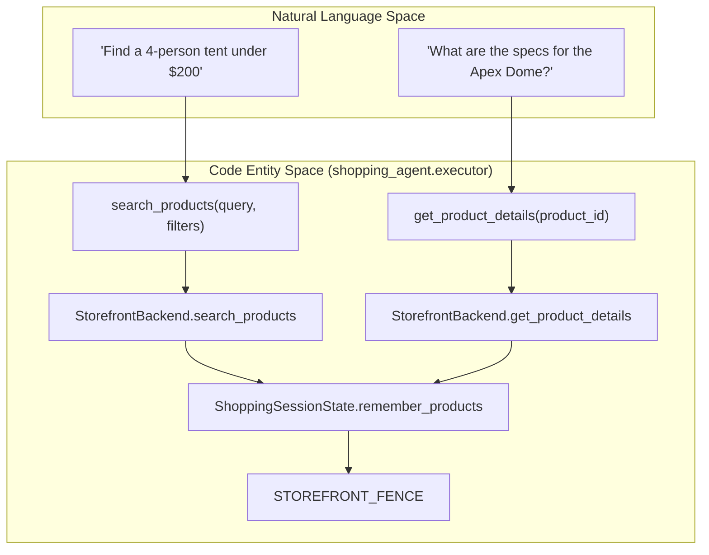
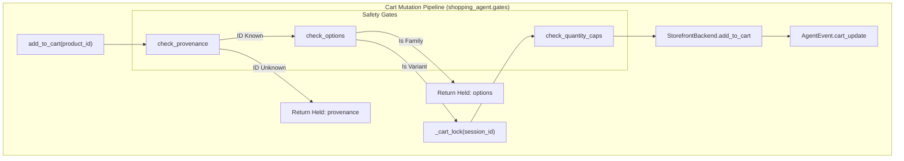

<!-- source: DeepWiki mcp.deepwiki.com · repo anthropics/commerce-agents · page 3.2 Shopping Agent Tool Registry and Executor · fetched 2026-10-26 -->

# Shopping Agent Tool Registry and Executor

Relevant source files

The following files were used as context for generating this wiki page:

- [merchant-agent/core/merchant_agent/changes.py](merchant-agent/core/merchant_agent/changes.py)
- [merchant-agent/core/merchant_agent/executor.py](merchant-agent/core/merchant_agent/executor.py)
- [merchant-agent/core/merchant_agent/tools/__init__.py](merchant-agent/core/merchant_agent/tools/__init__.py)
- [merchant-agent/core/merchant_agent/tools/registry.py](merchant-agent/core/merchant_agent/tools/registry.py)
- [merchant-agent/core/tests/test_gates.py](merchant-agent/core/tests/test_gates.py)
- [merchant-agent/managed-agents/merchant-agent/agent.yaml](merchant-agent/managed-agents/merchant-agent/agent.yaml)
- [merchant-agent/runtime-agent-sdk/merchant_agent_sdk/merchant_tools.py](merchant-agent/runtime-agent-sdk/merchant_agent_sdk/merchant_tools.py)
- [shopping-agent/core/shopping_agent/executor.py](shopping-agent/core/shopping_agent/executor.py)
- [shopping-agent/core/shopping_agent/gates.py](shopping-agent/core/shopping_agent/gates.py)
- [shopping-agent/core/shopping_agent/tools/__init__.py](shopping-agent/core/shopping_agent/tools/__init__.py)
- [shopping-agent/core/shopping_agent/tools/registry.py](shopping-agent/core/shopping_agent/tools/registry.py)
- [shopping-agent/core/tests/test_executor.py](shopping-agent/core/tests/test_executor.py)
- [shopping-agent/core/tests/test_gates.py](shopping-agent/core/tests/test_gates.py)
- [shopping-agent/core/tests/test_presentation.py](shopping-agent/core/tests/test_presentation.py)
- [shopping-agent/core/tests/test_serialization.py](shopping-agent/core/tests/test_serialization.py)
- [shopping-agent/managed-agents/shopping-agent/agent.yaml](shopping-agent/managed-agents/shopping-agent/agent.yaml)
- [shopping-agent/runtime-agent-sdk/shopping_agent_sdk/shopping_tools.py](shopping-agent/runtime-agent-sdk/shopping_agent_sdk/shopping_tools.py)

The Shopping Agent's tool system is built on a structured registry and a centralized execution pipeline. This architecture ensures that tool definitions remain stable for prompt caching while providing a secure, gated environment for executing backend operations and rendering UI components.

## Tool Registry and Construction

The tool surface is defined in `shopping_agent.tools.registry`. The registry is designed to be byte-stable for a given configuration to optimize for Anthropic's prompt caching.

### `build_tools` Function
The `build_tools` function is the entry point for generating the tool definitions sent to the model. It constructs a list of JSON schemas based on the `ShoppingAgentConfig` [shopping-agent/core/shopping_agent/tools/registry.py:72-80]().

*   **Fixed Order:** Tools are added in a deterministic order to maintain cache stability [shopping-agent/core/shopping_agent/tools/registry.py:4-7]().
*   **Conditional Inclusion:** Certain tools (like `get_orders` or `get_fulfillment_options`) are only included if enabled in the `ShoppingAgentConfig` [shopping-agent/core/shopping_agent/tools/registry.py:94-98]().
*   **Skill Loading:** The `load_skill` tool is always included first to allow the agent to pull in specialized instructions for specific flows [shopping-agent/core/shopping_agent/tools/registry.py:83-102]().
*   **Presentation Extensions:** Deployment-specific UI tools are appended to the end of the registry [shopping-agent/core/shopping_agent/tools/registry.py:78-79]().

### Tool Surface Overview

| Tool Name | Purpose | Data Source |
| :--- | :--- | :--- |
| `search_products` | High-level catalog search with filters. | `StorefrontBackend.search_products` |
| `get_product_details` | Full specs, reviews, and variant listings. | `StorefrontBackend.get_product_details` |
| `get_cart` | Retrieves current cart items and subtotal. | `StorefrontBackend.get_cart` |
| `add_to_cart` | Adds a specific `product_id` to the cart. | `StorefrontBackend.add_to_cart` |
| `update_cart_item` | Modifies quantity of an existing item. | `StorefrontBackend.update_cart_item` |
| `remove_from_cart` | Removes an item from the cart. | `StorefrontBackend.remove_from_cart` |
| `get_preferences` | Loads user profile and memory facts. | `StorefrontBackend.get_preferences` |
| `get_orders` | Lists recent order history. | `StorefrontBackend.get_orders` |

Sources: `[shopping-agent/core/shopping_agent/tools/registry.py:103-159]()`, `[shopping-agent/core/shopping_agent/executor.py:116-128]()`

## ShoppingToolExecutor Dispatch Pipeline

The `ShoppingToolExecutor` (extending `BaseToolExecutor`) is the central dispatch point for all tool calls across all runtimes (Messages API, SDK, and MCP) [shopping-agent/core/shopping_agent/executor.py:4-7]().

### Execution Flow
1.  **Handler Mapping:** The `handlers()` method maps tool names to internal async methods [shopping-agent/core/shopping_agent/executor.py:115-129]().
2.  **Sanitization:** Inputs (like search queries) are sanitized and length-capped before being passed to the backend [shopping-agent/core/shopping_agent/executor.py:133-139]().
3.  **Backend Call:** The executor invokes the corresponding method on the `StorefrontBackend` interface [shopping-agent/core/shopping_agent/executor.py:140-140]().
4.  **State Update:** The executor updates `ShoppingSessionState` (e.g., remembering seen products for provenance) [shopping-agent/core/shopping_agent/executor.py:141-141]().
5.  **Fencing:** Results are wrapped in the `STOREFRONT_FENCE` before being returned to the model to prevent prompt injection from catalog content [shopping-agent/core/shopping_agent/executor.py:142-142]().

### Natural Language to Code Entity Mapping (Catalog)

Sources: `[shopping-agent/core/shopping_agent/executor.py:132-152]()`, `[shopping-agent/core/shopping_agent/fencing.py:11-11]()`

## Cart Provenance and Mutation Gates

To prevent "hallucinated" purchases or adding items the user hasn't seen, the agent employs a gated mutation pattern in `shopping_agent.gates`.

### Provenance Gate
The `PROVENANCE_GATE` ensures that an item can only be added to the cart if its `product_id` was returned by a catalog or order tool in the current session [shopping-agent/core/shopping_agent/gates.py:25-26](). 
*   If the ID is missing from `state.seen_products`, the tool execution is "held," and the model is instructed to resolve the ID via `get_product_details` or search first [shopping-agent/core/shopping_agent/gates.py:40-44]().

### Options Gate
The `OPTIONS_GATE` prevents adding a "Family" product (e.g., a shoe with multiple sizes) directly to the cart.
*   If a product `has_options`, the `check_options` gate holds the call and instructs the model to pick a specific variant ID [shopping-agent/core/shopping_agent/gates.py:60-66]().

### Gated Mutation Pipeline

Sources: `[shopping-agent/core/shopping_agent/gates.py:102-130]()`, `[shopping-agent/core/tests/test_executor.py:62-98]()`

### Concurrency and Locking
Cart mutations are serialized per session using an `asyncio.Lock` stored in a `WeakValueDictionary` [shopping-agent/core/shopping_agent/gates.py:88-95](). This prevents race conditions where concurrent tool calls in a single turn (e.g., adding two different items) might interleave and exceed cart limits or quantity caps [shopping-agent/core/tests/test_gates.py:105-132]().

## Presentation and UI Dispatch

When the model calls a presentation tool (e.g., `present_products`), the executor does not return data to the model. Instead, it generates a `ToolOutcome` that signals the host application to render a UI component.

*   **Enrichment Lifecycle:** The executor validates the payload against the registry schema.
*   **Event Emission:** Successful presentation calls emit an `AgentEvent` containing the component name and the data payload [shopping-agent/core/shopping_agent/executor.py:66-67]().
*   **Validation:** The host portal (e.g., `demo_common`) re-validates these payloads and hydrates them with live catalog data (images, current prices) before rendering [shopping-agent/managed-agents/shopping-agent/agent.yaml:94-98]().

Sources: `[shopping-agent/core/shopping_agent/executor.py:60-67]()`, `[shopping-agent/managed-agents/shopping-agent/agent.yaml:99-135]()`

---

