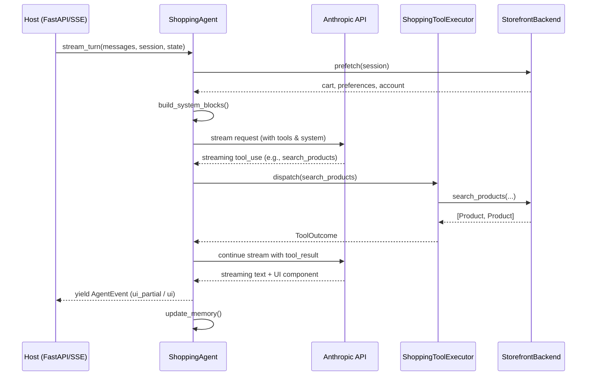
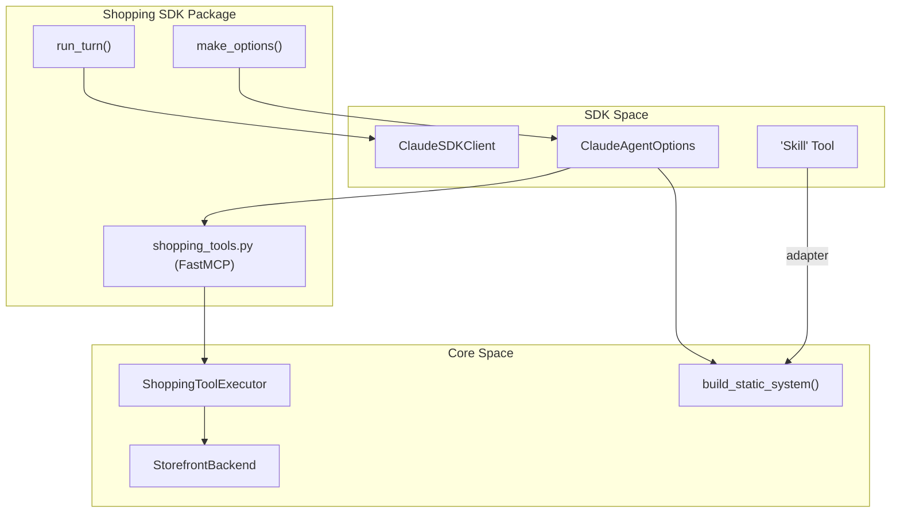
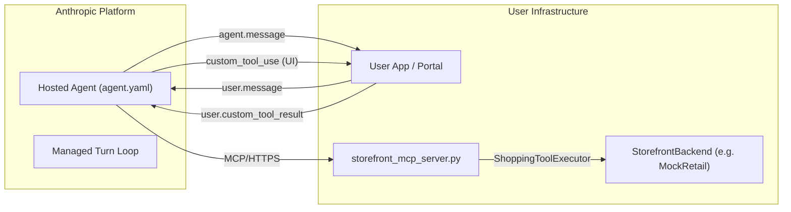

<!-- source: DeepWiki mcp.deepwiki.com · repo anthropics/commerce-agents · page 3.3 Shopping Agent Runtimes · fetched 2026-10-26 -->

# Shopping Agent Runtimes

Relevant source files

The following files were used as context for generating this wiki page:

- [conftest.py](conftest.py)
- [merchant-agent/core/merchant_agent/backend.py](merchant-agent/core/merchant_agent/backend.py)
- [merchant-agent/core/tests/test_prompt.py](merchant-agent/core/tests/test_prompt.py)
- [merchant-agent/managed-agents/README.md](merchant-agent/managed-agents/README.md)
- [merchant-agent/managed-agents/merchant-mcp-server/README.md](merchant-agent/managed-agents/merchant-mcp-server/README.md)
- [merchant-agent/managed-agents/merchant-mcp-server/merchant_mcp_server.py](merchant-agent/managed-agents/merchant-mcp-server/merchant_mcp_server.py)
- [merchant-agent/runtime-agent-sdk/main.py](merchant-agent/runtime-agent-sdk/main.py)
- [merchant-agent/runtime-messages-api/README.md](merchant-agent/runtime-messages-api/README.md)
- [merchant-agent/runtime-messages-api/merchant_agent_runtime/__init__.py](merchant-agent/runtime-messages-api/merchant_agent_runtime/__init__.py)
- [merchant-agent/runtime-messages-api/merchant_agent_runtime/orchestrator.py](merchant-agent/runtime-messages-api/merchant_agent_runtime/orchestrator.py)
- [shopping-agent/core/tests/test_prompt.py](shopping-agent/core/tests/test_prompt.py)
- [shopping-agent/managed-agents/README.md](shopping-agent/managed-agents/README.md)
- [shopping-agent/managed-agents/storefront-mcp-server/README.md](shopping-agent/managed-agents/storefront-mcp-server/README.md)
- [shopping-agent/managed-agents/storefront-mcp-server/storefront_mcp_server.py](shopping-agent/managed-agents/storefront-mcp-server/storefront_mcp_server.py)
- [shopping-agent/runtime-agent-sdk/README.md](shopping-agent/runtime-agent-sdk/README.md)
- [shopping-agent/runtime-agent-sdk/main.py](shopping-agent/runtime-agent-sdk/main.py)
- [shopping-agent/runtime-agent-sdk/shopping_agent_sdk/__init__.py](shopping-agent/runtime-agent-sdk/shopping_agent_sdk/__init__.py)
- [shopping-agent/runtime-agent-sdk/shopping_agent_sdk/agent.py](shopping-agent/runtime-agent-sdk/shopping_agent_sdk/agent.py)
- [shopping-agent/runtime-agent-sdk/tests/test_agent.py](shopping-agent/runtime-agent-sdk/tests/test_agent.py)
- [shopping-agent/runtime-messages-api/README.md](shopping-agent/runtime-messages-api/README.md)
- [shopping-agent/runtime-messages-api/shopping_agent_runtime/__init__.py](shopping-agent/runtime-messages-api/shopping_agent_runtime/__init__.py)
- [shopping-agent/runtime-messages-api/shopping_agent_runtime/orchestrator.py](shopping-agent/runtime-messages-api/shopping_agent_runtime/orchestrator.py)

The Shopping Agent is designed to be portable across different execution environments. It supports three distinct runtime paths: the **Messages API Runtime** (for custom turn loops and streaming), the **Agent SDK Runtime** (for in-process execution with Claude Code-like capabilities), and the **Managed Agents Path** (for hosting on the Anthropic platform).

## Messages API Runtime

The Messages API runtime, implemented in `shopping_agent_runtime`, provides a low-level, high-control turn loop. It is used by the reference demo verticals to provide a rich, streaming experience with eager tool dispatch.

### Orchestration and Turn Loop
The `ShoppingAgent` class [shopping-agent/runtime-messages-api/shopping_agent_runtime/orchestrator.py:75-80]() manages the lifecycle of a single conversation turn via `stream_turn` [shopping-agent/runtime-messages-api/shopping_agent_runtime/orchestrator.py:121-126]().

**Key Characteristics:**
*   **Eager Dispatch:** Tools are executed as soon as their JSON blocks are closed in the stream, rather than waiting for the model to finish its entire response [shopping-agent/runtime-messages-api/shopping_agent_runtime/orchestrator.py:114-119]().
*   **Rolling Cache:** It implements a rolling conversation cache breakpoint to optimize for prompt caching [shopping-agent/runtime-messages-api/shopping_agent_runtime/orchestrator.py:133-134]().
*   **Turn Termination:** The loop can be terminated early by "chips" or suggestion components if `close_on_presentation` is enabled [shopping-agent/runtime-messages-api/shopping_agent_runtime/orchestrator.py:161-166]().

### Data Flow: Messages API Turn
The diagram below illustrates the flow from a user message to a streamed response using the `ShoppingAgent` orchestrator.

**Messages API Runtime Execution Flow**

Sources: [shopping-agent/runtime-messages-api/shopping_agent_runtime/orchestrator.py:121-166](), [shopping-agent/runtime-messages-api/README.md:3-8]()

---

## Agent SDK Runtime

The Agent SDK runtime uses the `claude-agent-sdk` to run the shopping agent. This path is ideal for CLI-based interactions or environments where the SDK's built-in loop and skill-loading mechanisms are preferred.

### Implementation Details
*   **Options Construction:** `make_options` [shopping-agent/runtime-agent-sdk/shopping_agent_sdk/agent.py:56-64]() configures the `ClaudeAgentOptions`, including the system prompt, MCP servers, and allowed tools.
*   **In-Process MCP:** It mounts an in-process MCP server via `build_shopping_server` [shopping-agent/runtime-agent-sdk/shopping_agent_sdk/agent.py:80-80]() that wraps the `ShoppingToolExecutor`.
*   **Skill Adapter:** Because the SDK uses a `Skill` tool instead of the core's `load_skill`, the `SKILL_TOOL_ADAPTER` is appended to the prompt [shopping-agent/runtime-agent-sdk/shopping_agent_sdk/agent.py:52-53]().
*   **Grounding:** Unlike the Messages API path which uses `tool_choice` for grounding, the SDK path uses `ground_message` [shopping-agent/runtime-agent-sdk/shopping_agent_sdk/agent.py:97-99]() to pre-read data and append it to the user's message before calling the model.

### Code Mapping: SDK Entity Space
This diagram maps the SDK-specific concepts to the core shopping agent entities.

**Agent SDK Entity Mapping**

Sources: [shopping-agent/runtime-agent-sdk/shopping_agent_sdk/agent.py:56-94](), [shopping-agent/runtime-agent-sdk/README.md:13-16]()

---

## Managed Agents Path

The Managed Agents path allows the Shopping Agent to be deployed as a hosted entity on the Anthropic platform. In this architecture, the platform manages the turn loop and conversation state, while the developer hosts an MCP server to provide the commerce data.

### Manifest and Manifest Sync
The agent is defined by an `agent.yaml` manifest [shopping-agent/managed-agents/README.md:18-18](). This manifest includes:
*   **System Prompt:** A static version of the prompt derived from `build_static_system` [shopping-agent/managed-agents/README.md:19-19]().
*   **Tool Definitions:** Explicitly enabled tools for the storefront MCP server and custom presentation tools [shopping-agent/managed-agents/README.md:73-74]().
*   **Skills:** The 5 core shopping skills uploaded as part of the deployment [shopping-agent/managed-agents/README.md:36-38]().

### Storefront MCP Server
The `storefront_mcp_server.py` implements a `FastMCP` server [shopping-agent/managed-agents/storefront-mcp-server/storefront_mcp_server.py:20-20](). 

**Key implementation details:**
*   **Connection Executors:** It uses `ConnectionExecutors` to maintain one `ShoppingToolExecutor` per connection, ensuring session provenance is isolated [shopping-agent/managed-agents/storefront-mcp-server/storefront_mcp_server.py:92-102]().
*   **Description Overrides:** It uses `INLINE_CONTEXT_DESCRIPTIONS` [shopping-agent/managed-agents/storefront-mcp-server/storefront_mcp_server.py:46-46]() because the platform does not provide the dynamic per-turn context block; instead, the agent must call `get_preferences` to see the cart and profile.
*   **Safety:** The server enforces `enforce_local_only_bind` [shopping-agent/managed-agents/storefront-mcp-server/storefront_mcp_server.py:81-83]() to ensure it is only accessible through an authenticating gateway or tunnel.

### Managed Agent Architecture
This diagram shows how the platform, the user's app, and the MCP server interact.

**Managed Agents Data Flow**

Sources: [shopping-agent/managed-agents/README.md:9-14](), [shopping-agent/managed-agents/storefront-mcp-server/storefront_mcp_server.py:92-106]()

---

## Runtime Comparison Table

| Feature | Messages API | Agent SDK | Managed Agents |
| :--- | :--- | :--- | :--- |
| **Turn Loop** | `ShoppingAgent.stream_turn` | `ClaudeSDKClient` (Managed) | Anthropic Platform |
| **Tool Execution** | `ShoppingToolExecutor` | In-process MCP Server | External MCP Server |
| **Streaming UI** | Partial Card Streaming | Collected after turn | Custom Tool Call to App |
| **Grounding** | `tool_choice` (Forced) | `ground_message` (Pre-read) | Prompt-based rules only |
| **Context Block** | Dynamic block in system | `get_preferences` tool | `get_preferences` tool |
| **Memory** | `MemoryRuntime` (Local) | `MemoryStore` (In-memory/Local) | `recall_memories` via MCP |

Sources: [shopping-agent/runtime-messages-api/README.md:9-12](), [shopping-agent/runtime-agent-sdk/README.md:64-75](), [shopping-agent/managed-agents/README.md:52-60]()

---

