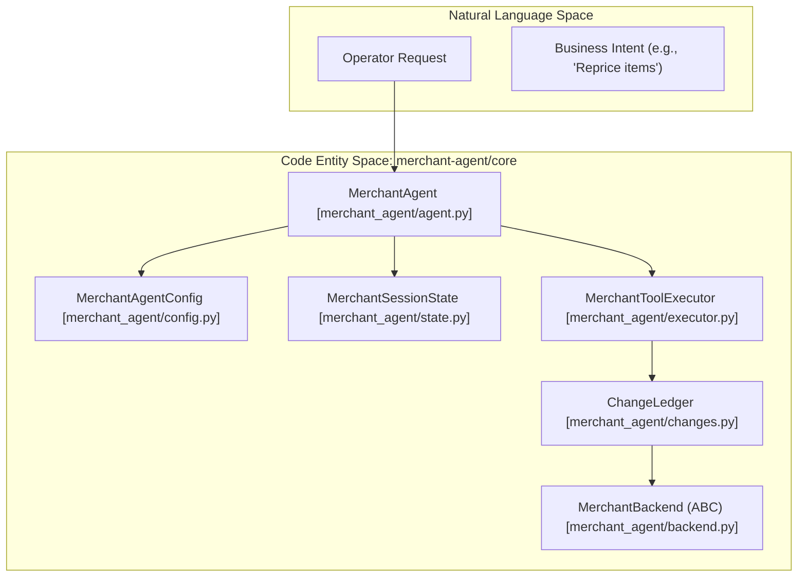
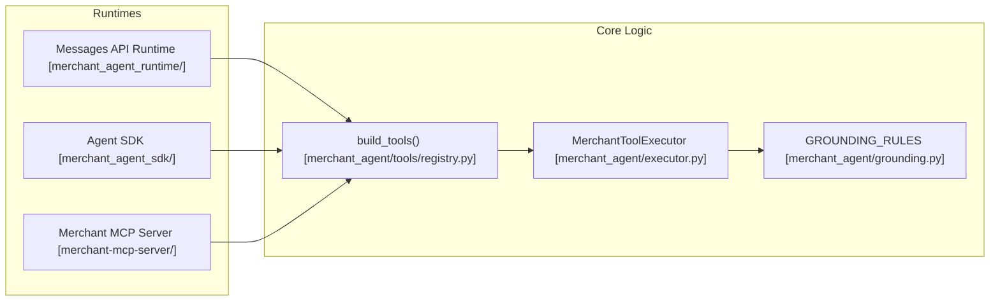

<!-- source: DeepWiki mcp.deepwiki.com · repo anthropics/commerce-agents · page 4 Merchant Agent · fetched 2026-10-26 -->

# Merchant Agent

Relevant source files

The following files were used as context for generating this wiki page:

- [merchant-agent/core/merchant_agent/tools/registry.py](merchant-agent/core/merchant_agent/tools/registry.py)
- [merchant-agent/managed-agents/merchant-agent/agent.yaml](merchant-agent/managed-agents/merchant-agent/agent.yaml)
- [merchant-agent/managed-agents/merchant-agent/system.md](merchant-agent/managed-agents/merchant-agent/system.md)
- [plugins/commerce-builder/skills/commerce-merchant-operations/SKILL.md](plugins/commerce-builder/skills/commerce-merchant-operations/SKILL.md)
- [shopping-agent/core/shopping_agent/tools/registry.py](shopping-agent/core/shopping_agent/tools/registry.py)
- [shopping-agent/managed-agents/shopping-agent/agent.yaml](shopping-agent/managed-agents/shopping-agent/agent.yaml)
- [shopping-agent/managed-agents/shopping-agent/system.md](shopping-agent/managed-agents/shopping-agent/system.md)

The Merchant Agent is a reference implementation designed for back-office operations. It enables store operators to analyze business performance, manage catalog listings, handle inventory, and orchestrate marketing campaigns. Built on a foundation of safety, it utilizes a "staged-change" pattern where no live data is modified without explicit host-app approval and guardrail validation.

### System Architecture

The Merchant Agent follows the core commerce-agent pattern, isolating business logic from runtime execution. It communicates with back-office systems through a defined `MerchantBackend` interface and presents data via structured UI components.

Merchant Agent Entity Mapping

**Sources:** [merchant-agent/core/merchant_agent/backend.py:14-17](), [merchant-agent/core/merchant_agent/config.py:103-107](), [plugins/commerce-builder/skills/commerce-merchant-operations/SKILL.md:12-17]()

---

### Core Components

#### 1. Merchant Agent Core: Types and Backend
The core package defines the domain model for merchant operations. The `MerchantBackend` abstract base class defines the contract for data access (e.g., `get_business_snapshot`, `search_listings`) and mutations. The `MerchantAgentConfig` governs agent behavior, such as whether pricing tools are enabled or if host approval is mandatory for writes.

For details, see [Merchant Agent Core: Types, Config, and Backend](#4.1).
**Sources:** [merchant-agent/core/merchant_agent/backend.py:14-17](), [merchant-agent/core/merchant_agent/config.py:19-20]()

#### 2. Staged Change Workflow
To ensure safety, the agent uses a **Propose → Preview → Approve → Apply** lifecycle.
- **Stage**: Tools like `stage_price_update` record a proposal in the `ChangeLedger`.
- **Preview**: The agent emits a `present_change_preview` component.
- **Approve**: The host application must mark the change as approved (e.g., via a portal UI).
- **Apply**: The `apply_change` tool executes the write to the backend only if approved.

For details, see [Staged Change Workflow and Guardrails](#4.2).
**Sources:** [plugins/commerce-builder/skills/commerce-merchant-operations/SKILL.md:19-29](), [merchant-agent/core/merchant_agent/changes.py:30-33]()

#### 3. Merchant Tool Registry and Executor
The `MerchantToolExecutor` dispatches model calls to backend implementations. The tool surface is divided into five functional skills: Performance Insights, Catalog Listings, Inventory Operations, Pricing & Promotions, and Marketing Campaigns.

For details, see [Merchant Tool Registry and Executor](#4.3).
**Sources:** [merchant-agent/core/merchant_agent/tools/registry.py:88-98](), [plugins/commerce-builder/skills/commerce-merchant-operations/SKILL.md:12-17]()

#### 4. Analysis Delegate
For complex data questions (e.g., "Which products had the highest return rate last month?"), the agent can delegate to an isolated `AnalysisRunner`. This sub-agent can execute SQL queries (via `execute_analysis_query`) or run code in a sandbox to produce high-fidelity metrics cards without risking the main conversation's state.

For details, see [Analysis Delegate](#4.4).
**Sources:** [plugins/commerce-builder/skills/commerce-merchant-operations/SKILL.md:60-70](), [merchant-agent/core/merchant_agent/tools/registry.py:18-18]()

#### 5. Merchant Agent Runtimes
The agent is deployable across three primary paths:
- **Messages API**: A standard streaming implementation for custom integrations.
- **Agent SDK**: A high-level SDK providing built-in console approval flows.
- **Managed Agents**: A manifest-driven deployment (via `agent.yaml`) that integrates with the Anthropic Agents API and MCP servers.

For details, see [Merchant Agent Runtimes](#4.5).
**Sources:** [merchant-agent/managed-agents/merchant-agent/agent.yaml:1-12](), [plugins/commerce-builder/skills/commerce-merchant-operations/SKILL.md:8-10]()

---

### Runtime Execution Paths

The following diagram illustrates how a merchant request flows through the different runtime implementations to reach the core logic.

Runtime Path Bridge

**Sources:** [merchant-agent/core/merchant_agent/tools/registry.py:88-93](), [merchant-agent/managed-agents/merchant-agent/agent.yaml:25-32](), [plugins/commerce-builder/skills/commerce-merchant-operations/SKILL.md:8-10]()

### Functional Skills
The agent's capabilities are organized into five skill directories, each containing a `SKILL.md` that defines specific instructions for that domain:

| Skill | Primary Tools | Purpose |
| :--- | :--- | :--- |
| **Performance Insights** | `get_business_snapshot`, `query_metrics` | Trend analysis and health checks. |
| **Catalog Listings** | `search_listings`, `stage_listing_update` | Content audits and metadata edits. |
| **Inventory Operations** | `get_inventory_alerts`, `stage_inventory_action` | Stock management and restock staging. |
| **Pricing & Promotions** | `get_pricing_context`, `stage_price_update` | Price adjustments and discount rules. |
| **Marketing Campaigns** | `stage_campaign`, `get_campaign_performance` | Ad spend management and drafting. |

**Sources:** [merchant-agent/core/merchant_agent/tools/registry.py:130-155](), [plugins/commerce-builder/skills/commerce-merchant-operations/SKILL.md:12-17]()

---

