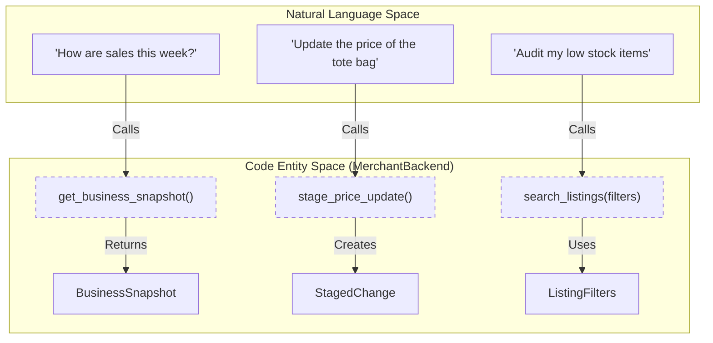
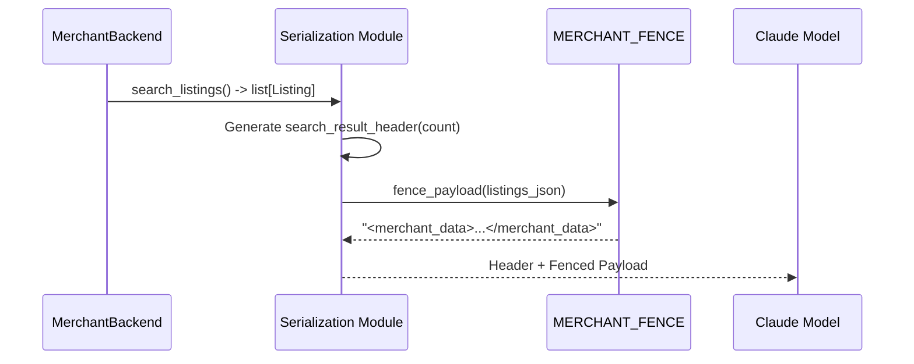

<!-- source: DeepWiki mcp.deepwiki.com · repo anthropics/commerce-agents · page 4.1 Merchant Agent Core: Types, Config, and Backend · fetched 2026-10-26 -->

# Merchant Agent Core: Types, Config, and Backend

Relevant source files

The following files were used as context for generating this wiki page:

- [merchant-agent/core/merchant_agent/config.py](merchant-agent/core/merchant_agent/config.py)
- [merchant-agent/core/merchant_agent/serialization.py](merchant-agent/core/merchant_agent/serialization.py)
- [merchant-agent/core/merchant_agent/types.py](merchant-agent/core/merchant_agent/types.py)
- [merchant-agent/core/tests/test_changes.py](merchant-agent/core/tests/test_changes.py)
- [merchant-agent/skills/catalog-listings/SKILL.md](merchant-agent/skills/catalog-listings/SKILL.md)
- [plugins/commerce-builder/commands/scaffold-commerce-agent.md](plugins/commerce-builder/commands/scaffold-commerce-agent.md)
- [shopping-agent/core/shopping_agent/config.py](shopping-agent/core/shopping_agent/config.py)
- [shopping-agent/core/shopping_agent/serialization.py](shopping-agent/core/shopping_agent/serialization.py)
- [shopping-agent/core/shopping_agent/types.py](shopping-agent/core/shopping_agent/types.py)
- [tests/test_search_envelope.py](tests/test_search_envelope.py)

This page details the foundational structures of the Merchant Agent, covering the configuration schema, the abstract backend interface, and the domain types that model a merchant's view of their business.

## Purpose and Scope

The Merchant Agent core provides the data models and configuration required to serve a merchant operator. Unlike the Shopping Agent, which focuses on discovery and purchase, the Merchant Agent is designed for **Business Intelligence** (metrics and analysis) and **Catalog Management** (staged changes and updates). 

Key architectural patterns include:
*   **Staged Writes**: All mutations to the backend are first staged in a ledger, requiring a preview and potential host approval before being applied [merchant-agent/core/merchant_agent/config.py:68-75]().
*   **Analysis Delegation**: Complex data queries are offloaded to a specialized analysis sub-agent [merchant-agent/core/merchant_agent/config.py:21-35]().
*   **Grounding Gates**: Lexicon-based triggers that force backend reads (e.g., fetching a business snapshot) when specific merchant intents are detected [merchant-agent/core/merchant_agent/config.py:79-86]().

## Configuration: MerchantAgentConfig

`MerchantAgentConfig` extends `BaseAgentConfig` to include settings for the analysis delegate, write capabilities, and guardrail thresholds.

### Key Configuration Sections

| Section | Fields | Description |
|:---|:---|:---|
| **Analysis** | `enable_analysis`, `analysis_model`, `analysis_sql_only` | Controls the analysis delegate's behavior and model selection [merchant-agent/core/merchant_agent/config.py:21-27](). |
| **Capabilities** | `enable_listing_edits`, `enable_pricing`, `enable_inventory` | Switches that remove specific tools and skills from the agent's surface if a business lacks those systems [merchant-agent/core/merchant_agent/config.py:37-46](). |
| **Guardrails** | `max_price_delta_pct`, `max_items_per_change`, `protected_fields` | Limits checked during staging and application of changes [merchant-agent/core/merchant_agent/config.py:48-66](). |
| **Approval** | `require_host_approval`, `approval_surface` | Defines if the host must explicitly signal approval via `MerchantSessionState` before `apply_change` succeeds [merchant-agent/core/merchant_agent/config.py:68-77](). |

Sources: [merchant-agent/core/merchant_agent/config.py:15-188]()

## Merchant Domain Types

The merchant domain models listings, metrics, and the change management lifecycle. These types are used by the `MerchantBackend` to communicate with the agent orchestrator.

### Listings and Metrics
The merchant's view of the catalog is represented by `Listing` and `ListingDetails`. Metrics are provided via `BusinessSnapshot` (headline numbers) and `MetricSeries` (time-series data).

*   **Listing**: A catalog item including status, price, stock, and attributes. It supports a family/variant structure similar to the storefront `Product` [merchant-agent/core/merchant_agent/types.py:25-53]().
*   **BusinessSnapshot**: A summary of sales, orders, traffic, and conversion for a specific period, including comparison deltas [merchant-agent/core/merchant_agent/types.py:87-105]().
*   **MetricSeries**: A collection of `MetricPoint` objects representing one metric over time, optionally segmented by category or listing [merchant-agent/core/merchant_agent/types.py:113-124]().

### Staged Changes
Mutations are modeled as `ChangeItem` objects grouped within a `StagedChange`.

*   **ChangeItem**: A single field update (e.g., updating a price from 100 to 110) [merchant-agent/core/tests/test_changes.py:18-22]().
*   **ChangeKind**: An enum defining the intent of the change, such as `PRICE_UPDATE`, `PROMOTION`, or `LISTING_UPDATE` [merchant-agent/core/tests/test_changes.py:41-45]().

Sources: [merchant-agent/core/merchant_agent/types.py:25-171](), [merchant-agent/core/tests/test_changes.py:6-15]()

## MerchantBackend Interface

The `MerchantBackend` is an Abstract Base Class (ABC) that developers must implement to connect the agent to their specific business systems.

### Natural Language to Code Entity Space: Backend Mapping

This diagram maps merchant operational intents to the specific `MerchantBackend` methods and domain types.

Sources: [merchant-agent/core/merchant_agent/types.py:67-105](), [plugins/commerce-builder/commands/scaffold-commerce-agent.md:56-60]()

## Session Context and State

The merchant agent maintains state across turns to handle multi-step change workflows and analysis.

*   **MerchantSessionContext**: Carries per-request metadata, including the `session_id` and `ClockContext` [merchant-agent/core/merchant_agent/types.py:188-192]().
*   **MerchantSessionState**: Durable state held by the host. It tracks `seen_listings` for provenance and `approved_change_ids` to satisfy the host approval gate [merchant-agent/core/merchant_agent/config.py:68-70]().

## Serialization and Fencing

Merchant data is wrapped in the `MERCHANT_FENCE` to prevent prompt injection and ensure the model treats backend data as grounded truth [merchant-agent/core/merchant_agent/serialization.py:16-17]().

### Search Result Structure
When `search_listings` is called, the response is structured with a clear boundary between the runtime-generated header and the fenced data payload.

| Component | Implementation | Purpose |
|:---|:---|:---|
| **Header** | `search_result_header(count)` | A plain-text line outside the fence stating the result count [merchant-agent/core/merchant_agent/serialization.py:65-71](). |
| **Payload** | `MERCHANT_FENCE.fence_payload(data)` | The JSON-serialized listings wrapped in XML-like tags [merchant-agent/core/merchant_agent/serialization.py:84](). |

### Data Flow: Listing Search to Model Input

Sources: [merchant-agent/core/merchant_agent/serialization.py:74-84](), [tests/test_search_envelope.py:43-54]()

## Guardrail Implementation

Guardrails are enforced by the `check_guardrails` function, which validates proposed changes against the thresholds defined in `MerchantAgentConfig`.

### Validated Rules
1.  **Price Delta**: Ensures price changes do not exceed `max_price_delta_pct` [merchant-agent/core/tests/test_changes.py:51-57]().
2.  **Bulk Cap**: Limits the number of items in a single `StagedChange` to `max_items_per_change` [merchant-agent/core/tests/test_changes.py:44-49]().
3.  **Protected Fields**: Prevents the agent from staging updates to sensitive fields like `tax_category` or `listing_id` [merchant-agent/core/tests/test_changes.py:132-141]().
4.  **Grounded Price**: Refuses price moves if the "before" price is missing or zero, ensuring the model has grounded context for the change [merchant-agent/core/tests/test_changes.py:113-119]().

Sources: [merchant-agent/core/merchant_agent/config.py:48-66](), [merchant-agent/core/tests/test_changes.py:40-154]()

---

