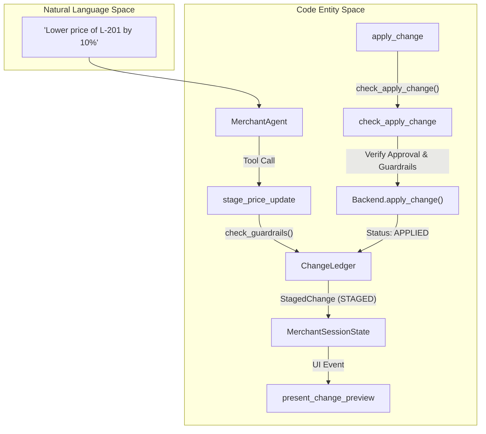
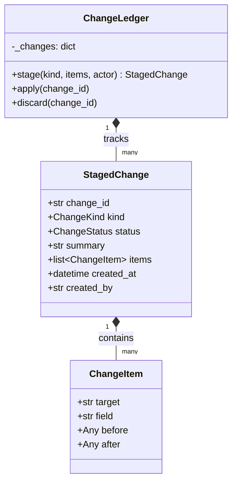

<!-- source: DeepWiki mcp.deepwiki.com · repo anthropics/commerce-agents · page 4.2 Staged Change Workflow and Guardrails · fetched 2026-10-26 -->

# Staged Change Workflow and Guardrails

Relevant source files

The following files were used as context for generating this wiki page:

- [commerce-common/commerce_common/execution.py](commerce-common/commerce_common/execution.py)
- [commerce-common/tests/test_agent_sdk.py](commerce-common/tests/test_agent_sdk.py)
- [commerce-common/tests/test_execution.py](commerce-common/tests/test_execution.py)
- [merchant-agent/core/merchant_agent/changes.py](merchant-agent/core/merchant_agent/changes.py)
- [merchant-agent/core/tests/test_changes.py](merchant-agent/core/tests/test_changes.py)
- [merchant-agent/core/tests/test_executor.py](merchant-agent/core/tests/test_executor.py)
- [merchant-agent/core/tests/test_gates.py](merchant-agent/core/tests/test_gates.py)
- [shopping-agent/core/shopping_agent/gates.py](shopping-agent/core/shopping_agent/gates.py)
- [shopping-agent/core/tests/test_gates.py](shopping-agent/core/tests/test_gates.py)

The Merchant Agent employs a **Staged Change** pattern for all destructive or significant business mutations (pricing, inventory, listing content, and campaign budgets). Instead of applying changes immediately, the agent proposes them to a ledger, previews them to the user via specialized UI components, and optionally waits for a host-verified approval before execution.

## The Propose→Preview→Approve→Apply Lifecycle

The workflow is designed to ensure that the agent never performs "silent" writes to the business backend. Every mutation follows a strict state machine managed by the `ChangeLedger` and enforced by `MerchantToolExecutor`.

### 1. Propose (Stage)
The agent calls one of the staging tools (e.g., `stage_price_update`, `stage_inventory_action`). The executor validates the request against **Guardrails** (see below). If valid, a `StagedChange` object is created with a `STAGED` status `[merchant-agent/core/merchant_agent/changes.py:155-161]()`.

### 2. Preview
Upon successful staging, the executor automatically emits a `present_change_preview` event. This triggers a UI block in the host application, showing the `before` and `after` values to the operator `[commerce-common/commerce_common/execution.py:170-173]()`.

### 3. Approve (Optional Gate)
If `require_host_approval` is enabled in `MerchantAgentConfig`, the `apply_change` tool will be blocked by an `approval` gate until the host explicitly marks the change ID as approved in the `MerchantSessionState` `[merchant-agent/core/merchant_agent/gates.py:110-118]()`.

### 4. Apply
The agent calls `apply_change`. The system re-checks guardrails (to ensure the business environment hasn't changed since staging) and verifies the approval gate before calling the backend to commit the change `[merchant-agent/core/merchant_agent/gates.py:99-108]()`.

### Workflow Data Flow
Title: Staged Change State Transitions

**Sources:** `[merchant-agent/core/merchant_agent/changes.py:126-161]()`, `[merchant-agent/core/merchant_agent/gates.py:92-119]()`, `[merchant-agent/core/merchant_agent/types.py:15-16]()`

---

## Guardrails and Validation

Guardrails are hard constraints defined in `MerchantAgentConfig` that prevent the agent from proposing or applying risky changes.

### Key Guardrail Mechanisms
The `check_guardrails` function `[merchant-agent/core/merchant_agent/changes.py:31-108]()` evaluates the following:

| Guardrail | Logic | Config Field |
| :--- | :--- | :--- |
| **Price Delta** | Limits the percentage change (up or down) from the current grounded price. | `max_price_delta_pct` |
| **Promotion Limit** | Separate, often deeper cap for items explicitly marked as promotions. | `max_promotion_discount_pct` |
| **Restock Limit** | Caps the number of units added to inventory in a single change. | `max_restock_quantity` |
| **Protected Fields** | Prevents edits to sensitive fields like `tax_category`. | `protected_fields` |
| **Bulk Cap** | Limits the number of items (targets) in a single staged change. | `max_items_per_change` |
| **Grounded Price** | Refuses price moves if the `before` price wasn't recently read/fenced. | N/A (Hardcoded) |

### Implementation Detail: Price Bearing Fields
The system allows configuring which fields are treated as "prices" for delta checking. By default, this is `price`, but it can be extended to fields like `nightly_rate` for travel verticals `[merchant-agent/core/tests/test_changes.py:74-86]()`.

**Sources:** `[merchant-agent/core/merchant_agent/changes.py:31-108]()`, `[merchant-agent/core/tests/test_changes.py:40-154]()`

---

## Safety Gates

Beyond guardrails, the system uses **Gates** to enforce session-level safety and provenance.

### check_apply_change
Located in `merchant_agent.gates`, this function is the final authority before a write occurs. It performs three checks:
1.  **Provenance:** Ensures the `change_id` was actually generated in the current session `[merchant-agent/core/merchant_agent/gates.py:92-97]()`.
2.  **Guardrail Re-check:** Re-runs `check_guardrails` in case the configuration or base prices changed since the agent staged the item `[merchant-agent/core/merchant_agent/gates.py:99-108]()`.
3.  **Host Approval:** If `require_host_approval` is true, it checks `state.approved_change_ids` for the specific ID `[merchant-agent/core/merchant_agent/gates.py:110-119]()`.

### STAGING_FOLLOWTHROUGH_REMINDER
When the agent stages a change, the executor appends a system note to the tool output. This reminder (defined in `merchant_agent.gates`) prompts the agent to wait for the user to review the preview before attempting to apply the change, preventing the agent from "rushing" the application without human oversight `[merchant-agent/core/merchant_agent/executor.py:11-18]()`.

**Sources:** `[merchant-agent/core/merchant_agent/gates.py:16-23]()`, `[merchant-agent/core/merchant_agent/gates.py:92-119]()`, `[merchant-agent/core/tests/test_executor.py:11-18]()`

---

## Data Model: ChangeLedger

The `ChangeLedger` acts as the source of truth for the lifecycle of a change. While the reference implementation uses an in-memory ledger, it defines the interface for production backend integration.

Title: ChangeLedger Data Flow

### Attribution
The ledger tracks whether a change was staged by the `AGENT` or an `OPERATOR` (human). This attribution is critical for the `apply` gate to determine if additional host verification is required `[merchant-agent/core/merchant_agent/changes.py:143-144]()`.

**Sources:** `[merchant-agent/core/merchant_agent/changes.py:126-161]()`, `[merchant-agent/core/merchant_agent/types.py:15-16]()`, `[merchant-agent/core/tests/test_gates.py:133-140]()`

---

