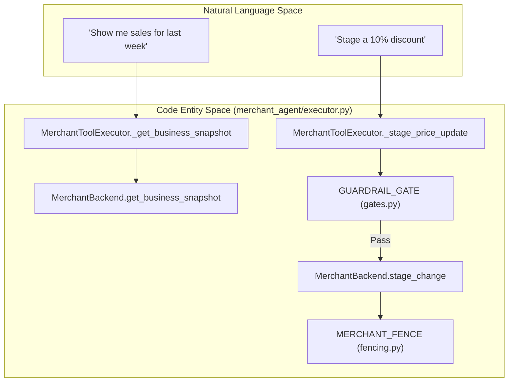
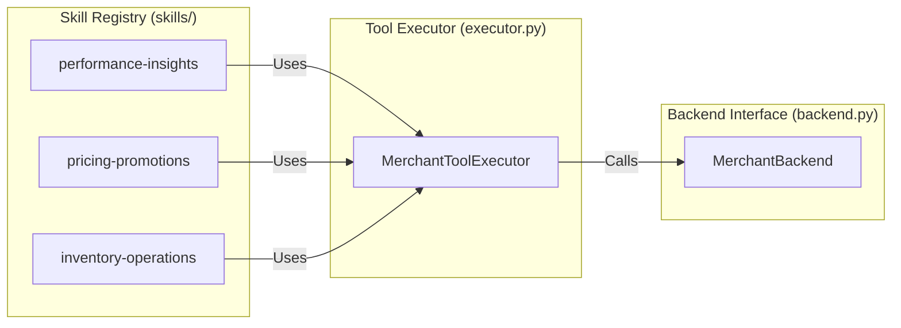

<!-- source: DeepWiki mcp.deepwiki.com · repo anthropics/commerce-agents · page 4.3 Merchant Tool Registry and Executor · fetched 2026-10-26 -->

# Merchant Tool Registry and Executor

Relevant source files

The following files were used as context for generating this wiki page:

- [merchant-agent/core/merchant_agent/executor.py](merchant-agent/core/merchant_agent/executor.py)
- [merchant-agent/core/merchant_agent/tools/registry.py](merchant-agent/core/merchant_agent/tools/registry.py)
- [merchant-agent/managed-agents/merchant-agent/agent.yaml](merchant-agent/managed-agents/merchant-agent/agent.yaml)
- [merchant-agent/runtime-agent-sdk/merchant_agent_sdk/merchant_tools.py](merchant-agent/runtime-agent-sdk/merchant_agent_sdk/merchant_tools.py)
- [merchant-agent/skills/inventory-operations/SKILL.md](merchant-agent/skills/inventory-operations/SKILL.md)
- [merchant-agent/skills/marketing-campaigns/SKILL.md](merchant-agent/skills/marketing-campaigns/SKILL.md)
- [merchant-agent/skills/performance-insights/SKILL.md](merchant-agent/skills/performance-insights/SKILL.md)
- [merchant-agent/skills/pricing-promotions/SKILL.md](merchant-agent/skills/pricing-promotions/SKILL.md)
- [shopping-agent/core/shopping_agent/executor.py](shopping-agent/core/shopping_agent/executor.py)
- [shopping-agent/core/shopping_agent/tools/registry.py](shopping-agent/core/shopping_agent/tools/registry.py)
- [shopping-agent/managed-agents/shopping-agent/agent.yaml](shopping-agent/managed-agents/shopping-agent/agent.yaml)
- [shopping-agent/runtime-agent-sdk/shopping_agent_sdk/shopping_tools.py](shopping-agent/runtime-agent-sdk/shopping_agent_sdk/shopping_tools.py)

The Merchant Agent's tool surface is a fixed contract of performance reads, catalog operations, and a staged-change workflow. The registry ensures that the tool definitions remain byte-stable for prompt caching, while the executor manages the dispatch logic, safety gates, and domain-specific error handling.

## Overview of Tool Registry

The merchant tool list is built via `build_tools` in [merchant-agent/core/merchant_agent/tools/registry.py:88-93](). The registry is designed to be deterministic; the list of tools depends only on the deployment configuration (`MerchantAgentConfig`), ensuring consistent behavior across different runtimes (Messages API, Agent SDK, and MCP) [merchant-agent/core/merchant_agent/tools/registry.py:4-7]().

### Tool Surface Categories

| Category | Key Tools | Purpose |
| :--- | :--- | :--- |
| **Performance Reads** | `get_business_snapshot`, `query_metrics`, `get_campaign_performance` | Headline figures, trend analysis, and marketing ROI [merchant-agent/core/merchant_agent/tools/registry.py:129-178](). |
| **Catalog & Operations** | `search_listings`, `get_listing`, `get_inventory_alerts`, `get_order_issues` | Inventory monitoring, auditing listing quality, and triaging order exceptions [merchant-agent/core/merchant_agent/executor.py:150-153](). |
| **Staged Changes** | `stage_price_update`, `stage_listing_update`, `stage_promotion`, `stage_campaign` | Proposing writes that require operator approval [merchant-agent/core/merchant_agent/executor.py:156-160](). |
| **Execution** | `apply_change`, `discard_change`, `run_analysis` | Committing staged changes to the backend or delegating complex data tasks [merchant-agent/core/merchant_agent/executor.py:161-163](). |

Sources: [merchant-agent/core/merchant_agent/tools/registry.py:1-178](), [merchant-agent/core/merchant_agent/executor.py:145-163]()

## Merchant Tool Executor Dispatch

The `MerchantToolExecutor` (inheriting from `BaseToolExecutor`) is the central dispatch point for all merchant operations. It maps tool names to internal handler methods and wraps backend calls in safety "fences" [merchant-agent/core/merchant_agent/executor.py:91-145]().

### The Dispatch Pipeline

1.  **Sanitization**: Inputs are sanitized and capped (e.g., notes are limited to `NOTE_MAX_CHARS`) [merchant-agent/core/merchant_agent/executor.py:68-70]().
2.  **Handler Mapping**: The `handlers()` method returns a dictionary mapping tool names to `_` prefixed methods (e.g., `stage_price_update` -> `self._stage_price_update`) [merchant-agent/core/merchant_agent/executor.py:145-163]().
3.  **Domain Error Handling**: `domain_error()` catches specific exceptions like `GuardrailViolation` (returning a `ToolOutcome.held`) or `ChangeNotApplicable` [merchant-agent/core/merchant_agent/executor.py:137-143]().
4.  **Fencing**: Successful results are wrapped in the `MERCHANT_FENCE` to prevent prompt injection from backend data [merchant-agent/core/merchant_agent/executor.py:92]().

### Natural Language to Code Entity Mapping: Executor Dispatch

Sources: [merchant-agent/core/merchant_agent/executor.py:145-171](), [merchant-agent/core/merchant_agent/gates.py:29-35]()

## Merchant Skills

The Merchant Agent uses five distinct skills, each defined in a `SKILL.md` file. These skills provide the "operating manual" for the agent, specifying which tools to use and how to interpret data [merchant-agent/managed-agents/merchant-agent/agent.yaml:18-23]().

| Skill Name | Role & Responsibility | Primary Tools |
| :--- | :--- | :--- |
| **Performance Insights** | Explaining business trends and progress against goals [merchant-agent/skills/performance-insights/SKILL.md:2-3](). | `get_business_snapshot`, `query_metrics` |
| **Catalog Listings** | Managing product data, descriptions, and auditing quality. | `search_listings`, `get_listing`, `stage_listing_update` |
| **Inventory Operations** | Monitoring stock levels and triaging order issues [merchant-agent/skills/inventory-operations/SKILL.md:2-3](). | `get_inventory_alerts`, `get_order_issues`, `stage_inventory_action` |
| **Pricing & Promotions** | Recommending and staging price moves within guardrails [merchant-agent/skills/pricing-promotions/SKILL.md:2-3](). | `get_pricing_context`, `stage_price_update`, `stage_promotion` |
| **Marketing Campaigns** | Drafting and reviewing marketing spend and attribution [merchant-agent/skills/marketing-campaigns/SKILL.md:2-3](). | `get_campaign_performance`, `stage_campaign` |

### Skill Integration Diagram

Sources: [merchant-agent/managed-agents/merchant-agent/agent.yaml:18-23](), [merchant-agent/core/merchant_agent/executor.py:145-163]()

## Staged Change Pipeline

A core architectural pattern for the merchant agent is the **Staged Change Workflow**. Writes never happen directly; they are proposed, previewed, and then applied only after host/operator approval [merchant-agent/managed-agents/merchant-agent/agent.yaml:45-47]().

1.  **Stage**: Agent calls a `stage_*` tool. The executor checks `GUARDRAIL_GATE` [merchant-agent/core/merchant_agent/executor.py:138-139]().
2.  **Preview**: If `stage_shows_preview` is enabled in config, the executor immediately emits a `present_change_preview` call [merchant-agent/core/merchant_agent/executor.py:7-8]().
3.  **Approval**: The runtime (e.g., SDK or MCP) pauses for the operator to approve the change. In the SDK, this is managed via `host_approve` [merchant-agent/runtime-agent-sdk/merchant_agent_sdk/merchant_tools.py:99-102]().
4.  **Apply**: Once approved, the agent calls `apply_change`, which triggers `check_apply_change` to verify the approval mark exists before calling the backend [merchant-agent/core/merchant_agent/executor.py:29-35]().

Sources: [merchant-agent/core/merchant_agent/executor.py:7-8, 29-35](), [merchant-agent/runtime-agent-sdk/merchant_agent_sdk/merchant_tools.py:8-10, 99-102](), [merchant-agent/managed-agents/merchant-agent/agent.yaml:107-110]()

---

