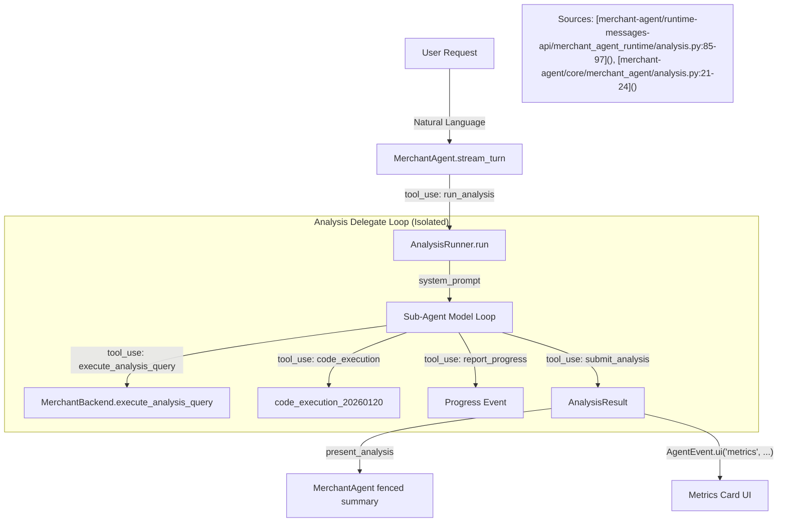

<!-- source: DeepWiki mcp.deepwiki.com · repo anthropics/commerce-agents · page 4.4 Analysis Delegate · fetched 2026-10-26 -->

# Analysis Delegate

<details>
<summary>Relevant source files</summary>

The following files were used as context for generating this wiki page:

- [commerce-common/commerce_common/delegation.py](commerce-common/commerce_common/delegation.py)
- [commerce-common/tests/test_delegation.py](commerce-common/tests/test_delegation.py)
- [merchant-agent/core/merchant_agent/analysis.py](merchant-agent/core/merchant_agent/analysis.py)
- [merchant-agent/core/tests/test_analysis.py](merchant-agent/core/tests/test_analysis.py)
- [merchant-agent/runtime-messages-api/merchant_agent_runtime/analysis.py](merchant-agent/runtime-messages-api/merchant_agent_runtime/analysis.py)
- [merchant-agent/runtime-messages-api/tests/test_analysis.py](merchant-agent/runtime-messages-api/tests/test_analysis.py)
- [merchant-agent/runtime-messages-api/tests/test_orchestrator_progress.py](merchant-agent/runtime-messages-api/tests/test_orchestrator_progress.py)

</details>


The **Analysis Delegate** is an isolated sub-agent within the Merchant Agent architecture designed to handle complex, data-intensive computational tasks [merchant-agent/runtime-messages-api/merchant_agent_runtime/analysis.py:4-11](). It operates in a separate model loop, preventing bulk data or complex intermediate reasoning from cluttering the main conversation history [merchant-agent/runtime-messages-api/merchant_agent_runtime/analysis.py:4-11]().

## Overview and Purpose

The delegate is invoked via the `run_analysis` tool when the Merchant Agent determines a query requires deep data inspection, such as segmenting sales drivers or comparing metric movements [merchant-agent/core/merchant_agent/analysis.py:49-54](). 

Key characteristics include:
*   **Isolation**: The sub-agent receives a task brief but never sees the primary conversation history [merchant-agent/runtime-messages-api/merchant_agent_runtime/analysis.py:6-8]().
*   **Read-Only Surface**: The delegate is restricted to read-only tools and cannot propose or apply changes to the store [merchant-agent/runtime-messages-api/merchant_agent_runtime/analysis.py:8-10]().
*   **Structured Exit**: The loop only ends when the sub-agent calls `submit_analysis` with a validated `AnalysisResult` [merchant-agent/core/merchant_agent/analysis.py:101-105]().

### Data Flow: Natural Language to Analysis Logic

The following diagram illustrates how a user's natural language request is transformed into an isolated analysis task handled by code entities.

**Diagram: Analysis Delegation Lifecycle**


## Core Components

### AnalysisRunner
The `AnalysisRunner` class manages the lifecycle of the sub-agent loop [merchant-agent/runtime-messages-api/merchant_agent_runtime/analysis.py:104-105](). It constructs a specialized tool surface for the sub-agent, which includes:
*   **Read Tools**: `get_business_snapshot`, `query_metrics`, `get_campaign_performance`, and `search_listings` [merchant-agent/core/merchant_agent/analysis.py:32-37]().
*   **Progress Reporting**: `report_progress` allows the delegate to send status updates (e.g., "querying metrics") back to the host without exiting the loop [merchant-agent/core/merchant_agent/analysis.py:24]().
*   **SQL Interface**: If supported by the backend, `execute_analysis_query` is provided [merchant-agent/runtime-messages-api/merchant_agent_runtime/analysis.py:132-133]().

### Security and SQL Gating
To ensure safety, the delegate's SQL capabilities are strictly limited. The `check_analysis_sql` function enforces a SELECT-only allowlist [merchant-agent/core/merchant_agent/analysis.py:19]().
*   **Permitted**: Single `SELECT` statements, including CTEs (`WITH` clauses) and joins [merchant-agent/core/tests/test_analysis.py:40-50]().
*   **Rejected**: Multi-statement queries, comments, and any DDL/DML operations like `UPDATE`, `DELETE`, `INSERT`, or `DROP` [merchant-agent/core/tests/test_analysis.py:53-76]().

### Code Execution Sandbox
When `config.analysis_use_code_execution` is enabled, the delegate uses the `code_execution_20260120` tool [merchant-agent/core/merchant_agent/analysis.py:41](). This sandbox allows the model to write Python code to process data. Crucially, the sandbox is the only entity allowed to call the read tools in this mode, keeping bulk data out of the model's text context to save tokens and improve reliability [merchant-agent/runtime-messages-api/merchant_agent_runtime/analysis.py:134-138]().

## Data Schemas and Capping

### AnalysisResult Schema
The `AnalysisResult` is the mandatory output format for the `submit_analysis` tool [merchant-agent/core/merchant_agent/analysis.py:92-93](). It includes:
*   **findings**: A list of up to 8 strings summarizing insights [merchant-agent/core/merchant_agent/analysis.py:112-116]().
*   **figures**: Up to 8 structured data points (label, value, unit, change_pct) [merchant-agent/core/merchant_agent/analysis.py:117-132]().
*   **derived_series**: Up to 4 metric series for charting, each capped at 40 data points to minimize generation costs [merchant-agent/core/merchant_agent/analysis.py:133-151]().

### Data Capping Mechanisms
The system aggressively caps data to prevent context overflow and excessive latency:
*   **Table Capping**: `cap_analysis_table` truncates SQL results based on `max_analysis_rows` and `max_analysis_table_chars` [merchant-agent/core/tests/test_analysis.py:102-113]().
*   **Text Truncation**: Fields like `headline` and `findings` are automatically clipped to predefined character limits (e.g., 200-300 chars) [merchant-agent/core/tests/test_analysis.py:133-141]().
*   **Downsampling**: If a `derived_series` exceeds 40 points, it is downsampled to fit the limit while preserving the start and end values [merchant-agent/core/tests/test_analysis.py:143-153]().

**Sources:**
* `merchant-agent/core/merchant_agent/analysis.py:21-162`
* `merchant-agent/runtime-messages-api/merchant_agent_runtime/analysis.py:76-140`
* `merchant-agent/core/tests/test_analysis.py:40-160`

## Implementation Detail: The Tool Surface

The sub-agent's tool surface is dynamically constructed based on the backend's capabilities and agent configuration.

**Diagram: Tool Surface Construction**
```mermaid
classDiagram
    class AnalysisRunner {
        -_client: AsyncAnthropic
        -_backend: MerchantBackend
        -_tools: list[dict]
        +_build_tools()
        +run(context, args)
    }
    
    class MerchantBackend {
        <<interface>>
        +execute_analysis_query(session, sql)
        +get_analysis_schema(session)
    }
    
    class AnalysisTools {
        +SUBMIT_ANALYSIS_TOOL
        +REPORT_PROGRESS_TOOL
        +ANALYSIS_QUERY_TOOL
        +CODE_EXECUTION_TOOL_TYPE
    }

    AnalysisRunner --> MerchantBackend : "detects execute_analysis_query"
    AnalysisRunner ..> AnalysisTools : "registers"
    
    note for AnalysisRunner "_build_tools() strips 'status' properties from read tools for the delegate"

    Sources["Sources: [merchant-agent/runtime-messages-api/merchant_agent_runtime/analysis.py:104-139](), [merchant-agent/core/merchant_agent/analysis.py:32-41]()"]
```

## Progress Reporting

During an analysis run, the sub-agent uses `report_progress` to provide feedback. These messages are intercepted by the `MerchantAgent.stream_turn` loop and emitted as `AgentEvent.progress` frames [merchant-agent/runtime-messages-api/tests/test_orchestrator_progress.py:83-93](). 

The `_STEP_VERBS` map translates tool calls into human-readable status lines:
*   `get_business_snapshot` -> "reading the snapshot" [merchant-agent/runtime-messages-api/merchant_agent_runtime/analysis.py:65]()
*   `query_metrics` -> "querying metrics" [merchant-agent/runtime-messages-api/merchant_agent_runtime/analysis.py:66]()
*   `execute_analysis_query` -> "running a query" [merchant-agent/runtime-messages-api/merchant_agent_runtime/analysis.py:69]()

**Sources:**
* `merchant-agent/runtime-messages-api/merchant_agent_runtime/analysis.py:60-73`
* `merchant-agent/runtime-messages-api/tests/test_orchestrator_progress.py:65-95`
* `commerce-common/commerce_common/delegation.py:21-31`

---

