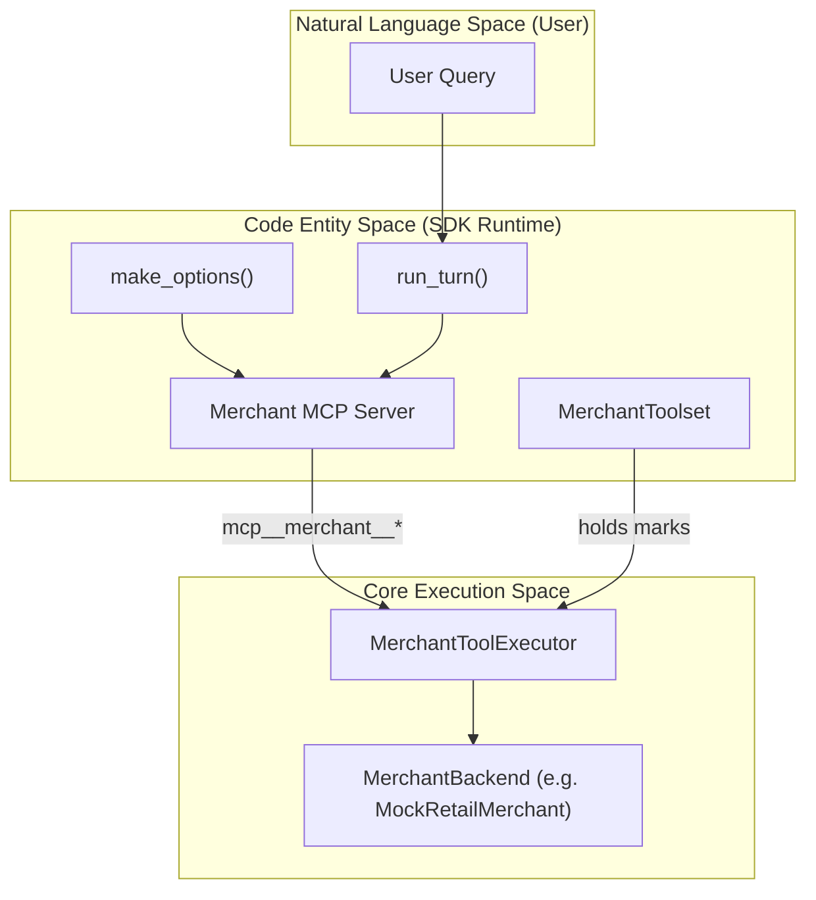
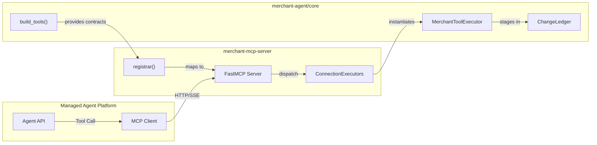

<!-- source: DeepWiki mcp.deepwiki.com · repo anthropics/commerce-agents · page 4.5 Merchant Agent Runtimes · fetched 2026-10-26 -->

# Merchant Agent Runtimes

Relevant source files

The following files were used as context for generating this wiki page:

- [conftest.py](conftest.py)
- [merchant-agent/core/merchant_agent/backend.py](merchant-agent/core/merchant_agent/backend.py)
- [merchant-agent/managed-agents/merchant-mcp-server/README.md](merchant-agent/managed-agents/merchant-mcp-server/README.md)
- [merchant-agent/managed-agents/merchant-mcp-server/merchant_mcp_server.py](merchant-agent/managed-agents/merchant-mcp-server/merchant_mcp_server.py)
- [merchant-agent/managed-agents/scheduled-digest/README.md](merchant-agent/managed-agents/scheduled-digest/README.md)
- [merchant-agent/runtime-agent-sdk/README.md](merchant-agent/runtime-agent-sdk/README.md)
- [merchant-agent/runtime-agent-sdk/merchant_agent_sdk/__init__.py](merchant-agent/runtime-agent-sdk/merchant_agent_sdk/__init__.py)
- [merchant-agent/runtime-agent-sdk/merchant_agent_sdk/agent.py](merchant-agent/runtime-agent-sdk/merchant_agent_sdk/agent.py)
- [merchant-agent/runtime-agent-sdk/tests/test_agent.py](merchant-agent/runtime-agent-sdk/tests/test_agent.py)
- [merchant-agent/runtime-messages-api/README.md](merchant-agent/runtime-messages-api/README.md)
- [merchant-agent/runtime-messages-api/merchant_agent_runtime/orchestrator.py](merchant-agent/runtime-messages-api/merchant_agent_runtime/orchestrator.py)
- [merchant-agent/runtime-messages-api/tests/test_orchestrator_followthrough.py](merchant-agent/runtime-messages-api/tests/test_orchestrator_followthrough.py)
- [merchant-agent/runtime-messages-api/tests/test_orchestrator_partial.py](merchant-agent/runtime-messages-api/tests/test_orchestrator_partial.py)
- [merchant-agent/runtime-messages-api/tests/test_scheduled_digest.py](merchant-agent/runtime-messages-api/tests/test_scheduled_digest.py)
- [shopping-agent/managed-agents/storefront-mcp-server/README.md](shopping-agent/managed-agents/storefront-mcp-server/README.md)
- [shopping-agent/managed-agents/storefront-mcp-server/storefront_mcp_server.py](shopping-agent/managed-agents/storefront-mcp-server/storefront_mcp_server.py)
- [shopping-agent/runtime-messages-api/README.md](shopping-agent/runtime-messages-api/README.md)
- [shopping-agent/runtime-messages-api/shopping_agent_runtime/orchestrator.py](shopping-agent/runtime-messages-api/shopping_agent_runtime/orchestrator.py)
- [shopping-agent/runtime-messages-api/tests/test_orchestrator.py](shopping-agent/runtime-messages-api/tests/test_orchestrator.py)
- [tests/test_turn_loop.py](tests/test_turn_loop.py)

The Merchant Agent implementation provides three distinct runtime paths, allowing the same core logic, tools, and skills to be deployed across different host environments. Whether running as a streaming web service via the Messages API, a local console application via the Agent SDK, or a managed service via the Model Context Protocol (MCP), the agent maintains consistent behavior regarding safety, provenance, and the staged-change workflow.

## 1. Messages API Runtime

The `merchant_agent_runtime` package implements a sophisticated turn loop optimized for streaming web interfaces. It handles multi-round model interactions, eager tool dispatch, and real-time UI enrichment.

### MerchantAgent.stream_turn
The core entry point is `MerchantAgent.stream_turn` [merchant-agent/runtime-messages-api/merchant_agent_runtime/orchestrator.py:136-141](). It orchestrates the following sequence:

1.  **Prefetching**: Concurrently fetches the `MerchantContext` and "Tier One" memory facts [merchant-agent/runtime-messages-api/merchant_agent_runtime/orchestrator.py:149-152]().
2.  **Prompt Assembly**: Builds the dynamic context block (e.g., current time, merchant status) and combines it with the cached static system prompt [merchant-agent/runtime-messages-api/merchant_agent_runtime/orchestrator.py:155-161]().
3.  **Grounding Detection**: Checks `GROUNDING_RULES` to see if the user's latest message requires a forced read tool (e.g., fetching metrics before discussing trends) [merchant-agent/runtime-messages-api/merchant_agent_runtime/orchestrator.py:71-71]().
4.  **Turn Loop**: Iterates up to `max_tool_iterations` times. Each iteration calls the model, dispatches tools, and streams events [merchant-agent/runtime-messages-api/merchant_agent_runtime/orchestrator.py:44-64]().

### Eager Dispatch and Progress Events
To minimize latency, the runtime uses an `EagerDispatcher` [merchant-agent/runtime-messages-api/merchant_agent_runtime/orchestrator.py:46-46](). Tool calls execute as soon as their JSON block is closed in the stream, rather than waiting for the entire model response to finish. 
*   **Analysis Delegation**: If the model calls `run_analysis`, the runtime invokes the `AnalysisRunner` [merchant-agent/runtime-messages-api/merchant_agent_runtime/orchestrator.py:113-117]().
*   **Progress Streaming**: While the analysis sub-agent works, `progress` events are yielded to the host to provide visual feedback [merchant-agent/runtime-messages-api/README.md:41-44]().

### Follow-through Reminder
If a user requests a change (detected via `change_requested`) but the model attempts to end the turn without staging anything, the runtime appends the `STAGING_FOLLOWTHROUGH_REMINDER` and forces one additional round [merchant-agent/runtime-messages-api/merchant_agent_runtime/orchestrator.py:70-71]().

**Sources:** [merchant-agent/runtime-messages-api/merchant_agent_runtime/orchestrator.py:1-161](), [merchant-agent/runtime-messages-api/README.md:1-77]()

## 2. Agent SDK Runtime

The `merchant_agent_sdk` package adapts the merchant agent for the **Claude Agent SDK**, typically used for CLI tools or local integrations.

### Registration and Mapping
The SDK runtime maps the core merchant tools into an in-process MCP server [merchant-agent/runtime-agent-sdk/merchant_agent_sdk/agent.py:124-124]().
*   **Skills**: Project skills are linked into a `.claude/skills` directory and indexed via the `Skill` tool [merchant-agent/runtime-agent-sdk/merchant_agent_sdk/agent.py:121-127]().
*   **Analysis Sub-agent**: Unlike the Messages API runtime (which uses a tool-based delegate), the SDK path defines `run-analysis` as a full `AgentDefinition` [merchant-agent/runtime-agent-sdk/merchant_agent_sdk/agent.py:63-78](). This sub-agent is restricted to read-only MCP tools [merchant-agent/runtime-agent-sdk/merchant_agent_sdk/agent.py:76-76]().

### Host Approval Console Flow
A unique feature of the SDK runtime is the `host_approve` console flow. 
1.  `run_turn` executes the model's rounds [merchant-agent/runtime-agent-sdk/merchant_agent_sdk/agent.py:154-165]().
2.  If changes are staged, the `MerchantToolset` holds them in a pending state [merchant-agent/runtime-agent-sdk/README.md:49-51]().
3.  The host (e.g., the `main.py` CLI) prompts the operator for approval [merchant-agent/runtime-agent-sdk/README.md:32-37]().
4.  `toolset.host_approve(change_id)` marks the change, allowing a subsequent `apply_change` call to succeed [merchant-agent/runtime-agent-sdk/README.md:51-51]().

### Diagram: SDK Runtime Data Flow
This diagram maps SDK entities to the core merchant execution logic.

**Sources:** [merchant-agent/runtime-agent-sdk/merchant_agent_sdk/agent.py:1-165](), [merchant-agent/runtime-agent-sdk/README.md:1-102](), [merchant-agent/runtime-agent-sdk/tests/test_agent.py:91-140]()

## 3. Managed Agents (MCP) Path

The `merchant-mcp-server` allows the agent to be deployed as a "Managed Agent" on platforms that support the Model Context Protocol.

### Implementation Details
*   **FastMCP**: The server is built using `FastMCP` [merchant-agent/managed-agents/merchant-mcp-server/merchant_mcp_server.py:25-25]().
*   **Tool Registration**: The server iterates through the core tool registry and registers each as an MCP tool, ensuring the model sees the exact same schemas and descriptions as the other runtimes [merchant-agent/managed-agents/merchant-mcp-server/merchant_mcp_server.py:141-143]().
*   **Connection Persistence**: It uses `ConnectionExecutors` to maintain a separate `MerchantToolExecutor` and `MerchantSessionState` for each client connection [merchant-agent/managed-agents/merchant-mcp-server/merchant_mcp_server.py:128-137]().

### Approval and Safety in MCP
In the managed path, `require_host_approval` is typically set to `False` in the `MerchantAgentConfig` [merchant-agent/managed-agents/merchant-mcp-server/merchant_mcp_server.py:71-71](). This is because the platform's native `always_ask` prompt on the `apply_change` tool serves as the approval mechanism [merchant-agent/managed-agents/merchant-mcp-server/merchant_mcp_server.py:65-67]().

### Scheduled Digest
The managed path also supports headless execution via `run_morning_digest.py`. This script:
1.  Instantiates a `MerchantAgent` (Messages API runtime style).
2.  Triggers a specific "morning briefing" prompt.
3.  Generates a `present_digest` UI component for the merchant to review upon login [merchant-agent/managed-agents/scheduled-digest/README.md]().

### Diagram: MCP Architecture Mapping
Mapping MCP protocol concepts to codebase classes.

**Sources:** [merchant-agent/managed-agents/merchant-mcp-server/merchant_mcp_server.py:1-163](), [merchant-agent/managed-agents/merchant-mcp-server/README.md:1-79](), [shopping-agent/managed-agents/storefront-mcp-server/storefront_mcp_server.py:92-102]()

---

