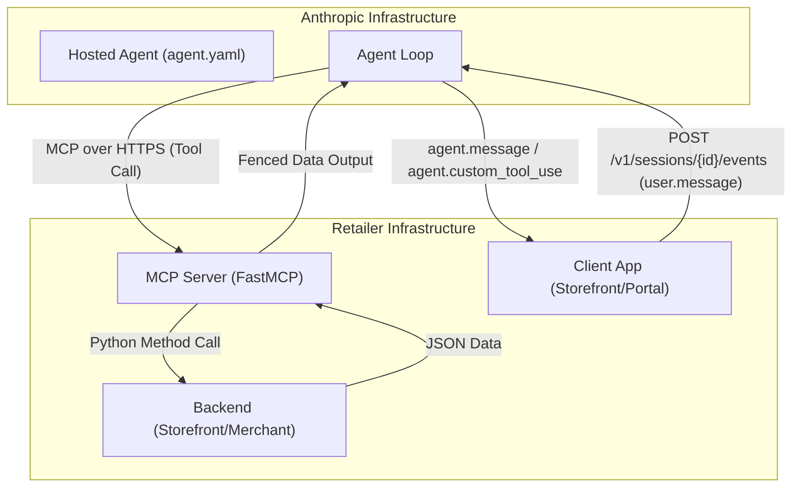
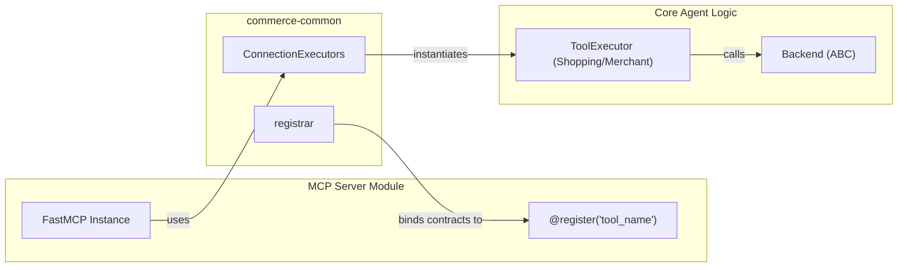

<!-- source: DeepWiki mcp.deepwiki.com · repo anthropics/commerce-agents · page 5 MCP Server Deployments (Managed Agents) · fetched 2026-10-26 -->

# MCP Server Deployments (Managed Agents)

Relevant source files

The following files were used as context for generating this wiki page:

- [commerce-common/commerce_common/manifest.py](commerce-common/commerce_common/manifest.py)
- [conftest.py](conftest.py)
- [merchant-agent/core/merchant_agent/backend.py](merchant-agent/core/merchant_agent/backend.py)
- [merchant-agent/managed-agents/README.md](merchant-agent/managed-agents/README.md)
- [merchant-agent/managed-agents/merchant-mcp-server/README.md](merchant-agent/managed-agents/merchant-mcp-server/README.md)
- [merchant-agent/managed-agents/merchant-mcp-server/merchant_mcp_server.py](merchant-agent/managed-agents/merchant-mcp-server/merchant_mcp_server.py)
- [scripts/deploy_managed_agent.sh](scripts/deploy_managed_agent.sh)
- [scripts/run_demo.py](scripts/run_demo.py)
- [shopping-agent/managed-agents/README.md](shopping-agent/managed-agents/README.md)
- [shopping-agent/managed-agents/storefront-mcp-server/README.md](shopping-agent/managed-agents/storefront-mcp-server/README.md)
- [shopping-agent/managed-agents/storefront-mcp-server/storefront_mcp_server.py](shopping-agent/managed-agents/storefront-mcp-server/storefront_mcp_server.py)

The **Managed Agents** deployment path allows the shopping and merchant agents to be hosted on the [Anthropic Agents API](https://platform.claude.com/docs/en/managed-agents/overview). In this architecture, Anthropic hosts the agent loop, system prompt, and skill bodies, while the retailer's business logic and data remain behind an **MCP (Model Context Protocol)** server hosted on the retailer's infrastructure.

## Architecture Overview

The Managed Agents path separates the "brain" (the LLM and its orchestration loop) from the "hands" (the tools and backend data).

### Component Interaction
*   **Hosted Agent**: Created via a manifest (`agent.yaml`). It executes the conversation loop and calls tools via MCP over HTTPS.
*   **MCP Server**: A `FastMCP` server that wraps the `ShoppingToolExecutor` or `MerchantToolExecutor`. It receives tool calls from the hosted agent and dispatches them to the `StorefrontBackend` or `MerchantBackend`.
*   **Host Application**: The retailer's web storefront or merchant portal. It sends user messages to the Agents API and handles **Presentation Tools** (custom tools) to render UI components like product carousels or metric charts.

### Managed Agents Data Flow
Title: Managed Agents Runtime Flow

Sources: [shopping-agent/managed-agents/README.md:9-14](), [merchant-agent/managed-agents/README.md:10-15]()

## The Deployment Manifest (`agent.yaml`)

The `agent.yaml` file is the source of truth for a Managed Agent. It defines the model, system prompt, enabled skills, and the tool definitions.

*   **Skills**: Local skill directories (containing `SKILL.md`) are uploaded to the Skills API during deployment.
*   **System Prompt**: Inlined from a `system.md` file, which is typically a static version of the dynamically assembled prompts used in other runtimes.
*   **MCP Servers**: Defines the HTTPS endpoint where the hosted agent can find the toolset.
*   **Custom Tools**: Defines the "Presentation Tools" that the hosted agent will call for the client application to execute (e.g., `present_products`).

The `commerce_common.manifest` module is used to resolve these YAML files into the JSON format required by the `/v1/agents` endpoint.

Sources: [commerce-common/commerce_common/manifest.py:4-10](), [shopping-agent/managed-agents/README.md:18-21]()

## Deployment Workflow

Deploying a managed agent involves a multi-step process coordinated by the `deploy_managed_agent.sh` script.

1.  **Skill Upload**: Each local skill directory is bundled and POSTed to `/v1/skills` to obtain a `skill_id`.
2.  **Manifest Resolution**: The `agent.yaml` is processed to replace `${VAR}` placeholders (like MCP URLs) and link the newly created `skill_id`s.
3.  **Agent Creation**: The resolved manifest is POSTed to `/v1/agents`.
4.  **Infrastructure Setup**: The retailer must provide an **Environment** (for networking) and a **Vault** (for MCP credentials) via the API to allow the hosted agent to reach the MCP server.

Sources: [scripts/deploy_managed_agent.sh:65-96](), [shopping-agent/managed-agents/README.md:25-49]()

## MCP Server Implementation

The codebase provides two reference MCP servers that bridge the standard `ToolExecutor` logic to the MCP protocol.

### Mapping Code Entities to MCP
Title: Code Entity to MCP Mapping

Sources: [shopping-agent/managed-agents/storefront-mcp-server/storefront_mcp_server.py:92-106](), [merchant-agent/managed-agents/merchant-mcp-server/merchant_mcp_server.py:128-143]()

### 1. Storefront MCP Server
The `storefront-mcp-server` exposes the shopping tool surface (search, cart, orders, memory). It uses `ConnectionExecutors` to maintain a separate `ShoppingToolExecutor` for each MCP connection, ensuring that session state and provenance are isolated.

For details, see [Storefront MCP Server](#5.1).

### 2. Merchant MCP Server
The `merchant-mcp-server` exposes the back-office tools. A key distinction on this path is that `require_host_approval` is typically set to `False` in the `MerchantAgentConfig` because the platform's `always_ask` mechanism on the `apply_change` tool serves as the approval gate.

For details, see [Merchant MCP Server and Scheduled Digest](#5.2).

## Safety and Identity

*   **Deny-by-Default**: Tools must be explicitly enabled in the `agent.yaml` manifest to be callable by the hosted agent.
*   **Always Ask**: Write operations (like `add_to_cart` or `apply_change`) are configured as `always_ask` in the manifest, forcing the platform to pause for user/host confirmation.
*   **Identity Binding**: In production, the MCP server should derive the `user_id` or `merchant_id` from the authenticated request (e.g., a JWT in the Authorization header) rather than accepting it as a tool argument.
*   **Local Bind Enforcement**: By default, the reference servers use `enforce_local_only_bind` to prevent accidental exposure to the public internet without an authenticating gateway.

Sources: [shopping-agent/managed-agents/README.md:67-72](), [shopping-agent/managed-agents/storefront-mcp-server/storefront_mcp_server.py:81-83](), [merchant-agent/managed-agents/merchant-mcp-server/README.md:69-76]()

---

