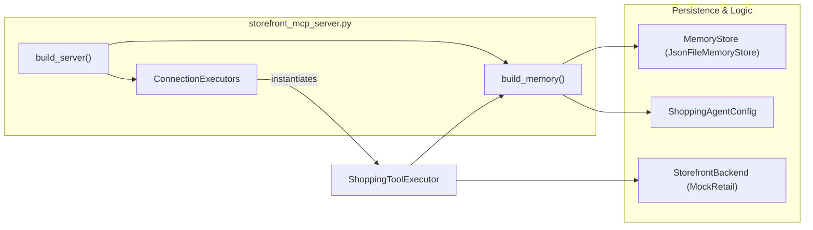

<!-- source: DeepWiki mcp.deepwiki.com · repo anthropics/commerce-agents · page 5.1 Storefront MCP Server · fetched 2026-10-26 -->

# Storefront MCP Server

<details>
<summary>Relevant source files</summary>

The following files were used as context for generating this wiki page:

- [commerce-common/commerce_common/mcp_server.py](commerce-common/commerce_common/mcp_server.py)
- [conftest.py](conftest.py)
- [merchant-agent/core/merchant_agent/backend.py](merchant-agent/core/merchant_agent/backend.py)
- [merchant-agent/managed-agents/merchant-mcp-server/README.md](merchant-agent/managed-agents/merchant-mcp-server/README.md)
- [merchant-agent/managed-agents/merchant-mcp-server/merchant_mcp_server.py](merchant-agent/managed-agents/merchant-mcp-server/merchant_mcp_server.py)
- [shopping-agent/managed-agents/storefront-mcp-server/README.md](shopping-agent/managed-agents/storefront-mcp-server/README.md)
- [shopping-agent/managed-agents/storefront-mcp-server/storefront_mcp_server.py](shopping-agent/managed-agents/storefront-mcp-server/storefront_mcp_server.py)
- [shopping-agent/managed-agents/storefront-mcp-server/tests/test_server.py](shopping-agent/managed-agents/storefront-mcp-server/tests/test_server.py)

</details>


The `storefront-mcp-server` is a reference implementation of a Model Context Protocol (MCP) server designed for the Shopping Agent. It exposes the full shopping tool surface—including catalog search, cart management, and order tracking—to hosted agents via the Anthropic Agents API or any MCP-compatible client.

## Overview and Purpose

The server acts as a bridge between the **Natural Language Space** (the agent's tool calls) and the **Code Entity Space** (the `StorefrontBackend` implementation). It uses the `FastMCP` framework to serve tools over streamable HTTP [shopping-agent/managed-agents/storefront-mcp-server/storefront_mcp_server.py:8-20]().

Key characteristics include:
*   **One Executor per Connection**: Uses `ConnectionExecutors` to maintain isolated `ShoppingToolExecutor` instances, ensuring that provenance (the history of what the agent has "seen") is scoped to a specific client session [shopping-agent/managed-agents/storefront-mcp-server/storefront_mcp_server.py:92-102]().
*   **Fenced Data**: All read operations return data wrapped in `<storefront_data>` tags to prevent prompt injection from untrusted product descriptions [shopping-agent/managed-agents/storefront-mcp-server/storefront_mcp_server.py:48-53]().
*   **Local-Only Safety**: By default, the server refuses to bind to non-loopback interfaces unless an authenticating gateway is explicitly acknowledged [commerce-common/commerce_common/mcp_server.py:29-38]().

### Architecture Diagram: Request Flow

This diagram shows how a natural language request from a Hosted Agent resolves to a specific backend method call through the MCP plumbing.

Title: Hosted Agent to Storefront Backend Mapping
```mermaid
graph TD
    subgraph "Natural Language Space"
        Agent["Hosted Agent (Claude)"]
        ToolCall["Tool Call: 'search_products(query=\"tent\")'"]
    end

    subgraph "MCP Server Layer (storefront_mcp_server.py)"
        FastMCP["FastMCP Server Instance"]
        Registrar["registrar() / @register"]
        Executors["ConnectionExecutors.call()"]
    end

    subgraph "Code Entity Space"
        Executor["ShoppingToolExecutor"]
        Backend["StorefrontBackend (e.g., MockRetail)"]
        SearchMethod["search_products()"]
    end

    Agent -- "JSON-RPC" --> FastMCP
    FastMCP --> Registrar
    Registrar --> Executors
    Executors -- "session-scoped" --> Executor
    Executor --> SearchMethod
    SearchMethod --> Backend
```
Sources: [shopping-agent/managed-agents/storefront-mcp-server/storefront_mcp_server.py:104-114](), [commerce-common/commerce_common/mcp_server.py:49-65]()

## Core Components

### FastMCP Setup and Tool Surface
The server is initialized via `build_server`, which configures the `FastMCP` instance with specific instructions and registers the tool surface [shopping-agent/managed-agents/storefront-mcp-server/storefront_mcp_server.py:70-103]().

| Tool Category | Key Functions / Tools | Description |
| :--- | :--- | :--- |
| **Discovery** | `search_products`, `get_product_details` | Catalog access with provenance tracking. |
| **Cart** | `add_to_cart`, `update_cart_item`, `remove_from_cart`, `get_cart` | Mutation tools are provenance-gated. |
| **Orders** | `get_orders`, `get_order_status` | Access to historical and current order state. |
| **Memory** | `save_memory`, `recall_memories`, `get_preferences` | Durable fact storage for user preferences. |
| **Support** | `search_policies`, `get_fulfillment_options` | Shipping and return policy lookup. |

Sources: [shopping-agent/managed-agents/storefront-mcp-server/README.md:13-27](), [shopping-agent/managed-agents/storefront-mcp-server/storefront_mcp_server.py:108-169]()

### ConnectionExecutors
The `ConnectionExecutors` class manages the lifecycle of `ShoppingToolExecutor` instances. It uses a `WeakKeyDictionary` keyed by the `mcp.server.fastmcp.Context.session` to ensure that each connected client has its own private state, specifically for **Provenance** (tracking which product IDs have been shown to the user) [commerce-common/commerce_common/mcp_server.py:49-61]().

### Safety: enforce_local_only_bind
Because the reference MCP server does not implement its own inbound authentication, it includes a safety check: `enforce_local_only_bind`. It will terminate the process if `host` is not a loopback address (`127.0.0.1`, `localhost`, `::1`) unless the environment variable `STOREFRONT_MCP_UNSAFE_ALLOW_NO_AUTH` is set to `1` [commerce-common/commerce_common/mcp_server.py:29-38]().

## Data Flow: Memory and Backend Integration

The server integrates a `MemoryStore` (defaulting to `JsonFileMemoryStore`) and a `StorefrontBackend` (defaulting to `MockRetail`) [shopping-agent/managed-agents/storefront-mcp-server/storefront_mcp_server.py:56-68]().

Title: Storefront MCP Data Integration

Sources: [shopping-agent/managed-agents/storefront-mcp-server/storefront_mcp_server.py:70-102](), [shopping_agent/executor.py:33]()

## Wiring a Custom Backend

To use the Storefront MCP server with a real production system, you implement the `StorefrontBackend` interface and pass it to `build_server`.

1.  **Implement Backend**: Create a class inheriting from `StorefrontBackend` [shopping-agent/core/shopping_agent/backend.py]().
2.  **Initialize Server**:
    ```python
    from storefront_mcp_server import build_server
    from my_custom_backend import MyProductionBackend

    backend = MyProductionBackend()
    server = build_server(backend=backend)
    server.run(transport="streamable-http")
    ```
3.  **Identity Handling**: In production, the `DEMO_USER_ID` and `DEMO_SESSION_ID` should be replaced by values derived from the authenticated request headers provided by your gateway [shopping-agent/managed-agents/storefront-mcp-server/storefront_mcp_server.py:41-42]().

Sources: [shopping-agent/managed-agents/storefront-mcp-server/README.md:47-68](), [shopping-agent/managed-agents/storefront-mcp-server/storefront_mcp_server.py:91-92]()

## Execution Environment

The server can be started via CLI, and configuration is primarily handled through environment variables:

*   `STOREFRONT_MCP_HOST`: Bind address (default `127.0.0.1`) [shopping-agent/managed-agents/storefront-mcp-server/storefront_mcp_server.py:39]().
*   `STOREFRONT_MCP_PORT`: Port (default `8200`) [shopping-agent/managed-agents/storefront-mcp-server/storefront_mcp_server.py:40]().
*   `STOREFRONT_MCP_MEMORY_FILE`: Path to the JSON file for persistent memory [shopping-agent/managed-agents/storefront-mcp-server/storefront_mcp_server.py:66]().
*   `STOREFRONT_MCP_USER_ID`: The customer identity for the session [shopping-agent/managed-agents/storefront-mcp-server/storefront_mcp_server.py:41]().

Sources: [shopping-agent/managed-agents/storefront-mcp-server/README.md:38-43](), [shopping-agent/managed-agents/storefront-mcp-server/storefront_mcp_server.py:39-42]()

---

