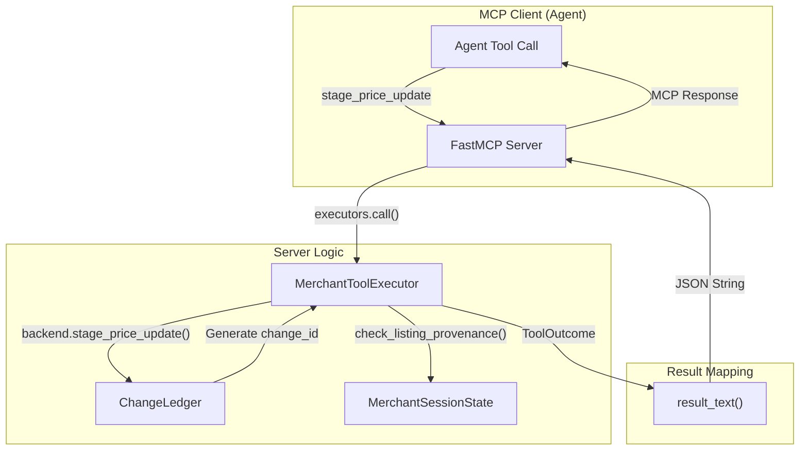
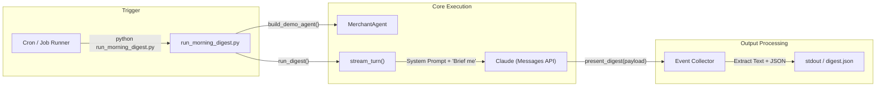

<!-- source: DeepWiki mcp.deepwiki.com · repo anthropics/commerce-agents · page 5.2 Merchant MCP Server and Scheduled Digest · fetched 2026-10-26 -->

# Merchant MCP Server and Scheduled Digest

Relevant source files

The following files were used as context for generating this wiki page:

- [commerce-common/commerce_common/mcp_server.py](commerce-common/commerce_common/mcp_server.py)
- [conftest.py](conftest.py)
- [merchant-agent/core/merchant_agent/backend.py](merchant-agent/core/merchant_agent/backend.py)
- [merchant-agent/managed-agents/merchant-mcp-server/README.md](merchant-agent/managed-agents/merchant-mcp-server/README.md)
- [merchant-agent/managed-agents/merchant-mcp-server/merchant_mcp_server.py](merchant-agent/managed-agents/merchant-mcp-server/merchant_mcp_server.py)
- [merchant-agent/managed-agents/merchant-mcp-server/tests/test_server.py](merchant-agent/managed-agents/merchant-mcp-server/tests/test_server.py)
- [merchant-agent/managed-agents/scheduled-digest/README.md](merchant-agent/managed-agents/scheduled-digest/README.md)
- [merchant-agent/runtime-messages-api/tests/test_orchestrator_partial.py](merchant-agent/runtime-messages-api/tests/test_orchestrator_partial.py)
- [merchant-agent/runtime-messages-api/tests/test_scheduled_digest.py](merchant-agent/runtime-messages-api/tests/test_scheduled_digest.py)
- [shopping-agent/managed-agents/storefront-mcp-server/README.md](shopping-agent/managed-agents/storefront-mcp-server/README.md)
- [shopping-agent/managed-agents/storefront-mcp-server/storefront_mcp_server.py](shopping-agent/managed-agents/storefront-mcp-server/storefront_mcp_server.py)

The Merchant MCP server provides a standardized interface for hosted merchant agents to interact with back-office systems. It utilizes the Model Context Protocol (MCP) to expose a comprehensive tool surface for business analytics, catalog management, and inventory operations. Complementing this is the scheduled digest system, which allows for headless, automated morning briefings.

## Merchant MCP Server Architecture

The `merchant-mcp-server` is built using the `FastMCP` framework [merchant-agent/managed-agents/merchant-mcp-server/merchant_mcp_server.py:25-25](). It acts as a bridge between a hosted agent and a `MerchantBackend` implementation [merchant-agent/managed-agents/merchant-mcp-server/README.md:9-11]().

### Connection and Identity Management
The server maintains isolation between different client connections using the `ConnectionExecutors` class [commerce-common/commerce_common/mcp_server.py:49-51](). This ensures that:
*   **Per-Connection Executors:** Each connection receives its own `MerchantToolExecutor` instance [merchant-agent/managed-agents/merchant-mcp-server/merchant_mcp_server.py:128-137]().
*   **Provenance Scoping:** Provenance records (tracking what data the agent has seen) are scoped to the individual connection [merchant-agent/managed-agents/merchant-mcp-server/tests/test_server.py:67-87]().
*   **Identity Binding:** The `MerchantSessionContext` (containing `merchant_id` and `operator`) is typically derived from the environment in the reference implementation but should be derived from authenticated requests in production [merchant-agent/managed-agents/merchant-mcp-server/merchant_mcp_server.py:48-50](), [merchant-agent/managed-agents/merchant-mcp-server/README.md:71-76]().

### Security and Binding
The server enforces a local-only bind policy via `enforce_local_only_bind` [commerce-common/commerce_common/mcp_server.py:29-38](). It refuses to bind to non-loopback addresses unless the `MERCHANT_MCP_UNSAFE_ALLOW_NO_AUTH` environment variable is set to `1`, signifying that an authenticating gateway is present [merchant-agent/managed-agents/merchant-mcp-server/merchant_mcp_server.py:108-110]().

### Natural Language to Code Entity Mapping: MCP Surface

| Natural Language Concept | Code Entity (Function/Class) | File Path |
| :--- | :--- | :--- |
| **Business Metrics** | `get_business_snapshot`, `query_metrics` | [merchant-agent/managed-agents/merchant-mcp-server/merchant_mcp_server.py:145-161]() |
| **Catalog Search** | `search_listings`, `get_listing` | [merchant-agent/managed-agents/merchant-mcp-server/README.md:18-19]() |
| **Staged Writes** | `stage_price_update`, `stage_inventory_action` | [merchant-agent/managed-agents/merchant-mcp-server/README.md:26-27]() |
| **Live Mutation** | `apply_change` | [merchant-agent/managed-agents/merchant-mcp-server/README.md:32-32]() |
| **Tool Registry** | `registrar`, `build_tools` | [commerce-common/commerce_common/mcp_server.py:67-75](), [merchant-agent/managed-agents/merchant-mcp-server/merchant_mcp_server.py:41-41]() |

**Sources:** [merchant-agent/managed-agents/merchant-mcp-server/merchant_mcp_server.py:25-143](), [merchant-agent/managed-agents/merchant-mcp-server/README.md:1-38](), [commerce-common/commerce_common/mcp_server.py:29-75]().

## ChangeLedger Integration and Guardrails

The MCP server relies on the `MerchantToolExecutor` to manage the staged-change workflow. 

### The Staging Workflow
1.  **Propose:** Tools like `stage_price_update` record a proposed change in the `ChangeLedger` [merchant-agent/managed-agents/merchant-mcp-server/README.md:26-26]().
2.  **Guardrails:** The backend enforces business rules during staging, and `check_apply_change` re-verifies these limits before final execution [merchant-agent/managed-agents/merchant-mcp-server/README.md:34-35]().
3.  **Approval:** In the MCP deployment, `require_host_approval` is typically set to `False` because the platform's own `always_ask` mechanism serves as the approval gate for the `apply_change` tool [merchant-agent/managed-agents/merchant-mcp-server/merchant_mcp_server.py:70-72](), [merchant-agent/managed-agents/merchant-mcp-server/README.md:63-66]().

### `stage_shows_preview` Flag
In the MCP server configuration, `stage_shows_preview` is explicitly set to `False` [merchant-agent/managed-agents/merchant-mcp-server/merchant_mcp_server.py:111-111](). This is because MCP tool outputs are returned to the model as text; the specialized UI components (like the change preview card) are handled by the platform's host application rather than the MCP server itself [merchant-agent/managed-agents/merchant-mcp-server/README.md:35-37]().

### Data Flow: Staged Change to MCP Result

**Sources:** [merchant-agent/managed-agents/merchant-mcp-server/merchant_mcp_server.py:111-137](), [commerce-common/commerce_common/mcp_server.py:41-65](), [merchant-agent/managed-agents/merchant-mcp-server/README.md:34-37]().

## Scheduled Digest (`run_morning_digest.py`)

The scheduled digest is a headless execution path that uses the Messages API runtime (`MerchantAgent`) to generate a morning briefing without an active operator session [merchant-agent/managed-agents/scheduled-digest/README.md:3-5]().

### Execution Flow
The script `run_morning_digest.py` performs the following steps:
1.  **Environment Setup:** Loads `MERCHANT_ID`, `MERCHANT_OPERATOR`, and `MERCHANT_TIMEZONE` to construct the `MerchantSessionContext` [merchant-agent/managed-agents/scheduled-digest/run_morning_digest.py:7-9]().
2.  **Agent Initialization:** Builds a `MerchantAgent` using `build_demo_agent()` (which uses the retail mock backend by default) [merchant-agent/managed-agents/scheduled-digest/README.md:9-10]().
3.  **Turn Execution:** Calls `run_digest`, which triggers a single turn asking the agent "what needs attention today" [merchant-agent/managed-agents/scheduled-digest/run_morning_digest.py:3-5]().
4.  **Output Generation:** Captures the text response and the `present_digest` tool payload. If the `--out` flag is provided, it writes the full JSON result, including all UI components, to a file [merchant-agent/managed-agents/scheduled-digest/README.md:5-7]().

### Digest Components
The digest often includes:
*   **Headline:** A natural language summary of the day's priorities [merchant-agent/runtime-messages-api/tests/test_orchestrator_partial.py:44-45]().
*   **Items:** Specific alerts (e.g., `low_stock`, `slow_mover`) that include a `ref_id` for the affected listing [merchant-agent/runtime-messages-api/tests/test_orchestrator_partial.py:41-47]().
*   **Enrichment:** The runtime automatically joins listing details into the digest items if the agent has previously searched for or referenced those listings in the turn [merchant-agent/runtime-messages-api/tests/test_orchestrator_partial.py:51-61]().

### Headless Agent Logic

**Sources:** [merchant-agent/managed-agents/scheduled-digest/README.md:1-26](), [merchant-agent/runtime-messages-api/tests/test_scheduled_digest.py:30-47](), [merchant-agent/runtime-messages-api/tests/test_orchestrator_partial.py:51-61]().

## Implementation Details

### Merchant Tool Surface
The server registers tools using the `registrar` helper, which synchronizes the MCP tool schema with the `MerchantToolExecutor`'s internal registry [commerce-common/commerce_common/mcp_server.py:67-75]().

| MCP Tool | Backend Method | Description |
| :--- | :--- | :--- |
| `get_business_snapshot` | `get_business_snapshot` | High-level performance metrics [merchant-agent/core/merchant_agent/backend.py:61-63]() |
| `query_metrics` | `query_metrics` | Detailed time-series data [merchant-agent/core/merchant_agent/backend.py:70-77]() |
| `search_listings` | `search_listings` | Catalog search with filters [merchant-agent/core/merchant_agent/backend.py:93-99]() |
| `get_inventory_alerts` | `get_inventory_alerts` | Identification of stock issues [merchant-agent/core/merchant_agent/backend.py:112-116]() |
| `stage_price_update` | `stage_price_update` | Proposes price changes [merchant-agent/core/merchant_agent/backend.py:146-152]() |
| `apply_change` | `apply_change` | Executes a staged change [merchant-agent/core/merchant_agent/backend.py:183-188]() |

### Schema Synchronization
The `published_schema` function ensures that the MCP-exposed schema is clean, specifically removing the `status` field which is only relevant for the internal execution frame and not for the model's tool-calling interface [commerce-common/commerce_common/mcp_server.py:96-102]().

**Sources:** [merchant-agent/managed-agents/merchant-mcp-server/merchant_mcp_server.py:145-163](), [merchant-agent/core/merchant_agent/backend.py:60-188](), [commerce-common/commerce_common/mcp_server.py:67-102]().

---

