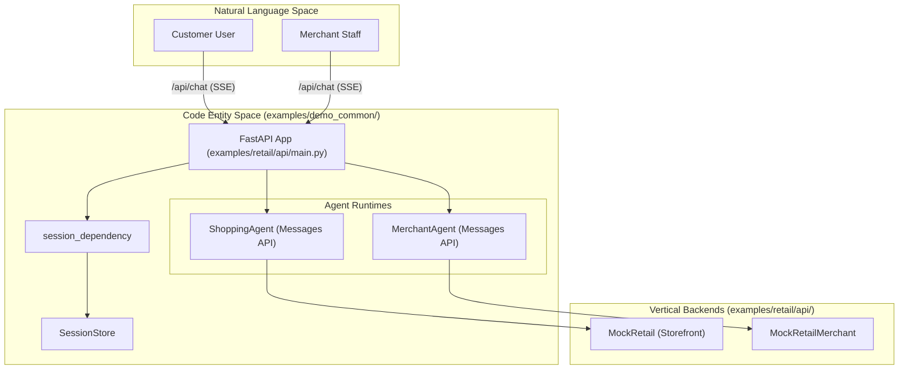
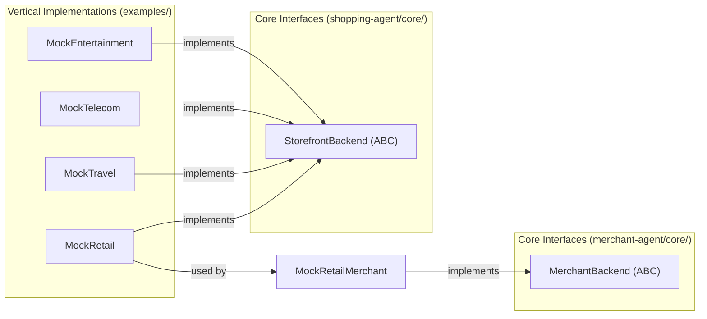

<!-- source: DeepWiki mcp.deepwiki.com · repo anthropics/commerce-agents · page 6 Example Verticals · fetched 2026-10-26 -->

# Example Verticals

Relevant source files

The following files were used as context for generating this wiki page:

- [.claude-plugin/marketplace.json](.claude-plugin/marketplace.json)
- [README.md](README.md)
- [merchant-agent/managed-agents/scheduled-digest/run_morning_digest.py](merchant-agent/managed-agents/scheduled-digest/run_morning_digest.py)
- [plugins/commerce-builder/.claude-plugin/plugin.json](plugins/commerce-builder/.claude-plugin/plugin.json)
- [plugins/commerce-builder/README.md](plugins/commerce-builder/README.md)
- [plugins/commerce-builder/commands/add-commerce-flow.md](plugins/commerce-builder/commands/add-commerce-flow.md)
- [scripts/check.py](scripts/check.py)
- [scripts/screenshot_tour.py](scripts/screenshot_tour.py)
- [scripts/smoke_chat.py](scripts/smoke_chat.py)

This section provides an overview of the four runnable vertical examples—**Retail**, **Travel**, **Telecom**, and **Entertainment**—and the shared infrastructure that hosts them. These examples demonstrate how the core shopping and merchant agents are applied to different business domains using the same library foundations [README.md:1-7]().

The examples are built as full-stack applications featuring:
*   **FastAPI Backends**: Hosting the agent runtimes and mock business logic.
*   **React Frontends**: Providing a customer storefront and a merchant back-office portal.
*   **Mock Backends**: Vertical-specific implementations of `StorefrontBackend` and `MerchantBackend`.
*   **Fixture Data**: Domain-specific catalogs, orders, and business metrics.

### Vertical Architecture Overview

The following diagram illustrates how the shared host infrastructure bridges the "Natural Language Space" (user/merchant chat) to the "Code Entity Space" (agent runtimes and mock backends).

**Host Infrastructure Bridge**

Sources: [README.md:83-96](), [examples/retail/api/mock_retail.py:1-20](), [examples/retail/api/mock_merchant.py:1-20]() (inferred from `run_morning_digest.py` and `smoke_chat.py` context).

---

## 6.1 Shared Host Infrastructure

The `examples/demo_common/` and `examples/web-shared/` directories contain the shared code used by all four verticals to minimize duplication.

### Server-Side (demo_common)
The shared Python infrastructure handles the boilerplate for running a commerce agent in a web context:
*   **Session Management**: A `SessionStore` handles the persistence of `ShoppingSessionState` and `MerchantSessionState` across turns [merchant-agent/managed-agents/scheduled-digest/run_morning_digest.py:54-70]().
*   **Route Patterns**: Standardized FastAPI endpoints for `/api/chat` (Server-Sent Events), `/api/cart`, `/api/orders`, and `/api/memory` [README.md:93-98]().
*   **Dependency Injection**: The `session_dependency` utility extracts session context from the `X-Session-Id` header to provide the agent with the correct `ShoppingSessionContext` or `MerchantSessionContext` [README.md:98]().

### Client-Side (web-shared)
The shared TypeScript/React code defines the communication protocol and UI components:
*   **Protocol Types**: Shared types for `AgentEvent` (text_delta, tool_call, ui, cart_update), `UIBlock`, and `TraceEntry` [README.md:94]().
*   **Shared Components**: React components for the chat interface, activity panel (showing tool traces), and the memory sheet.

For details, see [Shared Host Infrastructure (demo_common and web-shared)](#6.1).

---

## 6.2 Vertical Implementations

Each vertical provides a concrete implementation of the commerce agents tailored to its specific domain requirements. They are located in the `examples/` directory [README.md:75]().

| Vertical | Storefront Focus | Merchant Focus | Unique Features |
| :--- | :--- | :--- | :--- |
| **Retail** | Product discovery, gift planning, and cart management [scripts/smoke_chat.py:38-57]() | Inventory restocks and listing updates [scripts/smoke_chat.py:140-169]() | Physical goods catalog, variant handling. |
| **Travel** | Trip planning, itinerary building, and refundable bookings [scripts/smoke_chat.py:58-77]() | Booking trends and experience management | Date-bound inventory, cancellation policies. |
| **Telecom** | Plan comparison, data usage analysis, and upgrades [scripts/smoke_chat.py:78-103]() | Subscription metrics and plan performance | Plan matrix UI, service fact disclosures. |
| **Entertainment** | Venue seat selection and ticket tier comparison [scripts/smoke_chat.py:104-127]() | Event performance and fee transparency | Ticketing engine, venue maps, fee breakdowns. |

### Domain Entity Mapping

The following diagram shows how vertical-specific mock backends map to the core agent interfaces.

**Backend Implementation Mapping**

Sources: [README.md:52-60](), [merchant-agent/managed-agents/scheduled-digest/run_morning_digest.py:40-48](), [scripts/check.py:44-49]().

### Vertical-Specific Features
*   **Mock Backends**: Classes like `MockRetail` and `MockRetailMerchant` simulate database interactions using local JSON fixtures [scripts/check.py:182-194]().
*   **PresentationExtensions**: Each vertical can extend the standard UI components (e.g., the Telecom vertical's `present_plan` matrix) [scripts/smoke_chat.py:85]().
*   **Fixture Data**: Located in `examples/<vertical>/data/`, containing `catalog.json`, `orders.json`, and `policies.json` [scripts/check.py:187-191]().

For details, see [Vertical Implementations: Retail, Travel, Telecom, Entertainment](#6.2).

---

### Running the Examples
The `scripts/run_demo.py` script is the primary entry point for launching these verticals [README.md:24]().
*   **Storefront**: `python scripts/run_demo.py retail` (Port 3000)
*   **Merchant Portal**: `python scripts/run_demo.py retail --merchant` (Port 3100)
*   **Both**: `python scripts/run_demo.py retail --all`

Sources: [README.md:24-29](), [scripts/run_demo.py]() (inferred from README).

---

