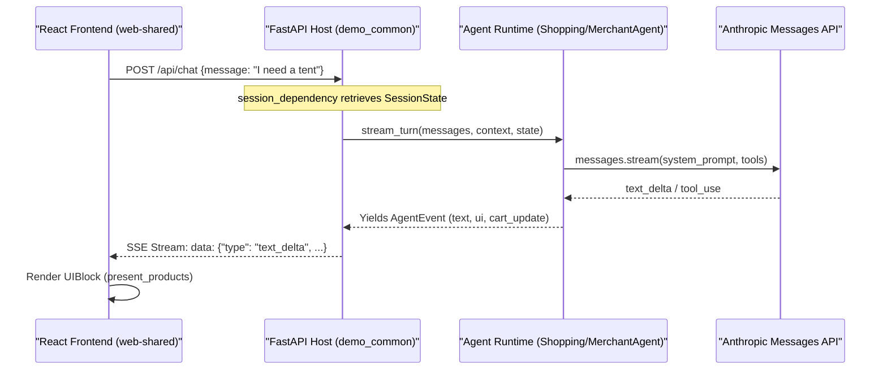
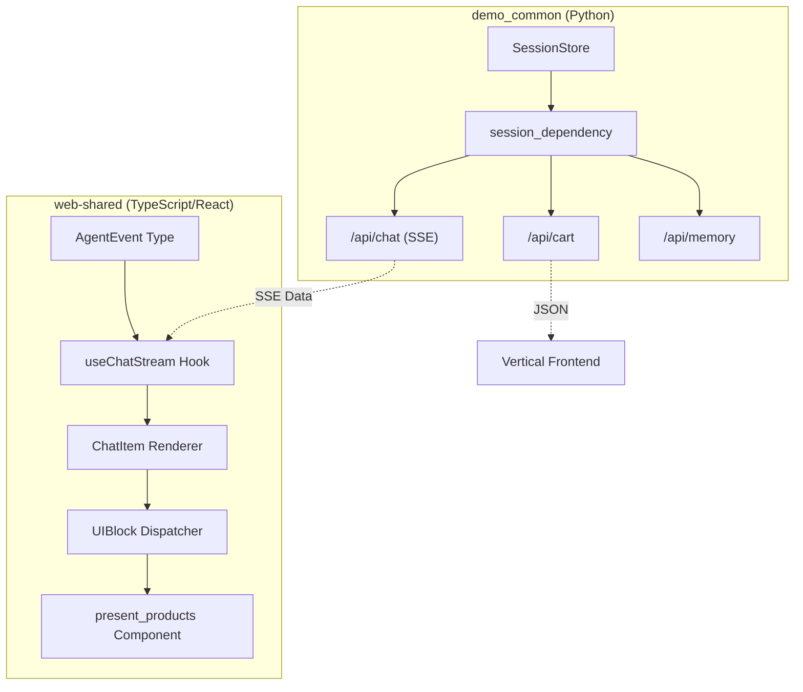

<!-- source: DeepWiki mcp.deepwiki.com · repo anthropics/commerce-agents · page 6.1 Shared Host Infrastructure (demo_common and web-shared) · fetched 2026-10-26 -->

# Shared Host Infrastructure (demo_common and web-shared)

Relevant source files

The following files were used as context for generating this wiki page:

- [docs/deployment.md](docs/deployment.md)
- [merchant-agent/managed-agents/scheduled-digest/run_morning_digest.py](merchant-agent/managed-agents/scheduled-digest/run_morning_digest.py)
- [scripts/check.py](scripts/check.py)
- [scripts/screenshot_tour.py](scripts/screenshot_tour.py)
- [scripts/smoke_chat.py](scripts/smoke_chat.py)
- [tests/test_platform_seams.py](tests/test_platform_seams.py)

The commerce-agents reference implementation provides a shared infrastructure layer that bridges the Python-based agent runtimes with the React-based frontend verticals. This infrastructure is split into two primary locations: `demo_common` (Python FastAPI host logic) and `web-shared` (TypeScript protocol types and React components).

## FastAPI Host Infrastructure (demo_common)

The shared host code provides a standardized way to mount agent runtimes as web APIs. It handles session persistence, Server-Sent Events (SSE) for streaming Claude's responses, and the management of storefront and merchant-specific state.

### Session Management
Session state is managed via `SessionStore` and injected into routes using `session_dependency`. This ensures that conversation history, cart state (for storefronts), and staged changes (for merchants) persist across requests.

*   **SessionStore**: A centralized repository for `ShoppingSessionState` and `MerchantSessionState`.
*   **session_dependency**: A FastAPI dependency that extracts the session ID from headers (typically `X-Session-Id`) and retrieves the associated state object.

### Route Patterns
The host infrastructure standardizes several key API endpoints used across all four vertical examples:

| Endpoint | Purpose | Key Symbols |
| :--- | :--- | :--- |
| `/api/chat` | SSE stream for agent turns. | `stream_turn`, `AgentEvent` |
| `/api/cart` | Retrieve or modify the current shopping cart. | `ShoppingCart`, `CartItem` |
| `/api/orders` | Retrieve order history for the session. | `Order`, `Fulfillment` |
| `/api/memory` | Interface for the durable fact storage system. | `MemoryStore`, `MemoryFact` |
| `/api/portal/approve` | (Merchant only) Host-side approval of staged changes. | `apply_change`, `ChangeLedger` |

### Data Flow: Chat SSE Stream
The following diagram illustrates how a natural language query flows from the UI through the shared host to the agent runtime and back.

**Natural Language to Code Entity Mapping: Chat Flow**

Sources: [scripts/smoke_chat.py:34-35](), [merchant-agent/managed-agents/scheduled-digest/run_morning_digest.py:58-70](), [docs/deployment.md:71-77]()

## Protocol and UI Components (web-shared)

The `web-shared` package defines the TypeScript interfaces that ensure the Python backend and React frontend agree on the data structures being exchanged.

### TypeScript Protocol Types
These types represent the core events emitted by the agents during a turn:

*   **AgentEvent**: The base envelope for all SSE data, including `text_delta`, `ui`, `cart_update`, `change_update`, and `turn_complete`.
*   **UIBlock**: A structured payload generated by a `PresentationComponent`. It contains a `component` name (e.g., `present_products`) and a `payload` specific to that component.
*   **TraceEntry**: Used in the activity panel to show the agent's internal reasoning steps and tool calls.
*   **ChatItem**: Represents a single entry in the conversation history, including text and any associated UI blocks.

### Shared React Components
The infrastructure includes a library of reusable UI components that handle the specialized rendering requirements of commerce agents:

1.  **Chat Interface**: Handles the SSE stream consumption and message list rendering.
2.  **Activity Panel**: A debugging and transparency tool that renders `TraceEntry` data, showing tool calls and "thought" process.
3.  **Memory Panel**: Renders durable facts stored in the `MemorySystem`.
4.  **Presentation Components**: Dynamic renderers for agent-specific outputs like `ProductCarousel`, `ComparisonTable`, `ChangePreview` (for merchant approvals), and `MorningDigest`.

## Integration with Vertical Examples

Each vertical (Retail, Travel, Telecom, Entertainment) imports these shared utilities to reduce boilerplate. The `scripts/run_demo.py` utility launches these FastAPI hosts, which then serve the `web-shared` components via a Vite-based frontend.

**Code Entity Mapping: Vertical Host Structure**

Sources: [scripts/check.py:44-49](), [scripts/screenshot_tour.py:28-31](), [merchant-agent/managed-agents/scheduled-digest/run_morning_digest.py:33-48]()

## Deployment and Platform Seams

The host infrastructure is designed to be platform-agnostic. While it defaults to the Anthropic API, it supports various backends via the `client` argument in the agent runtimes.

| Platform | Client Class | Configuration |
| :--- | :--- | :--- |
| Anthropic API | `AsyncAnthropic` | `ANTHROPIC_API_KEY` |
| GCP Vertex AI | `AsyncAnthropicVertex` | `project_id`, `region` |
| AWS Bedrock | `AsyncAnthropicBedrockMantle` | `aws_region` |
| Azure Foundry | `AsyncAnthropicFoundry` | `resource`, `api_key` |

Sources: [docs/deployment.md:9-17](), [docs/deployment.md:79-121](), [tests/test_platform_seams.py:29-72]()

---

