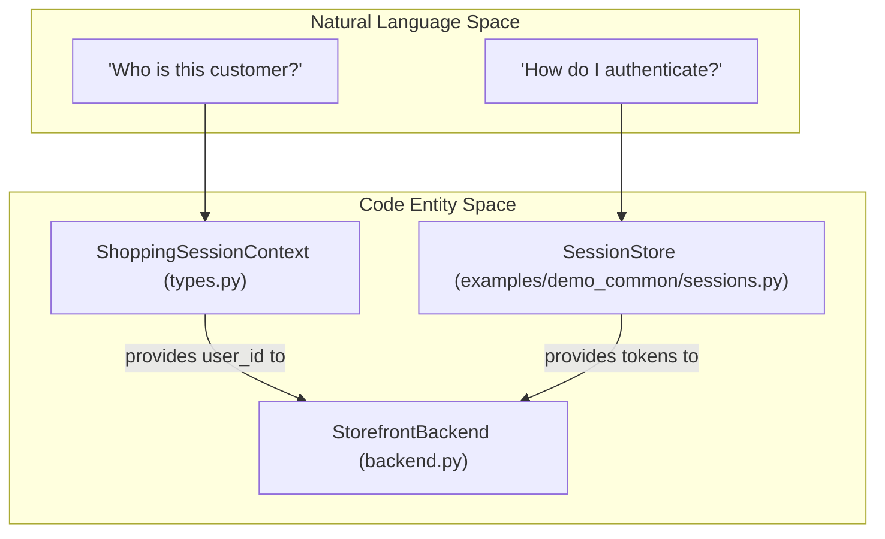
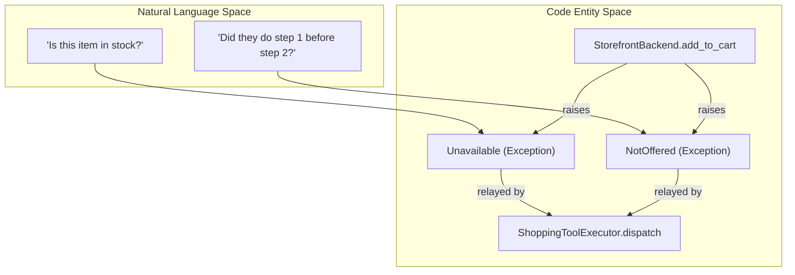

<!-- source: DeepWiki mcp.deepwiki.com · repo anthropics/commerce-agents · page 7 Backend Integration Guide · fetched 2026-10-26 -->

# Backend Integration Guide

Relevant source files

The following files were used as context for generating this wiki page:

- [docs/backends.md](docs/backends.md)
- [merchant-agent/core/merchant_agent/config.py](merchant-agent/core/merchant_agent/config.py)
- [merchant-agent/core/merchant_agent/types.py](merchant-agent/core/merchant_agent/types.py)
- [merchant-agent/skills/catalog-listings/SKILL.md](merchant-agent/skills/catalog-listings/SKILL.md)
- [plugins/commerce-builder/commands/scaffold-commerce-agent.md](plugins/commerce-builder/commands/scaffold-commerce-agent.md)
- [shopping-agent/core/shopping_agent/backend.py](shopping-agent/core/shopping_agent/backend.py)
- [shopping-agent/core/shopping_agent/config.py](shopping-agent/core/shopping_agent/config.py)
- [shopping-agent/core/shopping_agent/types.py](shopping-agent/core/shopping_agent/types.py)

This guide provides technical specifications for implementing the `StorefrontBackend` and `MerchantBackend` interfaces. These backends translate existing commerce systems (catalog, cart, metrics, etc.) into the structured records used by the agents.

## Identity and Credential Binding

The architecture enforces a strict separation between the agent's reasoning and the caller's identity. All backend methods receive a session context object which must carry the resolved identity of the user or operator.

### Identity Flow
1. **Host Resolution**: The host application (e.g., FastAPI in `examples/retail/api/main.py`) authenticates the caller before the agent is invoked [docs/backends.md:10-13]().
2. **Context Injection**: The identity (e.g., `user_id` or `merchant_id`) is placed in `ShoppingSessionContext` [shopping-agent/core/shopping_agent/types.py:188-192]() or `MerchantSessionContext`.
3. **Backend Access**: The backend implementation reads the identity from the `session` argument to filter data or authorize writes [docs/backends.md:12-13]().

### Credential Management
Credentials should never be passed through the model or stored in the agent's memory.
*   **Service Credentials**: Pass these to the backend constructor at initialization [docs/backends.md:20-20]().
*   **Per-User Tokens**: Store these in a secure subclass of the session context or a side-car store that the backend queries using the `session.user_id` [docs/backends.md:18-19]().

### Natural Language to Code: Identity Binding

Sources: [docs/backends.md:8-31](), [shopping-agent/core/shopping_agent/types.py:188-192](), [shopping-agent/core/shopping_agent/backend.py:44-55]()

---

## Catalog Mapping: Products and Variants

The agents support three primary catalog shapes. Implementing these correctly ensures that search results are navigable and cart operations are precise.

| Shape | Code Definition | Logic & Behavior |
| :--- | :--- | :--- |
| **Plain** | `Product` (no `options`) | Search returns it; `add_to_cart` takes its `product_id` directly [docs/backends.md:72-72](). |
| **Family** | `Product` (has `options`) | Represents a group (e.g., "Trail Tee"). Search returns this. The cart **refuses** family IDs [shopping-agent/core/shopping_agent/backend.py:98-99](). |
| **Variant** | `Product` (has `variant_of`) | Represents a specific SKU (e.g., "Trail Tee, Blue, Large"). Found in `ProductDetails.variants` [shopping-agent/core/shopping_agent/types.py:23-25](). |

### Mapping Guidelines
*   **Unified Namespace**: Family and variant IDs share one namespace. If your platform uses overlapping IDs, prefix them in the backend [docs/backends.md:77-78]().
*   **Price Logic**: For a family, the `price` field should reflect the lowest in-stock variant price [shopping-agent/core/shopping_agent/types.py:22-23]().
*   **Attributes**: Store non-varying facts (material, brand) in `attributes`. Store varying facts (size, color) in `options` (for families) and `option_values` (for variants) [shopping-agent/core/shopping_agent/types.py:30-45]().

Sources: [docs/backends.md:67-98](), [shopping-agent/core/shopping_agent/types.py:18-51](), [shopping-agent/core/shopping_agent/backend.py:96-101]()

---

## Ordered Flows and Exceptions

Backends must enforce business logic and step ordering. The agent relies on specific exception types to explain state to the user.

### Key Exceptions
1.  **`NotOffered`**: Used when a specific service (like delivery to a certain zip code) is not available for the item, but the system itself is functional [shopping-agent/core/shopping_agent/backend.py:30-34]().
2.  **`Unavailable`**: Specifically for `add_to_cart` when a product is out of stock or restricted [shopping-agent/core/shopping_agent/backend.py:37-42]().
3.  **Domain Errors**: Custom exceptions for multi-step flows (e.g., "Must verify ID before booking"). These should be mapped in the `ToolExecutor` to provide natural language feedback [docs/backends.md:34-41]().

### Natural Language to Code: Flow Control

Sources: [shopping-agent/core/shopping_agent/backend.py:30-42](), [docs/backends.md:32-50]()

---

## Checkout Handoff Patterns

The `checkout` tool does not process payments. It returns a `CheckoutHandoff` object that the host uses to redirect the user [shopping-agent/core/shopping_agent/types.py:86-90]().

*   **Internal Route**: Default behavior; the host links to its own `/checkout` page [docs/backends.md:58-58]().
*   **Hosted URL**: The backend returns a platform-specific URL (e.g., Stripe, Shopify) via `checkout_handoff` [shopping-agent/core/shopping_agent/backend.py:120-128]().
*   **Marketplace**: Return multiple `CheckoutHandoff` entries if the cart contains items from different sellers requiring separate payments [docs/backends.md:60-60]().

Sources: [docs/backends.md:51-65](), [shopping-agent/core/shopping_agent/types.py:86-95](), [shopping-agent/core/shopping_agent/backend.py:120-128]()

---

## Merchant Backend: Writes and Metrics

The `MerchantBackend` handles both analytical reads and staged writes.

### Staged Changes
Merchant writes follow a **Propose → Preview → Approve → Apply** lifecycle.
*   **Staging**: Tools like `stage_listing_update` create a `StagedChange` record [merchant-agent/skills/catalog-listings/SKILL.md:40-41]().
*   **Guardrails**: The backend or executor checks `MerchantAgentConfig` (e.g., `max_price_delta_pct`) during staging [merchant-agent/core/merchant_agent/config.py:48-57]().
*   **Approval**: If `require_host_approval` is `True`, the `apply_change` method must verify the change ID against `MerchantSessionState.approved_change_ids` [merchant-agent/core/merchant_agent/config.py:68-75]().

### Metrics and Missing Figures
When implementing `get_business_snapshot` or `query_metrics`:
*   **Nulls vs Zeros**: If a system cannot supply a figure (e.g., traffic data is missing), return `None`, never `0` [merchant-agent/core/merchant_agent/types.py:89-90]().
*   **Notes**: Use the `note` field (max 140 chars) to explain data gaps (e.g., "Traffic data unavailable for this period") [merchant-agent/core/merchant_agent/types.py:105-105]().

Sources: [merchant-agent/core/merchant_agent/types.py:87-126](), [merchant-agent/core/merchant_agent/config.py:48-79](), [merchant-agent/skills/catalog-listings/SKILL.md:10-10]()

---

