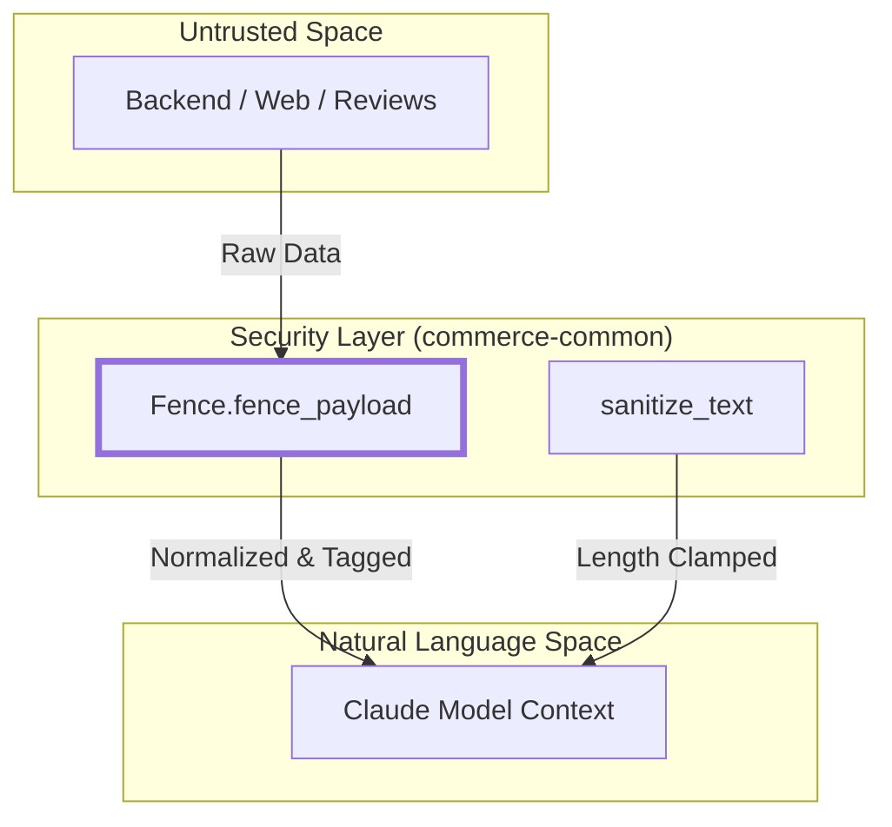
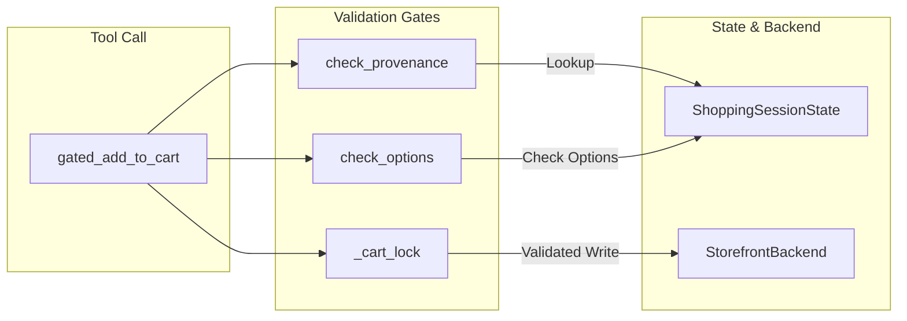

<!-- source: DeepWiki mcp.deepwiki.com · repo anthropics/commerce-agents · page 8 Safety and Security · fetched 2026-10-26 -->

# Safety and Security

Relevant source files

The following files were used as context for generating this wiki page:

- [commerce-common/commerce_common/execution.py](commerce-common/commerce_common/execution.py)
- [commerce-common/commerce_common/memory.py](commerce-common/commerce_common/memory.py)
- [commerce-common/tests/test_agent_sdk.py](commerce-common/tests/test_agent_sdk.py)
- [commerce-common/tests/test_execution.py](commerce-common/tests/test_execution.py)
- [commerce-common/tests/test_memory_facts.py](commerce-common/tests/test_memory_facts.py)
- [commerce-common/tests/test_memory_runtime.py](commerce-common/tests/test_memory_runtime.py)
- [commerce-common/tests/test_memory_stores.py](commerce-common/tests/test_memory_stores.py)
- [docs/deployment.md](docs/deployment.md)
- [docs/safety.md](docs/safety.md)
- [merchant-agent/core/merchant_agent/changes.py](merchant-agent/core/merchant_agent/changes.py)
- [merchant-agent/core/merchant_agent/grounding.py](merchant-agent/core/merchant_agent/grounding.py)
- [merchant-agent/core/tests/test_executor.py](merchant-agent/core/tests/test_executor.py)
- [merchant-agent/core/tests/test_gates.py](merchant-agent/core/tests/test_gates.py)
- [plugins/commerce-builder/skills/commerce-trust-safety/SKILL.md](plugins/commerce-builder/skills/commerce-trust-safety/SKILL.md)
- [shopping-agent/core/shopping_agent/gates.py](shopping-agent/core/shopping_agent/gates.py)
- [shopping-agent/core/shopping_agent/grounding.py](shopping-agent/core/shopping_agent/grounding.py)
- [shopping-agent/core/tests/test_gates.py](shopping-agent/core/tests/test_gates.py)
- [tests/test_consumption_paths.py](tests/test_consumption_paths.py)
- [tests/test_platform_seams.py](tests/test_platform_seams.py)

This page details the multi-layered safety and security architecture of the Claude Commerce Agents reference implementation. The system is designed to handle untrusted third-party content (catalog data, reviews, web search), prevent prompt injection, enforce transaction limits, and protect sensitive user identifiers through automated filtering and session-bound provenance.

## Fencing and Content Neutralization

The primary defense against prompt injection and malicious third-party content is **Fencing**. Every piece of data originating from a backend, web search, or user review is wrapped in XML-like tags and sanitized before being presented to the model.

*   **Sanitization**: The `Fence.fence_payload` function performs NFKC normalization, removes control characters, and neutralizes forged turn markers or special tokens `[commerce-common/commerce_common/fencing.py:1-20]()`.
*   **Role-Specific Fences**: The system uses distinct labels for different roles: `STOREFRONT_FENCE` for shoppers `[shopping-agent/core/shopping_agent/fencing.py:19]()` and `MERCHANT_FENCE` for merchant operations `[merchant-agent/core/merchant_agent/fencing.py:19]()`.
*   **Size Limits**: Fenced content is truncated at `max_fenced_chars` to prevent resource exhaustion or context window flooding `[plugins/commerce-builder/skills/commerce-trust-safety/SKILL.md:15-18]()`.
*   **UI Neutralization**: Hostile content in reviews (e.g., attempts to close the data fence and inject commands) is detected and replaced with `[removed]` `[merchant-agent/core/tests/test_executor.py:155-164]()`.

### Content Flow and Fencing Diagram

"Data Flow from Backend to Model"

Sources: `[commerce-common/commerce_common/fencing.py:1-20]()`, `[plugins/commerce-builder/skills/commerce-trust-safety/SKILL.md:13-24]()`

## Grounding and Intent Validation

Grounding ensures the model does not hallucinate information or answer based on stale data. It forces specific backend reads before the model can respond to certain query types.

*   **Lexicon Matchers**: Intent is detected using `matches_terms_and_cues` against config-driven lexicons like `policy_intent_terms` or `order_intent_terms` `[shopping-agent/core/shopping_agent/grounding.py:19-38]()`.
*   **Forced Tools**: In the Messages API runtime, grounding rules trigger a `tool_choice` to force the model to call a specific tool (e.g., `get_product_details`) when an unseen product ID is mentioned `[shopping-agent/core/shopping_agent/grounding.py:41-51]()`.
*   **Prefetching**: The Agent SDK runtime can prefetch grounding data to reduce latency, appending it to the user message with a specific `prefetch_intro` `[commerce-common/commerce_common/agent_sdk.py:98-107]()`.

Sources: `[shopping-agent/core/shopping_agent/grounding.py:1-73]()`, `[commerce-common/commerce_common/agent_sdk.py:81-128]()`

## Write Gates and Provenance

To prevent unauthorized or accidental modifications, all mutation tools (cart updates, merchant changes) are protected by **Provenance Gates**.

*   **Session Provenance**: An agent can only act on entities (Product IDs, Listing IDs) that it has explicitly "seen" in the current session via a read tool `[shopping-agent/core/shopping_agent/gates.py:40-45]()`.
*   **Cart Provenance**: `check_provenance` in the shopping agent ensures that `add_to_cart` only accepts IDs returned by catalog or order tools `[shopping-agent/core/shopping_agent/gates.py:29-37]()`.
*   **Merchant Provenance**: The merchant agent enforces `check_listing_provenance` for staging updates and `seen_changes` for applying them `[merchant-agent/core/tests/test_executor.py:67-76]()`.
*   **Concurrency**: Session-level locks (`_cart_lock`) prevent race conditions during cart mutations, ensuring limits are enforced correctly across concurrent tool calls `[shopping-agent/core/shopping_agent/gates.py:86-95]()`.

### Cart Mutation Safety Diagram

"Cart Write Security Pipeline"

Sources: `[shopping-agent/core/shopping_agent/gates.py:102-131]()`, `[shopping-agent/core/tests/test_gates.py:105-132]()`

## Limits and Caps

The system enforces hard limits to prevent abuse and ensure stability:
*   **Quantity Caps**: `max_quantity_per_item` clamps the number of items in a single cart line `[shopping-agent/core/shopping_agent/gates.py:120-123]()`.
*   **Cart Size**: `max_cart_lines` limits the total number of distinct items in the cart `[shopping-agent/core/shopping_agent/gates.py:118-119]()`.
*   **Search Limits**: `clamp_limit` ensures model-requested search counts do not exceed the `max_search_results` ceiling `[commerce-common/commerce_common/execution.py:64-67]()`.
*   **Analysis Isolation**: The Merchant Analysis delegate is limited by `max_delegate_calls_per_turn` to prevent infinite loops or excessive cost `[commerce-common/commerce_common/execution.py:116-118]()`.

## Memory Security and Privacy

Durable memory is protected by a write filter and a post-turn extraction process.

*   **MemoryWriteFilter**: Rejects facts containing sensitive patterns like credit card numbers (IBAN, 16-digit strings), email addresses, or phone numbers `[commerce-common/commerce_common/memory.py:130-139]()`.
*   **Validation**: Every fact is validated for length (Key: 64 chars, Value: 200 chars) and normalized before storage `[commerce-common/commerce_common/memory.py:183-184]()`.
*   **Provenance Tagging**: Facts are tagged with a `session_tag` (a HMAC-based hash) rather than the raw session ID to prevent session leakage `[commerce-common/commerce_common/turn.py:29-30]()`.
*   **Purge Awareness**: `extract_and_store` checks the `purge_generation` to ensure facts extracted from a session are not stored if the user cleared their memory while the model was processing `[commerce-common/commerce_common/memory.py:7-8]()`.

Sources: `[commerce-common/commerce_common/memory.py:122-184]()`, `[commerce-common/tests/test_memory_facts.py:72-103]()`

## Analysis Isolation

The Merchant Agent's `AnalysisRunner` uses a sub-agent to perform complex data tasks.
*   **SQL Safety**: `check_analysis_sql` (implemented in the backend) must validate that generated queries are read-only and scoped to the current merchant `[merchant-agent/core/merchant_agent/executor.py:34-36]()`.
*   **Sandbox**: If `MERCHANT_ANALYSIS_CODE_EXECUTION` is enabled, code runs in the `code_execution_20260120` sandbox provided by the Anthropic API, which is isolated from the host environment `[docs/deployment.md:31-36]()`.

## Deployment Requirements

A secure deployment must implement the following:
1.  **Identity Binding**: The host must bind the authenticated user/merchant to the `session_id` on the server side. The agent code never receives raw credentials `[plugins/commerce-builder/skills/commerce-trust-safety/SKILL.md:54-59]()`.
2.  **No-Payment Guarantee**: The reference implementation contains no tools for charging cards or processing payments. The `checkout` tool only provides a summary; final payment must happen in a host-controlled UI `[plugins/commerce-builder/skills/commerce-trust-safety/SKILL.md:34-36]()`.
3.  **Local Bind**: MCP servers default to loopback (`127.0.0.1`) to prevent external access unless explicitly configured with an authenticating gateway `[commerce-common/commerce_common/mcp_server.py:83-84]()`.

Sources: `[docs/deployment.md:1-29]()`, `[plugins/commerce-builder/skills/commerce-trust-safety/SKILL.md:54-85]()`

---

