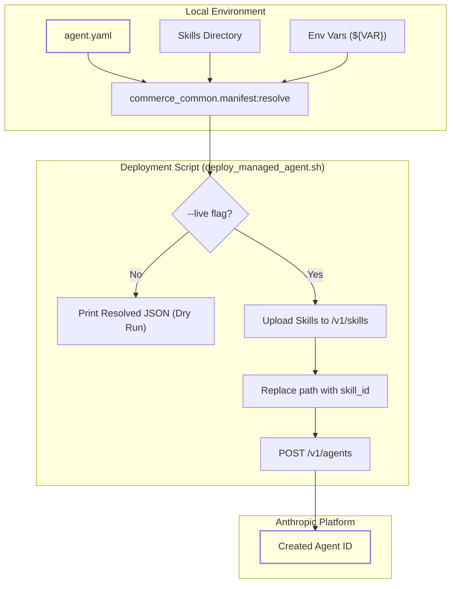
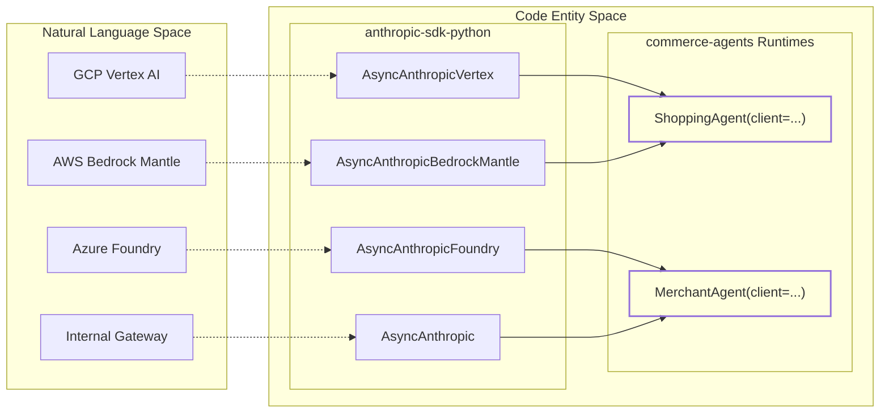

<!-- source: DeepWiki mcp.deepwiki.com · repo anthropics/commerce-agents · page 9 Deployment and Platform Configuration · fetched 2026-10-26 -->

# Deployment and Platform Configuration

Relevant source files

The following files were used as context for generating this wiki page:

- [commerce-common/commerce_common/manifest.py](commerce-common/commerce_common/manifest.py)
- [docs/deployment.md](docs/deployment.md)
- [merchant-agent/runtime-agent-sdk/merchant_agent_sdk/_paths.py](merchant-agent/runtime-agent-sdk/merchant_agent_sdk/_paths.py)
- [scripts/deploy_managed_agent.sh](scripts/deploy_managed_agent.sh)
- [scripts/run_demo.py](scripts/run_demo.py)
- [shopping-agent/runtime-agent-sdk/shopping_agent_sdk/_paths.py](shopping-agent/runtime-agent-sdk/shopping_agent_sdk/_paths.py)
- [tests/test_platform_seams.py](tests/test_platform_seams.py)

This page details how to deploy the Commerce Agents reference implementation across various cloud platforms and gateway infrastructures. While the codebase defaults to the Anthropic API, it provides standardized seams for **GCP Vertex AI**, **AWS Bedrock**, **Microsoft Foundry**, and **in-house gateways** across all three runtime paths (Messages API, Agent SDK, and Managed Agents).

## Platform Support Matrix

The following table outlines the availability of core features across supported platforms:

| Path | Anthropic API | GCP Vertex AI | AWS Bedrock | Microsoft Foundry | In-house gateway |
| :--- | :--- | :--- | :--- | :--- | :--- |
| **Messages API runtimes** | Yes | Yes | Yes | Yes | Yes |
| **Agent SDK runtimes** | Yes | Yes | Yes | Yes | Yes |
| **Managed Agents** | Yes | No | No¹ | No | Yes² |
| **Merchant Analysis (Code)** | Yes | No | No | Yes³ | No |
| **Merchant Analysis (SQL)** | Yes | Yes | Yes | Yes | Yes |

¹ Managed Agents on AWS are available via the [Claude Platform on AWS](https://platform.claude.com/docs/en/build-with-claude/claude-platform-on-aws) using standard `/v1` endpoints [docs/deployment.md:38-43]().
² Supported via pass-through proxy for the deploy script [docs/deployment.md:27]().
³ Foundry deployments hosted on Anthropic infrastructure only [docs/deployment.md:28-29]().

**Sources:** [docs/deployment.md:9-17](), [docs/deployment.md:38-43]()

---

## Configuration Mechanisms by Runtime

Each runtime path uses a specific mechanism to select and authenticate with a target platform.

### 1. Messages API Runtimes (`client=` parameter)
The `ShoppingAgent` and `MerchantAgent` classes accept an optional `client` argument. If omitted, they default to `AsyncAnthropic`, which reads `ANTHROPIC_API_KEY` and `ANTHROPIC_BASE_URL` from the environment [docs/deployment.md:71-74](). To target other platforms, inject the corresponding client from the `anthropic` Python package.

**Platform Client Mapping:**
*   **GCP Vertex AI:** `AsyncAnthropicVertex` [docs/deployment.md:97]()
*   **AWS Bedrock (Mantle):** `AsyncAnthropicBedrockMantle` [docs/deployment.md:106]()
*   **AWS Bedrock (Invoke):** `AsyncAnthropicBedrock` [tests/test_platform_seams.py:53-54]()
*   **Microsoft Foundry:** `AsyncAnthropicFoundry` [docs/deployment.md:113]()
*   **In-house Gateway:** `AsyncAnthropic(base_url=...)` [docs/deployment.md:119]()

### 2. Agent SDK Runtimes (CLI Environment)
The SDK runtimes do not construct HTTP clients directly. Instead, they wrap the Claude Code CLI. Platform selection is controlled by updating the `options.env` dictionary returned by `make_options()` before initializing the `ClaudeSDKClient` [docs/deployment.md:128-132]().

**Key Environment Variables:**
*   `CLAUDE_CODE_USE_VERTEX=1` [docs/deployment.md:24]()
*   `CLAUDE_CODE_USE_BEDROCK=1` or `CLAUDE_CODE_USE_MANTLE=1` [docs/deployment.md:24]()
*   `CLAUDE_CODE_USE_FOUNDRY=1` [docs/deployment.md:24]()
*   `ANTHROPIC_BASE_URL` (for gateways) [docs/deployment.md:24]()

### 3. Managed Agents (Deploy Script)
Managed Agents are deployed using the `scripts/deploy_managed_agent.sh` script. This script interacts with the `/v1/agents` and `/v1/skills` endpoints [scripts/deploy_managed_agent.sh:5-11](). The `ANTHROPIC_API_URL` environment variable can be used to point the script at a gateway or regional proxy [scripts/deploy_managed_agent.sh:20]().

**Sources:** [docs/deployment.md:19-25](), [tests/test_platform_seams.py:29-72](), [scripts/deploy_managed_agent.sh:19-23]()

---

## Model Identifiers

Model IDs are defined in the agent configuration (`model`, `memory_model`, and `analysis_model`) [docs/deployment.md:47-48](). Because ID formats vary by platform, these must be updated when switching providers.

| Platform | Format Example | Notes |
| :--- | :--- | :--- |
| **Anthropic / Gateways** | `claude-sonnet-5` | First-party IDs. |
| **GCP Vertex AI** | `claude-sonnet-5@20251001` | Uses `@` for dated snapshots [docs/deployment.md:59](). |
| **AWS Bedrock (Mantle)** | `anthropic.claude-sonnet-5` | Uses `anthropic.` prefix [docs/deployment.md:60-61](). |
| **AWS Bedrock (Invoke)** | `us.anthropic.claude-sonnet-5` | Region-prefixed inference profile IDs [docs/deployment.md:61-62](). |
| **Microsoft Foundry** | `claude-sonnet-5` | Deployment name in your Azure resource [docs/deployment.md:63-64](). |

**Sources:** [docs/deployment.md:53-67](), [tests/test_platform_seams.py:29-72]()

---

## Deployment Data Flow: Managed Agents

The Managed Agents path involves resolving a local `agent.yaml` manifest, uploading skill files, and creating the agent record on the Anthropic platform.

### Managed Agent Deployment Logic

**Sources:** [commerce-common/commerce_common/manifest.py:108-142](), [scripts/deploy_managed_agent.sh:65-95]()

---

## Implementation Details: Platform Seams

The following diagram maps the logical platform selection to the specific code entities responsible for instantiation.

### Code Entity Mapping: Platform Clients

**Sources:** [docs/deployment.md:82-121](), [tests/test_platform_seams.py:114-130]()

---

## Deployment Utilities

### `deploy_managed_agent.sh`
A shell script that orchestrates the multi-step deployment process for Managed Agents [scripts/deploy_managed_agent.sh:1-15]().
*   **Dry Run:** Validates the `agent.yaml` and prints the final JSON payload without making API calls [scripts/deploy_managed_agent.sh:53-57]().
*   **Live Deploy:** Iterates through local skill directories, uploads them to `/v1/skills`, captures the returned `skill_id`, and performs the final `POST` to `/v1/agents` [scripts/deploy_managed_agent.sh:67-95]().

### `commerce_common.manifest`
A Python module used by the deploy script to process manifests [commerce-common/commerce_common/manifest.py:4-10]().
*   **`load_manifest(path)`**: Parses the YAML file [commerce-common/commerce_common/manifest.py:37-44]().
*   **`substitute_env(value, require)`**: Replaces `${VAR}` placeholders with environment variable values [commerce-common/commerce_common/manifest.py:62-82]().
*   **`resolve(manifest_path, skill_ids)`**: Inlines the `system_file` content and maps local skill paths to API-compatible skill references [commerce-common/commerce_common/manifest.py:108-142]().

### `run_demo.py`
A developer utility for local testing of vertical examples [scripts/run_demo.py:4-19](). It manages:
*   **Port Selection:** Automatically finds free ports for the FastAPI backend and Next.js frontend [scripts/run_demo.py:75-82]().
*   **Dependency Checking:** Ensures `pip` and `npm` packages are installed before execution [scripts/run_demo.py:134-157]().
*   **Process Management:** Spawns and monitors the API and web servers as a single process group [scripts/run_demo.py:160-167]().

**Sources:** [scripts/deploy_managed_agent.sh:1-104](), [commerce-common/commerce_common/manifest.py:1-186](), [scripts/run_demo.py:1-187]()

---

