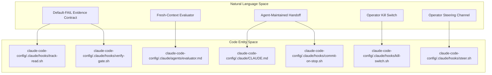
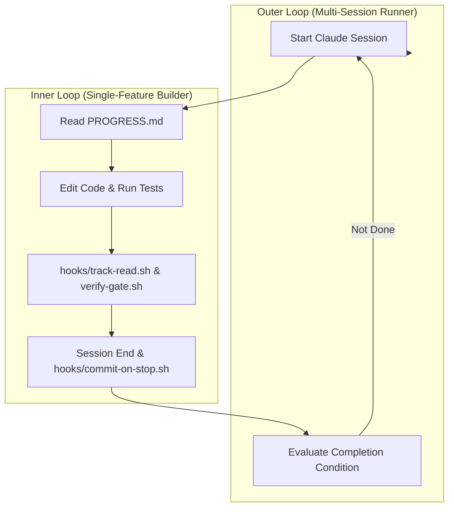

<!-- source: DeepWiki mcp.deepwiki.com · repo anthropics/cwc-long-running-agents · page 1 Overview · fetched 2026-10-26 -->

# Overview

Relevant source files

The following files were used as context for generating this wiki page:

- [README.md](README.md)
- [claude-code-config/README.md](claude-code-config/README.md)

This repository provides harness primitives for long-running Claude Code agents, translating research patterns from Anthropic engineering into concrete, inspectable [hooks](https://code.claude.com/docs/en/hooks) and [subagents](https://code.claude.com/docs/en/sub-agents) [README.md:1-3](). The core purpose is to solve common failure modes in autonomous coding—such as agents prematurely claiming success, losing context across long sessions, or drifting from project goals—by enforcing structural quality gates [README.md:11-16].

For installation, prerequisites, and setup instructions, see [Getting Started](#1.1). For details on directory structures and runtime state files, see [Repository Layout and Runtime State Files](#1.2).

Sources: [README.md:1-18]()

---

## 1.1. Getting Started

Setting up the harness requires copying the configuration directory into a target project, ensuring hook scripts are executable, and provisioning a results tracker [README.md:25-34]. The runtime depends on baseline environment tools including `bash`, `git`, and `python3` (which the hook scripts rely on for JSON parsing) [claude-code-config/README.md:5-5]. 

For a complete walkthrough of installation steps, environment requirements, results file initialization, and session startup procedures, see [Getting Started](#1.1).

Sources: [README.md:25-34](), [claude-code-config/README.md:5-11]()

---

## 1.2. Repository Layout and Runtime State Files

The repository organizes its configuration under `claude-code-config/.claude/`, containing native hook scripts, agent definitions, and baseline documentation conventions [README.md:44-46]. During execution, the system generates ephemeral runtime state files—such as stop triggers, steering inputs, progress logs, test results, and evidence reads—to coordinate state between agent sessions and operator controls [claude-code-config/README.md:13-20].

For a full map of the `.claude/` directory tree, ephemeral runtime files, ignore policies, and license details, see [Repository Layout and Runtime State Files](#1.2).

Sources: [README.md:44-46](), [claude-code-config/README.md:13-28]()

---

## The Outer/Inner Loop Model and Quality Pillars

The harness architecture relies on an inner/outer loop model governed by three quality pillars and two operator controls [README.md:11-17]. The inner loop executes single-feature development cycles, protected by a default-FAIL evidence contract and fresh-context evaluations [README.md:13-15, 60]. The outer loop manages multi-session progression via persistence files and automated wrapper scripts [README.md:64], [claude-code-config/README.md:29].

Below is an architectural mapping bridging natural language concepts to their concrete code entities within the repository:

### Diagram: Harness Architecture Mapping

Sources: [README.md:42-46](), [claude-code-config/README.md:13-20]()

### Diagram: Outer and Inner Loop Execution Flow

Sources: [README.md:60-64](), [claude-code-config/README.md:29-29]()

---

