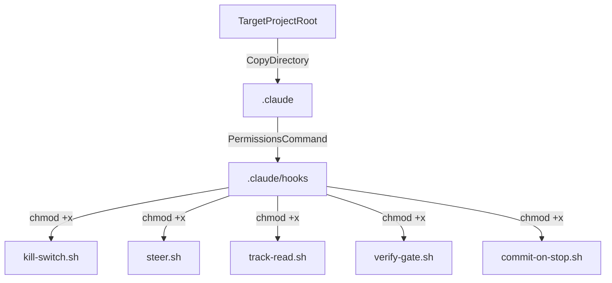
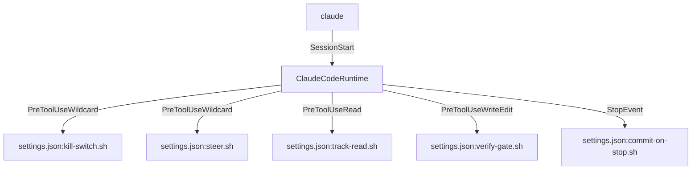

<!-- source: DeepWiki mcp.deepwiki.com · repo anthropics/cwc-long-running-agents · page 1.1 Getting Started · fetched 2026-10-26 -->

# Getting Started

<details>
<summary>Relevant source files</summary>

The following files were used as context for generating this wiki page:

- [claude-code-config/.claude/settings.json](claude-code-config/.claude/settings.json)
- [claude-code-config/README.md](claude-code-config/README.md)

</details>


## Purpose and Scope

This page covers the initial setup and configuration required to deploy the long-running agent harness primitives into a target project. It details the system requirements, the file-system installation procedure, hook permissions configuration, the creation of the mandatory verification contract file (`test-results.json`), and the execution of the Claude Code runtime environment.

Sources: `[claude-code-config/README.md:1-11]()`

---

## System Requirements and Environment Setup

Before integrating the `.claude` configuration directory into a project, ensure the host environment satisfies the following dependencies:

*   **`bash`**: Required to execute the shell scripts located in `.claude/hooks/`.
*   **`git`**: Required for version control hooks, specifically session checkpoint commits (`commit-on-stop.sh`).
*   **`python3`**: Required by the hook scripts to parse incoming and outgoing JSON payloads via standard input and output. If `python3` is missing from the environment, the hook scripts will silently no-op.

Sources: `[claude-code-config/README.md:5-6]()`

---

## Installation and Hook Permissions

The harness configuration is distributed as a self-contained `.claude/` directory that must be copied into the root of your target project. Once copied, execution permissions must be granted to all shell scripts within the hooks subdirectory.

The diagram below maps the natural language installation actions to the underlying code entities and file structures.


*Sources: [claude-code-config/README.md:7-11]()*

To install the configuration via terminal commands, execute the following block:

```bash
cp -r .claude/ /path/to/your/project/
chmod +x /path/to/your/project/.claude/hooks/*.sh
```
Sources: `[claude-code-config/README.md:7-9]()`

---

## Configuring the Test Results Contract

The verification gate primitives rely on a tracking file in the project root to enforce the default-FAIL contract. By default, this file is named `test-results.json`, though it can be overridden via the `RESULTS_FILE` environment variable.

Create a minimal initial `test-results.json` file in your project root before launching the agent:

```json
{ 
  "feature-1": { "passes": false }, 
  "feature-2": { "passes": false } 
}
```

The shape of this JSON file is flexible and defined entirely by your project requirements. The `verify-gate.sh` script verifies that the file exists and that the agent has reviewed evidence (such as a screenshot or log file) before allowing write or edit actions against protected targets.

Sources: `[claude-code-config/README.md:21-28]()`

---

## Initializing and Running Claude Code

Once the configuration is in place, the hooks registered in `[claude-code-config/.claude/settings.json:2-31]()` govern tool usage and session lifecycle events.

The following diagram illustrates how runtime events bridge to the registered hook handlers in `settings.json`:


*Sources: [claude-code-config/.claude/settings.json:2-31](), [claude-code-config/README.md:10-18]()*

To launch the agent with the newly established hooks and configurations, navigate to your project directory and invoke the CLI:

```bash
cd /path/to/your/project && claude
```

Sources: `[claude-code-config/README.md:10]()`

---

