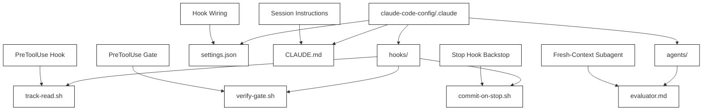
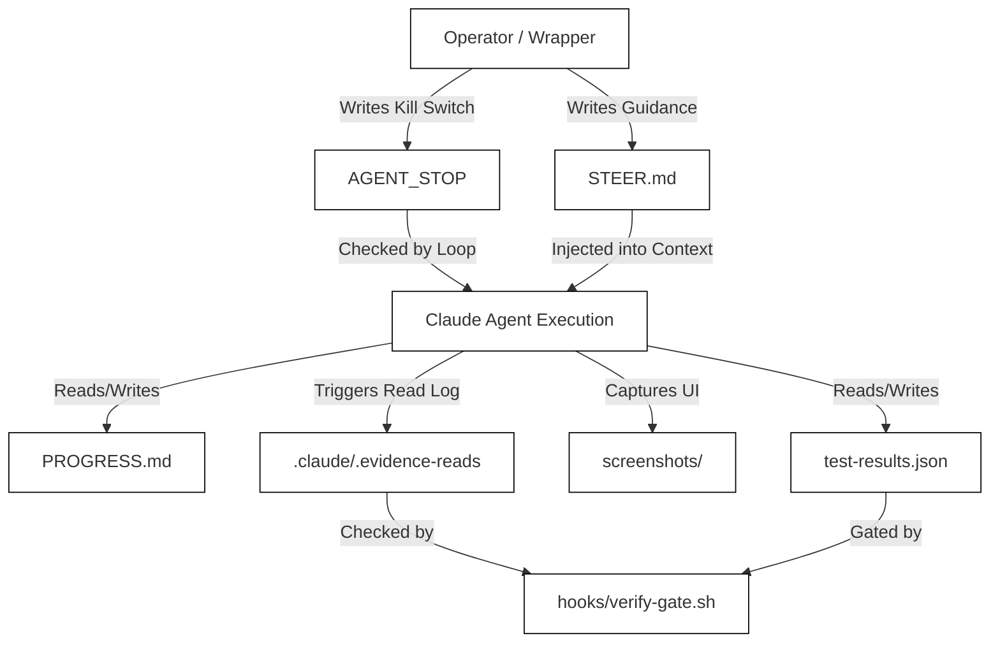

<!-- source: DeepWiki mcp.deepwiki.com · repo anthropics/cwc-long-running-agents · page 1.2 Repository Layout and Runtime State Files · fetched 2026-10-26 -->

# Repository Layout and RuntimeState Files

<details>
<summary>Relevant source files</summary>

The following files were used as context for generating this wiki page:

- [.gitignore](.gitignore)
- [LICENSE](LICENSE)
- [README.md](README.md)

</details>


## Purpose and Scope
This page maps the exact file layout of the `claude-code-config/.claude` configuration tree and defines the ephemeral runtime state files used across long-running agent sessions. It details how the harness structures its persistent configuration versus its dynamic, uncommitted runtime states (`AGENT_STOP`, `STEER.md`, `PROGRESS.md`, `test-results.json`, `screenshots/`, and `.claude/.evidence-reads`), along with `.gitignore` enforcement policies and the `LICENSE` terms.

Sources: [README.md:1-69](), [.gitignore:1-7]()

---

## The `claude-code-config/.claude` Directory Tree

The configuration directory `.claude` contains the core hooks, subagent definitions, session instructions, and tool wiring required by the harness. When deploying the harness to a target project, the entire `.claude` folder is copied into the project root [README.md:25-34]().


*Figure 1.1: Directory Layout bridging natural language configuration to code entity space.*

### Key Components of `.claude/`
- **`hooks/`**: Shell scripts executed by Claude Code via `settings.json` wiring [README.md:42-46](). Includes `track-read.sh`, `verify-gate.sh`, and `commit-on-stop.sh`.
- **`agents/`**: Contains subagent system prompts, specifically `evaluator.md` which implements the fresh-context evaluator [README.md:45]().
- **`CLAUDE.md`**: Session instructions and architecture guide loaded at the start of agent runs [README.md:46]().
- **`settings.json`**: JSON configuration mapping native Claude Code hooks (`PreToolUse`, `Stop`) to the shell script executables [README.md:42-46]().

Sources: [README.md:21-47]()

---

## Ephemeral Runtime State Files

During execution, the harness relies on several ephemeral state files and directories created at the project root or inside `.claude/`. These files govern control loops, evidence tracking, progresshandoffs, and quality gates.


*Figure 1.2: Ephemeral runtime state data flow across operator controls and agent operations.*

### Summary of Ephemeral Runtime Files

| File / Directory | Path | Role / Description |
|---|---|---|
| **Kill Switch** | `AGENT_STOP` | Presence signals an immediate halt requirement for the outer loop [README.md:1-69](). |
| **Steering Channel** | `STEER.md` | Injected operator instructions for runtime redirection between sessions [README.md:1-69](). |
| **Handoff Notes** | `PROGRESS.md` | Agent-maintained work log tracking completed features and current context [README.md:64](). |
| **Criteria Ledger** | `test-results.json` | Default-FAIL data structure tracking feature pass/fail boolean states [README.md:50-54](). |
| **Visual Evidence** | `screenshots/` | Directory storing visual inspection artifacts required to pass gates [README.md:56](). |
| **Read Evidence Log** | `.claude/.evidence-reads` | Ephemeral log populated by `track-read.sh` recording accessed evidence paths [README.md:44](). |

Sources: [README.md:42-65](), [.gitignore:1-7]()

---

## Git Ignore Policy and Licensing

### `.gitignore` Enforcement
Because ephemeral state files (`AGENT_STOP`, `STEER.md`, `PROGRESS.md`, `test-results.json`, `screenshots/`, and `.claude/.evidence-reads`) are modified dynamically during agent execution, they must be excluded from version control to prevent repository pollution [.gitignore:1-7](). 

The project `.gitignore` explicitly ignores these runtime artifacts:
```text
# Ephemeral state the hooks read/write at runtime; don't commit.
.claude/.evidence-reads
AGENT_STOP
STEER.md
PROGRESS.md
test-results.json
screenshots/
```
Sources: [.gitignore:1-7]()

### Licensing
The codebase is distributed under the Apache License, Version 2.0, permitting use, reproduction, modification, and distribution under standard Apache-2.0 terms [LICENSE:1-126]().

Sources: [LICENSE:1-126]()

---

