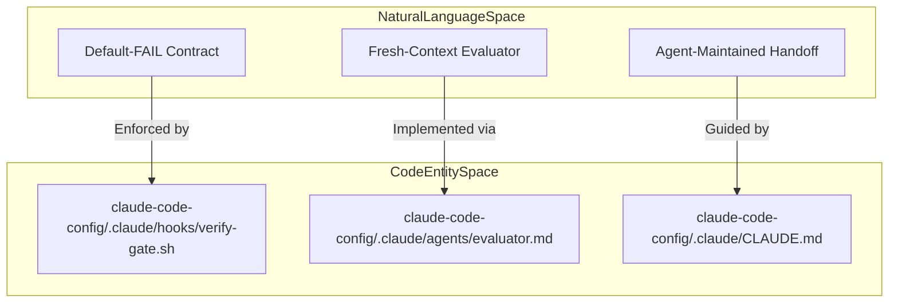
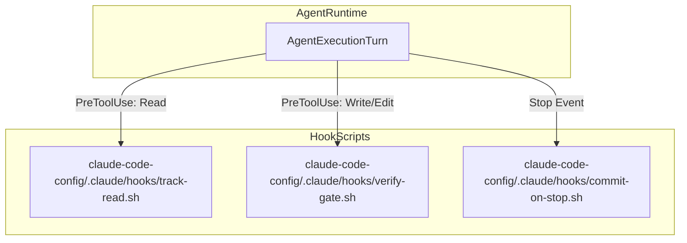

<!-- source: DeepWiki mcp.deepwiki.com · repo anthropics/cwc-long-running-agents · page 2 Harness Primitives and Quality Loop · fetched 2026-10-26 -->

# Harness Primitives and Quality Loop

Relevant source files

The following files were used as context for generating this wiki page:

- [README.md](README.md)

This page provides a conceptual overview of the three core pillars that compose the quality loop for long-running agents in the codebase, along with their associated operator control mechanisms `[README.md:11-18]`. 

The harness relies on structural enforcement rather than prompt instructions alone to ensure reliability across extended execution spans `[README.md:13-17]`.

Title: Quality Loop Architecture (Natural Language to Code Entities)

Sources: `README.md:11-17`, `README.md:44-47`

---

## Default-FAIL Evidence Contract

The default-FAIL contract ensures that criteria start in a failing state (`false`) within tracking files such as `test-results.json` `[README.md:13, README.md:48-54]`. Agents are structurally prohibited from marking features as passing without first opening valid evidence files (such as screenshots or console logs) via the Read tool `[README.md:13, README.md:56]`. 

This contract is enforced at runtime by pre-tool use hooks `[README.md:44]`. For details on criteria initialization, write gating via `track-read.sh` and `verify-gate.sh`, and known security limitations, see [Default-FAIL Evidence Contract](#2.1).

Sources: `README.md:13`, `README.md:44`, `README.md:48-57`

---

## Fresh-Context Evaluator Subagent

To prevent builders from grading their own work, a separate subagent configuration (`evaluator.md`) operates without Write or Edit tools `[README.md:14, README.md:58-60]`. It evaluates the git diff and evidence files from a clean context window that has not observed the build process `[README.md:14, README.md:60]`.

The evaluator outputs either a `PASS` or `NEEDS_WORK` verdict, generating structured findings that guide subsequent builder sessions `[README.md:60]`. For details on the review procedure, prompt configuration, and feedback protocol, see [Fresh-Context Evaluator Subagent](#2.2).

Sources: `README.md:14`, `README.md:58-60`

---

## Session Handoff and Progress Tracking

Long-running operations suffer from context window degradation and memory loss across sessions `[README.md:64]`. The agent-maintained handoff pattern addresses this by restricting each session to a single feature, maintaining structured status in `PROGRESS.md`, and leveraging git commits as a persistent historical record `[README.md:64]`.

A hook script serves as a backstop to commit uncommitted work when a session terminates `[README.md:46, README.md:64]`. For details on handoff conventions, proof requirements, and commit backstops, see [Session Handoff and Progress Tracking](#2.3).

Sources: `README.md:15`, `README.md:46`, `README.md:61-66`

---

## Operator Controls: Kill Switch and Steering

In addition to the core quality loop pillars, the harness incorporates operator control mechanisms allowing human supervisors to intervene during execution `[README.md:17]`. These controls provide immediate runtime termination and dynamic steering capabilities via designated state files.

For details on JSON block decision protocols, the `AGENT_STOP` kill switch, `STEER.md` steering channels, and trust-boundary caveats, see [Operator Controls: Kill Switch and Steering](#2.4).

Sources: `README.md:17`

---

Title: Hook and Execution Flow

Sources: `README.md:44-46`

---

