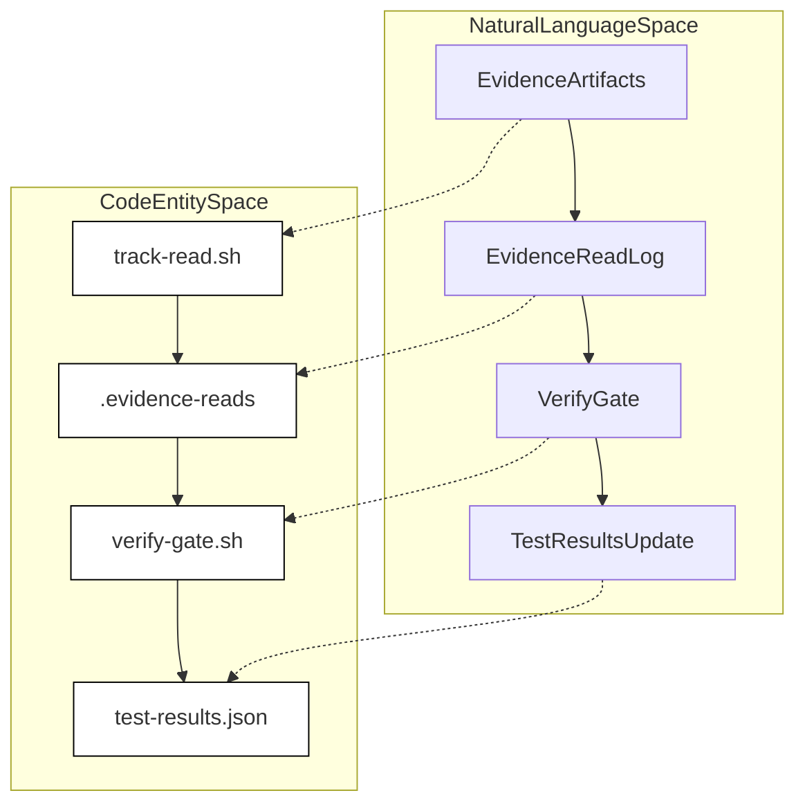
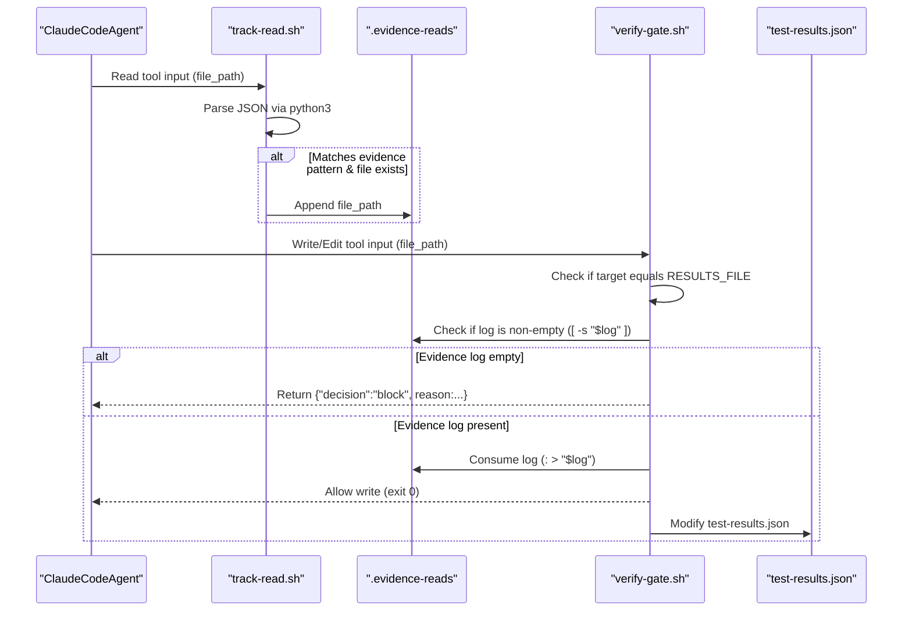

<!-- source: DeepWiki mcp.deepwiki.com · repo anthropics/cwc-long-running-agents · page 2.1 Default-FAIL Evidence Contract · fetched 2026-10-26 -->

# Default-FAIL Evidence Contract

<details>
<summary>Relevant source files</summary>

The following files were used as context for generating this wiki page:

- [claude-code-config/.claude/hooks/track-read.sh](claude-code-config/.claude/hooks/track-read.sh)
- [claude-code-config/.claude/hooks/verify-gate.sh](claude-code-config/.claude/hooks/verify-gate.sh)

</details>


## Purpose and Scope

The Default-FAIL Evidence Contract is a core harness primitive designed to prevent hallucinated test passes by long-running Claude Code agents. In autonomous execution loops, agents may be tempted to mark test criteria as passing in `test-results.json` without actually executing the tests or inspecting the outcomes. 

This contract enforces an empirical verification loop:
1. **Default-FAIL**: Test criteria and results start in a non-passing state or require explicit validation.
2. **Read-Gated Writes**: Modifying the results file (`test-results.json`) via `Write` or `Edit` tools is strictly gated [claude-code-config/.claude/hooks/verify-gate.sh:5-6] behind prior read actions of legitimate evidence artifacts (screenshots, console logs, or result text files) [claude-code-config/.claude/hooks/track-read.sh:4-9].
3. **Ephemeral Evidence Tracking**: Every session must independently accumulate read evidence, which is consumed upon a successful write gate validation [claude-code-config/.claude/hooks/verify-gate.sh:28-29].

---

## Conceptual Architecture and Code Mapping

To bridge natural language concepts to concrete implementation artifacts, the evidence contract relies on shell hook scripts, ephemeral log files, and configuration environment variables.



### Sources
* `[claude-code-config/.claude/hooks/track-read.sh:1-11]()`
* `[claude-code-config/.claude/hooks/verify-gate.sh:1-29]()`

---

## Interaction of `track-read.sh` and `verify-gate.sh`

The runtime enforcement mechanism relies on two hook scripts intercepting tool use events:

1. **`track-read.sh`**: Intercepts `Read` tool invocations. It checks if the accessed file matches known evidence patterns (`*screenshots/*`, `*-console.txt`, `*-result.txt`, `*.png`). If matched and the file exists, the path is appended to an ephemeral evidence read log [claude-code-config/.claude/hooks/track-read.sh:6-10].
2. **`verify-gate.sh`**: Intercepts `Write` and `Edit` tool invocations targeting the test results file. It inspects the evidence read log; if the log is empty or missing, it blocks the write operation and returns a JSON decision block instructing the agent to read evidence first [claude-code-config/.claude/hooks/verify-gate.sh:13-27]. If valid, it consumes the evidence log (`: > "$log"`) to require fresh proof for subsequent modifications [claude-code-config/.claude/hooks/verify-gate.sh:28-29].



### Sources
* `[claude-code-config/.claude/hooks/track-read.sh:1-11]()`
* `[claude-code-config/.claude/hooks/verify-gate.sh:1-29]()`

---

## Implementation Details

### Evidence Tracking: `track-read.sh`
The script reads tool input JSON from stdin, extracts the `file_path`, and validates it against shell glob patterns identifying empirical test artifacts [claude-code-config/.claude/hooks/track-read.sh:6-10]:

```bash
log="${VERIFY_READ_LOG:-./.claude/.evidence-reads}"
path=$(cat | python3 -c 'import json,sys; print(json.load(sys.stdin).get("tool_input",{}).get("file_path",""))' 2>/dev/null)
case "$path" in
  *screenshots/*|*-console.txt|*-result.txt|*.png) [ -f "$path" ] && echo "$path" >> "$log" ;;
esac
exit 0
```

### Gate Enforcement: `verify-gate.sh`
The gate intercepts writes to `test-results.json` (or the path defined in `RESULTS_FILE`), verifying that `VERIFY_READ_LOG` contains at least one recorded read entry [claude-code-config/.claude/hooks/verify-gate.sh:13-27]:

| Environment Variable | Default Value | Description |
| :--- | :--- | :--- |
| `VERIFY_READ_LOG` | `./.claude/.evidence-reads` | Ephemeral log tracking evidence files read during the session. |
| `RESULTS_FILE` | `test-results.json` | Target results file protected by the verification gate. |

If the agent attempts to update `test-results.json` without reading evidence, `verify-gate.sh` returns a blocking JSON payload:
```json
{"decision":"block","reason":"Cannot modify the results file: no screenshot or console-log evidence has been Read this session. Open the evidence file with the Read tool first, then retry."}
```

### Sources
* `[claude-code-config/.claude/hooks/track-read.sh:1-11]()`
* `[claude-code-config/.claude/hooks/verify-gate.sh:1-29]()`

---

## Known Limitations and Security Boundaries

As documented within the codebase, the Default-FAIL Evidence Contract is structured as a teaching and behavioral alignment example rather than an impenetrable security sandbox [claude-code-config/.claude/hooks/verify-gate.sh:8-12]. Known gaps include:

1. **Bash Tool Bypass**: The hook intercepts `Write` and `Edit` tool calls. An agent using the `Bash` tool (e.g., executing `sed`, `jq`, or python scripts to rewrite `test-results.json` directly) bypasses the gate entirely [claude-code-config/.claude/hooks/verify-gate.sh:8-10].
2. **Path Matching Rigidity**: Path matching is basename-sensitive and matches exact filename strings or path suffixes, making it susceptible to variations if not strictly standardized [claude-code-config/.claude/hooks/verify-gate.sh:10-11].
3. **Global Unlock Scope**: Reading *any* valid evidence file unlocks writes to the results file globally for that session; the contract does not currently map specific evidence files to specific test rows within `test-results.json` [claude-code-config/.claude/hooks/verify-gate.sh:11-12].

### Sources
* `[claude-code-config/.claude/hooks/verify-gate.sh:1-29]()`

---

