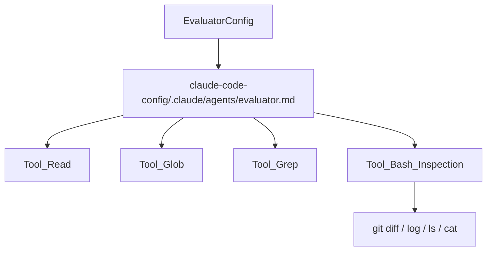
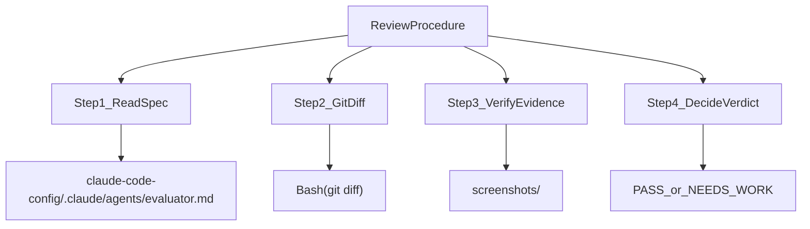
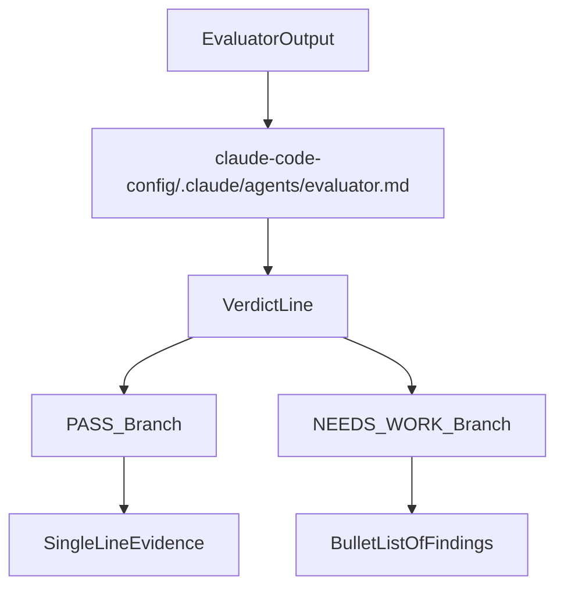

<!-- source: DeepWiki mcp.deepwiki.com · repo anthropics/cwc-long-running-agents · page 2.2 Fresh-Context Evaluator Subagent · fetched 2026-10-26 -->

# Fresh-Context Evaluator Subagent

Relevant source files

The following files were used as context for generating this wiki page:

- [claude-code-config/.claude/agents/evaluator.md](claude-code-config/.claude/agents/evaluator.md)

## Purpose and Scope
This section details the **Fresh-Context Evaluator Subagent**, a core quality gate in the harness architecture. Operating with an isolated context window and restricted tools, the evaluator acts as a skeptical second-opinion reviewer that assesses work claimed complete by a separate builder agent. Its implementation, configuration, tool boundaries, review methodology, and output protocols are defined in `[claude-code-config/.claude/agents/evaluator.md:1-25]()`.

---

## Evaluator Configuration and Tool Restrictions
The evaluator is defined as a specialized subagent configuration parsed by Claude Code. The YAML frontmatter specifies its operational identity and tool constraints [claude-code-config/.claude/agents/evaluator.md:1-5]():

- **Name**: `evaluator` [claude-code-config/.claude/agents/evaluator.md:2]()
- **Description**: Skeptical second-opinion reviewer [claude-code-config/.claude/agents/evaluator.md:3]()
- **Tools Granted**: `Read`, `Glob`, `Grep`, `Bash` [claude-code-config/.claude/agents/evaluator.md:4]()

Unlike the builder agent, the evaluator has **no write or edit tools** [claude-code-config/.claude/agents/evaluator.md:3](). The `Bash` tool is strictly scoped to non-mutating inspection commands such as `git diff`, `git log`, `ls`, and `cat` [claude-code-config/.claude/agents/evaluator.md:25](). It cannot execute the application or modify repository files [claude-code-config/.claude/agents/evaluator.md:25]().

*Sources: [claude-code-config/.claude/agents/evaluator.md:1-25]()*

---

## Four-Step Review Procedure
The evaluator executes a strict, repeatable four-step review procedure every time it is invoked [claude-code-config/.claude/agents/evaluator.md:11-16]():

1. **Read Spec**: Read the specification or acceptance criteria for the feature under review [claude-code-config/.claude/agents/evaluator.md:13]().
2. **Examine Diff**: Run `git diff` against the baseline to analyze precise code modifications [claude-code-config/.claude/agents/evaluator.md:14]().
3. **Verify Evidence**: Open screenshots, console logs, or artifacts located under `screenshots/` (or designated evidence paths) to verify actual runtime behavior rather than trusting filenames [claude-code-config/.claude/agents/evaluator.md:15](). Missing or unreadable files are treated as missing evidence [claude-code-config/.claude/agents/evaluator.md:15]().
4. **Decide Verdict**: Formulate a definitive decision based on verified proof rather than plausibility [claude-code-config/.claude/agents/evaluator.md:16]().

*Sources: [claude-code-config/.claude/agents/evaluator.md:11-25]()*

---

## PASS/NEEDS_WORK Output Protocol
To enable automated wrapper scripts to parse the review results, the evaluator strictly formats its terminal response [claude-code-config/.claude/agents/evaluator.md:20-24]():

- The response must begin with the bare word `PASS` or `NEEDS_WORK` on its own line, with nothing preceding it [claude-code-config/.claude/agents/evaluator.md:20]().
- **`PASS` Protocol**: Followed by a single line stating the exact evidence that convinced the reviewer [claude-code-config/.claude/agents/evaluator.md:22]().
- **`NEEDS_WORK` Protocol**: Followed by a bulleted list of specific, fixable findings that the builder agent can address in the subsequent session [claude-code-config/.claude/agents/evaluator.md:23]().

Plausibility is explicitly rejected; code changes that look reasonable but are paired with broken evidence or missing acceptance criteria must result in a `NEEDS_WORK` verdict [claude-code-config/.claude/agents/evaluator.md:18]().

*Sources: [claude-code-config/.claude/agents/evaluator.md:20-24]()*

---

## Next Findings and Builder Feedback
Findings returned with a `NEEDS_WORK` verdict serve as actionable input for the builder agent's next session. Because the evaluator is prohibited from editing code or fixing issues directly [claude-code-config/.claude/agents/evaluator.md:25](), these structured findings are routed back to guide the builder's iterative development loop.

---

