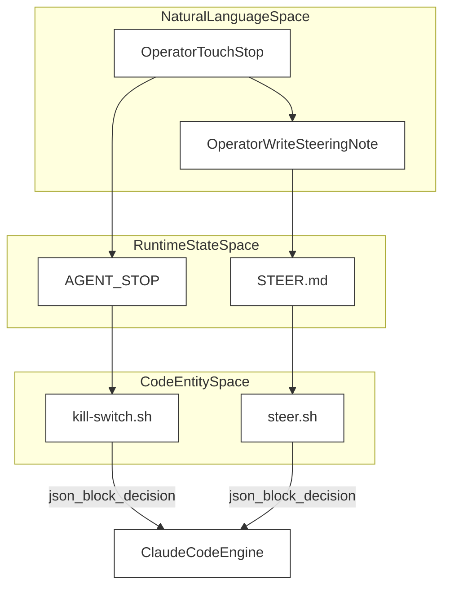
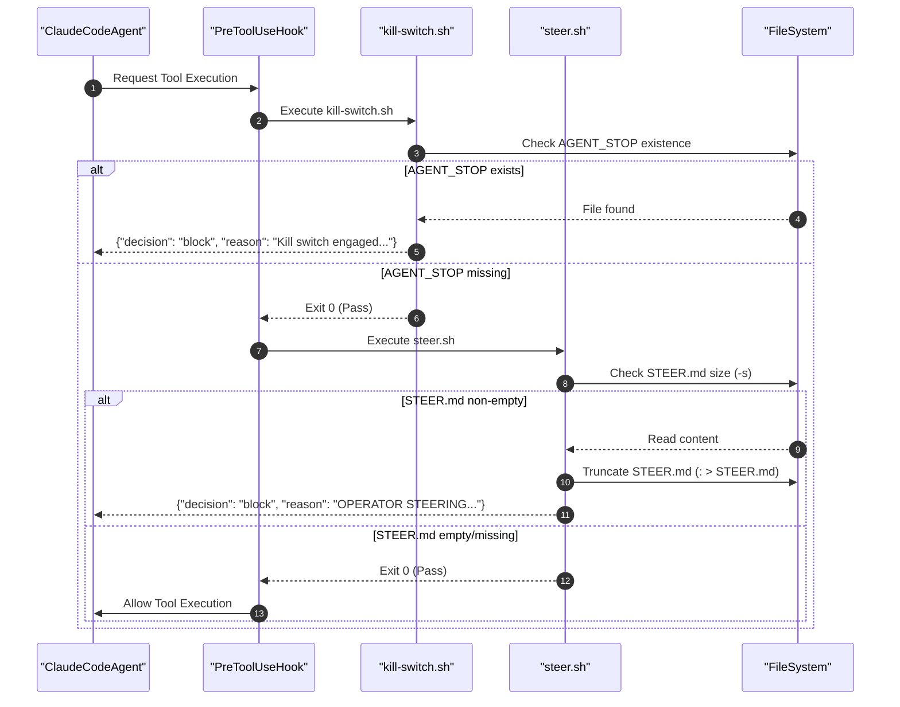

<!-- source: DeepWiki mcp.deepwiki.com · repo anthropics/cwc-long-running-agents · page 2.4 Operator Controls: Kill Switch and Steering · fetched 2026-10-26 -->

# Operator Controls: Kill Switch and Steering

<details>
<summary>Relevant source files</summary>

The following files were used as context for generating this wiki page:

- [claude-code-config/.claude/hooks/kill-switch.sh](claude-code-config/.claude/hooks/kill-switch.sh)
- [claude-code-config/.claude/hooks/steer.sh](claude-code-config/.claude/hooks/steer.sh)

</details>


### Purpose and Scope
This page details the implementation and operational semantics of the operator control channels within the long-running agent harness: the hard kill switch (`AGENT_STOP`) and the mid-run steering channel (`STEER.md`). These mechanisms allow human operators or automation wrappers to safely halt execution or redirect agent behavior without killing the underlying Claude Code process. 

---

## 1. The Kill Switch Mechanism (`AGENT_STOP`)

The kill switch is an immediate halting mechanism implemented via a simple file-existence check in `claude-code-config/.claude/hooks/kill-switch.sh` [claude-code-config/.claude/hooks/kill-switch.sh:1-9](). 

When any tool execution is attempted, the hook evaluates whether the designated stop file exists on the filesystem:

```bash
if [ -e "${AGENT_STOP_FILE:-./AGENT_STOP}" ]; then
  cat <<'JSON'
{"decision":"block","reason":"Kill switch engaged: AGENT_STOP file exists. Agent is halted. Remove the file to resume."}
JSON
fi
```
*(Source: [claude-code-config/.claude/hooks/kill-switch.sh:5-9]())*

* **File Location:** Defaults to `./AGENT_STOP`, but can be overridden via the `AGENT_STOP_FILE` environment variable [claude-code-config/.claude/hooks/kill-switch.sh:5]().
* **Engagement:** An operator executes `touch AGENT_STOP` (or the custom environment path) to halt the agent before its next tool invocation [claude-code-config/.claude/hooks/kill-switch.sh:4]().
* **Resumption:** Removing the file via `rm AGENT_STOP` restores normal tool execution [claude-code-config/.claude/hooks/kill-switch.sh:4]().

Sources: [claude-code-config/.claude/hooks/kill-switch.sh:1-9]()

---

## 2. The Steering Channel (`STEER.md`)

The steering channel provides a non-destructive way to inject prompt guidance or redirect the agent mid-run. It is implemented in `claude-code-config/.claude/hooks/steer.sh` [claude-code-config/.claude/hooks/steer.sh:1-14]().

The hook checks if the steering file exists and is non-empty (`-s`):

```bash
f="${AGENT_STEER_FILE:-./STEER.md}"
if [ -s "$f" ]; then
  note=$(cat "$f")
  reason=$(python3 -c 'import json,sys; print(json.dumps("OPERATOR STEERING: " + sys.argv[1] + "\n\nPause what you were about to do, incorporate this guidance, then continue toward the feature goal."))' "$note" 2>/dev/null) || exit 0
  printf '{"decision":"block","reason":%s}\n' "$reason"
  : > "$f"
fi
```
*(Source: [claude-code-config/.claude/hooks/steer.sh:8-14]())*

* **File Location:** Defaults to `./STEER.md`, overridable via `AGENT_STEER_FILE` [claude-code-config/.claude/hooks/steer.sh:8]().
* **Message Delivery:** When content is detected, the script reads the note, safely escapes it to JSON via Python [claude-code-config/.claude/hooks/steer.sh:10-11](), blocks the current tool invocation, and injects an `OPERATOR STEERING` block instructing the agent to pause, incorporate the guidance, and resume its path [claude-code-config/.claude/hooks/steer.sh:11]().
* **Auto-Clear:** Immediately after capturing and emitting the guidance block, the script truncates the file (`: > "$f"`) to ensure the message is delivered exactly once [claude-code-config/.claude/hooks/steer.sh:13]().

Sources: [claude-code-config/.claude/hooks/steer.sh:1-14]()

---

## 3. Architecture and Data Flow

### Diagram: Natural Language Space to Code Entity Space
The following diagram bridges conceptual operator intentions to the concrete hook scripts and runtime files responsible for enforcing them.


Sources: [claude-code-config/.claude/hooks/kill-switch.sh:1-9](), [claude-code-config/.claude/hooks/steer.sh:1-14]()

### Diagram: Hook Execution Interception Flow
This sequence illustrates how tool calls are intercepted by the control hooks before reaching the runtime environment.


Sources: [claude-code-config/.claude/hooks/kill-switch.sh:1-9](), [claude-code-config/.claude/hooks/steer.sh:1-14]()

---

## 4. Trust-Boundary Caveats

Operators should understand the security and trust boundaries of these control channels:

* **Convenience Channel, Not a Hard Sandbox:** As noted directly in `steer.sh`, these controls are convenience mechanisms rather than strict security boundaries [claude-code-config/.claude/hooks/steer.sh:6-7](). 
* **Self-Modification Risk:** Because the agent possesses write access to the project directory, a misaligned or compromised agent could theoretically locate and remove `AGENT_STOP` or rewrite `STEER.md` [claude-code-config/.claude/hooks/steer.sh:6-7](). 
* **Mitigation Recommendation:** For strict containment in unattended multi-session environments, control files (`AGENT_STOP_FILE`, `AGENT_STEER_FILE`) should be placed in paths outside the agent's direct workspace write scope, or enforced via container-level orchestration (such as read-only mount controls or outer wrapper loops).

Sources: [claude-code-config/.claude/hooks/kill-switch.sh:1-9](), [claude-code-config/.claude/hooks/steer.sh:1-14]()

---

