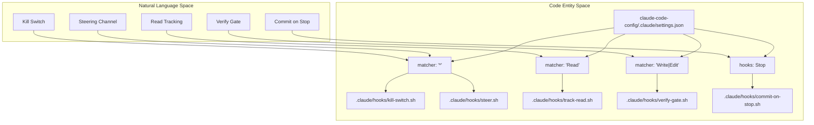

<!-- source: DeepWiki mcp.deepwiki.com · repo anthropics/cwc-long-running-agents · page 3.1 Hook Wiring in settings.json · fetched 2026-10-26 -->

# Hook Wiring in settings.json

<details>
<summary>Relevant source files</summary>

The following files were used as context for generating this wiki page:

- [claude-code-config/.claude/settings.json](claude-code-config/.claude/settings.json)
- [claude-code-config/README.md](claude-code-config/README.md)

</details>


## Purpose and Scope
This page details the configuration and execution flow of native Claude Code hooks defined in `claude-code-config/.claude/settings.json` [claude-code-config/.claude/settings.json:1-32](). It covers how tool call matchers (`*`, `Read`, `Write|Edit`) and session-level `Stop` events are intercepted, the execution ordering of underlying shell scripts, environment variable configurations, and runtime failure modes.

Sources: `claude-code-config/.claude/settings.json`, `claude-code-config/README.md`

---

## Hook Architecture and Matchers

Claude Code reads hook configurations from `.claude/settings.json` to intercept agent execution at specific lifecycle boundaries [claude-code-config/.claude/settings.json:1-32](). The wiring maps specific tool usage patterns to executable shell scripts located in `.claude/hooks/`.

The configuration establishes two primary event categories: `PreToolUse` and `Stop` [claude-code-config/.claude/settings.json:3-30](). 

### Diagram: Hook Wiring Map

Sources: `claude-code-config/.claude/settings.json`, `claude-code-config/README.md`

---

## PreToolUse and Stop Registration Ordering

The order of hooks within `settings.json` dictates their sequential execution behavior when an agent invokes tools [claude-code-config/.claude/settings.json:3-30](). 

### 1. Global Interceptors (`matcher: "*"`)
Triggered on every tool call regardless of type [claude-code-config/.claude/settings.json:3-10](). 
* **Kill Switch**: Executes `.claude/hooks/kill-switch.sh` first to inspect whether an emergency halt file exists [claude-code-config/.claude/settings.json:7]().
* **Steering**: Executes `.claude/hooks/steer.sh` second to inject pending human instructions from runtime state files [claude-code-config/.claude/settings.json:8]().

### 2. Targeted Interceptors (`matcher: "Read"` and `matcher: "Write|Edit"`)
Triggered conditionally based on the specific tool class being invoked [claude-code-config/.claude/settings.json:11-22]().
* **Read Verification**: When a read action occurs, `.claude/hooks/track-read.sh` executes to log evidence accessibility [claude-code-config/.claude/settings.json:12-15]().
* **Write Gate**: When a write or edit action occurs, `.claude/hooks/verify-gate.sh` evaluates whether sufficient read evidence exists before allowing modifications [claude-code-config/.claude/settings.json:17-21]().

### 3. Session Termination (`hooks: Stop`)
* **Commit on Stop**: When a session stops, `.claude/hooks/commit-on-stop.sh` executes to commit state changes [claude-code-config/.claude/settings.json:24-30]().

### Diagram: Tool Interception Execution Flow
```mermaid
sequenceDiagram
    participant Agent as "Claude Code Agent"
    subgraph CodeEntitySpace ["Code Entity Space (.claude/settings.json)"]
        participant KillHook as ".claude/hooks/kill-switch.sh"
        participant SteerHook as ".claude/hooks/steer.sh"
        participant ToolMatcher as "Tool Matcher Router"
        participant ReadHook as ".claude/hooks/track-read.sh"
        participant WriteHook as ".claude/hooks/verify-gate.sh"
    end

    Agent->>KillHook: "PreToolUse (*)"
    KillHook-->>Agent: "Halt if AGENT_STOP exists"
    Agent->>SteerHook: "PreToolUse (*)"
    SteerHook-->>Agent: "Inject STEER.md if present"
    Agent->>ToolMatcher: "Evaluate Tool Type"
    
    alt Tool is Read
        ToolMatcher->>ReadHook: "PreToolUse (Read)"
        ReadHook-->>Agent: "Log evidence read"
    else Tool is Write or Edit
        ToolMatcher->>WriteHook: "PreToolUse (Write|Edit)"
        WriteHook-->>Agent: "Verify evidence gate or block"
    end
```
Sources: `claude-code-config/.claude/settings.json`

---

## Environment-Var Overrides and Runtime Requirements

The wired hook scripts depend on specific host runtimes and environment variables to function correctly [claude-code-config/README.md:5-21]().

* **System Requirements**: Execution depends on `bash`, `git`, and `python3` [claude-code-config/README.md:5](). Because the hooks rely on `python3` for parsing JSON payloads passed via stdin, environments lacking `python3` will cause hooks to silently no-op [claude-code-config/README.md:5]().
* **Results File Override (`RESULTS_FILE`)**: The verify gate hook inspects a test results file to ensure compliance with the default-FAIL contract [claude-code-config/README.md:17-21](). By default, this points to `test-results.json`, but the target file path can be customized via the `RESULTS_FILE` environment variable [claude-code-config/README.md:21]().

Sources: `claude-code-config/README.md`

---

