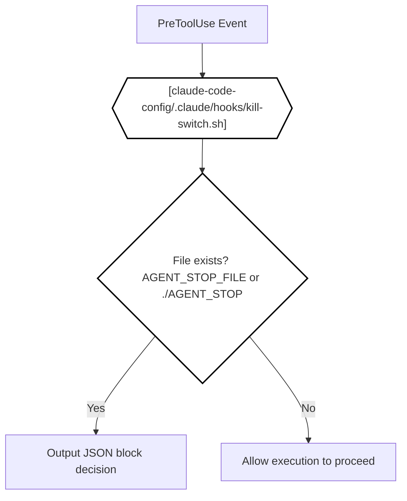
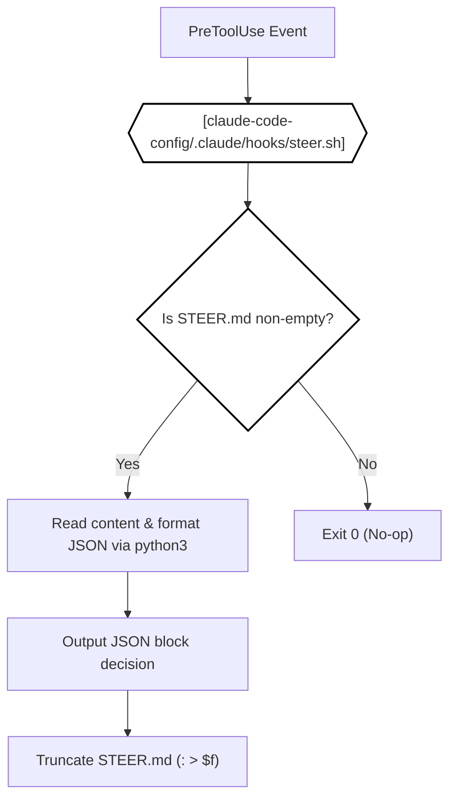
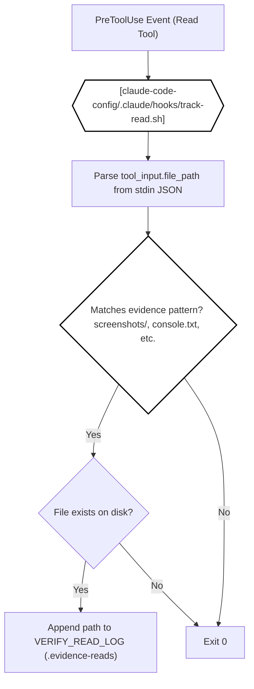
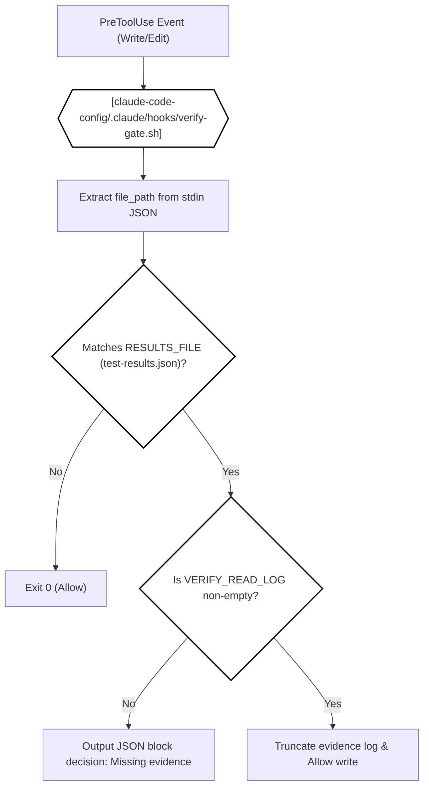
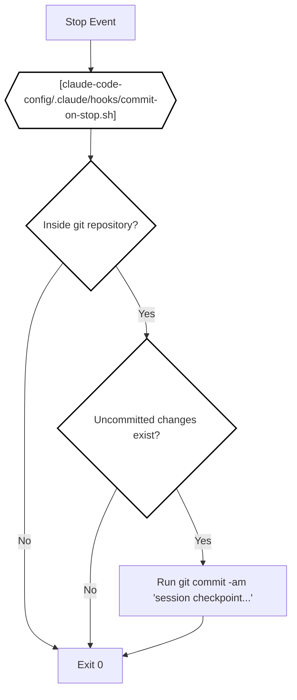

<!-- source: DeepWiki mcp.deepwiki.com · repo anthropics/cwc-long-running-agents · page 3.2 Hook Script Reference · fetched 2026-10-26 -->

# Hook Script Reference

<details>
<summary>Relevant source files</summary>

The following files were used as context for generating this wiki page:

- [claude-code-config/.claude/hooks/commit-on-stop.sh](claude-code-config/.claude/hooks/commit-on-stop.sh)
- [claude-code-config/.claude/hooks/kill-switch.sh](claude-code-config/.claude/hooks/kill-switch.sh)
- [claude-code-config/.claude/hooks/steer.sh](claude-code-config/.claude/hooks/steer.sh)
- [claude-code-config/.claude/hooks/track-read.sh](claude-code-config/.claude/hooks/track-read.sh)
- [claude-code-config/.claude/hooks/verify-gate.sh](claude-code-config/.claude/hooks/verify-gate.sh)

</details>


This page provides a line-level technical walkthrough of the five core hook scripts located in `claude-code-config/.claude/hooks/` [claude-code-config/.claude/hooks/commit-on-stop.sh:1-17](). It details their inputs via stdin JSON, environment variables, output formats, exit behaviors, and failure modes.

## Overview of Hook Architecture

Claude Code invokes hooks during agent execution based on event matchers defined in `settings.json`. The hooks act as gatekeepers, safety switches, and telemetry collectors, allowing the outer and inner loops to enforce quality contracts like the default-FAIL evidence rule and human-in-the-loop steering.

```
+-------------------------------------------------------------------+
|                        Claude Code Runtime                        |
|                                                                   |
|  [Tool Use: PreToolUse] ----+                                     |
|                             v                                     |
|              +------------------------------+                     |
|              | kill-switch.sh               |                     |
|              +------------------------------+                     |
|                             v                                     |
|              +------------------------------+                     |
|              | steer.sh                     |                     |
|              +------------------------------+                     |
|                             v                                     |
|         +-------------------+-------------------+                 |
|         |                                       |                 |
|         v (Read Tool)                           v (Write/Edit)    |
|  +--------------------+               +--------------------+      |
|  | track-read.sh      |               | verify-gate.sh     |      |
|  +--------------------+               +--------------------+      |
|                                                                   |
|  [Session Stop: Stop] ----+                                     |
|                             v                                     |
|              +------------------------------+                     |
|              | commit-on-stop.sh            |                     |
|              +------------------------------+                     |
+-------------------------------------------------------------------+
```

Sources: 
- `claude-code-config/.claude/hooks/kill-switch.sh` [claude-code-config/.claude/hooks/kill-switch.sh:1-9]()
- `claude-code-config/.claude/hooks/steer.sh` [claude-code-config/.claude/hooks/steer.sh:1-14]()
- `claude-code-config/.claude/hooks/track-read.sh` [claude-code-config/.claude/hooks/track-read.sh:1-11]()
- `claude-code-config/.claude/hooks/verify-gate.sh` [claude-code-config/.claude/hooks/verify-gate.sh:1-29]()
- `claude-code-config/.claude/hooks/commit-on-stop.sh` [claude-code-config/.claude/hooks/commit-on-stop.sh:1-17]()

---

## 1. Kill Switch: `kill-switch.sh`

### Purpose and Operation
The `kill-switch.sh` script halts every tool call immediately if the `AGENT_STOP` file is present in the workspace [claude-code-config/.claude/hooks/kill-switch.sh:4-5](). This functions as an absolute operator override to stop runaway agents.

### Implementation Walkthrough
- **Environment Variables**: Checks `AGENT_STOP_FILE` (defaults to `./AGENT_STOP`) [claude-code-config/.claude/hooks/kill-switch.sh:5]().
- **Stdin / Inputs**: None processed.
- **Outputs**: Emits a JSON payload instructing Claude Code to `block` execution with a explanatory reason [claude-code-config/.claude/hooks/kill-switch.sh:6-8]().
- **Exit Behavior**: Exits implicitly with code `0`, relying on JSON stdout to convey the blocking decision.



Sources: `claude-code-config/.claude/hooks/kill-switch.sh` [claude-code-config/.claude/hooks/kill-switch.sh:1-9]()

---

## 2. Operator Steering: `steer.sh`

### Purpose and Operation
The `steer.sh` script checks if `STEER.md` contains content, surfaces it to the agent as a blocking instruction, and clears the file [claude-code-config/.claude/hooks/steer.sh:4-14](). It provides a lightweight mid-run redirection channel.

### Implementation Walkthrough
- **Environment Variables**: Checks `AGENT_STEER_FILE` (defaults to `./STEER.md`) [claude-code-config/.claude/hooks/steer.sh:8]().
- **Stdin / Inputs**: None.
- **Key Functions**: Uses `python3` to safely encode the steering note string into a JSON response structure [claude-code-config/.claude/hooks/steer.sh:11]().
- **Side Effects**: Truncates `STEER.md` (`: > "$f"`) upon reading it so the prompt is delivered exactly once [claude-code-config/.claude/hooks/steer.sh:13]().
- **Failure Modes**: If python execution fails or formatting errors occur, it falls through safely (`|| exit 0`) [claude-code-config/.claude/hooks/steer.sh:11]().



Sources: `claude-code-config/.claude/hooks/steer.sh` [claude-code-config/.claude/hooks/steer.sh:1-14]()

---

## 3. Evidence Tracking: `track-read.sh`

### Purpose and Operation
The `track-read.sh` script intercepts Read tool calls, extracting the file path and appending matching evidence files (screenshots, console logs, result texts) to an evidence log [claude-code-config/.claude/hooks/track-read.sh:4-10]().

### Implementation Walkthrough
- **Environment Variables**: Uses `VERIFY_READ_LOG` (defaults to `./.claude/.evidence-reads`) [claude-code-config/.claude/hooks/track-read.sh:6]().
- **Stdin / Inputs**: Parses incoming tool-use JSON from stdin using `python3` to extract `tool_input.file_path` [claude-code-config/.claude/hooks/track-read.sh:7]().
- **Matching Logic**: Evaluates the path against patterns (`*screenshots/*`, `*-console.txt`, `*-result.txt`, `*.png`) [claude-code-config/.claude/hooks/track-read.sh:8-10]().
- **Outputs**: Appends verified file paths to the evidence log if the file exists (`[ -f "$path" ]`) [claude-code-config/.claude/hooks/track-read.sh:9]().



Sources: `claude-code-config/.claude/hooks/track-read.sh` [claude-code-config/.claude/hooks/track-read.sh:1-11]()

---

## 4. Verify Gate: `verify-gate.sh`

### Purpose and Operation
The `verify-gate.sh` hook enforces the default-FAIL contract. It intercepts Write or Edit tool calls targeting the results file and blocks them unless evidence has been read during the current session [claude-code-config/.claude/hooks/verify-gate.sh:5-12]().

### Implementation Walkthrough
- **Environment Variables**: 
  - `VERIFY_READ_LOG` (defaults to `./.claude/.evidence-reads`) [claude-code-config/.claude/hooks/verify-gate.sh:13]().
  - `RESULTS_FILE` (defaults to `test-results.json`) [claude-code-config/.claude/hooks/verify-gate.sh:14]().
- **Stdin / Inputs**: Reads tool execution payload, extracting `tool_input.file_path` [claude-code-config/.claude/hooks/verify-gate.sh:16-17]().
- **Guard Validation**: 
  - Checks if the target path matches the results file pattern (`$results` or `*/$results`) [claude-code-config/.claude/hooks/verify-gate.sh:20](). If not, exits immediately (`exit 0`).
  - Checks if the evidence log (`$log`) is non-empty (`[ ! -s "$log" ]`) [claude-code-config/.claude/hooks/verify-gate.sh:22](). If empty, blocks the write with a descriptive JSON reason [claude-code-config/.claude/hooks/verify-gate.sh:23-26]().
- **Consumption Side Effect**: Truncates the evidence log (`: > "$log"`) upon passing so subsequent edits require fresh proof [claude-code-config/.claude/hooks/verify-gate.sh:28-29]().



Sources: `claude-code-config/.claude/hooks/verify-gate.sh` [claude-code-config/.claude/hooks/verify-gate.sh:1-29]()

---

## 5. Commit on Stop: `commit-on-stop.sh`

### Purpose and Operation
The `commit-on-stop.sh` script acts as a session backstop. It triggers when an agent session ends, automatically committing tracked changes to ensure work remains durable across restarts [claude-code-config/.claude/hooks/commit-on-stop.sh:5-11]().

### Implementation Walkthrough
- **Environment Variables**: None explicitly configured; relies on environment `git` configuration and user credentials.
- **Validation**: Checks if a git repository directory exists (`git rev-parse --git-dir`) and if there are unstaged or staged modifications (`git diff --quiet` / `git diff --cached --quiet`) [claude-code-config/.claude/hooks/commit-on-stop.sh:12-13]().
- **Actions**: Executes `git commit -am "session checkpoint: $(date '+%Y-%m-%d %H:%M')"` for tracked files only, avoiding ephemeral scratch artifacts like logs or screenshots [claude-code-config/.claude/hooks/commit-on-stop.sh:6-14]().
- **Failure Modes**: Fails silently (`> /dev/null 2>&1`) if commits cannot be made due to missing user identity or hook rejections [claude-code-config/.claude/hooks/commit-on-stop.sh:10-14]().



Sources: `claude-code-config/.claude/hooks/commit-on-stop.sh` [claude-code-config/.claude/hooks/commit-on-stop.sh:1-17]()

---

## Summary Table of Hooks

| Hook Script | Event Trigger | Key Input Variable | Output / Action | Failure Mode |
| :--- | :--- | :--- | :--- | :--- |
| `kill-switch.sh` [claude-code-config/.claude/hooks/kill-switch.sh:1-9]() | `PreToolUse` | `AGENT_STOP_FILE` [claude-code-config/.claude/hooks/kill-switch.sh:5]() | JSON block payload | Exits silently if file missing |
| `steer.sh` [claude-code-config/.claude/hooks/steer.sh:1-14]() | `PreToolUse` | `AGENT_STEER_FILE` [claude-code-config/.claude/hooks/steer.sh:8]() | JSON block payload & truncates file | Falls through (`|| exit 0`) on python error [claude-code-config/.claude/hooks/steer.sh:11]() |
| `track-read.sh` [claude-code-config/.claude/hooks/track-read.sh:1-11]() | `PreToolUse` (Read) | `VERIFY_READ_LOG` [claude-code-config/.claude/hooks/track-read.sh:6]() | Appends path to evidence log | Ignores non-matching paths |
| `verify-gate.sh` [claude-code-config/.claude/hooks/verify-gate.sh:1-29]() | `PreToolUse` (Write/Edit) | `VERIFY_READ_LOG`, `RESULTS_FILE` [claude-code-config/.claude/hooks/verify-gate.sh:13-14]() | JSON block if unverified; resets log | Ignores non-results files |
| `commit-on-stop.sh` [claude-code-config/.claude/hooks/commit-on-stop.sh:1-17]() | `Stop` | Git diff state | `git commit -am` checkpoint | Fails silently if git config incomplete [claude-code-config/.claude/hooks/commit-on-stop.sh:10-14]() |

Sources:
- `claude-code-config/.claude/hooks/kill-switch.sh` [claude-code-config/.claude/hooks/kill-switch.sh:1-9]()
- `claude-code-config/.claude/hooks/steer.sh` [claude-code-config/.claude/hooks/steer.sh:1-14]()
- `claude-code-config/.claude/hooks/track-read.sh` [claude-code-config/.claude/hooks/track-read.sh:1-11]()
- `claude-code-config/.claude/hooks/verify-gate.sh` [claude-code-config/.claude/hooks/verify-gate.sh:1-29]()
- `claude-code-config/.claude/hooks/commit-on-stop.sh` [claude-code-config/.claude/hooks/commit-on-stop.sh:1-17]()

---

