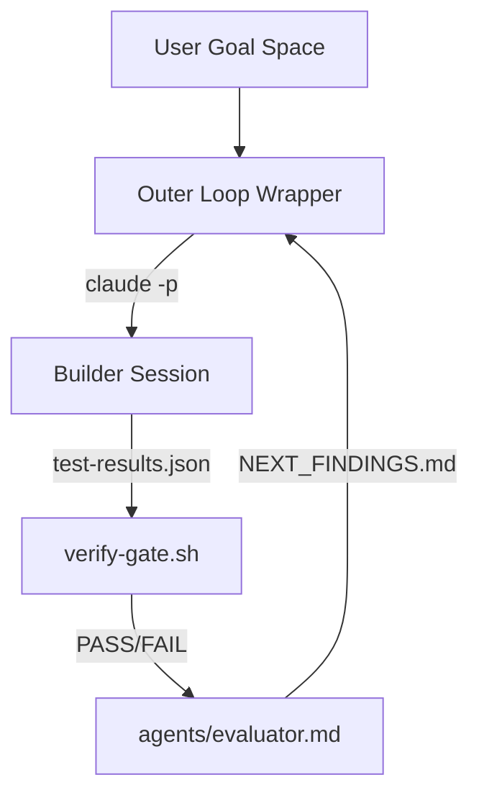

<!-- source: DeepWiki mcp.deepwiki.com · repo anthropics/cwc-long-running-agents · page 4 Unattended Multi-Session Operation · fetched 2026-10-26 -->

# Unattended Multi-Session Operation

Relevant source files

The following files were used as context for generating this wiki page:

- [README.md](README.md)

This page provides an overview of running the outer loop unattended, orchestrating multiple Claude Code sessions using harness primitives, custom wrapper scripts, and scaling patterns. As a parent page, it introduces the core concepts and links to detailed child pages.

For details on wrapper mechanics and loop exit conditions, see [Outer Loop: /goal, ralph-loop, and Wrapper Scripts](#4.1).
For details on advanced multi-session scaling architecture, see [Scaling Patterns: Sprint Contracts, Planner, Rubrics](#4.2).

## 4.1. Outer Loop: /goal, ralph-loop, and Wrapper Scripts

While Claude Code provides built-in mechanisms like [`/goal`](https://code.claude.com/docs/en/goal) for interactive generator-evaluator loops, long-running unattended operation requires custom wrapper scripts [README.md:1-10](). These wrappers orchestrate headless sessions using `claude -p` alongside the fresh-context evaluator subagent defined in `agents/evaluator.md` [README.md:60]().

The outer loop manages session transitions, executes test verification gates, checks loop exit conditions, and feeds evaluator findings (`NEEDS_WORK` or `PASS`) into subsequent builder iterations [README.md:60]().

For deep technical walkthroughs of wrapper scripts, `/goal` mechanics, and loop termination criteria, see [Outer Loop: /goal, ralph-loop, and Wrapper Scripts](#4.1).

Sources: `README.md:1-69`

## 4.2. Scaling Patterns: Sprint Contracts, Planner, Rubrics

Scaling long-running application development beyond single features requires higher-level architectural layers. As outlined in the core documentation, these patterns include sprint contracts for defining bounded units of work, autonomous planners for task decomposition, and objective rubrics for grading subjective features [README.md:66]().

These components build upon the foundational quality loop primitives (the default-FAIL contract, fresh-context evaluator, and agent-maintained handoff) to sustain multi-day or multi-sprint autonomous execution without human intervention [README.md:11-16]().

For comprehensive specifications on sprint planning and evaluation rubrics, see [Scaling Patterns: Sprint Contracts, Planner, Rubrics](#4.2).

Sources: `README.md:1-69`

---

## Outer Loop Architecture Overview

Sources: `README.md:1-69`

---

