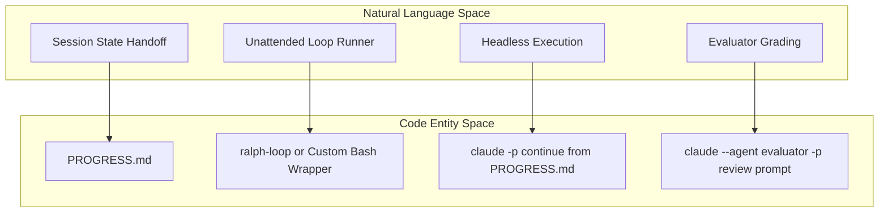

<!-- source: DeepWiki mcp.deepwiki.com · repo anthropics/cwc-long-running-agents · page 4.1 Outer Loop: /goal, ralph-loop, and Wrapper Scripts · fetched 2026-10-26 -->

# Outer Loop: /goal, ralph-loop, and Wrapper Scripts

<details>
<summary>Relevant source files</summary>

The following files were used as context for generating this wiki page:

- [README.md](README.md)
- [claude-code-config/README.md](claude-code-config/README.md)

</details>


## Purpose and Scope

This section covers the architecture of the outer execution loop for long-running Claude Code agents. While individual Claude Code sessions operate within an inner loop of tool calls and reasoning turns, unattended multi-session automation requires an outer loop. This page contrasts Claude Code's native, built-in [`/goal`](https://code.claude.com/docs/en/goal) command with custom wrapper scripts, headless execution via [`claude -p`](https://code.claude.com/docs/en/headless), and the [`ralph-loop`](https://github.com/anthropics/claude-plugins-official/tree/main/plugins/ralph-loop) plugin pattern. It details data flow, invocation patterns, and loop exit conditions.

Sources: `README.md:1-10`, `claude-code-config/README.md:29-30`

---

## Built-In `/goal` Command vs. Custom Wrappers

Claude Code provides an out-of-the-box generator/evaluator loop via the built-in [`/goal`](https://code.claude.com/docs/en/goal) command [README.md:1-9]. Users define a completion condition, and a separate fast model evaluates the condition after every turn until met [README.md:1-9]. 

Alternatively, for granular control over the evaluation phase, custom wrappers can orchestrate sessions by combining headless execution (`claude -p`) with the fresh-context evaluator subagent (`claude --agent evaluator`) [README.md:8-9, README.md:60].

```mermaid
graph TD
    subgraph "Native In-Product Loop"
        A1["UserGoal"] --> B1["ClaudeCodeInteractive"]
        B1 --> C1["BuiltInGoalCommand"]
        C1 --> D1["FastModelEvaluator"]
        D1 -->| "Check Condition" | B1
    end

    subgraph "Custom Harness Outer Loop"
        A2["PROGRESS.md"] --> B2["WrapperScriptOrRalphLoop"]
        B2 --> C2["ClaudeHeadlessInvocation"]
        C2 --> D2["EvaluatorSubagent"]
        D2 -->| "PASS/NEEDS_WORK" | B2
    end
```
*Figure 1: Native `/goal` versus custom wrapper loop execution architecture.*

Sources: `README.md:1-10`, `README.md:60`

---

## Wrapper Script Architecture and Headless Execution (`claude -p`)

Unattended multi-session operation relies on wrapper scripts or community plugins such as `ralph-loop` [README.md:68-69, claude-code-config/README.md:29-30]. A wrapper script orchestrates the outer loop by repeatedly invoking Claude Code in headless mode (`claude -p`), instructing the agent to resume execution using state stored in `PROGRESS.md` [README.md:60, claude-code-config/README.md:29-30].

The following diagram maps the natural language concepts of session management to the concrete command-line interface and configuration entities used in the codebase:


*Figure 2: Bridging natural language session execution concepts to specific codebase entities and commands.*

Sources: `README.md:60`, `README.md:68-69`, `claude-code-config/README.md:29-30`

---

## Loop Exit Conditions and State Evaluation

The outer loop persists across multiple agent sessions until specific termination criteria are satisfied [README.md:68-69, claude-code-config/README.md:29-30]. The loop monitors state files and exit signals to determine when to halt execution.

```mermaid
graph TD
    Start["StartOuterLoop"] --> ReadState["ChecktestresultsjsonAndPROGRESSmd"]
    ReadState --> CheckStop{"AGENT_STOP file exists?"}
    CheckStop -->| "Yes" | Halt["HaltLoopImmediately"]
    CheckStop -->| "No" | CheckPass{"All features passes: true?"}
    CheckPass -->| "Yes" | Success["TerminateLoopSuccess"]
    CheckPass -->| "No" | RunSession["InvokeClaudeHeadlessclaude-p"]
    RunSession --> RunEvaluator["InvokeEvaluatorSubagent"]
    RunEvaluator --> UpdateProgress["UpdatePROGRESSmdAndCommit"]
    UpdateProgress --> ReadState
```
*Figure 3: Data flow and conditional logic for outer loop exit criteria and session iteration.*

### Key Exit Conditions

1. **Feature Completion:** All features defined within `test-results.json` evaluate to `passes: true` [README.md:52-54, claude-code-config/README.md:23-25].
2. **Operator Kill Switch:** The presence of an `./AGENT_STOP` file in the working directory halts all tool execution via `.claude/hooks/kill-switch.sh` [claude-code-config/README.md:15].
3. **Evaluator Verdict Failure Thresholds:** If consecutive runs fail to achieve `PASS` from `agents/evaluator.md`, the wrapper may pause or abort depending on configured maximum iteration limits [README.md:60].

Sources: `README.md:52-60`, `README.md:68-69`, `claude-code-config/README.md:15`, `claude-code-config/README.md:23-30`

---

