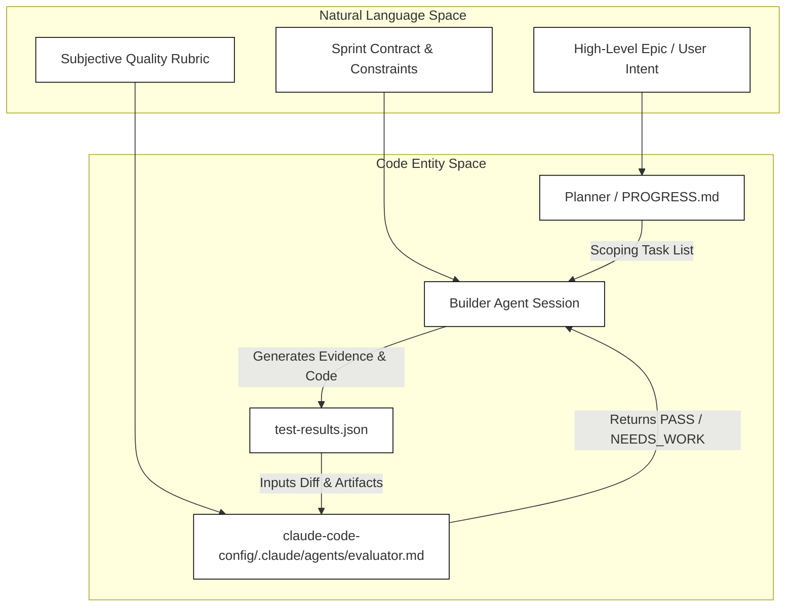

<!-- source: DeepWiki mcp.deepwiki.com · repo anthropics/cwc-long-running-agents · page 4.2 Scaling Patterns: Sprint Contracts, Planner, Rubrics · fetched 2026-10-26 -->

# Scaling Patterns: Sprint Contracts, Prompt Planners, and Rubrics

<details>
<summary>Relevant source files</summary>

The following files were used as context for generating this wiki page:

- [README.md](README.md)
- [claude-code-config/.claude/CLAUDE.md](claude-code-config/.claude/CLAUDE.md)

</details>


## Purpose and Scope

As long-running Claude Code agent deployments scale from single-feature scripts to multi-session application development, the foundational loops (`test-results.json`, basic handoffs in `PROGRESS.md`, and single-feature sessions) require higher-level orchestration layers. Section 4.2 covers the advanced scaling patterns described in the root README: **Sprint Contracts** (defining structured scopes across multiple agent boundaries), **Planner Architectures** (decomposing ambiguous epics into discrete, session-sized execution units), and **Rubrics** (evaluating subjective or qualitative dimensions beyond binary unit tests). 

These patterns bridge the gap between individual harness primitives and large-scale, unattended multi-session engineering pipelines.

Sources: [README.md:1-69](), [claude-code-config/.claude/CLAUDE.md:1-27]()

---

## 1. Sprint Contracts

In a long-running agent deployment, an agent left unconstrained over multiple sessions can drift in scope, refactor unrelated modules, or lose track of overarching architectural goals. A **Sprint Contract** formalizes the boundary of a multi-session milestone.

### Core Components
* **Scope Definition**: Explicitly lists what files, components, and user stories are in-bounds versus strictly out-of-bounds.
* **Acceptance Thresholds**: Extends the default-FAIL contract (`test-results.json`) from micro-features to multi-feature milestone gates.
* **Session Budgeting**: Restricts the maximum number of iterations or tool uses per feature block to prevent infinite debugging loops.

```json
{
  "sprint_id": "milestone-auth-v1",
  "allowed_paths": ["src/auth/", "tests/auth/"],
  "forbidden_paths": ["src/legacy_core/"],
  "max_sessions_per_item": 2,
  "required_evidence": ["playwright-login.png", "jest-auth-results.json"]
}
```

Sources: [README.md:48-57](), [claude-code-config/.claude/CLAUDE.md:9-11]()

---

## 2. Planner Subagents and Prompt Decomposition

While the builder agent focuses on implementation and the fresh-context evaluator (`agents/evaluator.md`) grades the result, complex epics require a dedicated planning phase. 

### Architecture and Workflow
1. **Epic Intake**: The operator provides a high-level requirement via the outer loop or prompt wrapper.
2. **Planner Execution**: A planning phase (or specialized subagent prompt) inspects the codebase, reads `PROGRESS.md`, and breaks the epic down into atomic, single-feature increments.
3. **State Initialization**: The planner populates or updates `PROGRESS.md` with structured task checkboxes and updates `test-results.json` with new default-FAIL evaluation rows.
4. **Execution Hand-off**: The builder agent picks up exactly one item per session as dictated by the pre-established plan [claude-code-config/.claude/CLAUDE.md:9-11]().

Sources: [README.md:60-65](), [claude-code-config/.claude/CLAUDE.md:6-8]()

---

## 3. Rubrics for Subjective and Qualitative Work

The default-FAIL contract handles deterministic tests (e.g., unit tests, API status codes, explicit file presence), but user-facing applications require handling subjective criteria such as UI visual polish, error message clarity, and accessibility compliance. 

### Extending the Evaluator Subagent
To evaluate subjective work, the fresh-context evaluator (`agents/evaluator.md`) is paired with a project-specific **Rubric**:
* **Multi-Dimensional Scoring**: Evaluates outputs across axes like *Visual Consistency*, *Robustness*, *Code Style*, and *UX Flow*.
* **Evidence Inspection**: Requires the evaluator to review specific artifacts (such as Playwright screenshots generated during the run) before rendering a qualitative score.
* **Structured Findings**: Outputs a detailed breakdown in `NEXT_FINDINGS.md` or standard output streams, grading each rubric dimension as `PASS` or `NEEDS_WORK` with explicit remediation steps.

Sources: [README.md:44-46](), [README.md:60-62]()

---

## 4. Architecture and Data Flow

The following diagrams illustrate how Sprint Contracts, Planners, and Rubrics integrate with the core state files (`PROGRESS.md`, `test-results.json`) and execution agents (`evaluator.md`).

### Natural Language Space to Code Entity Space Mapping



Sources: [README.md:40-67](), [claude-code-config/.claude/CLAUDE.md:6-27]()

### Multi-Session Scaling Execution Lifecycle

```mermaid
sequenceDiagram
    participant Op as Operator / Wrapper
    participant Pl as Planner / PROGRESS.md
    participant Bu as Builder Agent (CLAUDE.md)
    participant Ev as Evaluator (evaluator.md)
    participant Gate as Verify Gate (verify-gate.sh)

    Op->>Pl: Initialize Sprint Contract & Tasks
    loop Multi-Session Execution Loop
        Pl->>Bu: Read next uncompleted item
        Bu->>Bu: Implement feature (One feature/session)
        Bu->>Gate: Attempt write to test-results.json
        Gate--|--Bu: Deny if no Read evidence opened
        Bu->>Gate: Read screenshot / logs, update test-results.json
        Bu->>Bu: Commit changes & update PROGRESS.md
        Op->>Ev: Invoke claude --agent evaluator -p review
        Ev->>Ev: Inspect diff & screenshots against Rubric
        alt Verdict is NEEDS_WORK
            Ev--|--Op: Return findings for next session
        else Verdict is PASS
            Ev--|--Op: Advance to next sprint milestone
        end
    end

    classDef default fill:#fff,stroke:#000,stroke-width:1px;
    class Op,Pl,Bu,Ev,Gate default;
```

Sources: [README.md:11-17](), [README.md:60-65](), [claude-code-config/.claude/CLAUDE.md:9-25]()

---

