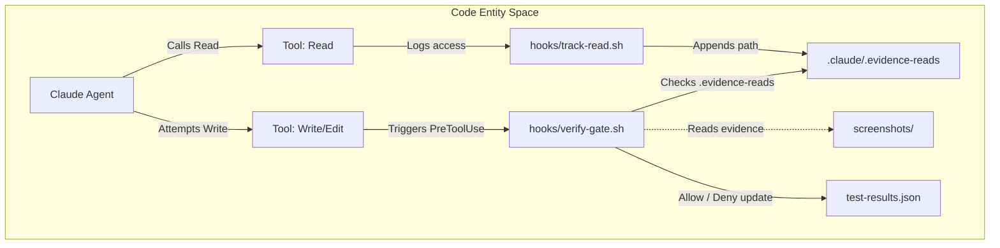
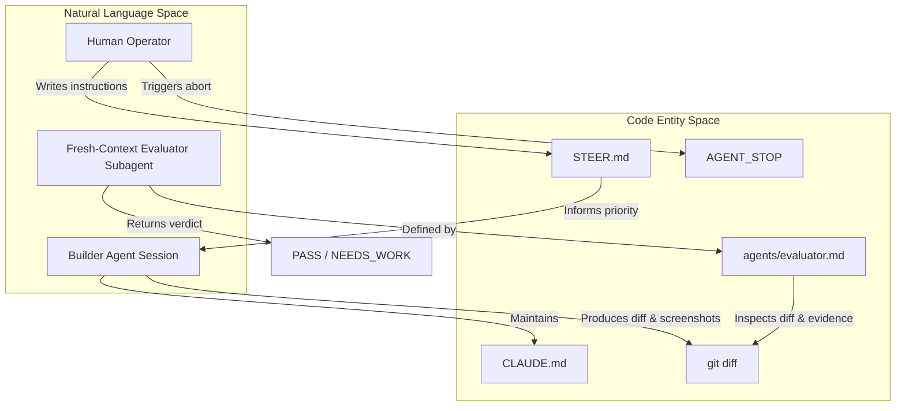

<!-- source: DeepWiki mcp.deepwiki.com · repo anthropics/cwc-long-running-agents · page 5 Glossary · fetched 2026-10-26 -->

# Glossary

Relevant source files

The following files were used as context for generating this wiki page:

- [.gitignore](.gitignore)
- [README.md](README.md)
- [claude-code-config/.claude/CLAUDE.md](claude-code-config/.claude/CLAUDE.md)
- [claude-code-config/.claude/agents/evaluator.md](claude-code-config/.claude/agents/evaluator.md)

## Purpose and Scope

This page provides exact definitions and code pointers for codebase-specific terms, conceptual primitives, and runtime artifacts used across the `cwc-long-running-agents` harness. Each term is linked directly to its implementation files, configuration scripts, or ephemeral state references to assist developers navigating the repository.

---

## Term Definitions

### Default-FAIL Contract
A core enforcement pattern where all features and verification criteria in `test-results.json` default to `false` [README.md:52-54](). The agent is structurally barred from changing status values to `passing` unless it has first opened concrete evidence (such as a screenshot or log) using the `Read` tool [README.md:13-13](). Enforcement is handled via a `PreToolUse` hook combination [README.md:44-44]().

- **Code Pointers**: [claude-code-config/.claude/hooks/track-read.sh](), [claude-code-config/.claude/hooks/verify-gate.sh]()
- **Sources**: [README.md:11-16](), [README.md:48-57]()

### Evidence File
An external artifact produced during the execution of a feature—typically a Playwright screenshot, console log, or raw test output—saved under a designated directory like `screenshots/` [README.md:56-56](). The fresh-context evaluator and verify gate inspect these files to determine if reported work matches reality [evaluator.md:13-15]().

- **Code Pointers**: [.gitignore:7-7](), [claude-code-config/.claude/CLAUDE.md:13-16]()
- **Sources**: [.gitignore:1-7](), [claude-code-config/.claude/CLAUDE.md:13-19]()

### Verify Gate
The `PreToolUse` hook implementation (`verify-gate.sh`) that intercepts attempts to write to `test-results.json`. It inspects the evidence-reads log (`.evidence-reads`) to confirm whether the agent has read a valid evidence file prior to permitting the state change [README.md:56-57]().

- **Code Pointers**: [claude-code-config/.claude/hooks/verify-gate.sh]()
- **Sources**: [README.md:44-44](), [README.md:56-57]()

### Evidence-Reads Log
An ephemeral runtime tracking file (`.claude/.evidence-reads`) populated by `track-read.sh`. It records paths of files accessed via the `Read` tool so that `verify-gate.sh` can validate whether required evidence has been inspected [README.md:56-57]().

- **Code Pointers**: [.gitignore:2-2](), [claude-code-config/.claude/hooks/track-read.sh]()
- **Sources**: [.gitignore:1-7](), [README.md:56-57]()

### Fresh-Context Evaluator
A separate subagent (`agents/evaluator.md`) invoked with restricted tool permissions (`Read`, `Glob`, `Grep`, `Bash` restricted to `git diff`) that reviews the builder's work from a clean context window [README.md:59-60](), [evaluator.md:3-4](). It acts as a skeptical second opinion [evaluator.md:3-3]().

- **Code Pointers**: [claude-code-config/.claude/agents/evaluator.md]()
- **Sources**: [README.md:14-14](), [README.md:58-60]()

### PASS / NEEDS_WORK
The binary evaluation verdict protocol returned by the fresh-context evaluator [README.md:60-60](). `PASS` indicates verifiable evidence supports the completion claim, whereas `NEEDS_WORK` supplies a bulleted list of actionable findings for the next builder session [evaluator.md:20-23]().

- **Code Pointers**: [claude-code-config/.claude/agents/evaluator.md:20-23]()
- **Sources**: [README.md:60-60](), [claude-code-config/.claude/agents/evaluator.md:1-25]()

### Handoff Note
A structured progress file (`PROGRESS.md`) maintained directly by the agent across sessions [README.md:64-64](). It contains sections for completed tasks, in-progress work, next steps, and general session notes [CLAUDE.md:7-7]() to bridge context across reboots.

- **Code Pointers**: [.gitignore:5-5](), [claude-code-config/.claude/CLAUDE.md:6-8]()
- **Sources**: [README.md:15-15](), [README.md:62-65]()

### Smoke Test
An initial command (such as `npm run build` or `npm test`) executed at the start of a session to verify that the agent is building upon a working tree rather than a broken handoff state [CLAUDE.md:7-8]().

- **Code Pointers**: [claude-code-config/.claude/CLAUDE.md:7-8]()
- **Sources**: [claude-code-config/.claude/CLAUDE.md:6-8]()

### Kill Switch
An emergency control file (`AGENT_STOP`) monitored by hook scripts. When present in the repository root, it forces agent execution loops or hooks to halt immediately.

- **Code Pointers**: [.gitignore:3-3]()
- **Sources**: [.gitignore:1-7](), [README.md:17-17]()

### Steering
An operator control mechanism utilizing `STEER.md`. Human operators write messages into this channel to redirect the agent's current plan dynamically [CLAUDE.md:26-27]().

- **Code Pointers**: [.gitignore:4-4](), [claude-code-config/.claude/CLAUDE.md:26-27]()
- **Sources**: [.gitignore:1-7](), [README.md:17-17]()

### Session Checkpoint
A discrete unit of work scope where the agent targets exactly one item from `PROGRESS.md` [CLAUDE.md:9-10]() per session, finalizing tests and capturing visual proof before exiting.

- **Code Pointers**: [claude-code-config/.claude/CLAUDE.md:9-11]()
- **Sources**: [README.md:62-64](), [claude-code-config/.claude/CLAUDE.md:9-12]()

### Backstop
An automated safety net (such as `commit-on-stop.sh`) that commits any remaining untracked or modified changes to git when a session terminates, ensuring work is not silently lost [README.md:46-46](), [CLAUDE.md:23-24]().

- **Code Pointers**: [claude-code-config/.claude/CLAUDE.md:23-25]()
- **Sources**: [README.md:44-46](), [claude-code-config/.claude/CLAUDE.md:23-25]()

### Inner and Outer Loop
- **Inner Loop**: The interactive execution cycle within a single Claude session where the builder writes code, runs tests, reads evidence, and updates `PROGRESS.md`.
- **Outer Loop**: The orchestrating wrapper script or command (`/goal`) that invokes builder sessions sequentially, triggers the fresh-context evaluator (`evaluator.md`), and feeds `NEEDS_WORK` findings back into subsequent sessions [README.md:3-9](), [README.md:58-60]().

- **Sources**: [README.md:1-17](), [README.md:58-60]()

---

## Architecture Mappings

### Diagram: Default-FAIL and Verify Gate Data Flow

Sources: [README.md:44-57](), [.gitignore:2-7]()

### Diagram: Evaluator and Operator Control Architecture

Sources: [README.md:14-17](), [CLAUDE.md:26-27](), [evaluator.md:1-26]()