# Page: Overview

# Overview

<details>
<summary>Relevant source files</summary>

The following files were used as context for generating this wiki page:

- [README.md](README.md)
- [claude-code-config/README.md](claude-code-config/README.md)

</details>


This repository provides harness primitives for long-running Claude Code agents, translating research patterns from Anthropic engineering into concrete, inspectable [hooks](https://code.claude.com/docs/en/hooks) and [subagents](https://code.claude.com/docs/en/sub-agents) [README.md:1-3](). The core purpose is to solve common failure modes in autonomous coding—such as agents prematurely claiming success, losing context across long sessions, or drifting from project goals—by enforcing structural quality gates [README.md:11-16].

For installation, prerequisites, and setup instructions, see [Getting Started](#1.1). For details on directory structures and runtime state files, see [Repository Layout and Runtime State Files](#1.2).

Sources: [README.md:1-18]()

---

## 1.1. Getting Started

Setting up the harness requires copying the configuration directory into a target project, ensuring hook scripts are executable, and provisioning a results tracker [README.md:25-34]. The runtime depends on baseline environment tools including `bash`, `git`, and `python3` (which the hook scripts rely on for JSON parsing) [claude-code-config/README.md:5-5]. 

For a complete walkthrough of installation steps, environment requirements, results file initialization, and session startup procedures, see [Getting Started](#1.1).

Sources: [README.md:25-34](), [claude-code-config/README.md:5-11]()

---

## 1.2. Repository Layout and Runtime State Files

The repository organizes its configuration under `claude-code-config/.claude/`, containing native hook scripts, agent definitions, and baseline documentation conventions [README.md:44-46]. During execution, the system generates ephemeral runtime state files—such as stop triggers, steering inputs, progress logs, test results, and evidence reads—to coordinate state between agent sessions and operator controls [claude-code-config/README.md:13-20].

For a full map of the `.claude/` directory tree, ephemeral runtime files, ignore policies, and license details, see [Repository Layout and Runtime State Files](#1.2).

Sources: [README.md:44-46](), [claude-code-config/README.md:13-28]()

---

## The Outer/Inner Loop Model and Quality Pillars

The harness architecture relies on an inner/outer loop model governed by three quality pillars and two operator controls [README.md:11-17]. The inner loop executes single-feature development cycles, protected by a default-FAIL evidence contract and fresh-context evaluations [README.md:13-15, 60]. The outer loop manages multi-session progression via persistence files and automated wrapper scripts [README.md:64], [claude-code-config/README.md:29].

Below is an architectural mapping bridging natural language concepts to their concrete code entities within the repository:

### Diagram: Harness Architecture Mapping

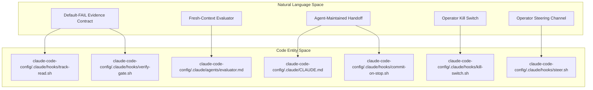

Sources: [README.md:42-46](), [claude-code-config/README.md:13-20]()

### Diagram: Outer and Inner Loop Execution Flow

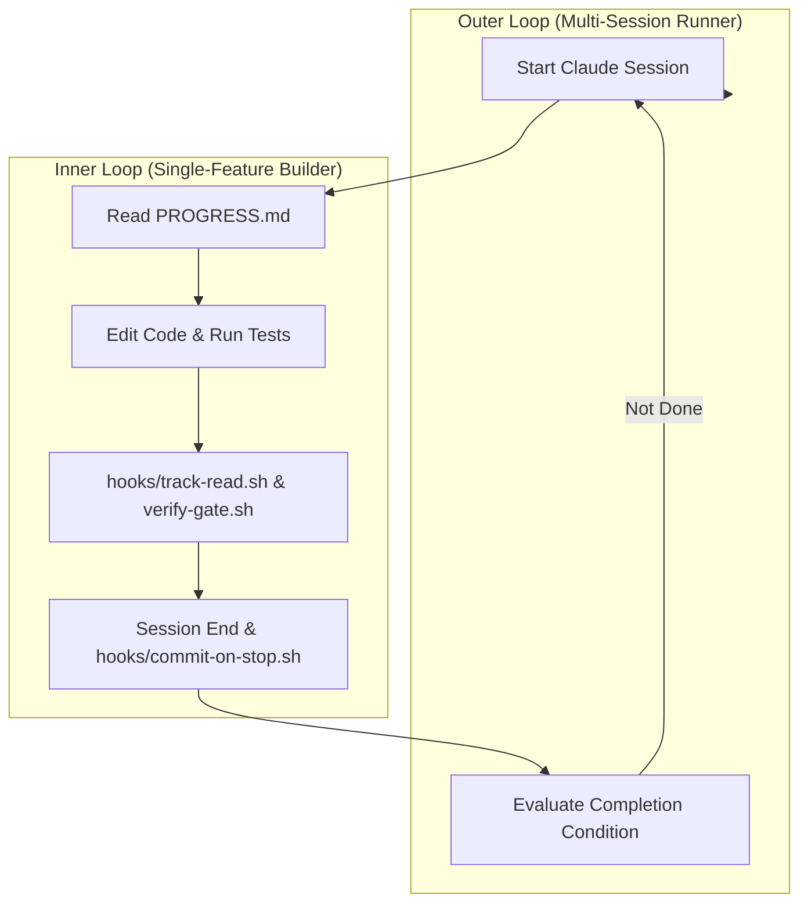

Sources: [README.md:60-64](), [claude-code-config/README.md:29-29]()

---

# Page: Getting Started

# Getting Started

<details>
<summary>Relevant source files</summary>

The following files were used as context for generating this wiki page:

- [claude-code-config/.claude/settings.json](claude-code-config/.claude/settings.json)
- [claude-code-config/README.md](claude-code-config/README.md)

</details>


## Purpose and Scope

This page covers the initial setup and configuration required to deploy the long-running agent harness primitives into a target project. It details the system requirements, the file-system installation procedure, hook permissions configuration, the creation of the mandatory verification contract file (`test-results.json`), and the execution of the Claude Code runtime environment.

Sources: `[claude-code-config/README.md:1-11]()`

---

## System Requirements and Environment Setup

Before integrating the `.claude` configuration directory into a project, ensure the host environment satisfies the following dependencies:

*   **`bash`**: Required to execute the shell scripts located in `.claude/hooks/`.
*   **`git`**: Required for version control hooks, specifically session checkpoint commits (`commit-on-stop.sh`).
*   **`python3`**: Required by the hook scripts to parse incoming and outgoing JSON payloads via standard input and output. If `python3` is missing from the environment, the hook scripts will silently no-op.

Sources: `[claude-code-config/README.md:5-6]()`

---

## Installation and Hook Permissions

The harness configuration is distributed as a self-contained `.claude/` directory that must be copied into the root of your target project. Once copied, execution permissions must be granted to all shell scripts within the hooks subdirectory.

The diagram below maps the natural language installation actions to the underlying code entities and file structures.

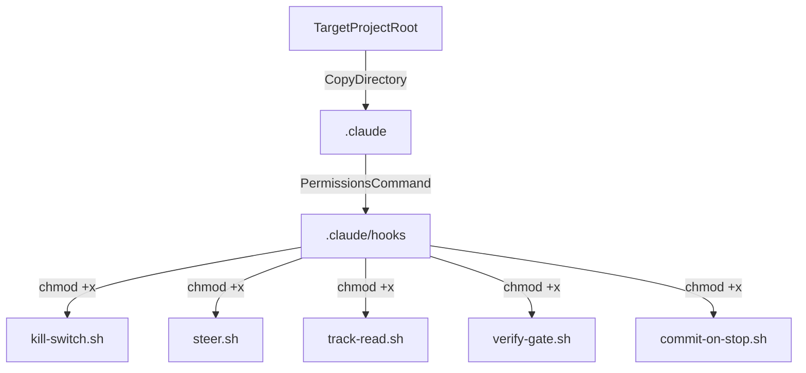
*Sources: [claude-code-config/README.md:7-11]()*

To install the configuration via terminal commands, execute the following block:

```bash
cp -r .claude/ /path/to/your/project/
chmod +x /path/to/your/project/.claude/hooks/*.sh
```
Sources: `[claude-code-config/README.md:7-9]()`

---

## Configuring the Test Results Contract

The verification gate primitives rely on a tracking file in the project root to enforce the default-FAIL contract. By default, this file is named `test-results.json`, though it can be overridden via the `RESULTS_FILE` environment variable.

Create a minimal initial `test-results.json` file in your project root before launching the agent:

```json
{ 
  "feature-1": { "passes": false }, 
  "feature-2": { "passes": false } 
}
```

The shape of this JSON file is flexible and defined entirely by your project requirements. The `verify-gate.sh` script verifies that the file exists and that the agent has reviewed evidence (such as a screenshot or log file) before allowing write or edit actions against protected targets.

Sources: `[claude-code-config/README.md:21-28]()`

---

## Initializing and Running Claude Code

Once the configuration is in place, the hooks registered in `[claude-code-config/.claude/settings.json:2-31]()` govern tool usage and session lifecycle events.

The following diagram illustrates how runtime events bridge to the registered hook handlers in `settings.json`:

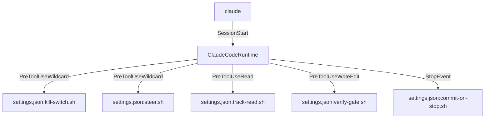
*Sources: [claude-code-config/.claude/settings.json:2-31](), [claude-code-config/README.md:10-18]()*

To launch the agent with the newly established hooks and configurations, navigate to your project directory and invoke the CLI:

```bash
cd /path/to/your/project && claude
```

Sources: `[claude-code-config/README.md:10]()`

---

# Page: Repository Layout and Runtime State Files

# Repository Layout and RuntimeState Files

<details>
<summary>Relevant source files</summary>

The following files were used as context for generating this wiki page:

- [.gitignore](.gitignore)
- [LICENSE](LICENSE)
- [README.md](README.md)

</details>


## Purpose and Scope
This page maps the exact file layout of the `claude-code-config/.claude` configuration tree and defines the ephemeral runtime state files used across long-running agent sessions. It details how the harness structures its persistent configuration versus its dynamic, uncommitted runtime states (`AGENT_STOP`, `STEER.md`, `PROGRESS.md`, `test-results.json`, `screenshots/`, and `.claude/.evidence-reads`), along with `.gitignore` enforcement policies and the `LICENSE` terms.

Sources: [README.md:1-69](), [.gitignore:1-7]()

---

## The `claude-code-config/.claude` Directory Tree

The configuration directory `.claude` contains the core hooks, subagent definitions, session instructions, and tool wiring required by the harness. When deploying the harness to a target project, the entire `.claude` folder is copied into the project root [README.md:25-34]().

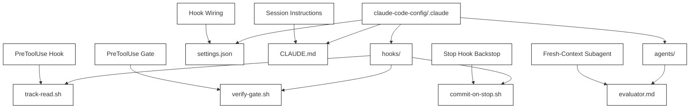
*Figure 1.1: Directory Layout bridging natural language configuration to code entity space.*

### Key Components of `.claude/`
- **`hooks/`**: Shell scripts executed by Claude Code via `settings.json` wiring [README.md:42-46](). Includes `track-read.sh`, `verify-gate.sh`, and `commit-on-stop.sh`.
- **`agents/`**: Contains subagent system prompts, specifically `evaluator.md` which implements the fresh-context evaluator [README.md:45]().
- **`CLAUDE.md`**: Session instructions and architecture guide loaded at the start of agent runs [README.md:46]().
- **`settings.json`**: JSON configuration mapping native Claude Code hooks (`PreToolUse`, `Stop`) to the shell script executables [README.md:42-46]().

Sources: [README.md:21-47]()

---

## Ephemeral Runtime State Files

During execution, the harness relies on several ephemeral state files and directories created at the project root or inside `.claude/`. These files govern control loops, evidence tracking, progresshandoffs, and quality gates.

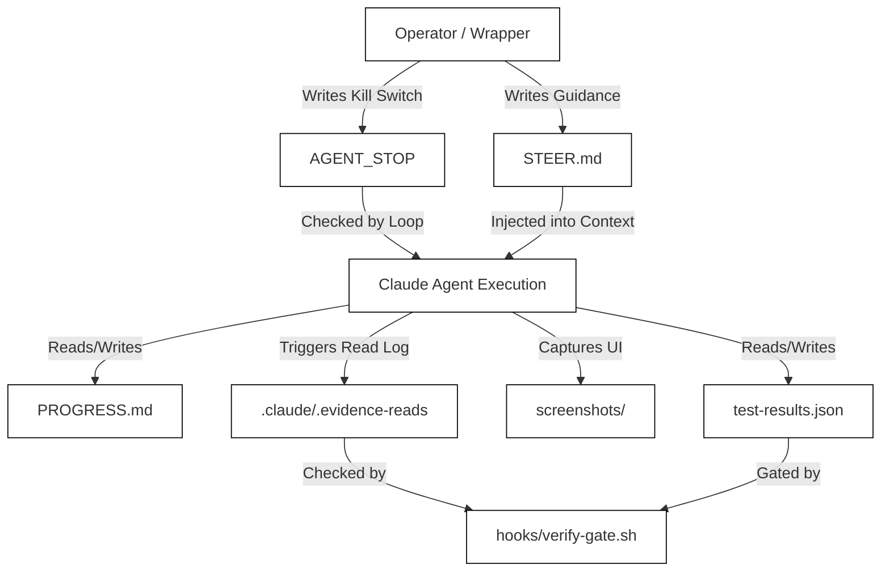
*Figure 1.2: Ephemeral runtime state data flow across operator controls and agent operations.*

### Summary of Ephemeral Runtime Files

| File / Directory | Path | Role / Description |
|---|---|---|
| **Kill Switch** | `AGENT_STOP` | Presence signals an immediate halt requirement for the outer loop [README.md:1-69](). |
| **Steering Channel** | `STEER.md` | Injected operator instructions for runtime redirection between sessions [README.md:1-69](). |
| **Handoff Notes** | `PROGRESS.md` | Agent-maintained work log tracking completed features and current context [README.md:64](). |
| **Criteria Ledger** | `test-results.json` | Default-FAIL data structure tracking feature pass/fail boolean states [README.md:50-54](). |
| **Visual Evidence** | `screenshots/` | Directory storing visual inspection artifacts required to pass gates [README.md:56](). |
| **Read Evidence Log** | `.claude/.evidence-reads` | Ephemeral log populated by `track-read.sh` recording accessed evidence paths [README.md:44](). |

Sources: [README.md:42-65](), [.gitignore:1-7]()

---

## Git Ignore Policy and Licensing

### `.gitignore` Enforcement
Because ephemeral state files (`AGENT_STOP`, `STEER.md`, `PROGRESS.md`, `test-results.json`, `screenshots/`, and `.claude/.evidence-reads`) are modified dynamically during agent execution, they must be excluded from version control to prevent repository pollution [.gitignore:1-7](). 

The project `.gitignore` explicitly ignores these runtime artifacts:
```text
# Ephemeral state the hooks read/write at runtime; don't commit.
.claude/.evidence-reads
AGENT_STOP
STEER.md
PROGRESS.md
test-results.json
screenshots/
```
Sources: [.gitignore:1-7]()

### Licensing
The codebase is distributed under the Apache License, Version 2.0, permitting use, reproduction, modification, and distribution under standard Apache-2.0 terms [LICENSE:1-126]().

Sources: [LICENSE:1-126]()

---

# Page: Harness Primitives and Quality Loop

# Harness Primitives and Quality Loop

<details>
<summary>Relevant source files</summary>

The following files were used as context for generating this wiki page:

- [README.md](README.md)

</details>


This page provides a conceptual overview of the three core pillars that compose the quality loop for long-running agents in the codebase, along with their associated operator control mechanisms `[README.md:11-18]`. 

The harness relies on structural enforcement rather than prompt instructions alone to ensure reliability across extended execution spans `[README.md:13-17]`.

Title: Quality Loop Architecture (Natural Language to Code Entities)
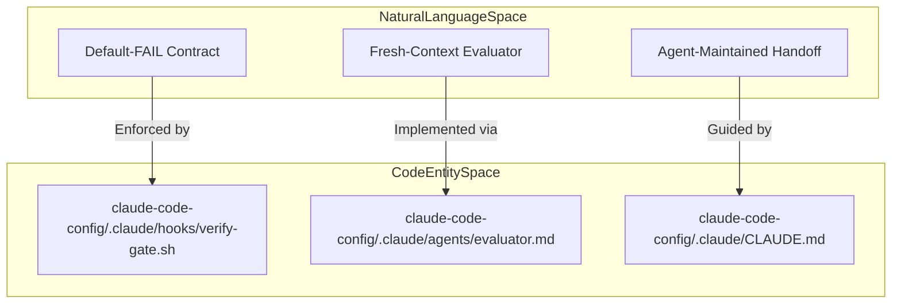
Sources: `README.md:11-17`, `README.md:44-47`

---

## Default-FAIL Evidence Contract

The default-FAIL contract ensures that criteria start in a failing state (`false`) within tracking files such as `test-results.json` `[README.md:13, README.md:48-54]`. Agents are structurally prohibited from marking features as passing without first opening valid evidence files (such as screenshots or console logs) via the Read tool `[README.md:13, README.md:56]`. 

This contract is enforced at runtime by pre-tool use hooks `[README.md:44]`. For details on criteria initialization, write gating via `track-read.sh` and `verify-gate.sh`, and known security limitations, see [Default-FAIL Evidence Contract](#2.1).

Sources: `README.md:13`, `README.md:44`, `README.md:48-57`

---

## Fresh-Context Evaluator Subagent

To prevent builders from grading their own work, a separate subagent configuration (`evaluator.md`) operates without Write or Edit tools `[README.md:14, README.md:58-60]`. It evaluates the git diff and evidence files from a clean context window that has not observed the build process `[README.md:14, README.md:60]`.

The evaluator outputs either a `PASS` or `NEEDS_WORK` verdict, generating structured findings that guide subsequent builder sessions `[README.md:60]`. For details on the review procedure, prompt configuration, and feedback protocol, see [Fresh-Context Evaluator Subagent](#2.2).

Sources: `README.md:14`, `README.md:58-60`

---

## Session Handoff and Progress Tracking

Long-running operations suffer from context window degradation and memory loss across sessions `[README.md:64]`. The agent-maintained handoff pattern addresses this by restricting each session to a single feature, maintaining structured status in `PROGRESS.md`, and leveraging git commits as a persistent historical record `[README.md:64]`.

A hook script serves as a backstop to commit uncommitted work when a session terminates `[README.md:46, README.md:64]`. For details on handoff conventions, proof requirements, and commit backstops, see [Session Handoff and Progress Tracking](#2.3).

Sources: `README.md:15`, `README.md:46`, `README.md:61-66`

---

## Operator Controls: Kill Switch and Steering

In addition to the core quality loop pillars, the harness incorporates operator control mechanisms allowing human supervisors to intervene during execution `[README.md:17]`. These controls provide immediate runtime termination and dynamic steering capabilities via designated state files.

For details on JSON block decision protocols, the `AGENT_STOP` kill switch, `STEER.md` steering channels, and trust-boundary caveats, see [Operator Controls: Kill Switch and Steering](#2.4).

Sources: `README.md:17`

---

Title: Hook and Execution Flow
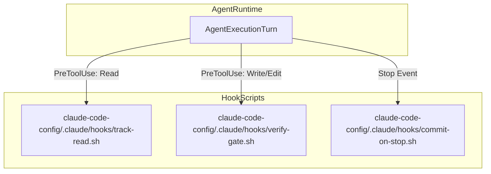
Sources: `README.md:44-46`

---

# Page: Default-FAIL Evidence Contract

# Default-FAIL Evidence Contract

<details>
<summary>Relevant source files</summary>

The following files were used as context for generating this wiki page:

- [claude-code-config/.claude/hooks/track-read.sh](claude-code-config/.claude/hooks/track-read.sh)
- [claude-code-config/.claude/hooks/verify-gate.sh](claude-code-config/.claude/hooks/verify-gate.sh)

</details>


## Purpose and Scope

The Default-FAIL Evidence Contract is a core harness primitive designed to prevent hallucinated test passes by long-running Claude Code agents. In autonomous execution loops, agents may be tempted to mark test criteria as passing in `test-results.json` without actually executing the tests or inspecting the outcomes. 

This contract enforces an empirical verification loop:
1. **Default-FAIL**: Test criteria and results start in a non-passing state or require explicit validation.
2. **Read-Gated Writes**: Modifying the results file (`test-results.json`) via `Write` or `Edit` tools is strictly gated [claude-code-config/.claude/hooks/verify-gate.sh:5-6] behind prior read actions of legitimate evidence artifacts (screenshots, console logs, or result text files) [claude-code-config/.claude/hooks/track-read.sh:4-9].
3. **Ephemeral Evidence Tracking**: Every session must independently accumulate read evidence, which is consumed upon a successful write gate validation [claude-code-config/.claude/hooks/verify-gate.sh:28-29].

---

## Conceptual Architecture and Code Mapping

To bridge natural language concepts to concrete implementation artifacts, the evidence contract relies on shell hook scripts, ephemeral log files, and configuration environment variables.

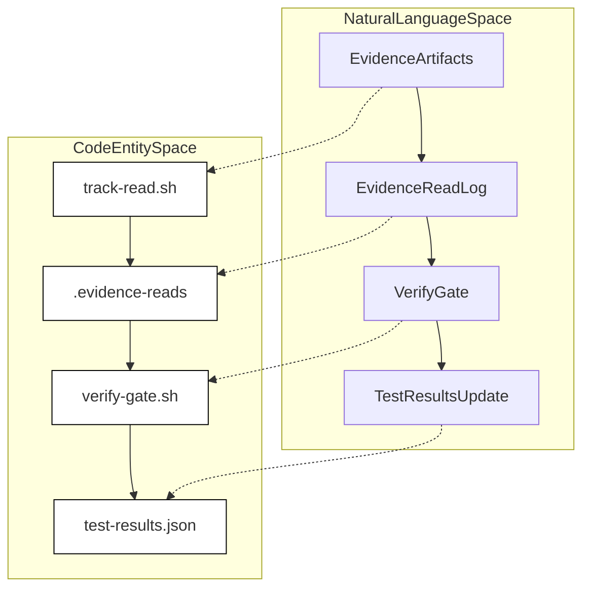

### Sources
* `[claude-code-config/.claude/hooks/track-read.sh:1-11]()`
* `[claude-code-config/.claude/hooks/verify-gate.sh:1-29]()`

---

## Interaction of `track-read.sh` and `verify-gate.sh`

The runtime enforcement mechanism relies on two hook scripts intercepting tool use events:

1. **`track-read.sh`**: Intercepts `Read` tool invocations. It checks if the accessed file matches known evidence patterns (`*screenshots/*`, `*-console.txt`, `*-result.txt`, `*.png`). If matched and the file exists, the path is appended to an ephemeral evidence read log [claude-code-config/.claude/hooks/track-read.sh:6-10].
2. **`verify-gate.sh`**: Intercepts `Write` and `Edit` tool invocations targeting the test results file. It inspects the evidence read log; if the log is empty or missing, it blocks the write operation and returns a JSON decision block instructing the agent to read evidence first [claude-code-config/.claude/hooks/verify-gate.sh:13-27]. If valid, it consumes the evidence log (`: > "$log"`) to require fresh proof for subsequent modifications [claude-code-config/.claude/hooks/verify-gate.sh:28-29].

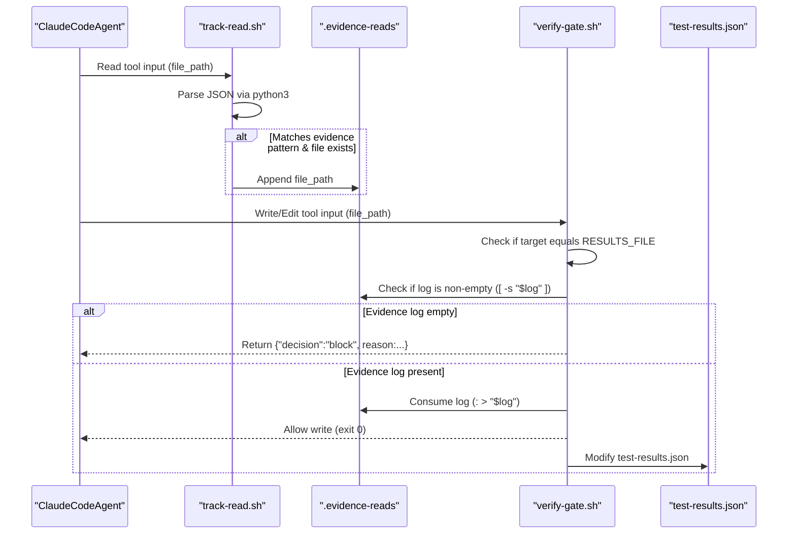

### Sources
* `[claude-code-config/.claude/hooks/track-read.sh:1-11]()`
* `[claude-code-config/.claude/hooks/verify-gate.sh:1-29]()`

---

## Implementation Details

### Evidence Tracking: `track-read.sh`
The script reads tool input JSON from stdin, extracts the `file_path`, and validates it against shell glob patterns identifying empirical test artifacts [claude-code-config/.claude/hooks/track-read.sh:6-10]:

```bash
log="${VERIFY_READ_LOG:-./.claude/.evidence-reads}"
path=$(cat | python3 -c 'import json,sys; print(json.load(sys.stdin).get("tool_input",{}).get("file_path",""))' 2>/dev/null)
case "$path" in
  *screenshots/*|*-console.txt|*-result.txt|*.png) [ -f "$path" ] && echo "$path" >> "$log" ;;
esac
exit 0
```

### Gate Enforcement: `verify-gate.sh`
The gate intercepts writes to `test-results.json` (or the path defined in `RESULTS_FILE`), verifying that `VERIFY_READ_LOG` contains at least one recorded read entry [claude-code-config/.claude/hooks/verify-gate.sh:13-27]:

| Environment Variable | Default Value | Description |
| :--- | :--- | :--- |
| `VERIFY_READ_LOG` | `./.claude/.evidence-reads` | Ephemeral log tracking evidence files read during the session. |
| `RESULTS_FILE` | `test-results.json` | Target results file protected by the verification gate. |

If the agent attempts to update `test-results.json` without reading evidence, `verify-gate.sh` returns a blocking JSON payload:
```json
{"decision":"block","reason":"Cannot modify the results file: no screenshot or console-log evidence has been Read this session. Open the evidence file with the Read tool first, then retry."}
```

### Sources
* `[claude-code-config/.claude/hooks/track-read.sh:1-11]()`
* `[claude-code-config/.claude/hooks/verify-gate.sh:1-29]()`

---

## Known Limitations and Security Boundaries

As documented within the codebase, the Default-FAIL Evidence Contract is structured as a teaching and behavioral alignment example rather than an impenetrable security sandbox [claude-code-config/.claude/hooks/verify-gate.sh:8-12]. Known gaps include:

1. **Bash Tool Bypass**: The hook intercepts `Write` and `Edit` tool calls. An agent using the `Bash` tool (e.g., executing `sed`, `jq`, or python scripts to rewrite `test-results.json` directly) bypasses the gate entirely [claude-code-config/.claude/hooks/verify-gate.sh:8-10].
2. **Path Matching Rigidity**: Path matching is basename-sensitive and matches exact filename strings or path suffixes, making it susceptible to variations if not strictly standardized [claude-code-config/.claude/hooks/verify-gate.sh:10-11].
3. **Global Unlock Scope**: Reading *any* valid evidence file unlocks writes to the results file globally for that session; the contract does not currently map specific evidence files to specific test rows within `test-results.json` [claude-code-config/.claude/hooks/verify-gate.sh:11-12].

### Sources
* `[claude-code-config/.claude/hooks/verify-gate.sh:1-29]()`

---

# Page: Fresh-Context Evaluator Subagent

# Fresh-Context Evaluator Subagent

<details>
<summary>Relevant source files</summary>

The following files were used as context for generating this wiki page:

- [claude-code-config/.claude/agents/evaluator.md](claude-code-config/.claude/agents/evaluator.md)

</details>


## Purpose and Scope
This section details the **Fresh-Context Evaluator Subagent**, a core quality gate in the harness architecture. Operating with an isolated context window and restricted tools, the evaluator acts as a skeptical second-opinion reviewer that assesses work claimed complete by a separate builder agent. Its implementation, configuration, tool boundaries, review methodology, and output protocols are defined in `[claude-code-config/.claude/agents/evaluator.md:1-25]()`.

---

## Evaluator Configuration and Tool Restrictions
The evaluator is defined as a specialized subagent configuration parsed by Claude Code. The YAML frontmatter specifies its operational identity and tool constraints [claude-code-config/.claude/agents/evaluator.md:1-5]():

- **Name**: `evaluator` [claude-code-config/.claude/agents/evaluator.md:2]()
- **Description**: Skeptical second-opinion reviewer [claude-code-config/.claude/agents/evaluator.md:3]()
- **Tools Granted**: `Read`, `Glob`, `Grep`, `Bash` [claude-code-config/.claude/agents/evaluator.md:4]()

Unlike the builder agent, the evaluator has **no write or edit tools** [claude-code-config/.claude/agents/evaluator.md:3](). The `Bash` tool is strictly scoped to non-mutating inspection commands such as `git diff`, `git log`, `ls`, and `cat` [claude-code-config/.claude/agents/evaluator.md:25](). It cannot execute the application or modify repository files [claude-code-config/.claude/agents/evaluator.md:25]().

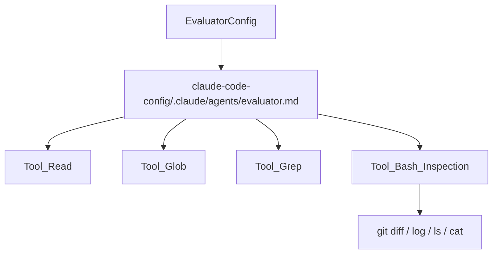
*Sources: [claude-code-config/.claude/agents/evaluator.md:1-25]()*

---

## Four-Step Review Procedure
The evaluator executes a strict, repeatable four-step review procedure every time it is invoked [claude-code-config/.claude/agents/evaluator.md:11-16]():

1. **Read Spec**: Read the specification or acceptance criteria for the feature under review [claude-code-config/.claude/agents/evaluator.md:13]().
2. **Examine Diff**: Run `git diff` against the baseline to analyze precise code modifications [claude-code-config/.claude/agents/evaluator.md:14]().
3. **Verify Evidence**: Open screenshots, console logs, or artifacts located under `screenshots/` (or designated evidence paths) to verify actual runtime behavior rather than trusting filenames [claude-code-config/.claude/agents/evaluator.md:15](). Missing or unreadable files are treated as missing evidence [claude-code-config/.claude/agents/evaluator.md:15]().
4. **Decide Verdict**: Formulate a definitive decision based on verified proof rather than plausibility [claude-code-config/.claude/agents/evaluator.md:16]().

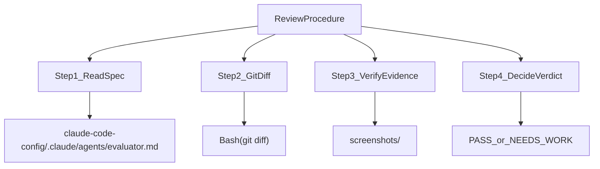
*Sources: [claude-code-config/.claude/agents/evaluator.md:11-25]()*

---

## PASS/NEEDS_WORK Output Protocol
To enable automated wrapper scripts to parse the review results, the evaluator strictly formats its terminal response [claude-code-config/.claude/agents/evaluator.md:20-24]():

- The response must begin with the bare word `PASS` or `NEEDS_WORK` on its own line, with nothing preceding it [claude-code-config/.claude/agents/evaluator.md:20]().
- **`PASS` Protocol**: Followed by a single line stating the exact evidence that convinced the reviewer [claude-code-config/.claude/agents/evaluator.md:22]().
- **`NEEDS_WORK` Protocol**: Followed by a bulleted list of specific, fixable findings that the builder agent can address in the subsequent session [claude-code-config/.claude/agents/evaluator.md:23]().

Plausibility is explicitly rejected; code changes that look reasonable but are paired with broken evidence or missing acceptance criteria must result in a `NEEDS_WORK` verdict [claude-code-config/.claude/agents/evaluator.md:18]().

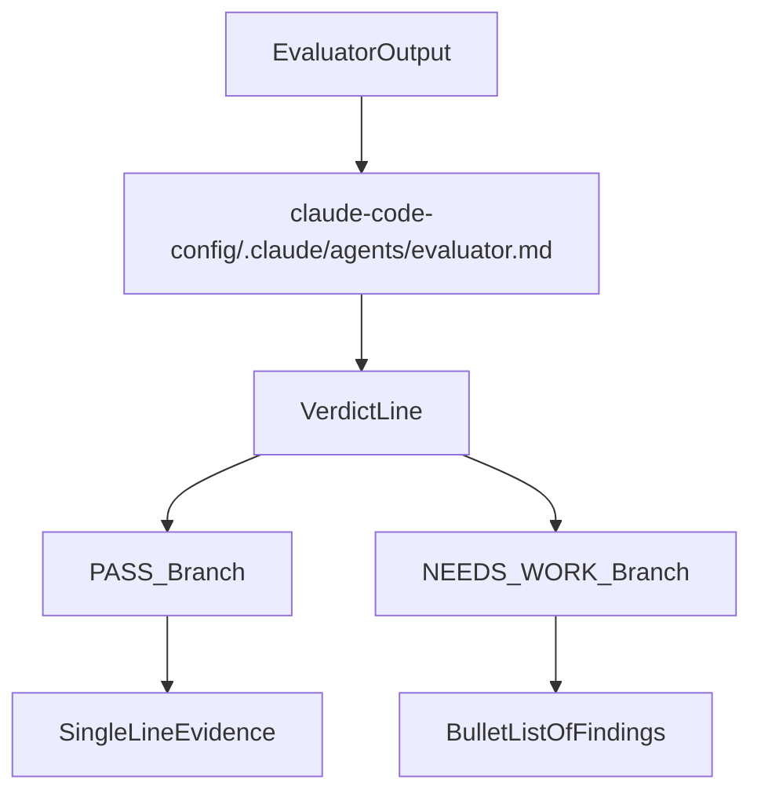
*Sources: [claude-code-config/.claude/agents/evaluator.md:20-24]()*

---

## Next Findings and Builder Feedback
Findings returned with a `NEEDS_WORK` verdict serve as actionable input for the builder agent's next session. Because the evaluator is prohibited from editing code or fixing issues directly [claude-code-config/.claude/agents/evaluator.md:25](), these structured findings are routed back to guide the builder's iterative development loop.

---

# Page: Session Handoff and Progress Tracking

# Session Handoff and Progress Tracking

<details>
<summary>Relevant source files</summary>

The following files were used as context for generating this wiki page:

- [claude-code-config/.claude/CLAUDE.md](claude-code-config/.claude/CLAUDE.md)
- [claude-code-config/.claude/hooks/commit-on-stop.sh](claude-code-config/.claude/hooks/commit-on-stop.sh)

</details>


This page details the mechanisms governing session handoff, progress tracking, and checkpointing within long-running agent loops. It covers `PROGRESS.md` conventions, the strict one-feature-per-session rule, proof-before-passing requirements, and the `commit-on-stop.sh` git backstop hook.

Sources: [claude-code-config/.claude/CLAUDE.md:1-27](), [claude-code-config/.claude/hooks/commit-on-stop.sh:1-17]()

---

## 1. `PROGRESS.md` Conventions and Cold Starts

When an agent begins a new session, it does not possess memory of previous conversational turns. To bridge this context gap, the agent relies entirely on `PROGRESS.md` as its primary handoff artifact.

As defined in `CLAUDE.md`, the session initialization sequence mandates that the agent read `PROGRESS.md` immediately [claude-code-config/.claude/CLAUDE.md:6-8](). If the file does not exist, the agent must initialize it with four mandatory section headings:
1. `## Done`
2. `## In progress`
3. `## Next`
4. `## Notes`

```
+-----------------------------------------------------------------+
| Natural Language Space: PROGRESS.md & CLAUDE.md Instructions    |
+-----------------------------------------------------------------+
                                 |
                                 v
+-----------------------------------------------------------------+
| Code Entity Space: Claude Code Startup Hook / CLAUDE.md         |
|  - Read: claude-code-config/.claude/CLAUDE.md (Lines 6-8)       |
|  - Parse: PROGRESS.md sections (Done, In progress, Next, Notes) |
|  - Verify: git log --oneline -10                              |
|  - Test: project smoke test / npm test                          |
+-----------------------------------------------------------------+
```

Sources: [claude-code-config/.claude/CLAUDE.md:6-8]()

---

## 2. The One-Feature-Per-Session Rule

To prevent context drift, hallucinations, and sprawling git diffs, agents operate under a strict **one-feature-per-session** constraint. 

According to `CLAUDE.md`, the agent must select exactly one item from `PROGRESS.md` per session, carry it through implementation, verification, and commit, before ever touching a second item [claude-code-config/.claude/CLAUDE.md:9-11](). If an operator injects a mid-session requirement, the agent is instructed to append it to `PROGRESS.md` rather than instantly context-switching away from the active item.

```
+-----------------------------------------------------------------+
| Natural Language Space: One Feature per Session Policy          |
+-----------------------------------------------------------------+
                                 |
                                 v
+-----------------------------------------------------------------+
| Code Entity Space: Scope Enforcement                            |
|  - Target: claude-code-config/.claude/CLAUDE.md (Lines 9-11)    |
|  - Action: Complete single task -> Verify -> Update PROGRESS.md |
+-----------------------------------------------------------------+
```

Sources: [claude-code-config/.claude/CLAUDE.md:9-11]()

---

## 3. Proof-Before-Passing Requirements

An agent cannot arbitrarily declare a test or feature passing. The harness enforces an evidence-backed verification workflow before status can be written back to results logs.

Per `CLAUDE.md`, a test is only validly "passing" after three strict steps are fulfilled [claude-code-config/.claude/CLAUDE.md:12-19]():
1. Executing the test against the live application (e.g., via Playwright screenshots or console logs).
2. Opening the resulting screenshot or console log file using the `Read` tool.
3. Confirming visually or textually that the output reflects correct behavior.

The `verify-gate` hook actively blocks writes to `test-results.json` unless these read-evidence conditions are satisfied, stopping agents from bypassing physical validation.

```
+-----------------------------------------------------------------+
| Natural Language Space: Proof Before Passing Contract           |
+-----------------------------------------------------------------+
                                 |
                                 v
+-----------------------------------------------------------------+
| Code Entity Space: Verification & Gate Enforcement              |
|  - Target: claude-code-config/.claude/CLAUDE.md (Lines 12-19)   |
|  - Execution: Test Run -> Read Evidence -> Verify-Gate Check    |
+-----------------------------------------------------------------+
```

Sources: [claude-code-config/.claude/CLAUDE.md:12-19]()

---

## 4. Commit-On-Stop Backstop Hook

To guarantee that work remains durable across unexpected session terminations, timeouts, or abrupt shutdowns, the harness registers a `Stop` hook named `commit-on-stop.sh`.

### Script Implementation Analysis

The script checks for an active git repository and looks for uncommitted tracked modifications (`git diff` or `git diff --cached`). If modifications are found, it automatically executes a checkpoint commit [claude-code-config/.claude/hooks/commit-on-stop.sh:12-16]().

```bash
if git rev-parse --git-dir >/dev/null 2>&1; then
  if ! git diff --quiet || ! git diff --cached --quiet; then
    git commit -am "session checkpoint: $(date '+%Y-%m-%d %H:%M')" >/dev/null 2>&1
  fi
fi
```

### Design Constraints of the Backstop
* **Tracked files only (`-am`):** Ephemeral runtime artifacts (such as screenshots, logs, and scratch files) are intentionally excluded so they do not pollute the git history [claude-code-config/.claude/hooks/commit-on-stop.sh:5-8]().
* **Agent responsibility for new files:** Because `git commit -am` only commits modified tracked files, the agent must explicitly stage new source files using `git add` during the session [claude-code-config/.claude/CLAUDE.md:23-24](), [claude-code-config/.claude/hooks/commit-on-stop.sh:7-8]().
* **Silent failure handling:** The script fails silently if git user credentials are unconfigured or if downstream hooks reject the commit [claude-code-config/.claude/hooks/commit-on-stop.sh:10-11]().

```
+-----------------------------------------------------------------+
| Natural Language Space: Session Termination Checkpoint          |
+-----------------------------------------------------------------+
                                 |
                                 v
+-----------------------------------------------------------------+
| Code Entity Space: Stop Hook Execution Flow                     |
|  - Script: claude-code-config/.claude/hooks/commit-on-stop.sh   |
|  - Check: git rev-parse & git diff --quiet                      |
|  - Action: git commit -am "session checkpoint: YYYY-MM-DD HH:MM"|
+-----------------------------------------------------------------+
```

Sources: [claude-code-config/.claude/CLAUDE.md:23-24](), [claude-code-config/.claude/hooks/commit-on-stop.sh:1-17]()

---

# Page: Operator Controls: Kill Switch and Steering

# Operator Controls: Kill Switch and Steering

<details>
<summary>Relevant source files</summary>

The following files were used as context for generating this wiki page:

- [claude-code-config/.claude/hooks/kill-switch.sh](claude-code-config/.claude/hooks/kill-switch.sh)
- [claude-code-config/.claude/hooks/steer.sh](claude-code-config/.claude/hooks/steer.sh)

</details>


### Purpose and Scope
This page details the implementation and operational semantics of the operator control channels within the long-running agent harness: the hard kill switch (`AGENT_STOP`) and the mid-run steering channel (`STEER.md`). These mechanisms allow human operators or automation wrappers to safely halt execution or redirect agent behavior without killing the underlying Claude Code process. 

---

## 1. The Kill Switch Mechanism (`AGENT_STOP`)

The kill switch is an immediate halting mechanism implemented via a simple file-existence check in `claude-code-config/.claude/hooks/kill-switch.sh` [claude-code-config/.claude/hooks/kill-switch.sh:1-9](). 

When any tool execution is attempted, the hook evaluates whether the designated stop file exists on the filesystem:

```bash
if [ -e "${AGENT_STOP_FILE:-./AGENT_STOP}" ]; then
  cat <<'JSON'
{"decision":"block","reason":"Kill switch engaged: AGENT_STOP file exists. Agent is halted. Remove the file to resume."}
JSON
fi
```
*(Source: [claude-code-config/.claude/hooks/kill-switch.sh:5-9]())*

* **File Location:** Defaults to `./AGENT_STOP`, but can be overridden via the `AGENT_STOP_FILE` environment variable [claude-code-config/.claude/hooks/kill-switch.sh:5]().
* **Engagement:** An operator executes `touch AGENT_STOP` (or the custom environment path) to halt the agent before its next tool invocation [claude-code-config/.claude/hooks/kill-switch.sh:4]().
* **Resumption:** Removing the file via `rm AGENT_STOP` restores normal tool execution [claude-code-config/.claude/hooks/kill-switch.sh:4]().

Sources: [claude-code-config/.claude/hooks/kill-switch.sh:1-9]()

---

## 2. The Steering Channel (`STEER.md`)

The steering channel provides a non-destructive way to inject prompt guidance or redirect the agent mid-run. It is implemented in `claude-code-config/.claude/hooks/steer.sh` [claude-code-config/.claude/hooks/steer.sh:1-14]().

The hook checks if the steering file exists and is non-empty (`-s`):

```bash
f="${AGENT_STEER_FILE:-./STEER.md}"
if [ -s "$f" ]; then
  note=$(cat "$f")
  reason=$(python3 -c 'import json,sys; print(json.dumps("OPERATOR STEERING: " + sys.argv[1] + "\n\nPause what you were about to do, incorporate this guidance, then continue toward the feature goal."))' "$note" 2>/dev/null) || exit 0
  printf '{"decision":"block","reason":%s}\n' "$reason"
  : > "$f"
fi
```
*(Source: [claude-code-config/.claude/hooks/steer.sh:8-14]())*

* **File Location:** Defaults to `./STEER.md`, overridable via `AGENT_STEER_FILE` [claude-code-config/.claude/hooks/steer.sh:8]().
* **Message Delivery:** When content is detected, the script reads the note, safely escapes it to JSON via Python [claude-code-config/.claude/hooks/steer.sh:10-11](), blocks the current tool invocation, and injects an `OPERATOR STEERING` block instructing the agent to pause, incorporate the guidance, and resume its path [claude-code-config/.claude/hooks/steer.sh:11]().
* **Auto-Clear:** Immediately after capturing and emitting the guidance block, the script truncates the file (`: > "$f"`) to ensure the message is delivered exactly once [claude-code-config/.claude/hooks/steer.sh:13]().

Sources: [claude-code-config/.claude/hooks/steer.sh:1-14]()

---

## 3. Architecture and Data Flow

### Diagram: Natural Language Space to Code Entity Space
The following diagram bridges conceptual operator intentions to the concrete hook scripts and runtime files responsible for enforcing them.

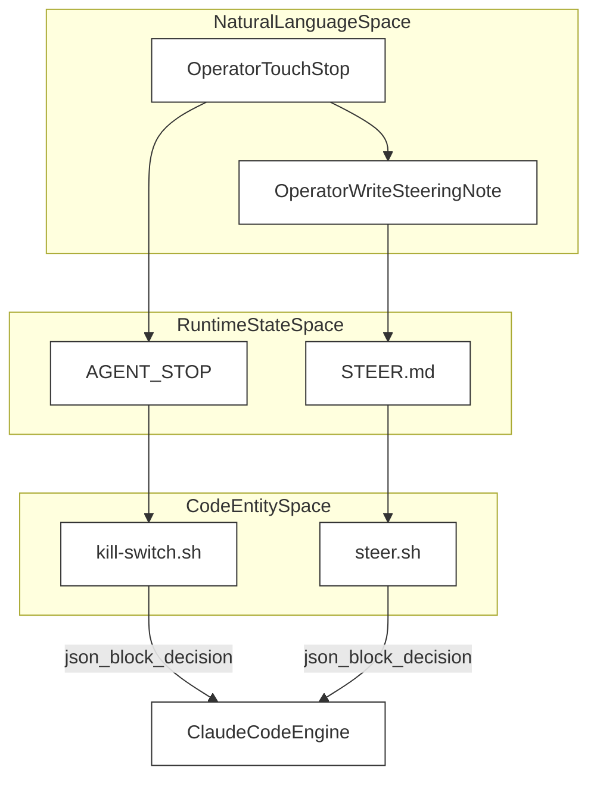
Sources: [claude-code-config/.claude/hooks/kill-switch.sh:1-9](), [claude-code-config/.claude/hooks/steer.sh:1-14]()

### Diagram: Hook Execution Interception Flow
This sequence illustrates how tool calls are intercepted by the control hooks before reaching the runtime environment.

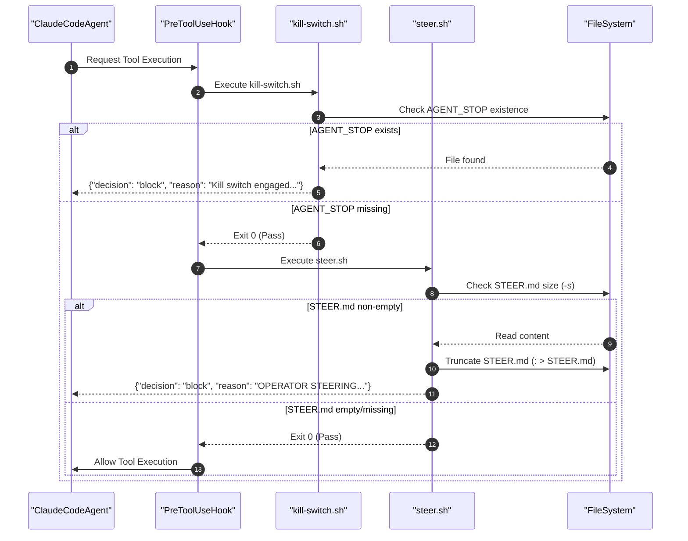
Sources: [claude-code-config/.claude/hooks/kill-switch.sh:1-9](), [claude-code-config/.claude/hooks/steer.sh:1-14]()

---

## 4. Trust-Boundary Caveats

Operators should understand the security and trust boundaries of these control channels:

* **Convenience Channel, Not a Hard Sandbox:** As noted directly in `steer.sh`, these controls are convenience mechanisms rather than strict security boundaries [claude-code-config/.claude/hooks/steer.sh:6-7](). 
* **Self-Modification Risk:** Because the agent possesses write access to the project directory, a misaligned or compromised agent could theoretically locate and remove `AGENT_STOP` or rewrite `STEER.md` [claude-code-config/.claude/hooks/steer.sh:6-7](). 
* **Mitigation Recommendation:** For strict containment in unattended multi-session environments, control files (`AGENT_STOP_FILE`, `AGENT_STEER_FILE`) should be placed in paths outside the agent's direct workspace write scope, or enforced via container-level orchestration (such as read-only mount controls or outer wrapper loops).

Sources: [claude-code-config/.claude/hooks/kill-switch.sh:1-9](), [claude-code-config/.claude/hooks/steer.sh:1-14]()

---

# Page: Claude Code Hook Implementation

# Claude Code Hook Implementation

<details>
<summary>Relevant source files</summary>

The following files were used as context for generating this wiki page:

- [claude-code-config/.claude/settings.json](claude-code-config/.claude/settings.json)

</details>


## Purpose and Scope

This section provides a high-level overview of how the harness primitives are wired into native Claude Code event hooks. Claude Code hooks intercept agent actions (`PreToolUse` and session completion (`Stop`)) to enforce quality contracts, security controls, and workflow handoffs. The configuration is managed centrally via `claude-code-config/.claude/settings.json` [claude-code-config/.claude/settings.json:1-32](). 

As a parent page, this document outlines the overarching architecture of the hook wiring, shell/JSON conventions, and configuration patterns. For line-level implementation details, refer to the child pages:
- For hook matcher rules and environment overrides, see [Hook Wiring in settings.json](#3.1).
- For script-level stdin/stdout behavior, exit codes, and failure modes, see [Hook Script Reference](#3.2).
- For evidence tracking, results file schema, and security limitations, see [Extending and Customizing the Gate](#3.3).

```mermaid
graph TD
    A["Natural Language Space: Agent Tool Call"] --> B["Code Entity Space: PreToolUse Matchers"]
    B --> C["claude-code-config/.claude/settings.json"]
    C --> D["kill-switch.sh"]
    C --> E["steer.sh"]
    C --> F["track-read.sh"]
    C --> G["verify-gate.sh"]
    
    sub: "Stop Event"
    H["Natural Language Space: Session Stop"] --> I["Code Entity Space: Stop Matcher"]
    I --> J["claude-code-config/.claude/settings.json"]
    J --> K["commit-on-stop.sh"]
```
Sources: [claude-code-config/.claude/settings.json:1-32]()

---

## 3.1 Hook Wiring in settings.json

The hook infrastructure leverages Claude Code's native configuration system to intercept tool invocations and lifecycle events. In `claude-code-config/.claude/settings.json`, hooks are divided into `PreToolUse` and `Stop` categories [claude-code-config/.claude/settings.json:2-30]().

`PreToolUse` hooks use matchers like `*` for global governance (kill switches and steering channels), `Read` to log evidence gathering via `track-read.sh`, and `Write|Edit` to enforce the default-FAIL contract via `verify-gate.sh` [claude-code-config/.claude/settings.json:3-23](). The `Stop` hook invokes `commit-on-stop.sh` to ensure state is captured when a session terminates [claude-code-config/.claude/settings.json:24-30]().

For detailed configuration patterns, environment variable overrides, and matcher precedence, see [Hook Wiring in settings.json](#3.1).

```mermaid
graph TD
    sub: "Hook Registration Flow"
    EV["Claude Code Event"] --> PTU["PreToolUse Matcher"]
    PTU -->|"matcher: *"| KS[".claude/hooks/kill-switch.sh"]
    PTU -->|"matcher: *"| ST[".claude/hooks/steer.sh"]
    PTU -->|"matcher: Read"| TR[".claude/hooks/track-read.sh"]
    PTU -->|"matcher: Write|Edit"| VG[".claude/hooks/verify-gate.sh"]
    
    EV --> STP["Stop Hook"]
    STP --> CS[".claude/hooks/commit-on-stop.sh"]
```
Sources: [claude-code-config/.claude/settings.json:1-32]()

---

## 3.2 Hook Script Architecture and Shell/JSON Conventions

All hook scripts share common conventions for consuming stdin payloads from Claude Code, interacting with environment variables, and producing structured JSON responses or standard exit codes. 

When a hook executes, Claude Code injects contextual payloads over `stdin` containing tool inputs, session metadata, or invocation arguments. The hook scripts process these inputs using standard POSIX shell utilities and Python helpers, validating evidence states or checking ephemeral control files.

For a line-level walkthrough of each script, stdin data structures, exit code behaviors, and failure recovery protocols, see [Hook Script Reference](#3.2).

Sources: [claude-code-config/.claude/settings.json:1-32]()

---

## 3.3 Gate Extension and Security Boundaries

The verification gate relies on tracking file reads and test execution results to prevent blind edits. By monitoring which files have been examined prior to modification, the system enforces rigor. However, native hook enforcement has distinct security boundaries and bypass vectors (such as direct Bash tool file modifications or case sensitivity edge cases).

Customizing these gates involves adapting test result schemas (`test-results.json`), modifying path matchers, or extending evidence collection scripts.

For instructions on extending criteria, managing results file shapes, and understanding security limitations, see [Extending and Customizing the Gate](#3.3).

Sources: [claude-code-config/.claude/settings.json:1-32]()

---

# Page: Hook Wiring in settings.json

# Hook Wiring in settings.json

<details>
<summary>Relevant source files</summary>

The following files were used as context for generating this wiki page:

- [claude-code-config/.claude/settings.json](claude-code-config/.claude/settings.json)
- [claude-code-config/README.md](claude-code-config/README.md)

</details>


## Purpose and Scope
This page details the configuration and execution flow of native Claude Code hooks defined in `claude-code-config/.claude/settings.json` [claude-code-config/.claude/settings.json:1-32](). It covers how tool call matchers (`*`, `Read`, `Write|Edit`) and session-level `Stop` events are intercepted, the execution ordering of underlying shell scripts, environment variable configurations, and runtime failure modes.

Sources: `claude-code-config/.claude/settings.json`, `claude-code-config/README.md`

---

## Hook Architecture and Matchers

Claude Code reads hook configurations from `.claude/settings.json` to intercept agent execution at specific lifecycle boundaries [claude-code-config/.claude/settings.json:1-32](). The wiring maps specific tool usage patterns to executable shell scripts located in `.claude/hooks/`.

The configuration establishes two primary event categories: `PreToolUse` and `Stop` [claude-code-config/.claude/settings.json:3-30](). 

### Diagram: Hook Wiring Map
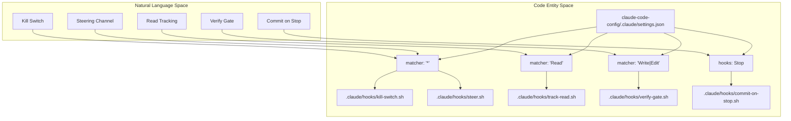
Sources: `claude-code-config/.claude/settings.json`, `claude-code-config/README.md`

---

## PreToolUse and Stop Registration Ordering

The order of hooks within `settings.json` dictates their sequential execution behavior when an agent invokes tools [claude-code-config/.claude/settings.json:3-30](). 

### 1. Global Interceptors (`matcher: "*"`)
Triggered on every tool call regardless of type [claude-code-config/.claude/settings.json:3-10](). 
* **Kill Switch**: Executes `.claude/hooks/kill-switch.sh` first to inspect whether an emergency halt file exists [claude-code-config/.claude/settings.json:7]().
* **Steering**: Executes `.claude/hooks/steer.sh` second to inject pending human instructions from runtime state files [claude-code-config/.claude/settings.json:8]().

### 2. Targeted Interceptors (`matcher: "Read"` and `matcher: "Write|Edit"`)
Triggered conditionally based on the specific tool class being invoked [claude-code-config/.claude/settings.json:11-22]().
* **Read Verification**: When a read action occurs, `.claude/hooks/track-read.sh` executes to log evidence accessibility [claude-code-config/.claude/settings.json:12-15]().
* **Write Gate**: When a write or edit action occurs, `.claude/hooks/verify-gate.sh` evaluates whether sufficient read evidence exists before allowing modifications [claude-code-config/.claude/settings.json:17-21]().

### 3. Session Termination (`hooks: Stop`)
* **Commit on Stop**: When a session stops, `.claude/hooks/commit-on-stop.sh` executes to commit state changes [claude-code-config/.claude/settings.json:24-30]().

### Diagram: Tool Interception Execution Flow
```mermaid
sequenceDiagram
    participant Agent as "Claude Code Agent"
    subgraph CodeEntitySpace ["Code Entity Space (.claude/settings.json)"]
        participant KillHook as ".claude/hooks/kill-switch.sh"
        participant SteerHook as ".claude/hooks/steer.sh"
        participant ToolMatcher as "Tool Matcher Router"
        participant ReadHook as ".claude/hooks/track-read.sh"
        participant WriteHook as ".claude/hooks/verify-gate.sh"
    end

    Agent->>KillHook: "PreToolUse (*)"
    KillHook-->>Agent: "Halt if AGENT_STOP exists"
    Agent->>SteerHook: "PreToolUse (*)"
    SteerHook-->>Agent: "Inject STEER.md if present"
    Agent->>ToolMatcher: "Evaluate Tool Type"
    
    alt Tool is Read
        ToolMatcher->>ReadHook: "PreToolUse (Read)"
        ReadHook-->>Agent: "Log evidence read"
    else Tool is Write or Edit
        ToolMatcher->>WriteHook: "PreToolUse (Write|Edit)"
        WriteHook-->>Agent: "Verify evidence gate or block"
    end
```
Sources: `claude-code-config/.claude/settings.json`

---

## Environment-Var Overrides and Runtime Requirements

The wired hook scripts depend on specific host runtimes and environment variables to function correctly [claude-code-config/README.md:5-21]().

* **System Requirements**: Execution depends on `bash`, `git`, and `python3` [claude-code-config/README.md:5](). Because the hooks rely on `python3` for parsing JSON payloads passed via stdin, environments lacking `python3` will cause hooks to silently no-op [claude-code-config/README.md:5]().
* **Results File Override (`RESULTS_FILE`)**: The verify gate hook inspects a test results file to ensure compliance with the default-FAIL contract [claude-code-config/README.md:17-21](). By default, this points to `test-results.json`, but the target file path can be customized via the `RESULTS_FILE` environment variable [claude-code-config/README.md:21]().

Sources: `claude-code-config/README.md`

---

# Page: Hook Script Reference

# Hook Script Reference

<details>
<summary>Relevant source files</summary>

The following files were used as context for generating this wiki page:

- [claude-code-config/.claude/hooks/commit-on-stop.sh](claude-code-config/.claude/hooks/commit-on-stop.sh)
- [claude-code-config/.claude/hooks/kill-switch.sh](claude-code-config/.claude/hooks/kill-switch.sh)
- [claude-code-config/.claude/hooks/steer.sh](claude-code-config/.claude/hooks/steer.sh)
- [claude-code-config/.claude/hooks/track-read.sh](claude-code-config/.claude/hooks/track-read.sh)
- [claude-code-config/.claude/hooks/verify-gate.sh](claude-code-config/.claude/hooks/verify-gate.sh)

</details>


This page provides a line-level technical walkthrough of the five core hook scripts located in `claude-code-config/.claude/hooks/` [claude-code-config/.claude/hooks/commit-on-stop.sh:1-17](). It details their inputs via stdin JSON, environment variables, output formats, exit behaviors, and failure modes.

## Overview of Hook Architecture

Claude Code invokes hooks during agent execution based on event matchers defined in `settings.json`. The hooks act as gatekeepers, safety switches, and telemetry collectors, allowing the outer and inner loops to enforce quality contracts like the default-FAIL evidence rule and human-in-the-loop steering.

```
+-------------------------------------------------------------------+
|                        Claude Code Runtime                        |
|                                                                   |
|  [Tool Use: PreToolUse] ----+                                     |
|                             v                                     |
|              +------------------------------+                     |
|              | kill-switch.sh               |                     |
|              +------------------------------+                     |
|                             v                                     |
|              +------------------------------+                     |
|              | steer.sh                     |                     |
|              +------------------------------+                     |
|                             v                                     |
|         +-------------------+-------------------+                 |
|         |                                       |                 |
|         v (Read Tool)                           v (Write/Edit)    |
|  +--------------------+               +--------------------+      |
|  | track-read.sh      |               | verify-gate.sh     |      |
|  +--------------------+               +--------------------+      |
|                                                                   |
|  [Session Stop: Stop] ----+                                     |
|                             v                                     |
|              +------------------------------+                     |
|              | commit-on-stop.sh            |                     |
|              +------------------------------+                     |
+-------------------------------------------------------------------+
```

Sources: 
- `claude-code-config/.claude/hooks/kill-switch.sh` [claude-code-config/.claude/hooks/kill-switch.sh:1-9]()
- `claude-code-config/.claude/hooks/steer.sh` [claude-code-config/.claude/hooks/steer.sh:1-14]()
- `claude-code-config/.claude/hooks/track-read.sh` [claude-code-config/.claude/hooks/track-read.sh:1-11]()
- `claude-code-config/.claude/hooks/verify-gate.sh` [claude-code-config/.claude/hooks/verify-gate.sh:1-29]()
- `claude-code-config/.claude/hooks/commit-on-stop.sh` [claude-code-config/.claude/hooks/commit-on-stop.sh:1-17]()

---

## 1. Kill Switch: `kill-switch.sh`

### Purpose and Operation
The `kill-switch.sh` script halts every tool call immediately if the `AGENT_STOP` file is present in the workspace [claude-code-config/.claude/hooks/kill-switch.sh:4-5](). This functions as an absolute operator override to stop runaway agents.

### Implementation Walkthrough
- **Environment Variables**: Checks `AGENT_STOP_FILE` (defaults to `./AGENT_STOP`) [claude-code-config/.claude/hooks/kill-switch.sh:5]().
- **Stdin / Inputs**: None processed.
- **Outputs**: Emits a JSON payload instructing Claude Code to `block` execution with a explanatory reason [claude-code-config/.claude/hooks/kill-switch.sh:6-8]().
- **Exit Behavior**: Exits implicitly with code `0`, relying on JSON stdout to convey the blocking decision.

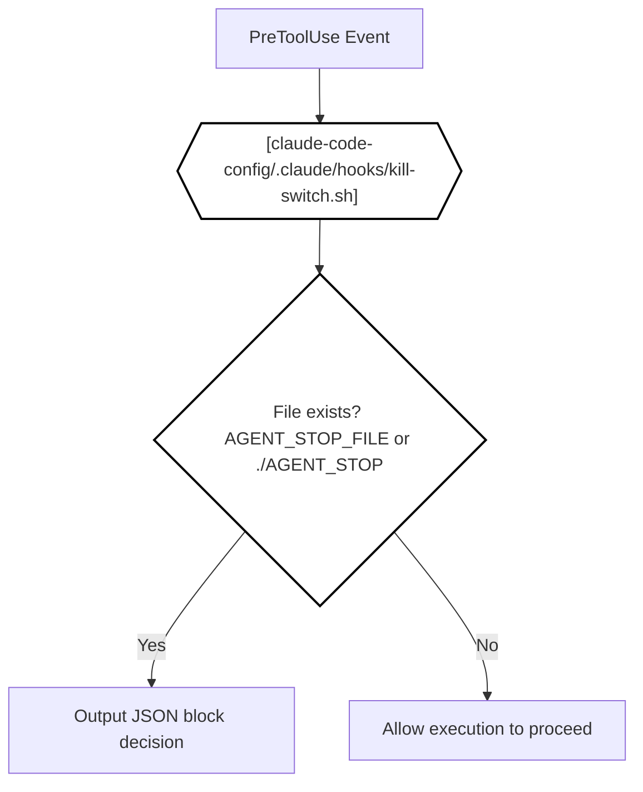

Sources: `claude-code-config/.claude/hooks/kill-switch.sh` [claude-code-config/.claude/hooks/kill-switch.sh:1-9]()

---

## 2. Operator Steering: `steer.sh`

### Purpose and Operation
The `steer.sh` script checks if `STEER.md` contains content, surfaces it to the agent as a blocking instruction, and clears the file [claude-code-config/.claude/hooks/steer.sh:4-14](). It provides a lightweight mid-run redirection channel.

### Implementation Walkthrough
- **Environment Variables**: Checks `AGENT_STEER_FILE` (defaults to `./STEER.md`) [claude-code-config/.claude/hooks/steer.sh:8]().
- **Stdin / Inputs**: None.
- **Key Functions**: Uses `python3` to safely encode the steering note string into a JSON response structure [claude-code-config/.claude/hooks/steer.sh:11]().
- **Side Effects**: Truncates `STEER.md` (`: > "$f"`) upon reading it so the prompt is delivered exactly once [claude-code-config/.claude/hooks/steer.sh:13]().
- **Failure Modes**: If python execution fails or formatting errors occur, it falls through safely (`|| exit 0`) [claude-code-config/.claude/hooks/steer.sh:11]().

```mermaid
graph TD
  A["PreToolUse Event"] --> B{{"[claude-code-config/.claude/hooks/steer.sh]"}}
  B --> C{"Is STEER.md non-empty?"}
  C -- "Yes" --> D["Read content & format JSON via python3"]
  D --> E["Output JSON block decision"]
  E --> F["Truncate STEER.md (: > $f)"]
  C -- "No" --> G["Exit 0 (No-op)"]

  style B fill:none,stroke:#000,stroke-width:2px
  style C fill:none,stroke:#000,stroke-width:2px
```

Sources: `claude-code-config/.claude/hooks/steer.sh` [claude-code-config/.claude/hooks/steer.sh:1-14]()

---

## 3. Evidence Tracking: `track-read.sh`

### Purpose and Operation
The `track-read.sh` script intercepts Read tool calls, extracting the file path and appending matching evidence files (screenshots, console logs, result texts) to an evidence log [claude-code-config/.claude/hooks/track-read.sh:4-10]().

### Implementation Walkthrough
- **Environment Variables**: Uses `VERIFY_READ_LOG` (defaults to `./.claude/.evidence-reads`) [claude-code-config/.claude/hooks/track-read.sh:6]().
- **Stdin / Inputs**: Parses incoming tool-use JSON from stdin using `python3` to extract `tool_input.file_path` [claude-code-config/.claude/hooks/track-read.sh:7]().
- **Matching Logic**: Evaluates the path against patterns (`*screenshots/*`, `*-console.txt`, `*-result.txt`, `*.png`) [claude-code-config/.claude/hooks/track-read.sh:8-10]().
- **Outputs**: Appends verified file paths to the evidence log if the file exists (`[ -f "$path" ]`) [claude-code-config/.claude/hooks/track-read.sh:9]().

```mermaid
graph TD
  A["PreToolUse Event (Read Tool)"] --> B{{"[claude-code-config/.claude/hooks/track-read.sh]"}}
  B --> C["Parse tool_input.file_path from stdin JSON"]
  C --> D{"Matches evidence pattern? screenshots/, console.txt, etc."}
  D -- "Yes" --> E{"File exists on disk?"}
  E -- "Yes" --> F["Append path to VERIFY_READ_LOG (.evidence-reads)"]
  D -- "No" --> G["Exit 0"]
  E -- "No" --> G

  style B fill:none,stroke:#000,stroke-width:2px
  style D fill:none,stroke:#000,stroke-width:2px
```

Sources: `claude-code-config/.claude/hooks/track-read.sh` [claude-code-config/.claude/hooks/track-read.sh:1-11]()

---

## 4. Verify Gate: `verify-gate.sh`

### Purpose and Operation
The `verify-gate.sh` hook enforces the default-FAIL contract. It intercepts Write or Edit tool calls targeting the results file and blocks them unless evidence has been read during the current session [claude-code-config/.claude/hooks/verify-gate.sh:5-12]().

### Implementation Walkthrough
- **Environment Variables**: 
  - `VERIFY_READ_LOG` (defaults to `./.claude/.evidence-reads`) [claude-code-config/.claude/hooks/verify-gate.sh:13]().
  - `RESULTS_FILE` (defaults to `test-results.json`) [claude-code-config/.claude/hooks/verify-gate.sh:14]().
- **Stdin / Inputs**: Reads tool execution payload, extracting `tool_input.file_path` [claude-code-config/.claude/hooks/verify-gate.sh:16-17]().
- **Guard Validation**: 
  - Checks if the target path matches the results file pattern (`$results` or `*/$results`) [claude-code-config/.claude/hooks/verify-gate.sh:20](). If not, exits immediately (`exit 0`).
  - Checks if the evidence log (`$log`) is non-empty (`[ ! -s "$log" ]`) [claude-code-config/.claude/hooks/verify-gate.sh:22](). If empty, blocks the write with a descriptive JSON reason [claude-code-config/.claude/hooks/verify-gate.sh:23-26]().
- **Consumption Side Effect**: Truncates the evidence log (`: > "$log"`) upon passing so subsequent edits require fresh proof [claude-code-config/.claude/hooks/verify-gate.sh:28-29]().

```mermaid
graph TD
  A["PreToolUse Event (Write/Edit)"] --> B{{"[claude-code-config/.claude/hooks/verify-gate.sh]"}}
  B --> C["Extract file_path from stdin JSON"]
  C --> D{"Matches RESULTS_FILE (test-results.json)?"}
  D -- "No" --> E["Exit 0 (Allow)"]
  D -- "Yes" --> F{"Is VERIFY_READ_LOG non-empty?"}
  F -- "No" --> G["Output JSON block decision: Missing evidence"]
  F -- "Yes" --> H["Truncate evidence log & Allow write"]

  style B fill:none,stroke:#000,stroke-width:2px
  style D fill:none,stroke:#000,stroke-width:2px
  style F fill:none,stroke:#000,stroke-width:2px
```

Sources: `claude-code-config/.claude/hooks/verify-gate.sh` [claude-code-config/.claude/hooks/verify-gate.sh:1-29]()

---

## 5. Commit on Stop: `commit-on-stop.sh`

### Purpose and Operation
The `commit-on-stop.sh` script acts as a session backstop. It triggers when an agent session ends, automatically committing tracked changes to ensure work remains durable across restarts [claude-code-config/.claude/hooks/commit-on-stop.sh:5-11]().

### Implementation Walkthrough
- **Environment Variables**: None explicitly configured; relies on environment `git` configuration and user credentials.
- **Validation**: Checks if a git repository directory exists (`git rev-parse --git-dir`) and if there are unstaged or staged modifications (`git diff --quiet` / `git diff --cached --quiet`) [claude-code-config/.claude/hooks/commit-on-stop.sh:12-13]().
- **Actions**: Executes `git commit -am "session checkpoint: $(date '+%Y-%m-%d %H:%M')"` for tracked files only, avoiding ephemeral scratch artifacts like logs or screenshots [claude-code-config/.claude/hooks/commit-on-stop.sh:6-14]().
- **Failure Modes**: Fails silently (`> /dev/null 2>&1`) if commits cannot be made due to missing user identity or hook rejections [claude-code-config/.claude/hooks/commit-on-stop.sh:10-14]().

```mermaid
graph TD
  A["Stop Event"] --> B{{"[claude-code-config/.claude/hooks/commit-on-stop.sh]"}}
  B --> C{"Inside git repository?"}
  C -- "No" --> D["Exit 0"]
  C -- "Yes" --> E{"Uncommitted changes exist?"}
  E -- "No" --> D
  E -- "Yes" --> F["Run git commit -am 'session checkpoint...'"]
  F --> D

  style B fill:none,stroke:#000,stroke-width:2px
  style C fill:none,stroke:#000,stroke-width:2px
  style E fill:none,stroke:#000,stroke-width:2px
```

Sources: `claude-code-config/.claude/hooks/commit-on-stop.sh` [claude-code-config/.claude/hooks/commit-on-stop.sh:1-17]()

---

## Summary Table of Hooks

| Hook Script | Event Trigger | Key Input Variable | Output / Action | Failure Mode |
| :--- | :--- | :--- | :--- | :--- |
| `kill-switch.sh` [claude-code-config/.claude/hooks/kill-switch.sh:1-9]() | `PreToolUse` | `AGENT_STOP_FILE` [claude-code-config/.claude/hooks/kill-switch.sh:5]() | JSON block payload | Exits silently if file missing |
| `steer.sh` [claude-code-config/.claude/hooks/steer.sh:1-14]() | `PreToolUse` | `AGENT_STEER_FILE` [claude-code-config/.claude/hooks/steer.sh:8]() | JSON block payload & truncates file | Falls through (`|| exit 0`) on python error [claude-code-config/.claude/hooks/steer.sh:11]() |
| `track-read.sh` [claude-code-config/.claude/hooks/track-read.sh:1-11]() | `PreToolUse` (Read) | `VERIFY_READ_LOG` [claude-code-config/.claude/hooks/track-read.sh:6]() | Appends path to evidence log | Ignores non-matching paths |
| `verify-gate.sh` [claude-code-config/.claude/hooks/verify-gate.sh:1-29]() | `PreToolUse` (Write/Edit) | `VERIFY_READ_LOG`, `RESULTS_FILE` [claude-code-config/.claude/hooks/verify-gate.sh:13-14]() | JSON block if unverified; resets log | Ignores non-results files |
| `commit-on-stop.sh` [claude-code-config/.claude/hooks/commit-on-stop.sh:1-17]() | `Stop` | Git diff state | `git commit -am` checkpoint | Fails silently if git config incomplete [claude-code-config/.claude/hooks/commit-on-stop.sh:10-14]() |

Sources:
- `claude-code-config/.claude/hooks/kill-switch.sh` [claude-code-config/.claude/hooks/kill-switch.sh:1-9]()
- `claude-code-config/.claude/hooks/steer.sh` [claude-code-config/.claude/hooks/steer.sh:1-14]()
- `claude-code-config/.claude/hooks/track-read.sh` [claude-code-config/.claude/hooks/track-read.sh:1-11]()
- `claude-code-config/.claude/hooks/verify-gate.sh` [claude-code-config/.claude/hooks/verify-gate.sh:1-29]()
- `claude-code-config/.claude/hooks/commit-on-stop.sh` [claude-code-config/.claude/hooks/commit-on-stop.sh:1-17]()

---

# Page: Extending and Customizing the Gate

# Extending and Customizing the Gate

<details>
<summary>Relevant source files</summary>

The following files were used as context for generating this wiki page:

- [claude-code-config/.claude/hooks/verify-gate.sh](claude-code-config/.claude/hooks/verify-gate.sh)
- [claude-code-config/README.md](claude-code-config/README.md)

</details>


## Purpose and Scope
This section details how to extend and customize the verify gate mechanism (`verify-gate.sh` and `track-read.sh`) to fit project-specific requirements. It covers configuring the results file schema via `RESULTS_FILE`, adapting path-matching rules, implementing fine-grained per-test evidence tracking, and understanding the inherent security limitations of shell-based hook enforcement.

Sources: `[claude-code-config/.claude/hooks/verify-gate.sh:1-29]()`, `[claude-code-config/README.md:1-29]()`

---

## 1. Results File Shape and Configuration (`RESULTS_FILE`)
The gate guards a designated results file defined in the environment or falling back to a default path [claude-code-config/.claude/hooks/verify-gate.sh:14](). By default, the system looks for `test-results.json` in the working directory, but this can be overridden by setting the `RESULTS_FILE` environment variable [claude-code-config/.claude/hooks/verify-gate.sh:14]().

The shape of the results file is flexible. The verification hook does not parse the internal structure of the JSON payload; it only verifies that the file path matches and that an evidence file was read during the session before allowing a `Write` or `Edit` tool call [claude-code-config/.claude/hooks/verify-gate.sh:19-27]().

A minimal starting structure for the results file is:
```json
{
  "feature-1": { "passes": false },
  "feature-2": { "passes": false }
}
```
[claude-code-config/README.md:23-25]()

```mermaid
graph TD
    A["AgentToolExecution"] -->|Interception| B["verify-gate.sh"]
    B -->|CheckEnv| C["RESULTS_FILE"]
    C -->|DefaultOrOverride| D["test-results.json"]
    B -->|ParseStdin| E["ToolInputFilePath"]
    E -->|MatchCheck| F{"MatchesRESULTS_FILE?"}
    F -->|No| G["Exit0Allow"]
    F -->|Yes| H["CheckEvidenceLog"]

    Sources: "claude-code-config/.claude/hooks/verify-gate.sh:13-20", "claude-code-config/README.md:21-25"
```

Sources: `[claude-code-config/.claude/hooks/verify-gate.sh:13-20](), [claude-code-config/README.md:21-25]()`

---

## 2. Adapting Matchers and Paths
The verification hook intercepts tool inputs via JSON passed over standard input, extracting the `file_path` property using an embedded Python 3 snippet [claude-code-config/.claude/hooks/verify-gate.sh:16-17]().

The matching logic anchors on the target path to ensure precise identification:
```bash
case "$target" in "$results"|*/"$results") ;; *) exit 0 ;; esac
```
[claude-code-config/.claude/hooks/verify-gate.sh:20]()

To adapt path matching for custom project structures (e.g., nesting results inside a `build/` or `reports/` directory), you can adjust the `case` pattern or modify the Python JSON extractor to evaluate absolute paths, glob patterns, or prefix matching.

Sources: `[claude-code-config/.claude/hooks/verify-gate.sh:16-20]()`

---

## 3. Implementing Per-Test Evidence Tracking
Out of the box, `verify-gate.sh` tracks evidence at the session level: any screenshot or console log opened via the `Read` tool unlocks any write to the results file for that session [claude-code-config/.claude/hooks/verify-gate.sh:22-29](), `[claude-code-config/README.md:27]()`. Once the gate passes, the evidence log (`.evidence-reads`) is cleared (`: > "$log"`) [claude-code-config/.claude/hooks/verify-gate.sh:29]().

For strict per-test evidence tracking, you must extend `track-read.sh` and `verify-gate.sh` to record specific associations:
1. **Metadata Tagging**: Update `track-read.sh` to parse the filename of the evidence being read (e.g., `screenshot-feature-1.png`) and append the specific test ID or feature key to `VERIFY_READ_LOG` instead of a generic flag.
2. **Keyed Validation**: Modify `verify-gate.sh` to inspect the contents of the `RESULTS_FILE` mutation payload (via `tool_input` JSON) to determine *which* test row is being modified.
3. **Targeted Consumption**: Check if a valid evidence read corresponding to that specific test ID exists in the log before allowing the write.

```mermaid
graph TD
    A["AgentReadTool"] -->|Invoke| B["track-read.sh"]
    B -->|LogEvidence| C[".evidence-reads"]
    D["AgentWriteTool"] -->|Invoke| E["verify-gate.sh"]
    E -->|ReadLog| C
    E -->|ParseTargetRow| F["test-results.json"]
    E -->|ValidateMatch| G{"EvidenceMatchesRow?"}
    G -->|Yes| H["AllowWriteAndConsumeLog"]
    G -->|No| I["BlockDecision"]

    Sources: "claude-code-config/.claude/hooks/verify-gate.sh:13-30", "claude-code-config/README.md:27"
```

Sources: `[claude-code-config/.claude/hooks/verify-gate.sh:13-29](), [claude-code-config/README.md:27]()`

---

## 4. Security Limitations and Threat Model
As noted in the reference implementation, these hooks serve as a teaching and workflow-guidance example rather than a hardened security boundary [claude-code-config/.claude/hooks/verify-gate.sh:8-12](). Real enforcement layers must account for the following architectural gaps:

* **Bash Tool Bypass**: The hook only intercepts `Write` and `Edit` tool calls. An agent with access to the `Bash` tool can easily bypass the gate by mutating `test-results.json` using command-line utilities like `sed`, `jq`, or python scripts [claude-code-config/.claude/hooks/verify-gate.sh:8-10](). To close this, hook `PreToolUse` for `Bash` and inspect command strings for writes to the results file.
* **Basename-Only and Case-Sensitive Matching**: Path matching uses a strict basename or relative path suffix comparison (`"$results"|*/"$results"`), which can be susceptible to path traversal variations or case-sensitivity mismatches on different filesystems [claude-code-config/.claude/hooks/verify-gate.sh:10-11]().
* **Global Unlocking**: Because the default implementation logs session-level reads without row-level binding, reading an unrelated evidence file unlocks all rows in the results file [claude-code-config/.claude/hooks/verify-gate.sh:11-12]().

Sources: `[claude-code-config/.claude/hooks/verify-gate.sh:8-12]()`

---

# Page: Unattended Multi-Session Operation

# Unattended Multi-Session Operation

<details>
<summary>Relevant source files</summary>

The following files were used as context for generating this wiki page:

- [README.md](README.md)

</details>


This page provides an overview of running the outer loop unattended, orchestrating multiple Claude Code sessions using harness primitives, custom wrapper scripts, and scaling patterns. As a parent page, it introduces the core concepts and links to detailed child pages.

For details on wrapper mechanics and loop exit conditions, see [Outer Loop: /goal, ralph-loop, and Wrapper Scripts](#4.1).
For details on advanced multi-session scaling architecture, see [Scaling Patterns: Sprint Contracts, Planner, Rubrics](#4.2).

## 4.1. Outer Loop: /goal, ralph-loop, and Wrapper Scripts

While Claude Code provides built-in mechanisms like [`/goal`](https://code.claude.com/docs/en/goal) for interactive generator-evaluator loops, long-running unattended operation requires custom wrapper scripts [README.md:1-10](). These wrappers orchestrate headless sessions using `claude -p` alongside the fresh-context evaluator subagent defined in `agents/evaluator.md` [README.md:60]().

The outer loop manages session transitions, executes test verification gates, checks loop exit conditions, and feeds evaluator findings (`NEEDS_WORK` or `PASS`) into subsequent builder iterations [README.md:60]().

For deep technical walkthroughs of wrapper scripts, `/goal` mechanics, and loop termination criteria, see [Outer Loop: /goal, ralph-loop, and Wrapper Scripts](#4.1).

Sources: `README.md:1-69`

## 4.2. Scaling Patterns: Sprint Contracts, Planner, Rubrics

Scaling long-running application development beyond single features requires higher-level architectural layers. As outlined in the core documentation, these patterns include sprint contracts for defining bounded units of work, autonomous planners for task decomposition, and objective rubrics for grading subjective features [README.md:66]().

These components build upon the foundational quality loop primitives (the default-FAIL contract, fresh-context evaluator, and agent-maintained handoff) to sustain multi-day or multi-sprint autonomous execution without human intervention [README.md:11-16]().

For comprehensive specifications on sprint planning and evaluation rubrics, see [Scaling Patterns: Sprint Contracts, Planner, Rubrics](#4.2).

Sources: `README.md:1-69`

---

## Outer Loop Architecture Overview

```mermaid
graph TD
    User["User Goal Space"] --> OuterLoop["Outer Loop Wrapper"]
    OuterLoop -->|"claude -p"| BuilderSession["Builder Session"]
    BuilderSession -->|"test-results.json"| VerifyGate["verify-gate.sh"]
    VerifyGate -->|"PASS/FAIL"| Evaluator["agents/evaluator.md"]
    Evaluator -->|"NEXT_FINDINGS.md"| OuterLoop
```

Sources: `README.md:1-69`

---

# Page: Outer Loop: /goal, ralph-loop, and Wrapper Scripts

# Outer Loop: /goal, ralph-loop, and Wrapper Scripts

<details>
<summary>Relevant source files</summary>

The following files were used as context for generating this wiki page:

- [README.md](README.md)
- [claude-code-config/README.md](claude-code-config/README.md)

</details>


## Purpose and Scope

This section covers the architecture of the outer execution loop for long-running Claude Code agents. While individual Claude Code sessions operate within an inner loop of tool calls and reasoning turns, unattended multi-session automation requires an outer loop. This page contrasts Claude Code's native, built-in [`/goal`](https://code.claude.com/docs/en/goal) command with custom wrapper scripts, headless execution via [`claude -p`](https://code.claude.com/docs/en/headless), and the [`ralph-loop`](https://github.com/anthropics/claude-plugins-official/tree/main/plugins/ralph-loop) plugin pattern. It details data flow, invocation patterns, and loop exit conditions.

Sources: `README.md:1-10`, `claude-code-config/README.md:29-30`

---

## Built-In `/goal` Command vs. Custom Wrappers

Claude Code provides an out-of-the-box generator/evaluator loop via the built-in [`/goal`](https://code.claude.com/docs/en/goal) command [README.md:1-9]. Users define a completion condition, and a separate fast model evaluates the condition after every turn until met [README.md:1-9]. 

Alternatively, for granular control over the evaluation phase, custom wrappers can orchestrate sessions by combining headless execution (`claude -p`) with the fresh-context evaluator subagent (`claude --agent evaluator`) [README.md:8-9, README.md:60].

```mermaid
graph TD
    subgraph "Native In-Product Loop"
        A1["UserGoal"] --> B1["ClaudeCodeInteractive"]
        B1 --> C1["BuiltInGoalCommand"]
        C1 --> D1["FastModelEvaluator"]
        D1 -->| "Check Condition" | B1
    end

    subgraph "Custom Harness Outer Loop"
        A2["PROGRESS.md"] --> B2["WrapperScriptOrRalphLoop"]
        B2 --> C2["ClaudeHeadlessInvocation"]
        C2 --> D2["EvaluatorSubagent"]
        D2 -->| "PASS/NEEDS_WORK" | B2
    end
```
*Figure 1: Native `/goal` versus custom wrapper loop execution architecture.*

Sources: `README.md:1-10`, `README.md:60`

---

## Wrapper Script Architecture and Headless Execution (`claude -p`)

Unattended multi-session operation relies on wrapper scripts or community plugins such as `ralph-loop` [README.md:68-69, claude-code-config/README.md:29-30]. A wrapper script orchestrates the outer loop by repeatedly invoking Claude Code in headless mode (`claude -p`), instructing the agent to resume execution using state stored in `PROGRESS.md` [README.md:60, claude-code-config/README.md:29-30].

The following diagram maps the natural language concepts of session management to the concrete command-line interface and configuration entities used in the codebase:

```mermaid
graph TD
    NL_Session["Session State Handoff"] --> Code_Progress["PROGRESS.md"]
    NL_Runner["Unattended Loop Runner"] --> Code_Ralph["ralph-loop or Custom Bash Wrapper"]
    NL_Execution["Headless Execution"] --> Code_ClaudeP["claude -p continue from PROGRESS.md"]
    NL_Evaluation["Evaluator Grading"] --> Code_Evaluator["claude --agent evaluator -p review prompt"]

    subgraph "Natural Language Space"
        NL_Session
        NL_Runner
        NL_Execution
        NL_Evaluation
    end

    subgraph "Code Entity Space"
        Code_Progress
        Code_Ralph
        Code_ClaudeP
        Code_Evaluator
    end
```
*Figure 2: Bridging natural language session execution concepts to specific codebase entities and commands.*

Sources: `README.md:60`, `README.md:68-69`, `claude-code-config/README.md:29-30`

---

## Loop Exit Conditions and State Evaluation

The outer loop persists across multiple agent sessions until specific termination criteria are satisfied [README.md:68-69, claude-code-config/README.md:29-30]. The loop monitors state files and exit signals to determine when to halt execution.

```mermaid
graph TD
    Start["StartOuterLoop"] --> ReadState["ChecktestresultsjsonAndPROGRESSmd"]
    ReadState --> CheckStop{"AGENT_STOP file exists?"}
    CheckStop -->| "Yes" | Halt["HaltLoopImmediately"]
    CheckStop -->| "No" | CheckPass{"All features passes: true?"}
    CheckPass -->| "Yes" | Success["TerminateLoopSuccess"]
    CheckPass -->| "No" | RunSession["InvokeClaudeHeadlessclaude-p"]
    RunSession --> RunEvaluator["InvokeEvaluatorSubagent"]
    RunEvaluator --> UpdateProgress["UpdatePROGRESSmdAndCommit"]
    UpdateProgress --> ReadState
```
*Figure 3: Data flow and conditional logic for outer loop exit criteria and session iteration.*

### Key Exit Conditions

1. **Feature Completion:** All features defined within `test-results.json` evaluate to `passes: true` [README.md:52-54, claude-code-config/README.md:23-25].
2. **Operator Kill Switch:** The presence of an `./AGENT_STOP` file in the working directory halts all tool execution via `.claude/hooks/kill-switch.sh` [claude-code-config/README.md:15].
3. **Evaluator Verdict Failure Thresholds:** If consecutive runs fail to achieve `PASS` from `agents/evaluator.md`, the wrapper may pause or abort depending on configured maximum iteration limits [README.md:60].

Sources: `README.md:52-60`, `README.md:68-69`, `claude-code-config/README.md:15`, `claude-code-config/README.md:23-30`

---

# Page: Scaling Patterns: Sprint Contracts, Planner, Rubrics

# Scaling Patterns: Sprint Contracts, Prompt Planners, and Rubrics

<details>
<summary>Relevant source files</summary>

The following files were used as context for generating this wiki page:

- [README.md](README.md)
- [claude-code-config/.claude/CLAUDE.md](claude-code-config/.claude/CLAUDE.md)

</details>


## Purpose and Scope

As long-running Claude Code agent deployments scale from single-feature scripts to multi-session application development, the foundational loops (`test-results.json`, basic handoffs in `PROGRESS.md`, and single-feature sessions) require higher-level orchestration layers. Section 4.2 covers the advanced scaling patterns described in the root README: **Sprint Contracts** (defining structured scopes across multiple agent boundaries), **Planner Architectures** (decomposing ambiguous epics into discrete, session-sized execution units), and **Rubrics** (evaluating subjective or qualitative dimensions beyond binary unit tests). 

These patterns bridge the gap between individual harness primitives and large-scale, unattended multi-session engineering pipelines.

Sources: [README.md:1-69](), [claude-code-config/.claude/CLAUDE.md:1-27]()

---

## 1. Sprint Contracts

In a long-running agent deployment, an agent left unconstrained over multiple sessions can drift in scope, refactor unrelated modules, or lose track of overarching architectural goals. A **Sprint Contract** formalizes the boundary of a multi-session milestone.

### Core Components
* **Scope Definition**: Explicitly lists what files, components, and user stories are in-bounds versus strictly out-of-bounds.
* **Acceptance Thresholds**: Extends the default-FAIL contract (`test-results.json`) from micro-features to multi-feature milestone gates.
* **Session Budgeting**: Restricts the maximum number of iterations or tool uses per feature block to prevent infinite debugging loops.

```json
{
  "sprint_id": "milestone-auth-v1",
  "allowed_paths": ["src/auth/", "tests/auth/"],
  "forbidden_paths": ["src/legacy_core/"],
  "max_sessions_per_item": 2,
  "required_evidence": ["playwright-login.png", "jest-auth-results.json"]
}
```

Sources: [README.md:48-57](), [claude-code-config/.claude/CLAUDE.md:9-11]()

---

## 2. Planner Subagents and Prompt Decomposition

While the builder agent focuses on implementation and the fresh-context evaluator (`agents/evaluator.md`) grades the result, complex epics require a dedicated planning phase. 

### Architecture and Workflow
1. **Epic Intake**: The operator provides a high-level requirement via the outer loop or prompt wrapper.
2. **Planner Execution**: A planning phase (or specialized subagent prompt) inspects the codebase, reads `PROGRESS.md`, and breaks the epic down into atomic, single-feature increments.
3. **State Initialization**: The planner populates or updates `PROGRESS.md` with structured task checkboxes and updates `test-results.json` with new default-FAIL evaluation rows.
4. **Execution Hand-off**: The builder agent picks up exactly one item per session as dictated by the pre-established plan [claude-code-config/.claude/CLAUDE.md:9-11]().

Sources: [README.md:60-65](), [claude-code-config/.claude/CLAUDE.md:6-8]()

---

## 3. Rubrics for Subjective and Qualitative Work

The default-FAIL contract handles deterministic tests (e.g., unit tests, API status codes, explicit file presence), but user-facing applications require handling subjective criteria such as UI visual polish, error message clarity, and accessibility compliance. 

### Extending the Evaluator Subagent
To evaluate subjective work, the fresh-context evaluator (`agents/evaluator.md`) is paired with a project-specific **Rubric**:
* **Multi-Dimensional Scoring**: Evaluates outputs across axes like *Visual Consistency*, *Robustness*, *Code Style*, and *UX Flow*.
* **Evidence Inspection**: Requires the evaluator to review specific artifacts (such as Playwright screenshots generated during the run) before rendering a qualitative score.
* **Structured Findings**: Outputs a detailed breakdown in `NEXT_FINDINGS.md` or standard output streams, grading each rubric dimension as `PASS` or `NEEDS_WORK` with explicit remediation steps.

Sources: [README.md:44-46](), [README.md:60-62]()

---

## 4. Architecture and Data Flow

The following diagrams illustrate how Sprint Contracts, Planners, and Rubrics integrate with the core state files (`PROGRESS.md`, `test-results.json`) and execution agents (`evaluator.md`).

### Natural Language Space to Code Entity Space Mapping

```mermaid
graph TD
    subgraph "Natural Language Space"
        H["High-Level Epic / User Intent"]
        S["Sprint Contract & Constraints"]
        R["Subjective Quality Rubric"]
    end

    subgraph "Code Entity Space"
        P["Planner / PROGRESS.md"]
        E["claude-code-config/.claude/agents/evaluator.md"]
        TF["test-results.json"]
        W["Builder Agent Session"]
    end

    H --> P
    S --> W
    R --> E
    P -->|"Scoping Task List"| W
    W -->|"Generates Evidence & Code"| TF
    TF -->|"Inputs Diff & Artifacts"| E
    E -->|"Returns PASS / NEEDS_WORK"| W

    classDef default fill:#fff,stroke:#000,stroke-width:1px;
    class H,S,R,P,E,TF,W default;
```

Sources: [README.md:40-67](), [claude-code-config/.claude/CLAUDE.md:6-27]()

### Multi-Session Scaling Execution Lifecycle

```mermaid
sequenceDiagram
    participant Op as Operator / Wrapper
    participant Pl as Planner / PROGRESS.md
    participant Bu as Builder Agent (CLAUDE.md)
    participant Ev as Evaluator (evaluator.md)
    participant Gate as Verify Gate (verify-gate.sh)

    Op->>Pl: Initialize Sprint Contract & Tasks
    loop Multi-Session Execution Loop
        Pl->>Bu: Read next uncompleted item
        Bu->>Bu: Implement feature (One feature/session)
        Bu->>Gate: Attempt write to test-results.json
        Gate--|--Bu: Deny if no Read evidence opened
        Bu->>Gate: Read screenshot / logs, update test-results.json
        Bu->>Bu: Commit changes & update PROGRESS.md
        Op->>Ev: Invoke claude --agent evaluator -p review
        Ev->>Ev: Inspect diff & screenshots against Rubric
        alt Verdict is NEEDS_WORK
            Ev--|--Op: Return findings for next session
        else Verdict is PASS
            Ev--|--Op: Advance to next sprint milestone
        end
    end

    classDef default fill:#fff,stroke:#000,stroke-width:1px;
    class Op,Pl,Bu,Ev,Gate default;
```

Sources: [README.md:11-17](), [README.md:60-65](), [claude-code-config/.claude/CLAUDE.md:9-25]()

---

# Page: Glossary

# Glossary

<details>
<summary>Relevant source files</summary>

The following files were used as context for generating this wiki page:

- [.gitignore](.gitignore)
- [README.md](README.md)
- [claude-code-config/.claude/CLAUDE.md](claude-code-config/.claude/CLAUDE.md)
- [claude-code-config/.claude/agents/evaluator.md](claude-code-config/.claude/agents/evaluator.md)

</details>


## Purpose and Scope

This page provides exact definitions and code pointers for codebase-specific terms, conceptual primitives, and runtime artifacts used across the `cwc-long-running-agents` harness. Each term is linked directly to its implementation files, configuration scripts, or ephemeral state references to assist developers navigating the repository.

---

## Term Definitions

### Default-FAIL Contract
A core enforcement pattern where all features and verification criteria in `test-results.json` default to `false` [README.md:52-54](). The agent is structurally barred from changing status values to `passing` unless it has first opened concrete evidence (such as a screenshot or log) using the `Read` tool [README.md:13-13](). Enforcement is handled via a `PreToolUse` hook combination [README.md:44-44]().

- **Code Pointers**: [claude-code-config/.claude/hooks/track-read.sh](), [claude-code-config/.claude/hooks/verify-gate.sh]()
- **Sources**: [README.md:11-16](), [README.md:48-57]()

### Evidence File
An external artifact produced during the execution of a feature—typically a Playwright screenshot, console log, or raw test output—saved under a designated directory like `screenshots/` [README.md:56-56](). The fresh-context evaluator and verify gate inspect these files to determine if reported work matches reality [evaluator.md:13-15]().

- **Code Pointers**: [.gitignore:7-7](), [claude-code-config/.claude/CLAUDE.md:13-16]()
- **Sources**: [.gitignore:1-7](), [claude-code-config/.claude/CLAUDE.md:13-19]()

### Verify Gate
The `PreToolUse` hook implementation (`verify-gate.sh`) that intercepts attempts to write to `test-results.json`. It inspects the evidence-reads log (`.evidence-reads`) to confirm whether the agent has read a valid evidence file prior to permitting the state change [README.md:56-57]().

- **Code Pointers**: [claude-code-config/.claude/hooks/verify-gate.sh]()
- **Sources**: [README.md:44-44](), [README.md:56-57]()

### Evidence-Reads Log
An ephemeral runtime tracking file (`.claude/.evidence-reads`) populated by `track-read.sh`. It records paths of files accessed via the `Read` tool so that `verify-gate.sh` can validate whether required evidence has been inspected [README.md:56-57]().

- **Code Pointers**: [.gitignore:2-2](), [claude-code-config/.claude/hooks/track-read.sh]()
- **Sources**: [.gitignore:1-7](), [README.md:56-57]()

### Fresh-Context Evaluator
A separate subagent (`agents/evaluator.md`) invoked with restricted tool permissions (`Read`, `Glob`, `Grep`, `Bash` restricted to `git diff`) that reviews the builder's work from a clean context window [README.md:59-60](), [evaluator.md:3-4](). It acts as a skeptical second opinion [evaluator.md:3-3]().

- **Code Pointers**: [claude-code-config/.claude/agents/evaluator.md]()
- **Sources**: [README.md:14-14](), [README.md:58-60]()

### PASS / NEEDS_WORK
The binary evaluation verdict protocol returned by the fresh-context evaluator [README.md:60-60](). `PASS` indicates verifiable evidence supports the completion claim, whereas `NEEDS_WORK` supplies a bulleted list of actionable findings for the next builder session [evaluator.md:20-23]().

- **Code Pointers**: [claude-code-config/.claude/agents/evaluator.md:20-23]()
- **Sources**: [README.md:60-60](), [claude-code-config/.claude/agents/evaluator.md:1-25]()

### Handoff Note
A structured progress file (`PROGRESS.md`) maintained directly by the agent across sessions [README.md:64-64](). It contains sections for completed tasks, in-progress work, next steps, and general session notes [CLAUDE.md:7-7]() to bridge context across reboots.

- **Code Pointers**: [.gitignore:5-5](), [claude-code-config/.claude/CLAUDE.md:6-8]()
- **Sources**: [README.md:15-15](), [README.md:62-65]()

### Smoke Test
An initial command (such as `npm run build` or `npm test`) executed at the start of a session to verify that the agent is building upon a working tree rather than a broken handoff state [CLAUDE.md:7-8]().

- **Code Pointers**: [claude-code-config/.claude/CLAUDE.md:7-8]()
- **Sources**: [claude-code-config/.claude/CLAUDE.md:6-8]()

### Kill Switch
An emergency control file (`AGENT_STOP`) monitored by hook scripts. When present in the repository root, it forces agent execution loops or hooks to halt immediately.

- **Code Pointers**: [.gitignore:3-3]()
- **Sources**: [.gitignore:1-7](), [README.md:17-17]()

### Steering
An operator control mechanism utilizing `STEER.md`. Human operators write messages into this channel to redirect the agent's current plan dynamically [CLAUDE.md:26-27]().

- **Code Pointers**: [.gitignore:4-4](), [claude-code-config/.claude/CLAUDE.md:26-27]()
- **Sources**: [.gitignore:1-7](), [README.md:17-17]()

### Session Checkpoint
A discrete unit of work scope where the agent targets exactly one item from `PROGRESS.md` [CLAUDE.md:9-10]() per session, finalizing tests and capturing visual proof before exiting.

- **Code Pointers**: [claude-code-config/.claude/CLAUDE.md:9-11]()
- **Sources**: [README.md:62-64](), [claude-code-config/.claude/CLAUDE.md:9-12]()

### Backstop
An automated safety net (such as `commit-on-stop.sh`) that commits any remaining untracked or modified changes to git when a session terminates, ensuring work is not silently lost [README.md:46-46](), [CLAUDE.md:23-24]().

- **Code Pointers**: [claude-code-config/.claude/CLAUDE.md:23-25]()
- **Sources**: [README.md:44-46](), [claude-code-config/.claude/CLAUDE.md:23-25]()

### Inner and Outer Loop
- **Inner Loop**: The interactive execution cycle within a single Claude session where the builder writes code, runs tests, reads evidence, and updates `PROGRESS.md`.
- **Outer Loop**: The orchestrating wrapper script or command (`/goal`) that invokes builder sessions sequentially, triggers the fresh-context evaluator (`evaluator.md`), and feeds `NEEDS_WORK` findings back into subsequent sessions [README.md:3-9](), [README.md:58-60]().

- **Sources**: [README.md:1-17](), [README.md:58-60]()

---

## Architecture Mappings

### Diagram: Default-FAIL and Verify Gate Data Flow

```mermaid
graph TD
    subgraph "Code Entity Space"
        Agent["Claude Agent"]
        ReadTool["Tool: Read"]
        WriteTool["Tool: Write/Edit"]
        TrackRead["hooks/track-read.sh"]
        VerifyGate["hooks/verify-gate.sh"]
        EvidenceLog[".claude/.evidence-reads"]
        TestResults["test-results.json"]
        Screenshots["screenshots/"]
    end

    Agent -->|"Calls Read"| ReadTool
    ReadTool -->|"Logs access"| TrackRead
    TrackRead -->|"Appends path"| EvidenceLog
    
    Agent -->|"Attempts Write"| WriteTool
    WriteTool -->|"Triggers PreToolUse"| VerifyGate
    VerifyGate -->|"Checks .evidence-reads"| EvidenceLog
    VerifyGate -.->|"Reads evidence"| Screenshots
    VerifyGate -->|"Allow / Deny update"| TestResults
```

Sources: [README.md:44-57](), [.gitignore:2-7]()

### Diagram: Evaluator and Operator Control Architecture

```mermaid
graph TD
    subgraph "Natural Language Space"
        Human["Human Operator"]
        Builder["Builder Agent Session"]
        EvaluatorSubagent["Fresh-Context Evaluator Subagent"]
    end

    subgraph "Code Entity Space"
        SteerFile["STEER.md"]
        StopFile["AGENT_STOP"]
        ClaudeConfig["CLAUDE.md"]
        EvaluatorConfig["agents/evaluator.md"]
        GitRepo["git diff"]
    end

    Human -->|"Writes instructions"| SteerFile
    Human -->|"Triggers abort"| StopFile
    SteerFile -->|"Informs priority"| Builder
    Builder -->|"Maintains"| ClaudeConfig
    Builder -->|"Produces diff & screenshots"| GitRepo
    EvaluatorSubagent -->|"Defined by"| EvaluatorConfig
    EvaluatorConfig -->|"Inspects diff & evidence"| GitRepo
    EvaluatorSubagent -->|"Returns verdict"| PASS_NEEDS_WORK["PASS / NEEDS_WORK"]
```

Sources: [README.md:14-17](), [CLAUDE.md:26-27](), [evaluator.md:1-26]()