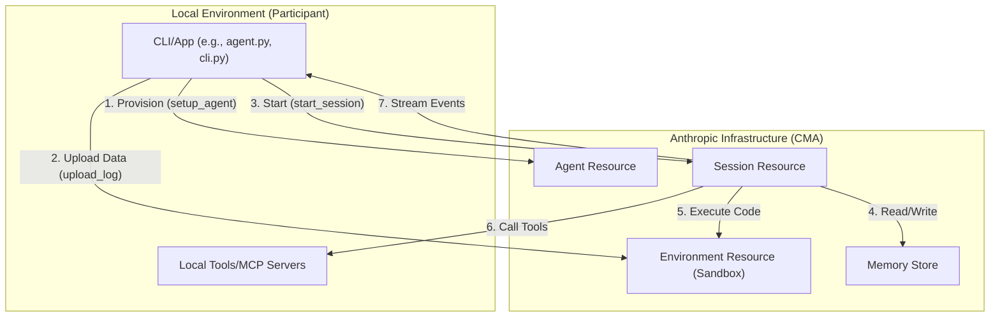

<!-- source: DeepWiki mcp.deepwiki.com · repo anthropics/cwc-workshops · page 1 Repository Overview · fetched 2026-10-26 -->

# Repository Overview

Relevant source files

The following files were used as context for generating this wiki page:

- [.gitignore](.gitignore)
- [LICENSE](LICENSE)
- [README.md](README.md)

The `cwc-workshops` repository is a monorepo containing materials and codebase structures for the **Code with Claude** workshop series by Anthropic [README.md:4-9](). Each directory within the repository represents a distinct, hands-on technical workshop focused on building, evaluating, or optimizing AI agents using the **Claude Managed Agents (CMA)** platform and associated developer tools.

## Monorepo Structure

The repository is organized into top-level directories, each functioning as an independent project with its own infrastructure, configuration, and evaluation harnesses [README.md:12-19]().

| Workshop Directory | Core Focus | Key Technologies |
|:---|:---|:---|
| `agent-battle/` | Competitive orchestration | MCP, Mineflayer, Python, Node.js |
| `agent-decomposition/` | Prompt engineering & sub-agents | CMA, CSV Code Execution, Python |
| `how-we-claude-code/` | AI-assisted product development | Vite, React, DOM Contracts, Zod |
| `ship-your-first-managed-agent/` | SRE/Infrastructure automation | Streamlit, CMA API, Python |
| `agents-that-remember/` | Long-term persistence | Memory Stores, Dreaming Service |
| `eval-driven-agent-development/` | Systematic agent optimization | PPTX XML, LLM-as-judge, TypeScript |
| `production-ready-agent/` | Multi-agent UI systems | Next.js, SSE, Memory Stores, MCP |
| `rightmodel/` | Model selection & Benchmarking | Claude Code SKILLs, tau2-bench |

Sources: [README.md:10-20]()

## Implementation and Data Flow

The workshops generally follow a pattern where a local environment (host) interacts with the Claude Managed Agents API to orchestrate sandboxed execution environments.

### General Agent Lifecycle
The following diagram illustrates the typical data flow between the participant's local machine and the Anthropic infrastructure across most workshops.

**System Interaction Flow**

Sources: [README.md:15-17](), [README.md:19]()

## Workshop Directory Details

### 1. Agent Battle
A competition where participants configure a Managed Agent to drive a Minecraft bot. It emphasizes the use of **Model Context Protocol (MCP)** to bridge high-level agent reasoning with low-level game actions [README.md:16]().
*   **Key Entity:** `bot.js` (Mineflayer bot), `my_agent.py` (CMA Orchestrator).
*   **Go to:** [2. Agent Battle Workshop]()

### 2. Agent Decomposition (StockPilot)
Focuses on refactoring a monolithic "god-prompt" into a modular system of skills and sub-agents. It demonstrates the **compute-over-context** principle [README.md:13]().
*   **Key Entity:** `cma.py` (Deployment layer), `cli.py` (Eval harness).
*   **Go to:** [3. Agent Decomposition Workshop (StockPilot)]()

### 3. Production-Ready Agent (Deal Desk)
A complex multi-agent system for M&A research. It features a Next.js frontend that handles Server-Sent Events (SSE) from multiple parallel sub-agents [README.md:19]().
*   **Key Entity:** `lib/sse.ts` (Event streaming), `bin/setup.sh` (Provisioning).
*   **Go to:** [4. Production-Ready Agent Workshop (Deal Desk)]()

### 4. Eval-Driven Agent Development
A workshop dedicated to the "measure, don't vibe" philosophy. It uses a two-layer grader to evaluate the quality of generated PowerPoint files [README.md:18]().
*   **Key Entity:** `create-slides.ts` (Runner), `render.ts` (Visual verification).
*   **Go to:** [5. Eval-Driven Agent Development Workshop]()

### 5. Ship Your First Managed Agent
The entry-point workshop for understanding the CMA API. Participants implement the core lifecycle functions (Setup, Session, Tool Handling) for an SRE agent [README.md:15]().
*   **Key Entity:** `agent.py` (Implementation target), `provided.py` (Scaffolding).
*   **Go to:** [6. Ship Your First Managed Agent Workshop]()

### 6. Agents That Remember
Explores the evolution of agent memory, from stateless sessions to persistent Memory Stores and the **Dreaming Service** for transcript consolidation [README.md:17]().
*   **Key Entity:** `ant` (CLI tool), Memory Store API.
*   **Go to:** [7. Agents That Remember Workshop]()

### 7. How We Claude Code
Demonstrates a modern development workflow using **Claude Code**. It introduces the concept of "Verifiable React" where components emit machine-readable contracts [README.md:14]().
*   **Key Entity:** `VerifiableUnit`, `window.__verify`.
*   **Go to:** [8. How We Claude Code Workshop]()

### 8. Picking the Right Model
A meta-workshop using Claude Code SKILLs to audit other eval suites and perform parameter sweeps (Thinking, Effort) to optimize for cost and latency [README.md:12]().
*   **Key Entity:** `SKILL.md`, `tau2-bench` integration.
*   **Go to:** [9. Picking the Right Model Workshop]()

## Getting Started

For developers new to Claude Managed Agents, the recommended path is:
1.  **Ship Your First Managed Agent**: To learn the basic API primitives [README.md:15]().
2.  **Agent Decomposition**: To learn how to structure complex logic [README.md:13]().
3.  **Eval-Driven Agent Development**: To learn how to maintain quality as agents grow [README.md:18]().

## License
This repository is licensed under the **Apache License 2.0** [LICENSE:2-5](), [README.md:21-23]().

Sources: [README.md:1-24](), [LICENSE:1-130]()

---

