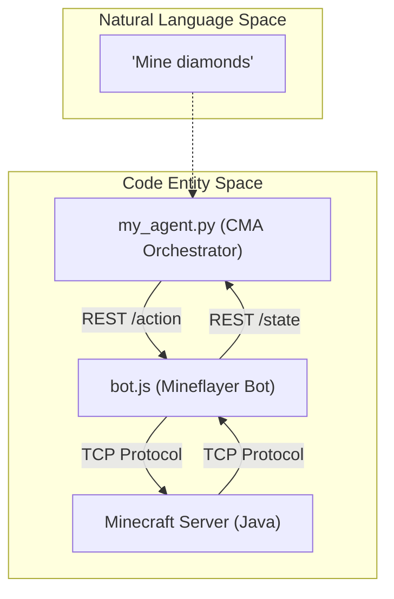
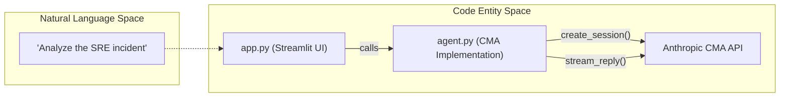

<!-- source: DeepWiki mcp.deepwiki.com · repo anthropics/cwc-workshops · page 10 Glossary · fetched 2026-10-26 -->

# Glossary

Relevant source files

The following files were used as context for generating this wiki page:

- [agent-battle/.env.event](agent-battle/.env.event)
- [agent-battle/HOST.md](agent-battle/HOST.md)
- [agent-battle/README.md](agent-battle/README.md)
- [agent-battle/bot/bot.js](agent-battle/bot/bot.js)
- [agent-battle/my_agent.py](agent-battle/my_agent.py)
- [agent-battle/setup.sh](agent-battle/setup.sh)
- [agent-decomposition/README.md](agent-decomposition/README.md)
- [agent-decomposition/agents/cma.py](agent-decomposition/agents/cma.py)
- [agent-decomposition/agents/common.py](agent-decomposition/agents/common.py)
- [eval-driven-agent-development/README.md](eval-driven-agent-development/README.md)
- [production-ready-agent/README.md](production-ready-agent/README.md)
- [rightmodel/README.md](rightmodel/README.md)

This page provides technical definitions for codebase-specific terms, jargon, and domain concepts used across the Claude with Claude (CWC) workshops. It serves as a bridge between high-level workshop concepts and their specific implementations in the code.

## Core Managed Agents (CMA) Primitives

These terms refer to the resources provided by the Anthropic Claude Managed Agents API.

| Term | Definition | Code Pointer |
| :--- | :--- | :--- |
| **Agent** | A persistent configuration in the Anthropic cloud defining a model, system prompt, and attached tools/skills. | `[agent-battle/my_agent.py:86-100]()`, `[agent-decomposition/agents/cma.py:140-156]()` |
| **Environment** | A sandboxed compute space where an agent's code execution and tool calls occur. | `[agent-decomposition/agents/cma.py:130-138]()`, `[sre-agent/agent.py:42-53]()` |
| **Session** | A single instance of an interaction with an Agent. Sessions are stateful and can persist over multiple turns. | `[agent-battle/my_agent.py:214-228]()`, `[sre-agent/agent.py:76-88]()` |
| **Skill** | A packaged set of instructions and files (often `.md` or `.py`) uploaded to CMA and loaded into the agent's context on demand. | `[agent-battle/my_agent.py:135-155]()`, `[agent-decomposition/agents/cma.py:97-127]()` |
| **Memory Store** | A persistent storage layer attached to sessions allowing agents to read/write long-term context across session boundaries. | `[production-ready-agent/README.md:99-99]()`, `[production-ready-agent/bin/setup.sh:1-25]()` |

**Sources:** `[agent-battle/my_agent.py:86-228]()`, `[agent-decomposition/agents/cma.py:97-156]()`, `[sre-agent/agent.py:42-88]()`, `[production-ready-agent/README.md:99-99]()`.

## Agent Battle Domain Concepts

Specific terminology used in the Minecraft-based Agent Battle workshop.

### Three-Layer Architecture
The Agent Battle infrastructure is split into the Host, the Participant, and the Managed Agent.

#### Minecraft Bot Architecture
The bot is a Node.js process using the `mineflayer` library to interact with a vanilla Minecraft server.

*   **Port Offset:** A mechanism to run multiple bot stacks on one machine by incrementing base ports (25565, 8088, 3007) by an `INSTANCE` integer `[agent-battle/setup.sh:34-42]()`.
*   **withBusy:** A concurrency manager in `bot.js` that ensures only one Minecraft action (e.g., `mine_block`, `craft`) executes at a time `[agent-battle/bot/bot.js:25-27]()`.
*   **Cast View:** A specialized leaderboard UI intended for projectors, enabled via the `?cast=1` query parameter `[agent-battle/HOST.md:17-17]()`.
*   **Wiki MCP:** A Model Context Protocol server providing a `lookup(query)` tool for Minecraft facts `[agent-battle/my_agent.py:71-74]()`.

**Sources:** `[agent-battle/setup.sh:34-42]()`, `[agent-battle/bot/bot.js:25-27]()`, `[agent-battle/my_agent.py:71-74]()`, `[agent-battle/HOST.md:17-17]()`.

## Evaluation & Grader Jargon

Terms used in the Agent Decomposition and PPTX workshops to measure agent performance.

*   **Baseline:** The initial performance score of an un-optimized agent (e.g., the "before" agent) used for comparison `[agent-decomposition/README.md:29-30]()`, `[eval-driven-agent-development/README.md:64-65]()`.
*   **Pass-Slow:** A verdict where the agent achieves the goal but exceeds a defined "token budget" or "turn limit," indicating inefficiency `[agent-decomposition/README.md:33-35]()`.
*   **LLM-as-Judge:** A grading pattern where a high-capability model (like Claude 3.5 Sonnet) evaluates subjective criteria like "visual density" or "color palette" `[eval-driven-agent-development/README.md:60-61]()`.
*   **Programmatic Grader:** A deterministic check written in code (e.g., verifying a file exists or counting slide elements) `[eval-driven-agent-development/README.md:60-61]()`.
*   **Sink Isolation:** A technique in the StockPilot workshop where each parallel evaluation task writes to a unique thread-local directory to prevent data corruption `[agent-decomposition/agents/common.py:40-45]()`.

**Sources:** `[agent-decomposition/README.md:29-35]()`, `[eval-driven-agent-development/README.md:60-65]()`, `[agent-decomposition/agents/common.py:40-45]()`.

## System Components & Tools

| Term | Implementation / Purpose | Code Pointer |
| :--- | :--- | :--- |
| **ant CLI** | The official Anthropic command-line tool for managing CMA resources (Agents, Environments). | `[eval-driven-agent-development/README.md:48-51]()` |
| **Claude Code** | A CLI-based agentic coding tool used by participants to run `/cwc-setup` and `/cwc-fix` commands. | `[agent-battle/README.md:46-54]()` |
| **Dreaming Service** | A research-preview service that consolidates multiple session transcripts into a single memory store. | `[agent-battle/my_agent.py:105-105]()` |
| **Vault** | A secure storage for sensitive credentials (like Linear API keys) accessible by Managed Agents. | `[production-ready-agent/README.md:103-109]()` |
| **Quick-Tunnel** | Temporary Cloudflare tunnels used to expose local MCP servers to the Anthropic cloud without manual DNS setup. | `[agent-battle/setup.sh:79-83]()`, `[agent-battle/HOST.md:43-44]()` |

**Sources:** `[eval-driven-agent-development/README.md:48-51]()`, `[agent-battle/README.md:46-54]()`, `[production-ready-agent/README.md:103-109]()`, `[agent-battle/setup.sh:79-83]()`.