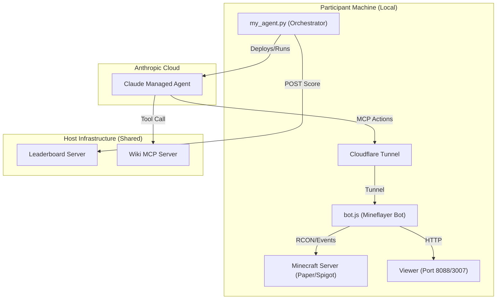
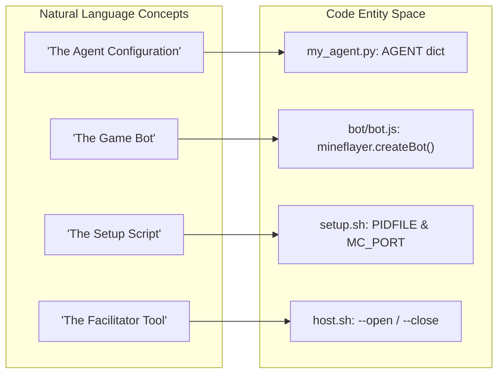

<!-- source: DeepWiki mcp.deepwiki.com · repo anthropics/cwc-workshops · page 2 Agent Battle Workshop · fetched 2026-10-26 -->

# Agent Battle Workshop

Relevant source files

The following files were used as context for generating this wiki page:

- [agent-battle/.env.event](agent-battle/.env.event)
- [agent-battle/HOST.md](agent-battle/HOST.md)
- [agent-battle/README.md](agent-battle/README.md)
- [agent-battle/setup.sh](agent-battle/setup.sh)

The **Agent Battle** is a 45-minute technical workshop where participants compete to build the most efficient diamond-mining agent in Minecraft using **Claude Managed Agents**. Unlike traditional coding competitions, the challenge lies in prompt engineering, tool orchestration, and managing the lifecycle of an autonomous agent within a dynamic, sandboxed environment.

## Overview

The workshop utilizes a three-layer architecture to bridge the gap between high-level agent logic and low-level game mechanics. Participants interact primarily with a single Python orchestrator to configure their agent's system prompt and toolset, while a background stack manages the Minecraft simulation and connectivity.

### Competition Mechanics
- **Objective**: Collect as many diamonds as possible within a fixed 5-minute window [agent-battle/README.md:78-85]().
- **Scoring**: Ranked by diamonds collected; ties are broken by token efficiency (diamonds per token) [agent-battle/README.md:11-15]().
- **Evaluation**: Participants can use a local `--eval` mode to test agent decision-making against single-turn probes without launching the full game [agent-battle/README.md:92-98]().

## System Architecture

The environment is divided into three distinct zones: the **Host Infrastructure** (shared across all participants), the **Participant Environment** (local to each user), and the **Agent Logic** (the code participants modify).

### High-Level Component Interaction

The following diagram illustrates how the local participant stack connects to the Anthropic Managed Agents cloud and the shared facilitator services.

**Sources:** [agent-battle/README.md:136-148](), [agent-battle/setup.sh:34-44]()

## Core Components

### 1. Setup and Infrastructure
The workshop relies on `setup.sh` to orchestrate a complex local stack. This script handles dependency management (Java 17+, Node 18+, Python 3), process lifecycle management via PID files, and port-offsetting to allow multiple instances on a single machine. It also establishes a Cloudflare "Quick Tunnel" to allow the Anthropic cloud to communicate with the local `bot.js` instance.

For details, see [Agent Battle: Setup and Infrastructure](#2.1).

### 2. Bot and Agent Architecture
The "brain" of the operation is split between `my_agent.py` (which defines the `AGENT` configuration) and `bot.js` (a Mineflayer-based bot that translates LLM intents into Minecraft actions). The agent uses an MCP (Model Context Protocol) interface to query the world state (`/state`) and execute complex behaviors like `mine_block` or `craft_item`.

For details, see [Agent Battle: Bot and Agent Architecture](#2.2).

### 3. Scoring and Leaderboard
The facilitator runs `host.sh` to manage the shared leaderboard and Wiki MCP server. The leaderboard tracks participant progress in real-time, enforcing the 5-minute session limit and calculating efficiency metrics. A "Cast View" is provided for projectors to display the live competition standings.

For details, see [Agent Battle: Scoring, Leaderboard, and Harness](#2.3).

## Technical Map: Natural Language to Code Entities

The following diagram maps the conceptual "Agent Battle" entities to their specific implementations in the codebase.

**Sources:** [agent-battle/my_agent.py:139-139](), [agent-battle/setup.sh:40-44](), [agent-battle/HOST.md:21-35]()

## Getting Started

Participants follow a streamlined workflow using `Claude Code` to automate the environment preparation:

| Step | Command | Description |
| :--- | :--- | :--- |
| **1. Clone** | `git clone ...` | Pull the repository. |
| **2. Configure** | `export PARTICIPANT="..."` | Set identity and API keys. |
| **3. Bootstrap** | `/cwc-setup` | Claude Code runs `setup.sh` to start the stack. |
| **4. Execute** | `python3 my_agent.py` | Launch the 5-minute competition run. |
| **5. Evaluate** | `python3 my_agent.py --eval` | Test prompt changes quickly. |

**Sources:** [agent-battle/README.md:20-98]()

---

