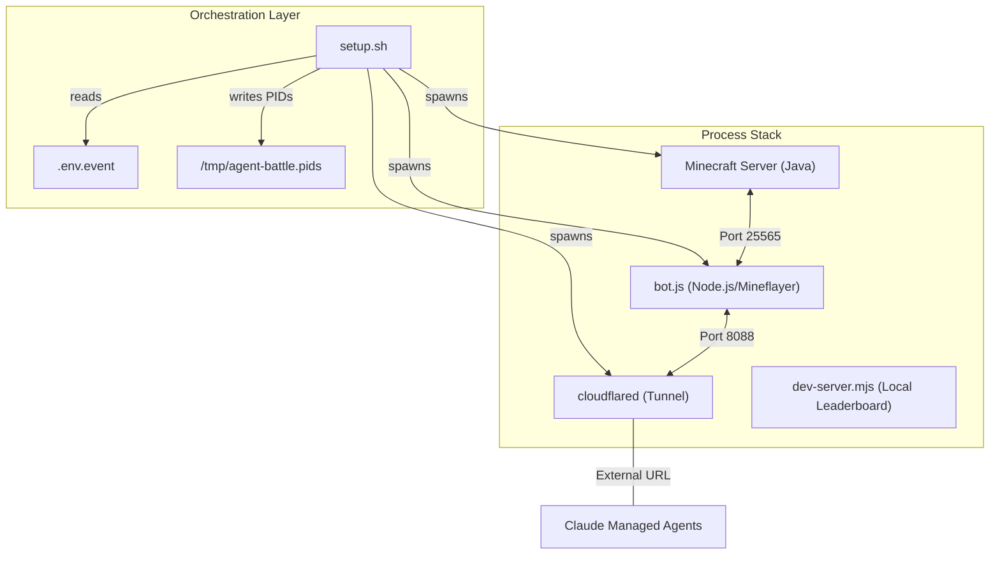
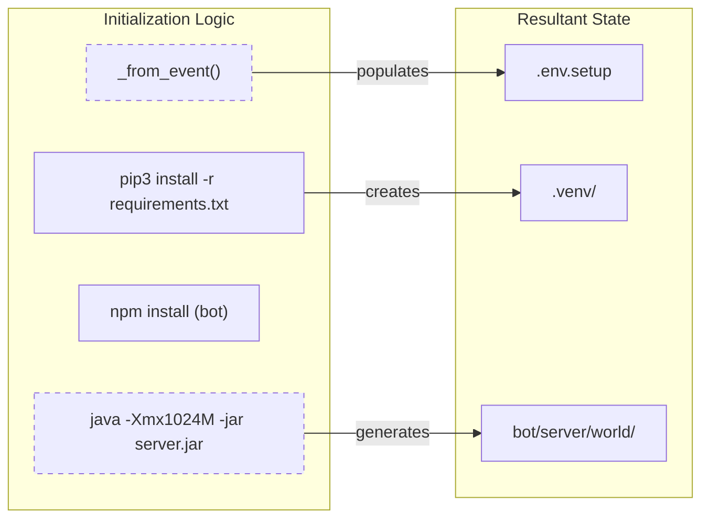

<!-- source: DeepWiki mcp.deepwiki.com · repo anthropics/cwc-workshops · page 2.1 Agent Battle: Setup and Infrastructure · fetched 2026-10-26 -->

# Agent Battle: Setup and Infrastructure

Relevant source files

The following files were used as context for generating this wiki page:

- [agent-battle/.claude/commands/cwc-setup.md](agent-battle/.claude/commands/cwc-setup.md)
- [agent-battle/.env.event](agent-battle/.env.event)
- [agent-battle/setup.sh](agent-battle/setup.sh)

The Agent Battle infrastructure is designed to provide a "one-click" experience for participants to deploy a complex stack consisting of a Minecraft server, a Mineflayer-based bot, a local leaderboard, and a Cloudflare tunnel for external MCP connectivity. The orchestration is handled primarily by `setup.sh`, which ensures idempotency and manages process lifecycles.

## The Orchestration Script (`setup.sh`)

`setup.sh` is the central entry point for the workshop environment. It handles dependency verification, environment configuration, and process management.

### Process Lifecycle and PID Management
The script tracks all background processes (Minecraft server, Node.js bot, Cloudflare tunnel) using a PID file located at `/tmp/agent-battle${SUFFIX}.pids` [agent-battle/setup.sh:44-44](). 

The script supports several operational modes:
*   **Standard Setup**: Detects missing dependencies, starts the Minecraft server, waits for the TCP port to open, then launches the bot and tunnel [agent-battle/setup.sh:19-19]().
*   **`--stop`**: Reads the PID file and uses `kill` to terminate the stack. It also uses `lsof` to target specific ports (`MC_PORT`, `HTTP_PORT`, `VIEWER_PORT`) to ensure no "zombie" processes remain [agent-battle/setup.sh:57-77]().
*   **`--restart`**: Performs a partial teardown but specifically preserves the Cloudflare tunnel. This is a critical optimization for workshops to avoid hitting Cloudflare's per-IP rate limits for "quick tunnels" [agent-battle/setup.sh:78-94]().

### Port-Offset Mechanism
To allow multiple participants or instances to run on a single host (e.g., during testing or shared server environments), the script uses an `INSTANCE` variable to calculate port offsets [agent-battle/setup.sh:34-42]().

| Service | Base Port | Formula |
| :--- | :--- | :--- |
| Minecraft Server | 25565 | `25565 + OFFSET` |
| Bot HTTP API | 8088 | `8088 + OFFSET` |
| Mineflayer Viewer | 3007 | `3007 + OFFSET` |

Sources: [agent-battle/setup.sh:34-44](), [agent-battle/setup.sh:57-94]()

## Configuration and Environment

The infrastructure relies on a tiered environment variable system where shell exports take precedence over file-based defaults.

### `.env.event` and Event-Day Defaults
During a live workshop, the facilitator provides a `.env.event` file containing shared infrastructure URLs and the world seed [agent-battle/.env.event:1-5](). The `_from_event` function in `setup.sh` reads these values only if they are not already set in the shell [agent-battle/setup.sh:145-153]().

Key variables include:
*   `LEADERBOARD_URL`: The endpoint for submitting scores [agent-battle/.env.event:1-1]().
*   `WIKI_MCP_URL`: A remote MCP server providing Minecraft game knowledge to the agents [agent-battle/.env.event:3-3]().
*   `MC_SEED`: Ensures all participants compete on the exact same terrain [agent-battle/.env.event:4-4]().

### Mandatory Participant Variables
The setup will fail (`die`) if the following are not provided:
1.  `ANTHROPIC_API_KEY`: Required for the agent to call Claude [agent-battle/setup.sh:154-154]().
2.  `PARTICIPANT`: A unique identifier for the leaderboard [agent-battle/.claude/commands/cwc-setup.md:23-23]().
3.  `MINECRAFT_EULA`: Must be set to `accept` by the user [agent-battle/.claude/commands/cwc-setup.md:24-28]().

Sources: [agent-battle/setup.sh:145-154](), [agent-battle/.env.event:1-5](), [agent-battle/.claude/commands/cwc-setup.md:12-36]()

## Infrastructure Components

The following diagram illustrates the relationship between the orchestration script and the processes it manages.

### System Infrastructure Diagram

Sources: [agent-battle/setup.sh:40-44](), [agent-battle/setup.sh:101-138]()

## Data Flow: Setup to Execution

The setup process transitions the environment from a raw state to a "ready" state where `my_agent.py` can be executed.

### Code Entity Mapping
The following diagram maps the setup logic to the specific files and functions responsible for initializing the agent environment.

Sources: [agent-battle/setup.sh:110-134](), [agent-battle/setup.sh:145-153](), [agent-battle/setup.sh:195-215]()

## Facilitator Commands (`host.sh`)

While participants use `setup.sh`, the facilitator uses `host.sh` (referenced in the `setup.sh` comments) to manage the room-wide infrastructure [agent-battle/setup.sh:61-63]().

*   **Shared Leaderboard**: By default, `setup.sh` starts a local leaderboard. If `LEADERBOARD_URL` is set to a non-localhost address, it skips the local instance and points to the facilitator's shared server [agent-battle/setup.sh:48-53]().
*   **Tunnel Management**: The host tunnel on ports `:8888` and `:8077` is protected from the standard `--stop` command to prevent room-wide URL changes during local participant restarts [agent-battle/setup.sh:61-63]().

Sources: [agent-battle/setup.sh:45-53](), [agent-battle/setup.sh:60-64]()

---

