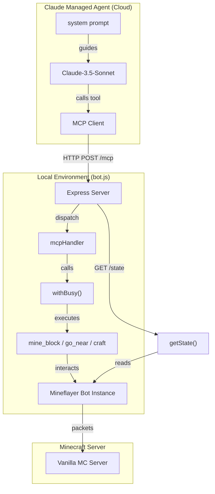
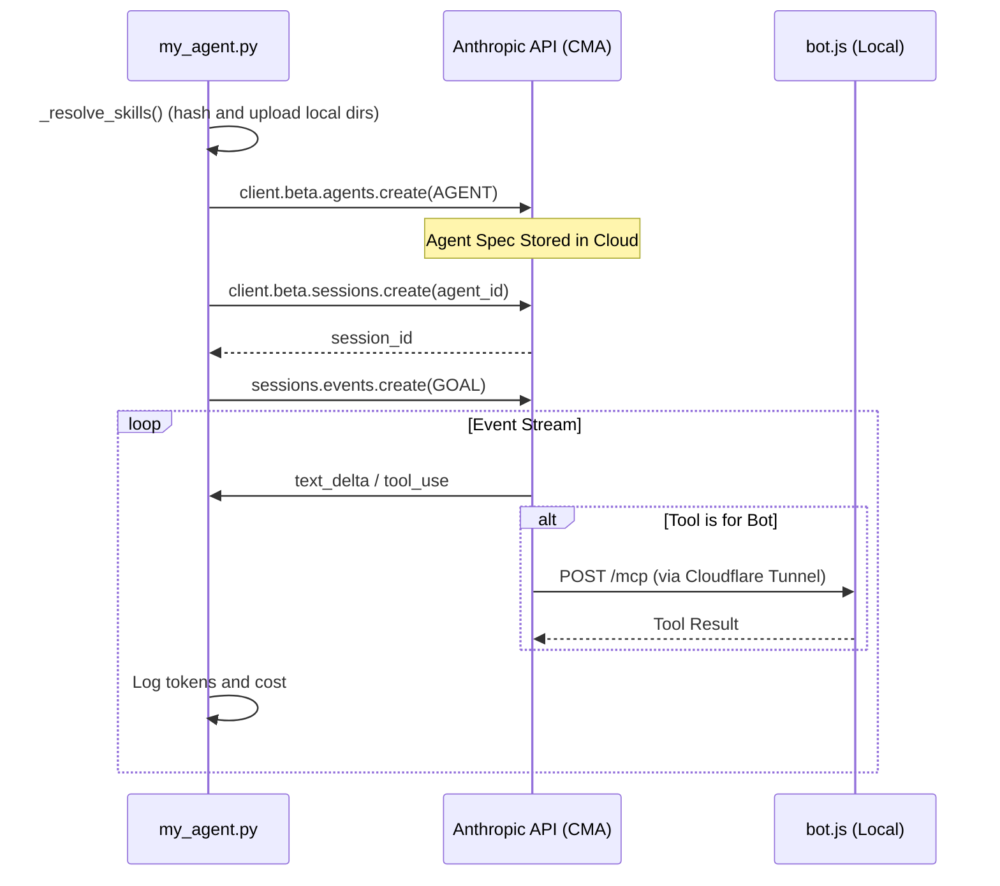

<!-- source: DeepWiki mcp.deepwiki.com · repo anthropics/cwc-workshops · page 2.2 Agent Battle: Bot and Agent Architecture · fetched 2026-10-26 -->

# Agent Battle: Bot and Agent Architecture

Relevant source files

The following files were used as context for generating this wiki page:

- [agent-battle/HOST.md](agent-battle/HOST.md)
- [agent-battle/README.md](agent-battle/README.md)
- [agent-battle/bot/bot.js](agent-battle/bot/bot.js)
- [agent-battle/my_agent.py](agent-battle/my_agent.py)

This page details the two primary components of the Agent Battle workshop: the **Mineflayer-based bot** (`bot.js`) which acts as the physical embodiment in Minecraft, and the **Python orchestrator** (`my_agent.py`) which configures and launches the Claude Managed Agent.

## System Overview

The architecture follows a three-tier model where the Claude Managed Agent (CMA) acts as the "brain," communicating via Model Context Protocol (MCP) to a local "body" (the Node.js bot).

### Data Flow and Entity Mapping

The following diagram illustrates how natural language goals are translated into game actions through specific code entities.

**Diagram: Natural Language to Minecraft Action Flow**

Sources: [agent-battle/my_agent.py:86-102](), [agent-battle/bot/bot.js:15-30](), [agent-battle/bot/bot.js:235-250]()

---

## The Node.js Bot (`bot.js`)

The bot is a Node.js application using the `mineflayer` library to interface with Minecraft. It provides a REST API and an MCP server interface for the agent to perceive and interact with the world.

### Concurrency and the `withBusy` Manager
To prevent the bot from attempting multiple physical actions simultaneously (which causes Mineflayer state corruption), all mutating actions are wrapped in the `withBusy` concurrency manager [agent-battle/bot/bot.js:338-356]().

- **Queueing**: If an action is requested while another is in progress, it is queued [agent-battle/bot/bot.js:25-27]().
- **State Flag**: The `busy` variable is set to `true` during execution and exposed via the `/state` endpoint [agent-battle/bot/bot.js:51](), [agent-battle/bot/bot.js:203]().
- **Timeout**: Actions have a default timeout to prevent the bot from hanging on unreachable goals [agent-battle/bot/bot.js:345-348]().

### Key API Endpoints
The bot exposes an Express server on port `8088` [agent-battle/bot/bot.js:41]().

| Endpoint | Method | Description |
| :--- | :--- | :--- |
| `/state` | GET | Returns a JSON snapshot of position, vitals, inventory, and nearby blocks [agent-battle/bot/bot.js:22](). |
| `/action` | POST | Executes a raw action (e.g., `mine_block`) via JSON payload [agent-battle/bot/bot.js:23](). |
| `/view` | GET | Serves a web UI containing the `prismarine-viewer` first-person stream [agent-battle/bot/bot.js:37-42](). |
| `/mcp` | POST | The entry point for the Claude Managed Agent's tool calls [agent-battle/bot/bot.js:46](). |

### Action Implementation
The bot implements high-level behaviors that simplify the task for the LLM:
- **`mine_block`**: Uses the `mineflayer-collectblock` plugin to navigate to and harvest a block [agent-battle/bot/bot.js:36](), [agent-battle/bot/bot.js:411-432]().
- **`go_near`**: Uses `mineflayer-pathfinder` to move within a specific range of coordinates [agent-battle/bot/bot.js:35](), [agent-battle/bot/bot.js:385-409]().
- **`craft`**: Resolves recipes and interacts with a crafting table if necessary [agent-battle/bot/bot.js:456-487]().

Sources: [agent-battle/bot/bot.js:32-113](), [agent-battle/bot/bot.js:195-233](), [agent-battle/bot/bot.js:338-487]()

---

## The Python Orchestrator (`my_agent.py`)

This script is the entry point for participants. It defines the agent's configuration and manages the session lifecycle with the Anthropic API.

### Managed Agent Configuration
The `AGENT` dictionary is the core "spec" for the agent [agent-battle/my_agent.py:86-100](). It includes:
- **Model**: Selection of Claude models (e.g., `claude-3-5-sonnet-latest`) [agent-battle/my_agent.py:88]().
- **System Prompt**: The primary instructions for the agent [agent-battle/my_agent.py:90]().
- **Skills**: Local directories (like `skills/mining`) that are bundled and uploaded to the agent's context [agent-battle/my_agent.py:67-70]().
- **MCP Servers**: Connections to external tools, such as the `WIKI_MCP_URL` for Minecraft game facts [agent-battle/my_agent.py:71-74]().

### Session Lifecycle
The script handles the transition from a local configuration to a running cloud session.

**Diagram: Session Lifecycle**

Sources: [agent-battle/my_agent.py:135-185](), [agent-battle/my_agent.py:228-285]()

### Skill Management
The `_resolve_skills` function automates the process of turning local text files into Managed Agent skills [agent-battle/my_agent.py:135-175]().
1. It scans the provided directory for a `SKILL.md` file [agent-battle/my_agent.py:148-150]().
2. It generates a hash of the content to determine if an upload is necessary [agent-battle/my_agent.py:153-155]().
3. It uses `client.beta.skills.create` to register the skill with Anthropic [agent-battle/my_agent.py:171]().
4. The resulting `skill_id` is cached in `.agent_cache.json` to avoid redundant uploads [agent-battle/my_agent.py:132](), [agent-battle/my_agent.py:173]().

### Execution Pipeline
The `main()` function orchestrates the 5-minute run [agent-battle/my_agent.py:228]().
- **Cost Tracking**: Uses `CostTracker` to monitor token usage and estimate USD cost [agent-battle/my_agent.py:60](), [agent-battle/my_agent.py:245]().
- **Streaming**: Consumes the session event stream, printing Claude's thoughts and tool calls to the console [agent-battle/my_agent.py:263-285]().
- **Automatic Retries**: The `_STREAM_RETRY` tuple defines network errors that trigger a reconnection to the SSE stream without failing the entire run [agent-battle/my_agent.py:125-129]().

Sources: [agent-battle/my_agent.py:135-185](), [agent-battle/my_agent.py:228-315]()

---

