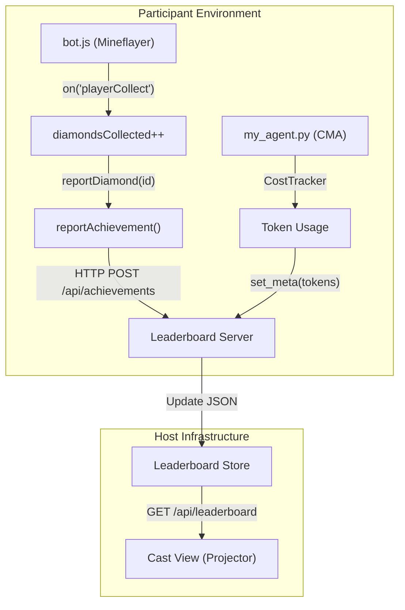
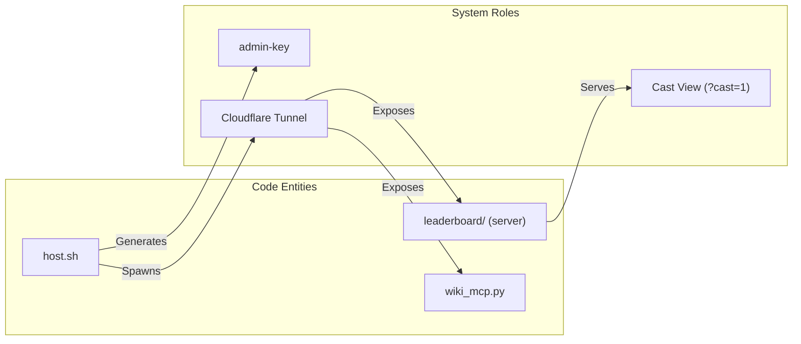

<!-- source: DeepWiki mcp.deepwiki.com · repo anthropics/cwc-workshops · page 2.3 Agent Battle: Scoring, Leaderboard, and Harness · fetched 2026-10-26 -->

# Agent Battle: Scoring, Leaderboard, and Harness

Relevant source files

The following files were used as context for generating this wiki page:

- [agent-battle/HOST.md](agent-battle/HOST.md)
- [agent-battle/README.md](agent-battle/README.md)
- [agent-battle/bot/bot.js](agent-battle/bot/bot.js)
- [agent-battle/my_agent.py](agent-battle/my_agent.py)

This page details the evaluation and competitive infrastructure of the Agent Battle workshop. It covers how agents are scored based on diamond collection and token efficiency, the harness used for local verification and evaluation probes, and the centralized leaderboard system used by facilitators to track participant progress.

## Scoring System and Metrics

The primary objective of the Agent Battle is to collect as many diamonds as possible within a fixed 300-second window. The scoring system prioritizes outcomes but uses efficiency as a tie-breaker.

### Primary Metrics
*   **Diamonds Collected**: The count of diamond items picked up by the bot. This is tracked by `diamondsCollected` in the bot process [agent-battle/bot/bot.js:59-59]().
*   **Token Efficiency**: Total tokens consumed (Input + Output) during the run. In the event of a tie in diamond count, the agent with the lower token count ranks higher [agent-battle/bot/bot.js:57-58]().
*   **Run Duration**: Every competitive run is capped at 300 seconds (5 minutes). The leaderboard rejects any achievement reported with a timestamp past 305 seconds to prevent local clock drift exploits [agent-battle/my_agent.py:115-120]().

### Milestones and Quests
Beyond diamonds, the bot tracks "Achievements" to provide granular progress feedback.
*   **Quests**: Discrete tasks like `first_block` (triggered on `diggingCompleted`) [agent-battle/bot/bot.js:149-149]().
*   **Milestones**: Triggered when specific items enter the inventory (e.g., `iron_ingot`, `crafting_table`, `furnace`) [agent-battle/bot/bot.js:132-132]().
*   **Diamond Achievements**: Each diamond collected is reported as a unique achievement (e.g., `diamond_1`, `diamond_2`) to the leaderboard [agent-battle/bot/bot.js:140-143]().

**Sources:** [agent-battle/bot/bot.js:55-64](), [agent-battle/bot/bot.js:130-148](), [agent-battle/my_agent.py:115-120]()

---

## The Evaluation Harness

The `harness/` directory contains the logic for running agents, logging their behavior, and performing rapid evaluations without launching a full Minecraft session.

### --eval Mode
Running `python3 my_agent.py --eval` executes a "decision-probe" scorecard [agent-battle/my_agent.py:24-24](). This mode bypasses the 5-minute Minecraft run and instead tests the agent's `AGENT` configuration against a set of static scenarios (probes) to see if it makes the correct tactical decisions [agent-battle/README.md:92-98]().

### Logging and Cost Tracking
*   **RunLogger**: Manages session logs and event streaming [agent-battle/my_agent.py:61-61]().
*   **CostTracker**: Calculates the financial cost and token usage of the run based on the model used [agent-battle/my_agent.py:60-60]().
*   **verify.py**: A utility within the harness used to validate the environment and agent connectivity [agent-battle/README.md:146-146]().

### Data Flow: Agent to Leaderboard
The following diagram illustrates how performance data flows from the bot's actions to the host's leaderboard.

**Performance Tracking Flow**

**Sources:** [agent-battle/bot/bot.js:130-148](), [agent-battle/my_agent.py:60-61](), [agent-battle/README.md:147-148]()

---

## Leaderboard and Host Infrastructure

The host runs a centralized server that aggregates results from all participants.

### The SHARE Block
When a host starts the infrastructure using `./host.sh`, it generates a **SHARE block**. This block contains the environment variables participants must export to connect to the shared resources:
*   `LEADERBOARD_URL`: The endpoint for posting scores.
*   `WIKI_MCP_URL`: The URL for the shared Minecraft Wiki MCP server [agent-battle/HOST.md:12-16]().
*   `LEADERBOARD_KEY`: A key authorizing participants to post scores (but not manage the session) [agent-battle/HOST.md:72-73]().

### Host Commands
| Command | Description |
| :--- | :--- |
| `./host.sh --open` | Opens the scoring window for a specified duration [agent-battle/HOST.md:22-22](). |
| `./host.sh --close` | Freezes the board, preventing further score submissions [agent-battle/HOST.md:34-34](). |
| `./host.sh --reset` | Wipes all scores but maintains the same tunnel URLs [agent-battle/HOST.md:22-22](). |

### Admin and Cast Views
*   **Cast View**: A projector-optimized version of the leaderboard accessible by appending `?cast=1` to the leaderboard URL [agent-battle/HOST.md:17-17]().
*   **Admin Session**: An endpoint (`/admin/session`) used by the facilitator to manage the competition state, protected by the `admin-key` found in `.host-state/` [agent-battle/HOST.md:69-74]().

**Host Entity Mapping**

**Sources:** [agent-battle/HOST.md:1-87](), [agent-battle/README.md:147-148]()

---

