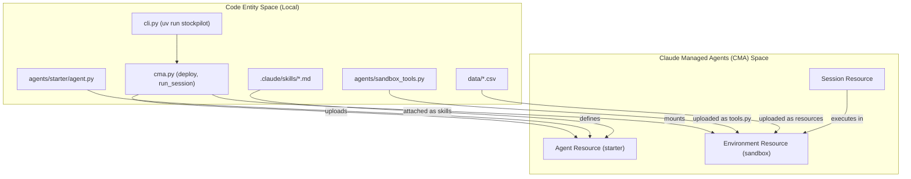
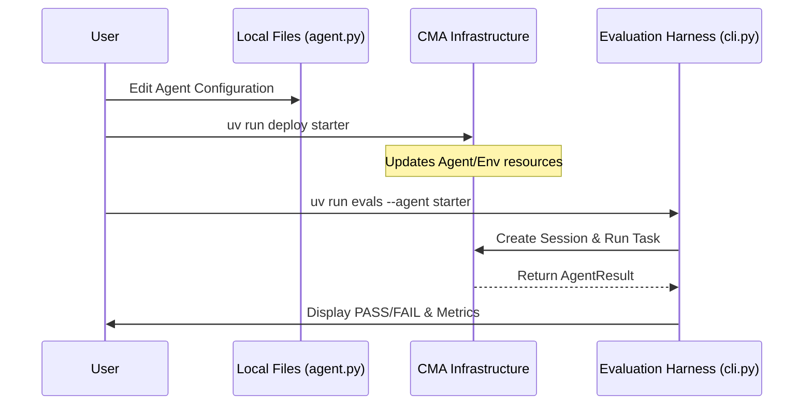

<!-- source: DeepWiki mcp.deepwiki.com · repo anthropics/cwc-workshops · page 3 Agent Decomposition Workshop (StockPilot) · fetched 2026-10-26 -->

# Agent Decomposition Workshop (StockPilot)

Relevant source files

The following files were used as context for generating this wiki page:

- [agent-decomposition/.claude/CLAUDE.md](agent-decomposition/.claude/CLAUDE.md)
- [agent-decomposition/README.md](agent-decomposition/README.md)

The **StockPilot** workshop focuses on the transition from monolithic, prompt-heavy agents to modular, high-performance systems using **Claude Managed Agents (CMA)**. Participants inherit a "legacy" inventory-management agent characterized by a 402-line system prompt and 12 stateless tools that often struggle with large-scale data processing and complex reasoning.

The core objective is to apply the **Tool → Skill → Subagent** decision framework to decompose this monolith into a more efficient architecture that leverages sandboxed code execution and on-demand context loading.

### Workshop Objectives
*   **Decompose the Monolith**: Break down a 402-line `LEGACY_PROMPT` into a 15-line `SHORT_PROMPT` using on-demand skills.
*   **Compute-over-Context**: Replace expensive "data-dumping" tools with Bash-based code execution over CSV files in the CMA sandbox.
*   **Dynamic Delegation**: Replace hardcoded subagent logic with callable subagents that are spawned only when specialized reasoning (like forecasting) is required.
*   **Evaluation-Driven Development**: Use a 12-task evaluation suite to measure improvements in accuracy, wall-clock time, and token efficiency.

### System Architecture Overview

The workshop transitions the agent from a local "Before" state (running on the raw Messages API) to a "Starter" state deployed on CMA infrastructure.

#### Logical Components to Code Entities
The following diagram bridges the conceptual decomposition strategy to the specific files and classes in the codebase.

**StockPilot System Mapping**

Sources: [agent-decomposition/README.md:156-164](), [agent-decomposition/agents/cma.py:20-50]()

### The Decision Framework
The workshop guides participants through three cycles of decomposition based on the following power-vs-cost spectrum:

| Entity | Definition | Use Case |
| :--- | :--- | :--- |
| **Tool Call** | One function, stateless, deterministic. | Basic API lookups or single-row writes. |
| **Skill** | Instructions the agent reads on demand. | Policies, templates, or "always do X" rules. |
| **Subagent** | Separate agent with its own context/goal. | Specialized, long-running, or high-reasoning tasks. |

**Smell Tests for Decomposition:**
*   **Tool returns >2k tokens?** → Use code execution (Bash/Python) instead [agent-decomposition/README.md:104-104]().
*   **Prompt says "Always do X"?** → Move to a Skill [agent-decomposition/README.md:105-105]().
*   **Subagent returns a single number?** → It shouldn't be a subagent [agent-decomposition/README.md:105-106]().

### Iteration Workflow
The workshop utilizes a tight feedback loop involving local code edits, remote deployment, and automated evaluation.

**Iteration Loop**

Sources: [agent-decomposition/README.md:71-78](), [agent-decomposition/evals/cli.py:128-150]()

### Key Components

#### 1. Architecture and Decomposition Strategy
Details the specific shifts from the `Before` agent to the `Starter` agent, including the use of `SHORT_PROMPT` and the transition of tools like `list_low_stock` to Bash scripts.
For details, see [StockPilot: Architecture and Decomposition Strategy](#3.1).

#### 2. CMA Deployment and Session Management
Explains the orchestration layer in `cma.py` that handles the idempotent creation of agents, environment provisioning, and the lifecycle of subagents.
For details, see [StockPilot: CMA Deployment and Session Management](#3.2).

#### 3. CLI, Evaluation Harness, and Metrics
Covers the `evals/` directory logic, including how tasks (R1-R9, F1-F3) are graded and how performance is compared between the monolithic and decomposed versions.
For details, see [StockPilot: CLI, Evaluation Harness, and Metrics](#3.3).

### Workshop Results
By the end of the workshop, the agent typically achieves a significant performance boost:
*   **Accuracy**: Score increases from ~71% to ~92% [agent-decomposition/README.md:144-144]().
*   **Efficiency**: The "Daily Sweep" task (F1) drops from 102 tool calls to ~3 scripts [agent-decomposition/README.md:145-145]().
*   **Maintainability**: The system prompt is reduced from 402 lines to 15 lines [agent-decomposition/README.md:146-146]().

Sources: [agent-decomposition/README.md:141-148](), [agent-decomposition/.claude/CLAUDE.md:51-60]()

---

