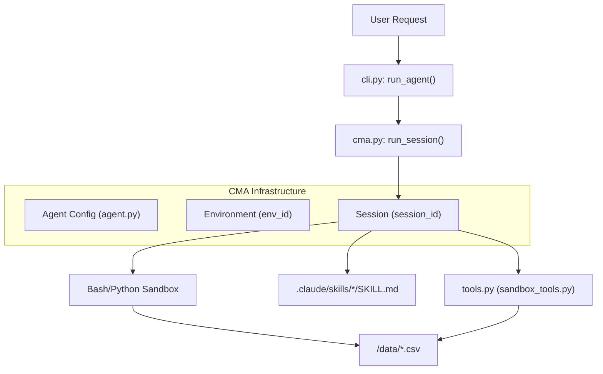
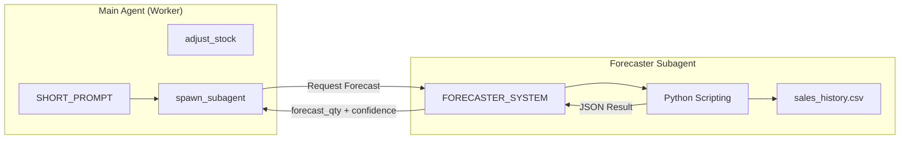

<!-- source: DeepWiki mcp.deepwiki.com · repo anthropics/cwc-workshops · page 3.1 StockPilot: Architecture and Decomposition Strategy · fetched 2026-10-26 -->

# StockPilot: Architecture and Decomposition Strategy

<details>
<summary>Relevant source files</summary>

The following files were used as context for generating this wiki page:

- [agent-decomposition/.claude/CLAUDE.md](agent-decomposition/.claude/CLAUDE.md)
- [agent-decomposition/README.md](agent-decomposition/README.md)
- [agent-decomposition/agents/cma.py](agent-decomposition/agents/cma.py)

</details>


This page details the architectural evolution of the StockPilot inventory-management agent. It covers the transition from a monolithic, prompt-heavy agent to a modular system utilizing **Skills**, **Code Execution**, and **Subagents** on the Claude Managed Agents (CMA) platform.

## The Decomposition Framework

StockPilot serves as a demonstration of the **Tool → Skill → Subagent** decision framework. The architecture is designed to optimize for the "compute-over-context" principle, ensuring the agent remains efficient as business logic complexity scales.

| Strategy | Mechanism | Best Use Case | Implementation in StockPilot |
| :--- | :--- | :--- | :--- |
| **Tool** | Stateless function calls | Deterministic, small-payload operations | `adjust_stock`, `create_purchase_order` |
| **Skill** | On-demand instructions | Policy-heavy logic or templating | `reorder-policy`, `notify-templates` |
| **Code Exec** | Bash/Python in sandbox | Data-heavy processing (>2k tokens) | CSV analysis via Bash/Python scripts |
| **Subagent** | Independent context | Parallelizable goals or high-reasoning tasks | `Forecaster` subagent for demand analysis |

**Sources:** [agent-decomposition/README.md:93-106](), [agent-decomposition/agents/starter/agent.py:10-40]()

## Architecture Evolution: Before vs. Starter

The workshop compares two distinct architectural states: the **Before** agent (monolithic) and the **Starter** agent (decomposed).

### 1. The "Before" Agent (Monolith)
The baseline agent operates via the raw Messages API. It relies on a 402-line system prompt that includes all business policies (reordering, forecasting, reporting) within the primary context window.
*   **Context Pressure:** High. Every turn includes the full policy set.
*   **Data Handling:** Uses 12 specialized tools that often return massive raw CSV dumps (e.g., `list_low_stock` returning 400+ rows), leading to token bloat and context overflow.

### 2. The "Starter" Agent (Decomposed)
The evolved agent uses a 15-line `SHORT_PROMPT` and offloads complexity to the CMA environment.
*   **Dynamic Context:** Skills are loaded only when relevant.
*   **Compute-over-Context:** Instead of reading 400 rows of CSV data, the agent writes a Python script to filter data within the CMA sandbox.

### System Flow: Natural Language to Code Entities

The following diagram illustrates how a user request flows through the CMA architecture, mapping high-level concepts to specific code implementations.

**StockPilot Request Execution Flow**

**Sources:** [agent-decomposition/agents/cma.py:168-210](), [agent-decomposition/agents/starter/agent.py:42-60](), [agent-decomposition/cli.py:45-65]()

## Core Components

### The CMA Sandbox and Data Layer
The agent operates within a sandboxed environment where data is mounted as read-only CSV files.
*   **Data Mounting:** Files like `products.csv` and `sales_history.csv` are uploaded via the Files API and mounted to `/data/` or `data/` in the sandbox [agents/cma.py:43-46](), [agents/cma.py:158-165]().
*   **CSV-Based Execution:** Instead of "data-dump" tools, the agent is encouraged to use `ls`, `grep`, or `python3` to process files locally. This reduces wall-time and token costs for tasks like the "Daily low-stock sweep" (F1) [agent-decomposition/README.md:141-147]().

### Skills: Policy-as-Skill
Skills are packaged as ZIP files containing a `SKILL.md` (instructions) and optional helper scripts [agents/cma.py:97-104]().
*   **`reorder-policy`**: Encapsulates the logic for when to trigger a restock.
*   **`notify-templates`**: Contains the specific formatting for Slack/Email alerts, removing 100+ lines of formatting examples from the main system prompt [agent-decomposition/README.md:116-117]().

### Subagent Strategy: The Forecaster
For high-reasoning tasks like demand forecasting (Task F2), the architecture employs a specialized **Forecaster** subagent.

**Subagent Decomposition Strategy**

*   **Forecaster Role:** Defined by `FORECASTER_SYSTEM` in `cma.py`. It is strictly instructed to return a JSON object containing `forecast_qty`, `confidence`, and `method` [agents/cma.py:30-41]().
*   **Worker Role:** The main agent (Starter) acts as the orchestrator, delegating complex analysis to the Forecaster and then executing the physical inventory adjustments based on the returned data.

**Sources:** [agent-decomposition/agents/cma.py:30-41](), [agent-decomposition/agents/starter/agent.py:100-115]()

## Implementation Details

### Agent Configuration (`agent.py`)
The `starter/agent.py` file defines the CMA configuration. It uses a `config_builder` pattern to dynamically assemble the agent's capabilities.

```python
def config_builder(skill_ids: dict[str, str]):
    return {
        "name": agent_name_for("stockpilot-starter"),
        "model": MODEL,
        "system": SHORT_PROMPT,
        "tools": [
            # Tools are selected here based on the decomposition strategy
            {"type": "bash_20241022", "name": "bash", "sandbox": {"type": "cloud"}},
            # ... legacy tools
        ],
        "skill_ids": list(skill_ids.values()),
        "wants_forecaster": True # Triggers subagent provisioning in cma.py
    }
```
**Sources:** [agent-decomposition/agents/starter/agent.py:100-130](), [agent-decomposition/agents/cma.py:190-193]()

### Idempotent Deployment
The `deploy()` function in `cma.py` ensures that agent updates are efficient. It caches IDs in `.stockpilot_ids.json` to reuse existing resources rather than creating duplicates [agents/cma.py:5-8]().
1.  **Upload Skills:** Versions existing skills or creates new ones [agents/cma.py:97-127]().
2.  **Upload Data:** Syncs local CSVs to the CMA Files API [agents/cma.py:87-94]().
3.  **Update Agent:** Uses `beta.agents.update` to push prompt or tool changes without changing the Agent ID [agents/cma.py:140-155]().

**Sources:** [agent-decomposition/agents/cma.py:176-198]()

---

