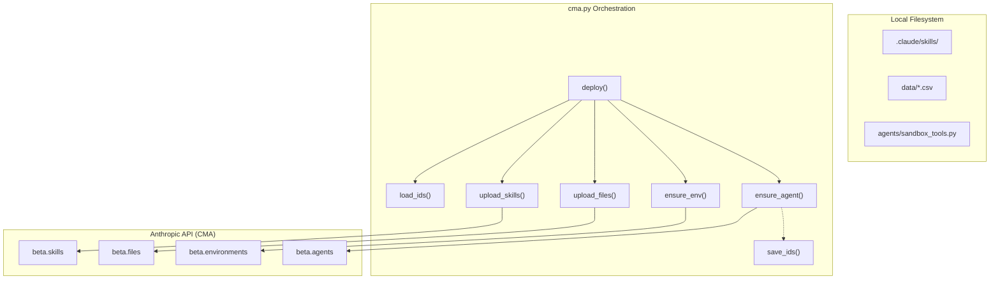
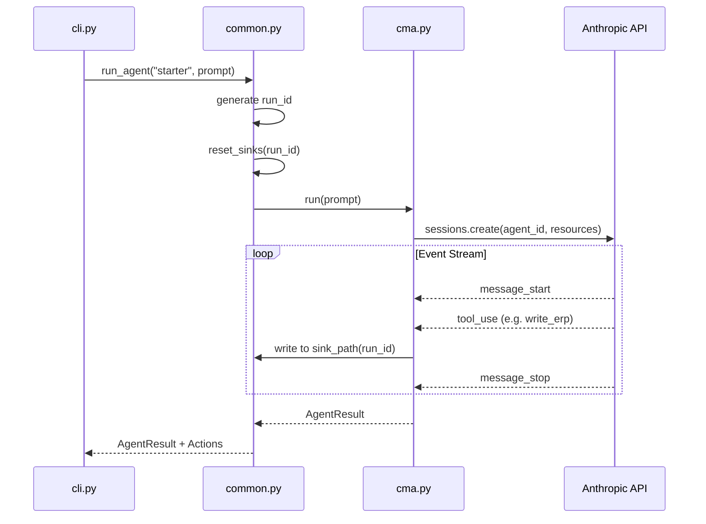

<!-- source: DeepWiki mcp.deepwiki.com · repo anthropics/cwc-workshops · page 3.2 StockPilot: CMA Deployment and Session Management · fetched 2026-10-26 -->

# StockPilot: CMA Deployment and Session Management

Relevant source files

The following files were used as context for generating this wiki page:

- [agent-decomposition/agents/cma.py](agent-decomposition/agents/cma.py)
- [agent-decomposition/agents/common.py](agent-decomposition/agents/common.py)
- [agent-decomposition/agents/deploy_cli.py](agent-decomposition/agents/deploy_cli.py)

This page details the `cma.py` orchestration layer, which manages the lifecycle of Claude Managed Agents (CMA) for the StockPilot workshop. It covers idempotent deployment, skill packaging, resource mounting, and the execution of stateful agent sessions.

## Orchestration Overview

The `agents/cma.py` file serves as a shared utility layer designed to abstract the complexity of the Managed Agents API. It ensures that participant environments are provisioned consistently and that agents have access to the necessary data and tools.

### Key Responsibilities
*   **Idempotency**: Using `.stockpilot_ids.json` to track resource IDs (Agents, Environments, Skills, Files) across runs [agents/cma.py:5-8]().
*   **Skill Management**: Packaging local directories into zip files for upload as CMA Skills [agents/cma.py:97-104]().
*   **Resource Mounting**: Attaching CSV data and Python modules to agent sandboxes [agents/cma.py:158-166]().
*   **Session Lifecycle**: Creating sessions, streaming events, and handling subagent spawning [agents/cma.py:215-260]().

### Code Entity Mapping: Deployment Flow

The following diagram maps the logical deployment steps to the specific functions in `agents/cma.py`.

**Sources:** [agents/cma.py:176-200](), [agents/cma.py:56-61](), [agents/cma.py:87-94](), [agents/cma.py:97-127]()

---

## Idempotency and State Persistence

To avoid redundant uploads and "Name already taken" errors during workshop iterations, `cma.py` maintains a local cache of resource IDs in `.stockpilot_ids.json` [agents/cma.py:26]().

### Name Suffixing
The `agent_name_for()` function generates a unique 8-hex suffix for each participant [agents/cma.py:64-79](). This suffix is appended to agent and skill names (e.g., `stockpilot-starter-a1b2c3d4`), allowing multiple participants to use the same Anthropic Organization without namespace collisions.

### Resource Tracking
The `IDS_FILE` stores:
1.  `name_suffix`: The unique identifier for the attendee [agents/cma.py:75]().
2.  `skills`: A mapping of skill names to remote IDs [agents/cma.py:105]().
3.  `data_files`: Mapping of CSV filenames to File API IDs [agents/cma.py:185]().
4.  `agents`: Mapping of slots (e.g., `starter`) to Agent IDs [agents/cma.py:192]().

**Sources:** [agents/cma.py:26](), [agents/cma.py:56-79](), [agents/cma.py:179-195]()

---

## Skill Packaging and Uploads

Managed Agents use "Skills" to encapsulate logic. In StockPilot, skills are defined in `.claude/skills/` [agents/cma.py:25]().

### Zip Bundling
The `upload_skills()` function zips the entire directory for each skill [agents/cma.py:114](). This allows a skill to include not just the `SKILL.md` entry point, but also helper Python scripts or configuration files that the agent can execute within the sandbox.

### Versioning
If a skill ID already exists in the cache or on the server, `cma.py` creates a new version of the skill rather than a new skill object [agents/cma.py:116-120](). This preserves the skill's history and avoids cluttering the Anthropic Console.

**Sources:** [agents/cma.py:97-127](), [agents/cma.py:114-119]()

---

## Session Management and Execution

The `run_session()` function handles the real-time interaction with a provisioned agent [agents/cma.py:215]().

### Resource Mounting
When a session is created, local data files and sandbox modules are mounted into the agent's environment [agents/cma.py:158-166]().
*   **CSV Data**: Mounted at `/mnt/session/uploads/data/` [agents/cma.py:161]().
*   **Sandbox Tools**: `agents/sandbox_tools.py` is mounted as `tools.py` to provide a standard library for agent-driven scripts [agents/cma.py:47]().

### The Event Loop
`run_session()` initiates a session with `beta.sessions.create` and processes the resulting event stream [agents/cma.py:230-245](). It tracks:
*   **Input/Output Tokens**: Aggregated from `message_start` and `message_delta` events [agents/cma.py:252-253]().
*   **Agent Turns**: Incremented for each model response [agents/cma.py:251]().
*   **Subagent Spawning**: Detected via `spawn_subagent` tool calls [agents/cma.py:254-255]().

### Subagent Lifecycle
StockPilot utilizes "Callable Agents" to decompose tasks.
*   **Forecaster Subagent**: A specialized agent with a system prompt optimized for data processing [agents/cma.py:30-41]().
*   **Spawning**: When the primary agent calls the `spawn_subagent` tool, `cma.py` handles the recursive execution and returns the result to the parent agent [agents/cma.py:254-255]().

**Sources:** [agents/cma.py:158-166](), [agents/cma.py:215-260](), [agents/cma.py:30-41]()

---

## Infrastructure Resilience

Managed Agent infrastructure can occasionally experience transient errors (e.g., sandbox provisioning delays). `cma.py` implements resilience patterns to ensure reliable evaluation runs.

### Exponential Backoff
The deployment and session creation logic is wrapped in retry logic (implicitly via the Anthropic SDK and explicitly in workshop scripts) to handle `503 Service Unavailable` or `429 Too Many Requests` errors.

### Sink Management
To support parallel evaluation of tasks, `cma.py` uses "Sinks" for side effects (like creating Purchase Orders). Each session is assigned a `run_id`, and its outputs are isolated in `data/.runs/<run_id>/` [agents/common.py:41-44](). This prevents agents in concurrent threads from reading or overwriting each other's actions.

**Sources:** [agents/common.py:48-61](), [agents/common.py:104-117](), [agents/cma.py:215-230]()

### Error Handling
If an agent session fails (e.g., max turns exceeded or API error), the `AgentResult` object captures the error string and the partial transcript, allowing the evaluation harness to record a `FAIL` and provide debugging context [agents/common.py:22-30]().

**Sources:** [agents/common.py:22-30](), [agents/cma.py:256-260]()

---

