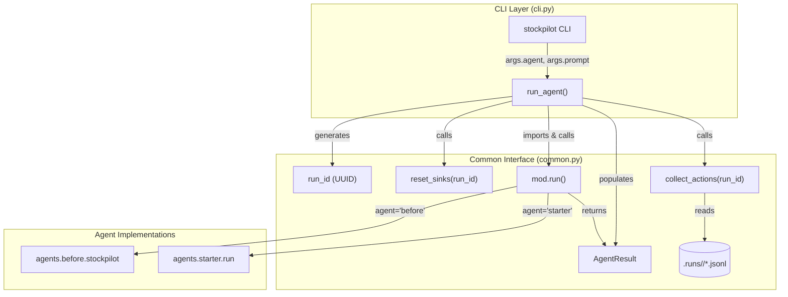
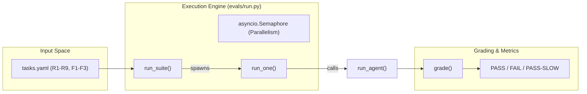

<!-- source: DeepWiki mcp.deepwiki.com · repo anthropics/cwc-workshops · page 3.3 StockPilot: CLI, Evaluation Harness, and Metrics · fetched 2026-10-26 -->

# StockPilot: CLI, Evaluation Harness, and Metrics

Relevant source files

The following files were used as context for generating this wiki page:

- [agent-decomposition/agents/cli.py](agent-decomposition/agents/cli.py)
- [agent-decomposition/agents/common.py](agent-decomposition/agents/common.py)
- [agent-decomposition/evals/reference_scores.json](agent-decomposition/evals/reference_scores.json)
- [agent-decomposition/evals/run.py](agent-decomposition/evals/run.py)

The StockPilot evaluation system provides a standardized interface for measuring the performance of agents across a suite of inventory management and forecasting tasks. It facilitates side-by-side comparisons between the monolithic "before" agent and the decomposed "starter" agent, tracking metrics such as token consumption, turn counts, and wall-clock time.

## CLI and Common Interface

The `stockpilot` CLI serves as the primary entry point for manual interaction with the agents. It abstracts the underlying implementation details (local Messages API for `before` vs. CMA sessions for `starter`) through a unified `run_agent` interface [agents/cli.py:15-15]().

### Data Flow: CLI to Agent Execution
The diagram below illustrates how a CLI command is dispatched to the appropriate runner and how results are collected into a standard dataclass.

**StockPilot CLI Execution Flow**

Sources: [agents/cli.py:8-21](), [agents/common.py:98-117]()

### The AgentResult Dataclass
All agent executions return an `AgentResult` object, which encapsulates the final output and execution telemetry [agents/common.py:21-30]().

| Field | Type | Description |
| :--- | :--- | :--- |
| `final_text` | `str` | The agent's terminal response to the user. |
| `actions` | `list[dict]` | Side effects captured from sinks (POs, notifications, ERP writes). |
| `turns` | `int` | Number of message exchanges between user and agent. |
| `tokens_in` | `int` | Total input tokens consumed. |
| `tokens_out` | `int` | Total output tokens generated. |
| `wall_ms` | `int` | Total execution time in milliseconds. |
| `error` | `str \| None` | Error message if the run failed. |

Sources: [agents/common.py:21-39]()

## Sink Isolation and Parallelism

To support parallel evaluation runs without data corruption, StockPilot uses "sink isolation." Each execution is assigned a unique `run_id` [agents/common.py:108-110]().

### Per-Run Directory Structure
Side effects (actions) are written to thread-local or environment-specific paths within `data/.runs/<run_id>/` [agents/common.py:57-61](). This ensures that if two agents are running the same task simultaneously, their Purchase Orders or ERP writes do not collide.

*   **Sinks tracked:** `purchase_orders.jsonl`, `outbox.jsonl`, `erp_writes.jsonl` [agents/common.py:44-44]().
*   **Collection:** After the agent finishes, `collect_actions()` reads these files and attaches them to the `AgentResult` [agents/common.py:90-95]().

Sources: [agents/common.py:40-95]()

## Evaluation Harness

The evaluation suite (run via `python -m evals.run`) automates the testing of agents against a 12-task suite defined in `tasks.yaml`.

### Evaluation Suite Components

Sources: [evals/run.py:29-34](), [evals/run.py:51-81]()

### Task Categories
The suite consists of 12 tasks categorized by the type of logic required:
1.  **Reporting (R1-R9):** Tasks focused on data retrieval and aggregation (e.g., "Which SKU has the highest stock?").
2.  **Forecasting (F1-F3):** Complex tasks requiring trend analysis and inventory planning (e.g., "Will we run out of SKU-102 in the next 3 months?").

### Grading Logic and "PASS-SLOW"
The `grade()` function determines success based on task-specific criteria [evals/run.py:58-58]().
*   **PASS:** The agent provided the correct answer within the turn/token budget.
*   **FAIL:** The agent provided an incorrect answer or encountered a system error.
*   **PASS-SLOW:** The agent provided the correct answer but exceeded the "efficient" budget (defined in the grader), indicating suboptimal tool use [evals/run.py:23-23]().

The overall score is calculated as: `(PASS_count + 0.5 * SLOW_count) / Total_tasks` [evals/run.py:37-39]().

Sources: [evals/run.py:18-26](), [evals/run.py:37-39]()

## Reference Scores and Comparison

StockPilot maintains `reference_scores.json` to provide a baseline for both the `before` and `starter` agents [evals/reference_scores.json:1-4]().

### Comparing Agents
The `--compare` flag in the eval CLI allows developers to see the impact of decomposition [evals/run.py:148-149]().

| Metric | Goal for Decomposition |
| :--- | :--- |
| **Score** | Maintain or improve accuracy (target: 63%–75%) [evals/reference_scores.json:2-3](). |
| **Tokens** | Significant reduction (due to SHORT_PROMPT and subagents). |
| **Turns** | May increase slightly as the agent coordinates subagents. |
| **Wall Time** | May increase due to CMA session overhead and parallel subagent spawns. |

The CLI outputs a delta table showing transitions (e.g., `FAIL → PASS`) and the change in token consumption [evals/run.py:118-133]().

Sources: [evals/run.py:118-133](), [evals/reference_scores.json:1-5]()

---

